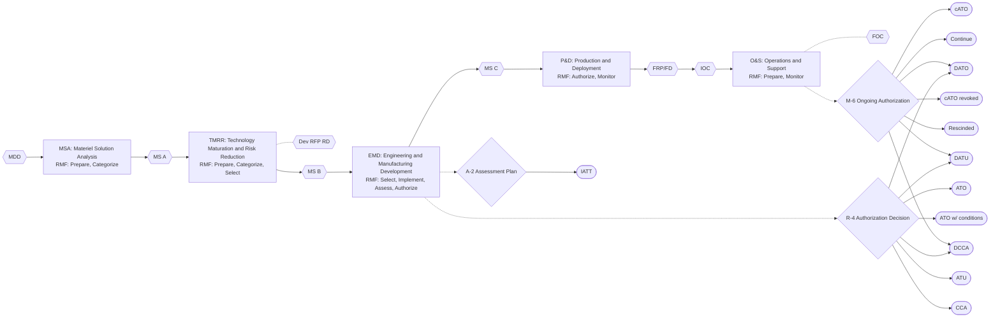

# DoD Risk Management Framework on NIST SP 800-37 Rev. 2, anchored to the DoD acquisition life cycle

> **Generated file. Do not edit.** `uv run rmf render` writes this file from `framework/`
> (framework version 0.2.0). To change it, edit the YAML and render again;
> `rmf ci` fails while the committed manual differs from a fresh render (FW-MAN-001).
>
> **Draft guidance, not policy.** This manual arranges public NIST, CNSS and DoD guidance into a
> working plan. It does not replace those documents, your DoD Component's RMF guidance, a Security
> Control Assessor or an Authorizing Official.

The RMF roadmap from system inception to fielding and operations: the 47 SP 800-37r2 tasks as executed under DoDI 8510.01, mapped onto the major capability acquisition phases, milestones, systems engineering technical reviews and authorization decisions. This YAML is the single source of truth (INV-1); the manual is generated from it.

## Contents

1. [How to read this manual](#how-to-read)
2. [Life cycle at a glance](#lifecycle)
3. [Who does what (RACI matrix)](#raci)
4. [Phases and tasks](#phases)
   - [Phase 1: MSA · Materiel Solution Analysis](#ph-msa) (19 tasks; also in [docs/manual/PH-MSA.md](docs/manual/PH-MSA.md))
   - [Phase 2: TMRR · Technology Maturation and Risk Reduction](#ph-tmrr) (8 tasks; also in [docs/manual/PH-TMRR.md](docs/manual/PH-TMRR.md))
   - [Phase 3: EMD · Engineering and Manufacturing Development](#ph-emd) (13 tasks; also in [docs/manual/PH-EMD.md](docs/manual/PH-EMD.md))
   - [Phase 4: P&D · Production and Deployment](#ph-pd) (0 tasks; also in [docs/manual/PH-PD.md](docs/manual/PH-PD.md))
   - [Phase 5: O&S · Operations and Support](#ph-os) (7 tasks; also in [docs/manual/PH-OS.md](docs/manual/PH-OS.md))
5. [Authorization decisions](#decisions)
6. [Acquisition pathway notes](#pathways)
7. [Artifact catalog](#artifacts)
8. [Persona catalog](#personas)
9. [References](#references)

## 1. How to read this manual

The manual follows a system from inception to disposal. It covers the 47 tasks of
the NIST SP 800-37 Rev. 2 Risk Management Framework (RMF) as the DoD runs them, arranged along the
phases, milestones and technical reviews of the [MCA](#pw-mca) acquisition pathway. Start with the
[life cycle](#lifecycle) to find the phase your program is in, then read that phase's chapter.

Each phase chapter has an overview (purpose, entry and exit criteria, the milestones and technical
reviews in the phase, and the RMF evidence each one expects), a task summary table, and one section
per task. Every task section has the same parts:

| Part | What it tells you |
|---|---|
| Purpose | The outcome the task produces. |
| Stakeholders (RACI) | Who does the work (**R**esponsible), who owns the outcome and signs off (**A**ccountable, exactly one), whose input is needed (**C**onsulted) and who is kept informed (**I**nformed). Names link to persona cards that describe each role. |
| Inputs | Artifacts and outside material the task needs, and the task that produces each artifact. |
| Outputs | The deliverables the task first **produces** or later **updates**, with their package status: *core* artifacts are required in the authorization package. |
| Entry criteria | What must be true before the task starts. |
| Exit criteria | What must be true to call the task done. |
| Alignment | The acquisition milestones, technical reviews and authorization decisions the task's results feed. |
| Citations | The source passages the task rests on. |
| Playbook | The step-by-step procedure an analyst or an AI agent follows to carry out the task. |
| Cross-references | Tasks this one depends on, tasks that depend on it, and feedback loops. |

Conventions:

- IDs are stable and never reused: `PH-` phases, `MS-` milestones and decision points, `RV-`
  technical reviews, `AD-` authorization decisions, `PER-` personas, `ART-` artifacts, `EXT-`
  outside inputs, and the SP 800-37 Rev. 2 task IDs (`P-1` to `M-7`).
- A citation reads `REFERENCE, section "heading"` or `REFERENCE, p. N, "quoted words"`. The page is
  the PDF page. To read the passage, run `uv run rmf refs show REFERENCE --section "heading"` or
  `uv run rmf refs show REFERENCE --page N --anchor "quoted words"`.
- Tasks run in dependency order. A task lists every task it depends on; feedback loops (later
  results that revise earlier work) are shown separately and do not block.
- `facts.yaml` is the single record of system facts in a run (identity, boundary, categorization,
  baseline). Where a task writes one, its section says so.

> **Warning: CUI and LLM endpoints.** Put Controlled Unclassified Information (CUI) or any other
> non-public data into a fork of this repository, its `product/` folder or an AI agent's context only
> when the repository host, every machine involved and the LLM endpoint are all authorized for that
> data (AGENTS.md INV-7). Do not assume a commercial LLM service is authorized for CUI; confirm with
> your ISSM and AO first. Simulated (`synthetic`) runs need only public or invented product material.

## 2. Life cycle at a glance

| # | Phase | Starts at | Ends at | Milestones and decision points | Technical reviews | RMF tasks (primary phase) | Also active | Authorization decisions |
|---|---|---|---|---|---|---|---|---|
| 1 | [MSA](#ph-msa) Materiel Solution Analysis | [MDD](#ms-mdd) | [MS A](#ms-a) | [MDD](#ms-mdd), [MS A](#ms-a) | — | [P-1](#task-p-1), [P-2](#task-p-2), [P-3](#task-p-3), [P-4](#task-p-4), [P-5](#task-p-5), [P-6](#task-p-6), [P-7](#task-p-7), [P-8](#task-p-8), [P-9](#task-p-9), [P-10](#task-p-10), [P-11](#task-p-11), [P-12](#task-p-12), [P-13](#task-p-13), [P-14](#task-p-14), [P-15](#task-p-15), [P-18](#task-p-18), [C-1](#task-c-1), [C-2](#task-c-2), [C-3](#task-c-3) | [P-16](#task-p-16) | — |
| 2 | [TMRR](#ph-tmrr) Technology Maturation and Risk Reduction | [MS A](#ms-a) | [MS B](#ms-b) | [Dev RFP RD](#ms-drfprd), [MS B](#ms-b) | [SRR](#rv-srr), [SFR](#rv-sfr), [PDR](#rv-pdr) | [P-16](#task-p-16), [P-17](#task-p-17), [S-1](#task-s-1), [S-2](#task-s-2), [S-3](#task-s-3), [S-4](#task-s-4), [S-5](#task-s-5), [S-6](#task-s-6) | [P-14](#task-p-14), [P-15](#task-p-15), [P-18](#task-p-18), [C-1](#task-c-1), [C-2](#task-c-2), [C-3](#task-c-3) | — |
| 3 | [EMD](#ph-emd) Engineering and Manufacturing Development | [MS B](#ms-b) | [MS C](#ms-c) | [MS C](#ms-c) | [CDR](#rv-cdr), [TRR](#rv-trr), [SVR/FCA](#rv-svr), [PRR](#rv-prr) | [I-1](#task-i-1), [I-2](#task-i-2), [A-1](#task-a-1), [A-2](#task-a-2), [A-3](#task-a-3), [A-4](#task-a-4), [A-5](#task-a-5), [A-6](#task-a-6), [R-1](#task-r-1), [R-2](#task-r-2), [R-3](#task-r-3), [R-4](#task-r-4), [R-5](#task-r-5) | [S-4](#task-s-4), [S-5](#task-s-5) | [IATT](#ad-iatt), [ATO](#ad-ato), [ATO w/ conditions](#ad-atoc), [DATO](#ad-dato), [ATU](#ad-atu), [DATU](#ad-datu), [CCA](#ad-cca), [DCCA](#ad-dcca) |
| 4 | [P&D](#ph-pd) Production and Deployment | [MS C](#ms-c) | [FRP/FD](#ms-frp) | [FRP/FD](#ms-frp), [IOC](#ms-ioc) | [PCA](#rv-pca) | — | [R-1](#task-r-1), [R-2](#task-r-2), [R-3](#task-r-3), [R-4](#task-r-4), [R-5](#task-r-5), [M-1](#task-m-1), [M-2](#task-m-2), [M-3](#task-m-3), [M-4](#task-m-4), [M-5](#task-m-5), [M-6](#task-m-6) | [ATO](#ad-ato), [ATO w/ conditions](#ad-atoc), [DATO](#ad-dato), [cATO](#ad-cato), [ATU](#ad-atu), [DATU](#ad-datu), [CCA](#ad-cca), [DCCA](#ad-dcca), [Continue](#ad-cont), [cATO revoked](#ad-rcato), [Rescinded](#ad-resc) |
| 5 | [O&S](#ph-os) Operations and Support | [IOC](#ms-ioc) | — | [FOC](#ms-foc) | — | [M-1](#task-m-1), [M-2](#task-m-2), [M-3](#task-m-3), [M-4](#task-m-4), [M-5](#task-m-5), [M-6](#task-m-6), [M-7](#task-m-7) | [P-3](#task-p-3) | [ATO](#ad-ato), [ATO w/ conditions](#ad-atoc), [DATO](#ad-dato), [cATO](#ad-cato), [ATU](#ad-atu), [DATU](#ad-datu), [CCA](#ad-cca), [DCCA](#ad-dcca), [Continue](#ad-cont), [cATO revoked](#ad-rcato), [Rescinded](#ad-resc) |

The flowchart shows the phases in order, joined by the milestones that open and close them. Dotted
lines lead to events inside a phase and to the tasks where the Authorizing Official makes an
authorization decision.

### RMF steps

| Step | Purpose | Tasks | Primary phases |
|---|---|---|---|
| P Prepare | Set the organizational and system context and priorities for security and privacy risk management before the system is categorized. Organization-level tasks (P-1 to P-7) precede the program; system-level tasks (P-8 to P-18) run in MSA and early TMRR, most of them before Milestone A and the SRR, with requirements allocation (P-17) finished by the SFR. | [P-1](#task-p-1), [P-2](#task-p-2), [P-3](#task-p-3), [P-4](#task-p-4), [P-5](#task-p-5), [P-6](#task-p-6), [P-7](#task-p-7), [P-8](#task-p-8), [P-9](#task-p-9), [P-10](#task-p-10), [P-11](#task-p-11), [P-12](#task-p-12), [P-13](#task-p-13), [P-14](#task-p-14), [P-15](#task-p-15), [P-16](#task-p-16), [P-17](#task-p-17), [P-18](#task-p-18) | [MSA](#ph-msa), [TMRR](#ph-tmrr) |
| C Categorize | Describe the system and categorize it in accordance with CNSSI 1253 from the impact of a loss of confidentiality, integrity and availability. The AO-approved categorization is due by Milestone A. | [C-1](#task-c-1), [C-2](#task-c-2), [C-3](#task-c-3) | [MSA](#ph-msa) |
| S Select | Select and tailor the initial control set, allocate controls, and document the planned implementations and the monitoring strategy in plans the AO approves. Select runs in TMRR and is complete by the PDR and Milestone B. | [S-1](#task-s-1), [S-2](#task-s-2), [S-3](#task-s-3), [S-4](#task-s-4), [S-5](#task-s-5), [S-6](#task-s-6) | [TMRR](#ph-tmrr) |
| I Implement | Implement the controls in the plans and record how they are employed in the system and its operating environment. Implement runs through EMD, designed in by the CDR and updated to the as-built state before test readiness. | [I-1](#task-i-1), [I-2](#task-i-2) | [EMD](#ph-emd) |
| A Assess | Assess whether controls are implemented correctly, operating as intended and producing the desired outcome, using developmental and operational test events where possible. The assessment plan is approved before the TRR so DT&E events can supply assessment evidence. | [A-1](#task-a-1), [A-2](#task-a-2), [A-3](#task-a-3), [A-4](#task-a-4), [A-5](#task-a-5), [A-6](#task-a-6) | [EMD](#ph-emd) |
| R Authorize | Decide whether the risk to operations, assets, individuals, other organizations and the Nation is acceptable and cyberspace operational commanders' requirements are met. The decision precedes Milestone C and fielding; an AD-IATT covers earlier testing on live networks. | [R-1](#task-r-1), [R-2](#task-r-2), [R-3](#task-r-3), [R-4](#task-r-4), [R-5](#task-r-5) | [EMD](#ph-emd) |
| M Monitor | Monitor the system and its controls on an ongoing basis, track changes, respond to risk and report the security and privacy posture. Monitor starts with fielding and runs through O&S to disposal. | [M-1](#task-m-1), [M-2](#task-m-2), [M-3](#task-m-3), [M-4](#task-m-4), [M-5](#task-m-5), [M-6](#task-m-6), [M-7](#task-m-7) | [O&S](#ph-os) |

## 3. Who does what (RACI matrix)

**R** Responsible (does the work) · **A** Accountable (owns the outcome; one per task) ·
**C** Consulted · **I** Informed. `A/R` means the accountable persona also does the work. Column
headings link to the persona catalog; each persona's card describes the role in full.

### P Prepare

| Task | [AO](#per-ao) | [Component CIO](#per-cio) | [Component CISO](#per-ciso) | [RE](#per-re) | [SCA](#per-sca) | [PM/SO](#per-pm) | [ISSM](#per-issm) | [ISSO](#per-isso) | [ISSE](#per-isse) | [LSE](#per-lse) | [UR](#per-ur) | [IO](#per-io) | [CCP](#per-ccp) | [CSSP](#per-cssp) | [Privacy](#per-priv) | [MDA](#per-mda) | [Sponsor](#per-sponsor) | [Developer](#per-dev) | [PAO](#per-pao) | [JCA CPM](#per-jcacpm) |
|---|:-:|:-:|:-:|:-:|:-:|:-:|:-:|:-:|:-:|:-:|:-:|:-:|:-:|:-:|:-:|:-:|:-:|:-:|:-:|:-:|
| [P-1](#task-p-1) Risk Management Roles | C | R/A | C | C |  | I |  |  |  |  |  |  |  |  | R |  |  |  | C | C |
| [P-2](#task-p-2) Risk Management Strategy | I | R/A | C | R |  |  |  |  |  |  |  |  |  |  | C |  |  |  | C | C |
| [P-3](#task-p-3) Risk Assessment—Organization | C | C | R | R/A |  |  |  |  |  |  |  |  |  |  | R |  | C |  | C | C |
| [P-4](#task-p-4) Organizationally-Tailored Control Baselines and CSF Profiles | C | C | C | R/A |  |  |  |  |  |  |  |  |  |  | C |  | R |  | C | C |
| [P-5](#task-p-5) Common Control Identification | C | C | R/A | C |  | C |  |  |  |  |  |  | C |  | R |  | C |  | C | C |
| [P-6](#task-p-6) Impact-Level Prioritization | C | C | C | R/A |  | C |  |  |  |  |  |  |  |  | C |  | C |  | C | C |
| [P-7](#task-p-7) Continuous Monitoring Strategy—Organization | C | C | C | R/A |  | C |  |  |  |  |  |  |  | I | C |  | C |  | C | C |
| [P-8](#task-p-8) Mission or Business Focus | C | C | C |  |  | A | I |  |  |  | C | C |  |  | C |  | R |  |  |  |
| [P-9](#task-p-9) System Stakeholders | C | C | C |  |  | R/A | I |  |  |  |  | C |  |  | C | C | R |  |  |  |
| [P-10](#task-p-10) Asset Identification | C |  | C |  |  | R/A | R |  |  |  |  | C |  |  | C |  | C | C |  |  |
| [P-11](#task-p-11) Authorization Boundary | A | C | C |  |  | R | R |  | C | C |  |  |  |  | C |  | C |  |  |  |
| [P-12](#task-p-12) Information Types |  |  |  |  |  | R/A | C | C |  |  |  | R |  |  | R |  | C |  |  |  |
| [P-13](#task-p-13) Information Life Cycle |  | C |  |  |  | R/A |  |  | C | C |  | R |  |  | R |  | C |  |  |  |
| [P-14](#task-p-14) Risk Assessment—System | C |  |  | C | C | R/A | R | R |  |  |  | C |  |  | R |  | C |  |  |  |
| [P-15](#task-p-15) Requirements Definition | C |  | C |  |  | R/A | C | C | C | C | C | R |  |  | R | C | R |  |  |  |
| [P-16](#task-p-16) Enterprise Architecture | C | C | C |  |  | A |  |  | R | R |  | C |  |  | R |  | R |  |  |  |
| [P-17](#task-p-17) Requirements Allocation | C | C | C |  |  | A | R | R | R |  |  |  | C |  | R |  | C |  |  |  |
| [P-18](#task-p-18) System Registration |  | I | I |  |  | R/A | R | C |  |  |  |  |  |  |  |  | C |  |  |  |

### C Categorize

| Task | [AO](#per-ao) | [AODR](#per-aodr) | [Component CIO](#per-cio) | [Component CISO](#per-ciso) | [RE](#per-re) | [PM/SO](#per-pm) | [ISSM](#per-issm) | [ISSO](#per-isso) | [ISSE](#per-isse) | [LSE](#per-lse) | [UR](#per-ur) | [IO](#per-io) | [Privacy](#per-priv) |
|---|:-:|:-:|:-:|:-:|:-:|:-:|:-:|:-:|:-:|:-:|:-:|:-:|:-:|
| [C-1](#task-c-1) System Description | C |  |  |  |  | R/A | R | C |  | C |  | C | C |
| [C-2](#task-c-2) Security Categorization | I |  | C | C | C | A | R | C | C |  | C | R | C |
| [C-3](#task-c-3) Security Categorization Review and Approval | A | R | C | C | C | I | I |  |  |  |  |  | R |

### S Select

| Task | [AO](#per-ao) | [AODR](#per-aodr) | [Component CIO](#per-cio) | [Component CISO](#per-ciso) | [RE](#per-re) | [PM/SO](#per-pm) | [ISSM](#per-issm) | [ISSO](#per-isso) | [ISSE](#per-isse) | [IO](#per-io) | [CCP](#per-ccp) | [CSSP](#per-cssp) | [Privacy](#per-priv) | [MDA](#per-mda) | [Sponsor](#per-sponsor) | [Developer](#per-dev) | [CCB](#per-ccb) |
|---|:-:|:-:|:-:|:-:|:-:|:-:|:-:|:-:|:-:|:-:|:-:|:-:|:-:|:-:|:-:|:-:|:-:|
| [S-1](#task-s-1) Control Selection | C |  |  |  |  | R/A | R | C | C | C | R |  | C |  |  |  |  |
| [S-2](#task-s-2) Control Tailoring | C |  |  |  |  | R/A | R | C | C | C | R |  | C |  |  |  |  |
| [S-3](#task-s-3) Control Allocation | C |  | C | C |  | A | R | R | R |  | C |  | R |  | C |  |  |
| [S-4](#task-s-4) Documentation of Planned Control Implementations | C |  |  |  |  | A | R | C | R | C | R | C | C |  |  | C | C |
| [S-5](#task-s-5) Continuous Monitoring Strategy—System | C |  | C | C | C | R/A | R | C | C | C | R | C | C |  |  |  |  |
| [S-6](#task-s-6) Plan Review and Approval | A | R | C | C | C | I | I |  |  |  |  |  | R | C |  |  |  |

### I Implement

| Task | [PM/SO](#per-pm) | [ISSM](#per-issm) | [ISSO](#per-isso) | [ISSE](#per-isse) | [LSE](#per-lse) | [IO](#per-io) | [CCP](#per-ccp) | [Privacy](#per-priv) | [Developer](#per-dev) |
|---|:-:|:-:|:-:|:-:|:-:|:-:|:-:|:-:|:-:|
| [I-1](#task-i-1) Control Implementation | R/A | C | C | R | C | C | R | C | R |
| [I-2](#task-i-2) Update Control Implementation Information | A | R | C | C | C | C | R | C | R |

### A Assess

| Task | [AO](#per-ao) | [AODR](#per-aodr) | [Component CIO](#per-cio) | [Component CISO](#per-ciso) | [RE](#per-re) | [SCA](#per-sca) | [PM/SO](#per-pm) | [ISSM](#per-issm) | [ISSO](#per-isso) | [ISSE](#per-isse) | [IO](#per-io) | [CCP](#per-ccp) | [Privacy](#per-priv) | [MDA](#per-mda) | [CDT](#per-cdt) | [OTA](#per-ota) | [Developer](#per-dev) |
|---|:-:|:-:|:-:|:-:|:-:|:-:|:-:|:-:|:-:|:-:|:-:|:-:|:-:|:-:|:-:|:-:|:-:|
| [A-1](#task-a-1) Assessor Selection | A | R | C | C |  | I | I |  |  |  |  |  | C |  |  |  |  |
| [A-2](#task-a-2) Assessment Plan | A | R |  | C |  | R | C | C | C |  | C | C | C |  | C | C |  |
| [A-3](#task-a-3) Control Assessments | I | C |  | I |  | R/A | C | C | C |  | C | C | C |  | C | C | C |
| [A-4](#task-a-4) Assessment Reports | I | I |  | C |  | R/A | C | C | C |  |  | C | C |  |  |  |  |
| [A-5](#task-a-5) Remediation Actions |  | C |  | C | C | R | R/A | C | C | C | C | R | C |  |  |  | R |
| [A-6](#task-a-6) Plan of Action and Milestones | I |  |  | C |  | C | R/A | R | C |  | C | R | C | C |  |  |  |

### R Authorize

| Task | [AO](#per-ao) | [AODR](#per-aodr) | [Component CIO](#per-cio) | [Component CISO](#per-ciso) | [RE](#per-re) | [SCA](#per-sca) | [PM/SO](#per-pm) | [ISSM](#per-issm) | [ISSO](#per-isso) | [ISSE](#per-isse) | [UR](#per-ur) | [IO](#per-io) | [CCP](#per-ccp) | [Privacy](#per-priv) | [MDA](#per-mda) | [Operational commanders](#per-opcdr) |
|---|:-:|:-:|:-:|:-:|:-:|:-:|:-:|:-:|:-:|:-:|:-:|:-:|:-:|:-:|:-:|:-:|
| [R-1](#task-r-1) Authorization Package | I | I |  | C |  | C | R/A | R | C |  |  |  | R | R |  |  |
| [R-2](#task-r-2) Risk Analysis and Determination | A | R |  | C | C | C | I | C |  |  |  |  |  | C |  |  |
| [R-3](#task-r-3) Risk Response | A | R |  | C | C |  | R | C | C | C |  | C | C | C |  |  |
| [R-4](#task-r-4) Authorization Decision | R/A | C | C | C | C |  | I | I |  |  | I |  |  | C | I |  |
| [R-5](#task-r-5) Authorization Reporting | A | R | I | C |  |  | C | C | C |  |  | C | C | C | I | I |

### M Monitor

| Task | [AO](#per-ao) | [AODR](#per-aodr) | [Component CIO](#per-cio) | [Component CISO](#per-ciso) | [RE](#per-re) | [SCA](#per-sca) | [PM/SO](#per-pm) | [ISSM](#per-issm) | [ISSO](#per-isso) | [ISSE](#per-isse) | [IO](#per-io) | [CCP](#per-ccp) | [CSSP](#per-cssp) | [Privacy](#per-priv) | [CCB](#per-ccb) | [DoD CISO](#per-dodciso) |
|---|:-:|:-:|:-:|:-:|:-:|:-:|:-:|:-:|:-:|:-:|:-:|:-:|:-:|:-:|:-:|:-:|
| [M-1](#task-m-1) System and Environment Changes | I | C |  | R | C |  | R/A | C | R |  | C | R |  | R | C |  |
| [M-2](#task-m-2) Ongoing Assessments | I | C |  | C |  | R/A | C | C | C |  | C | C | C | C |  |  |
| [M-3](#task-m-3) Ongoing Risk Response | A | C |  |  | C |  | R | R | C | C | C | R | C | C |  |  |
| [M-4](#task-m-4) Authorization Package Updates | I |  |  | C |  |  | R/A | R | C |  | C | R |  | C |  |  |
| [M-5](#task-m-5) Security and Privacy Reporting | I |  | I | R | C |  | R/A | R | C |  |  | R | C | R |  |  |
| [M-6](#task-m-6) Ongoing Authorization | R/A | C | C | C | C |  | C | I |  |  |  |  |  | C |  | C |
| [M-7](#task-m-7) System Disposal | I | C |  | C | C |  | R/A | R | C |  | C |  |  | C |  |  |

## 4. Phases and tasks

### Phase 1: MSA · Materiel Solution Analysis

Analyze materiel solutions to the validated capability need and select a preferred solution; start the RMF early, at system inception, so security requirements shape the solution rather than follow it. The system-level Prepare tasks and the Categorize step run here, so the approved categorization, the system risk assessment and the initial security and privacy requirements can inform the Milestone A acquisition strategy, program protection and test strategy.

| | |
|---|---|
| Starts at | [MDD](#ms-mdd) Materiel Development Decision |
| Ends at | [MS A](#ms-a) Milestone A |
| RMF steps active | [P Prepare](#step-p), [C Categorize](#step-c) |
| Tasks | 19 with this primary phase; 1 more also run here |
| Authorization decisions possible | none |

**Entry criteria**

- Materiel Development Decision made on a validated capability need.
- A validated requirements document (ICD or equivalent) and the AoA study plan are available to the program (EXT-CAPDOC).
- Organization-level Prepare outputs (P-1 to P-7) are in place or under way, so the system tasks can use the risk management strategy, common controls and organizational monitoring strategy.

**Exit criteria**

- Preferred materiel solution selected and Milestone A approved.
- RMF roles assigned, system-level Prepare tasks under way and the categorization approved (C-3) to inform the technology development strategy.
- The system risk assessment (P-14) and the security and privacy requirements (P-15) are available to the cybersecurity strategy in the program protection plan.
- The system is registered (P-18) and described (C-1).

**Sources**

- [DODI8510.01](#ref-dodi8510-01), p. 20, "RMF activities must be initiated as early as possible in the DoD acquisition process"
- [DODI5000.85](#ref-dodi5000-85), p. 11, "3.6. MSA PHASE."
- [DODI5000.85](#ref-dodi5000-85), p. 12, "A proposed acquisition strategy, including intellectual property (IP), program protection" (Milestone A considers program protection and the test strategy.)
- [DODI5000.90](#ref-dodi5000-90), p. 10, "PMs must deploy cybersecurity risk analyses and controls mapping early in the system development"
- [DODI5000.89](#ref-dodi5000-89), p. 15, "Develop a cybersecurity strategy as part of the program protection plan"
- [SP800-37R2](#ref-sp800-37r2), p. 181, "Risk management activities begin early in the SDLC and continue throughout the life cycle" (Initiation in the SP 800-37r2 SDLC.)

#### MSA milestones and decision points

| Event | Kind | Decision authority | What it decides | RMF tasks that feed it |
|---|---|---|---|---|
| **MDD** Materiel Development Decision | decision point | [MDA](#per-mda) | Enter the acquisition process on a validated capability need; the point at which RMF activities should begin (system inception). The organization-level Prepare tasks (P-1 to P-7) should already be in place so that system-level Prepare starts with the program; a program that starts the RMF late must still complete it. | [P-1](#task-p-1), [P-2](#task-p-2), [P-3](#task-p-3), [P-4](#task-p-4), [P-5](#task-p-5), [P-6](#task-p-6), [P-7](#task-p-7) |
| **MS A** Milestone A | milestone | [MDA](#per-mda) | Approve entry into technology maturation; the approved security categorization informs the program's cybersecurity strategy. Milestone A also approves the acquisition strategy, including program protection, and considers the test strategy, so the system-level Prepare outputs (system risk assessment, security and privacy requirements) and the Categorize step should be complete. | [P-8](#task-p-8), [P-9](#task-p-9), [P-10](#task-p-10), [P-11](#task-p-11), [P-12](#task-p-12), [P-13](#task-p-13), [P-14](#task-p-14), [P-15](#task-p-15), [P-18](#task-p-18), [C-1](#task-c-1), [C-2](#task-c-2), [C-3](#task-c-3) |

Sources:

- **MDD**: [DODI8510.01](#ref-dodi8510-01), p. 12, "The program initiates or updates RMF activities during system inception"; [DODI5000.85](#ref-dodi5000-85), p. 11, "The MDD is the mandatory entry point into the major capability acquisition process"; [DODI8510.01](#ref-dodi8510-01), p. 12, "Failure to initiate the RMF at system or program inception"
- **MS A**: [DODI8510.01](#ref-dodi8510-01), p. 8, "before program initiation for new systems and all acquisition milestones"; [DODI5000.85](#ref-dodi5000-85), p. 12, "Milestone A approves program entry into the technology maturation and risk"; [DODI5000.85](#ref-dodi5000-85), p. 12, "A proposed acquisition strategy, including intellectual property (IP), program protection"; [DODI5000.89](#ref-dodi5000-89), p. 15, "Develop a cybersecurity strategy as part of the program protection plan"

#### MSA task summary

Tasks are listed in the order they can start: every task comes after the tasks it depends on.

| Task | Step | Accountable | Produces | Updates | Feeds |
|---|---|---|---|---|---|
| [P-1](#task-p-1) Risk Management Roles | Prepare | [Component CIO](#per-cio) | [ART-ORG-CONTEXT](#art-org-context) | — | [MDD](#ms-mdd) |
| [P-2](#task-p-2) Risk Management Strategy | Prepare | [Component CIO](#per-cio) | — | [ART-ORG-CONTEXT](#art-org-context) | [MDD](#ms-mdd) |
| [P-3](#task-p-3) Risk Assessment—Organization | Prepare | [RE](#per-re) | — | [ART-ORG-CONTEXT](#art-org-context) | [MDD](#ms-mdd) |
| [P-4](#task-p-4) Organizationally-Tailored Control Baselines and CSF Profiles *(optional)* | Prepare | [RE](#per-re) | — | [ART-ORG-CONTEXT](#art-org-context) | [MDD](#ms-mdd) |
| [P-5](#task-p-5) Common Control Identification | Prepare | [Component CISO](#per-ciso) | — | [ART-ORG-CONTEXT](#art-org-context) | [MDD](#ms-mdd) |
| [P-6](#task-p-6) Impact-Level Prioritization *(optional)* | Prepare | [RE](#per-re) | — | [ART-ORG-CONTEXT](#art-org-context) | [MDD](#ms-mdd) |
| [P-7](#task-p-7) Continuous Monitoring Strategy—Organization | Prepare | [RE](#per-re) | — | [ART-ORG-CONTEXT](#art-org-context) | [MDD](#ms-mdd) |
| [P-8](#task-p-8) Mission or Business Focus | Prepare | [PM/SO](#per-pm) | [ART-BIA](#art-bia) | — | [MS A](#ms-a) |
| [P-9](#task-p-9) System Stakeholders | Prepare | [PM/SO](#per-pm) | [ART-STAKE](#art-stake) | — | [MS A](#ms-a) |
| [P-10](#task-p-10) Asset Identification | Prepare | [PM/SO](#per-pm) | [ART-INV](#art-inv) | — | [MS A](#ms-a) |
| [P-11](#task-p-11) Authorization Boundary | Prepare | [AO](#per-ao) | [ART-BND](#art-bnd) | — | [MS A](#ms-a) |
| [P-12](#task-p-12) Information Types | Prepare | [PM/SO](#per-pm) | [ART-INFOTYPES](#art-infotypes) | — | [MS A](#ms-a) |
| [P-13](#task-p-13) Information Life Cycle | Prepare | [PM/SO](#per-pm) | — | [ART-INFOTYPES](#art-infotypes) | [MS A](#ms-a) |
| [P-14](#task-p-14) Risk Assessment—System | Prepare | [PM/SO](#per-pm) | [ART-RA](#art-ra), [ART-PIA](#art-pia) | — | [MS A](#ms-a), [SRR](#rv-srr) |
| [P-15](#task-p-15) Requirements Definition | Prepare | [PM/SO](#per-pm) | [ART-REQ](#art-req) | — | [MS A](#ms-a), [SRR](#rv-srr) |
| [P-18](#task-p-18) System Registration | Prepare | [PM/SO](#per-pm) | [ART-REG](#art-reg) | — | [MS A](#ms-a) |
| [C-1](#task-c-1) System Description | Categorize | [PM/SO](#per-pm) | [ART-SD](#art-sd) | [ART-BND](#art-bnd), [ART-REG](#art-reg) | [MS A](#ms-a) |
| [C-2](#task-c-2) Security Categorization | Categorize | [PM/SO](#per-pm) | [ART-CAT](#art-cat) | [ART-BIA](#art-bia) | [MS A](#ms-a) |
| [C-3](#task-c-3) Security Categorization Review and Approval | Categorize | [AO](#per-ao) | — | [ART-CAT](#art-cat), [ART-REG](#art-reg) | [MS A](#ms-a), [SRR](#rv-srr) |

Also active in this phase (described in their primary phase): [P-16](#task-p-16).

#### P-1 · Risk Management Roles

*[Prepare](#step-p) step · organization level · primary phase [MSA](#ph-msa) · required · at least 1 stakeholder interview*

**Purpose.** Identify and assign the individuals who fill the security and privacy risk management roles, free of conflicts of interest, before system-level RMF work starts with the program.

**Stakeholders (RACI)**

| Role | Persona |
|---|---|
| Responsible | [Component CIO](personas/PER-CIO.md) DoD Component Chief Information Officer [Privacy](personas/PER-PRIV.md) Component Privacy Officer |
| Accountable | [Component CIO](personas/PER-CIO.md) DoD Component Chief Information Officer |
| Consulted | [AO](personas/PER-AO.md) Authorizing Official [RE](personas/PER-RE.md) Risk Executive Function [Component CISO](personas/PER-CISO.md) DoD Component Chief Information Security Officer [PAO](personas/PER-PAO.md) Principal Authorizing Official [JCA CPM](personas/PER-JCACPM.md) Joint Capability Area Capability Portfolio Manager |
| Informed | [PM/SO](personas/PER-PM.md) Program Manager / System Owner |

**Inputs**

| Input | What it is | Comes from |
|---|---|---|
| [EXT-ORG-POLICY](#ext-org-policy) | Organizational policy and Prepare-step guidance | outside input (organization) |

**Outputs**

| Output | What it is | This task | Package |
|---|---|---|---|
| [ART-ORG-CONTEXT](#art-org-context) | Organizational risk context | produces | supporting |

**Entry criteria**

- Component policies and organizational charts are available (EXT-ORG-POLICY).
- The appointing authority for each RMF role is known (DoDI 8510.01 Table 8).

**Exit criteria**

- Individuals are identified and assigned key roles for executing the RMF (DoDI 8510.01 Table 1 outcome).
- ART-ORG-CONTEXT records the RMF role assignments, with no AO also acting as system owner or common control provider for what it authorizes.
- Each AO is government personnel with expertise in the technology being authorized and has completed AO or RMF training.
- artifacts/data/scrm-org.yaml names an executive C-SCRM lead, a PMO or other dedicated C-SCRM function, the authorizing officials who own supply chain risk, the council and its charter, and the C-SCRM duty of each run role (SCRM-021).

**Alignment**

- Milestones and decision points: [MDD](#ms-mdd)

**Citations**

- [SP800-37R2](#ref-sp800-37r2), section "TASK P-1"
- [DODI8510.01](#ref-dodi8510-01), p. 13, "Task P-1 Risk Management Roles"
- [DODI8510.01](#ref-dodi8510-01), p. 30, "Appointment of RMF Roles"
- [SP800-37R2](#ref-sp800-37r2), section "TABLE 1: PREPARE TASKS AND OUTCOMES—ORGANIZATION LEVEL"
- [DODI8510.01](#ref-dodi8510-01), p. 9, "Only be government personnel"
- [DODI8510.01](#ref-dodi8510-01), p. 26, "Verifies an SO and/or PM is appointed in writing"

**Playbook:** [playbooks/P/P-org-context.md#task-p-1](playbooks/P/P-org-context.md#task-p-1)

**Cross-references:** depends on nothing; required by [P-2](#task-p-2).

#### P-2 · Risk Management Strategy

*[Prepare](#step-p) step · organization level · primary phase [MSA](#ph-msa) · required · at least 1 stakeholder interview*

**Purpose.** Establish the organization's risk management strategy, including how it frames, assesses, responds to and monitors risk and the risk tolerance that the Component CIO communicates to programs.

**Stakeholders (RACI)**

| Role | Persona |
|---|---|
| Responsible | [Component CIO](personas/PER-CIO.md) DoD Component Chief Information Officer [RE](personas/PER-RE.md) Risk Executive Function |
| Accountable | [Component CIO](personas/PER-CIO.md) DoD Component Chief Information Officer |
| Consulted | [Component CISO](personas/PER-CISO.md) DoD Component Chief Information Security Officer [Privacy](personas/PER-PRIV.md) Component Privacy Officer [PAO](personas/PER-PAO.md) Principal Authorizing Official [JCA CPM](personas/PER-JCACPM.md) Joint Capability Area Capability Portfolio Manager |
| Informed | [AO](personas/PER-AO.md) Authorizing Official |

**Inputs**

| Input | What it is | Comes from |
|---|---|---|
| [EXT-ORG-POLICY](#ext-org-policy) | Organizational policy and Prepare-step guidance | outside input (organization) |
| [ART-ORG-CONTEXT](#art-org-context) | Organizational risk context | [P-1](#task-p-1) (supporting artifact) |

**Outputs**

| Output | What it is | This task | Package |
|---|---|---|---|
| [ART-ORG-CONTEXT](#art-org-context) | Organizational risk context | updates | supporting |

**Entry criteria**

- RMF roles assigned (P-1).
- Component Prepare-step guidance and DoD-level risk guidance are available (EXT-ORG-POLICY).

**Exit criteria**

- A risk management strategy for the organization that includes a determination and expression of organizational risk tolerance is established (DoDI 8510.01 Table 1 outcome).
- ART-ORG-CONTEXT states the risk management strategy and the organizational risk tolerance.
- ART-ORG-CONTEXT "## Software program" states the Component's direction under DoWI 8430.01 for the software it develops or deploys.
- ART-ORG-CONTEXT records the Component CIO's process for designated approval authorities to make certification determinations and issue an IATT or ATO expeditiously for a capability fielded under urgent capability acquisition.
- artifacts/data/scrm-org.yaml states the C-SCRM frame of SP 800-161 Tasks 1-1 to 1-4 (OT suppliers in scope, each assumption refined at P-14, threat sources addressed, appetite at Level 1, tolerance at Levels 2 and 3, priorities and the nine framing outputs), the C-SCRM policy and strategy, what each level holds and informs, the process steps and the maturity of the key practices (SCRM-020, SCRM-022, SCRM-024, SCRM-027 to SCRM-029).

**Alignment**

- Milestones and decision points: [MDD](#ms-mdd)

**Citations**

- [SP800-37R2](#ref-sp800-37r2), section "TASK P-2"
- [DODI8510.01](#ref-dodi8510-01), p. 13, "Task P-2 Risk Management Strategy"
- [SP800-39](#ref-sp800-39), section 2.3.3
- [SP800-37R2](#ref-sp800-37r2), section "TABLE 1: PREPARE TASKS AND OUTCOMES—ORGANIZATION LEVEL"
- [DODI8510.01](#ref-dodi8510-01), p. 26, "Communicate organizational risk tolerance"
- [SP800-39](#ref-sp800-39), section 3.1

**Playbook:** [playbooks/P/P-org-context.md#task-p-2](playbooks/P/P-org-context.md#task-p-2)

**Cross-references:** depends on [P-1](#task-p-1); required by [P-3](#task-p-3), [P-7](#task-p-7), [P-8](#task-p-8).

#### P-3 · Risk Assessment—Organization

*[Prepare](#step-p) step · organization level · primary phase [MSA](#ph-msa) (continues in [O&S](#ph-os)) · required · at least 1 stakeholder interview*

**Purpose.** Assess organization-wide security and privacy risk, including supply chain risk, using current cyber threat information, and keep the results current: in operations, review threat, vulnerability, technology and mission changes against the organizational risk posture.

**Stakeholders (RACI)**

| Role | Persona |
|---|---|
| Responsible | [RE](personas/PER-RE.md) Risk Executive Function [Component CISO](personas/PER-CISO.md) DoD Component Chief Information Security Officer [Privacy](personas/PER-PRIV.md) Component Privacy Officer |
| Accountable | [RE](personas/PER-RE.md) Risk Executive Function |
| Consulted | [Component CIO](personas/PER-CIO.md) DoD Component Chief Information Officer [Sponsor](personas/PER-SPONSOR.md) Capability / Requirements Sponsor [AO](personas/PER-AO.md) Authorizing Official [PAO](personas/PER-PAO.md) Principal Authorizing Official [JCA CPM](personas/PER-JCACPM.md) Joint Capability Area Capability Portfolio Manager |

**Inputs**

| Input | What it is | Comes from |
|---|---|---|
| [ART-ORG-CONTEXT](#art-org-context) | Organizational risk context | [P-1](#task-p-1) (supporting artifact) |
| [EXT-THREAT](#ext-threat) | Threat information | outside input (operational) |
| [EXT-ORG-POLICY](#ext-org-policy) | Organizational policy and Prepare-step guidance | outside input (organization) |

**Outputs**

| Output | What it is | This task | Package |
|---|---|---|---|
| [ART-ORG-CONTEXT](#art-org-context) | Organizational risk context | updates | supporting |

**Entry criteria**

- Risk management strategy established (P-2).
- Threat information is available (EXT-THREAT).

**Exit criteria**

- An organization-wide risk assessment is completed, or an existing risk assessment is updated (DoDI 8510.01 Table 1 outcome).
- ART-ORG-CONTEXT summarizes the organization-level risk assessment results.
- Once the system operates, org-context.yaml posture_reviews records each review of threat, vulnerability, technology and mission changes against the organizational risk posture, and the sections it updated (OCTX-011).
- scrm-org.yaml sharing follows each SP 800-150 key practice, has an executive FASC liaison and feeds P-3 and P-14 as EXT-THREAT (SCRM-023).

**Alignment**

- Milestones and decision points: [MDD](#ms-mdd)

**Citations**

- [SP800-37R2](#ref-sp800-37r2), section "TASK P-3"
- [DODI8510.01](#ref-dodi8510-01), p. 13, "Task P-3 Risk Assessment – Organization"
- [SP800-30R1](#ref-sp800-30r1), section 2.4
- [SP800-37R2](#ref-sp800-37r2), section "TABLE 1: PREPARE TASKS AND OUTCOMES—ORGANIZATION LEVEL"
- [SP800-30R1](#ref-sp800-30r1), section 3.4

**Playbook:** [playbooks/P/P-org-context.md#task-p-3](playbooks/P/P-org-context.md#task-p-3)

**Cross-references:** depends on [P-2](#task-p-2); required by [P-4](#task-p-4), [P-5](#task-p-5), [P-6](#task-p-6), [P-7](#task-p-7), [P-14](#task-p-14); receives feedback from [P-14](#task-p-14).

#### P-4 · Organizationally-Tailored Control Baselines and CSF Profiles

*[Prepare](#step-p) step · organization level · primary phase [MSA](#ph-msa) · optional · at least 1 stakeholder interview*

**Purpose.** Establish and publish organizationally-tailored control baselines and/or CSF profiles (optional); in DoD they build on the CNSSI 1253 baselines, overlays and DoD assignment values.

**Stakeholders (RACI)**

| Role | Persona |
|---|---|
| Responsible | [Sponsor](personas/PER-SPONSOR.md) Capability / Requirements Sponsor [RE](personas/PER-RE.md) Risk Executive Function |
| Accountable | [RE](personas/PER-RE.md) Risk Executive Function |
| Consulted | [Component CIO](personas/PER-CIO.md) DoD Component Chief Information Officer [AO](personas/PER-AO.md) Authorizing Official [Component CISO](personas/PER-CISO.md) DoD Component Chief Information Security Officer [Privacy](personas/PER-PRIV.md) Component Privacy Officer [PAO](personas/PER-PAO.md) Principal Authorizing Official [JCA CPM](personas/PER-JCACPM.md) Joint Capability Area Capability Portfolio Manager |

**Inputs**

| Input | What it is | Comes from |
|---|---|---|
| [ART-ORG-CONTEXT](#art-org-context) | Organizational risk context | [P-1](#task-p-1) (supporting artifact) |
| [EXT-BASELINES](#ext-baselines) | Control baselines | outside input (reference) |
| [EXT-CNSSI1253-OVERLAYS](#ext-cnssi1253-overlays) | CNSSI 1253 overlays | outside input (reference) |
| [EXT-ORG-POLICY](#ext-org-policy) | Organizational policy and Prepare-step guidance | outside input (organization) |
| [EXT-PRODUCT](#ext-product) | Product material | outside input (product) |

**Outputs**

| Output | What it is | This task | Package |
|---|---|---|---|
| [ART-ORG-CONTEXT](#art-org-context) | Organizational risk context | updates | supporting |

**Entry criteria**

- Organization-level risk assessment available (P-3).
- The CNSSI 1253 baselines and overlays are available (EXT-BASELINES, EXT-CNSSI1253-OVERLAYS).

**Exit criteria**

- Organizationally-tailored control baselines and/or CSF profiles are established and made available (DoDI 8510.01 Table 1 outcome).
- ART-ORG-CONTEXT lists the approved or directed tailored baselines and overlays, or records that none apply.
- scrm-org.yaml keeps a C-SCRM Risk Response Framework at Levels 1 and 2 (SCRM-026).

**Alignment**

- Milestones and decision points: [MDD](#ms-mdd)

**Citations**

- [SP800-37R2](#ref-sp800-37r2), section "TASK P-4"
- [DODI8510.01](#ref-dodi8510-01), p. 13, "Task P-4 Organizationally – Tailored Control Baselines"
- [SP800-53B](#ref-sp800-53b), section "OVERLAYS"
- [SP800-37R2](#ref-sp800-37r2), section "TABLE 1: PREPARE TASKS AND OUTCOMES—ORGANIZATION LEVEL"
- [CNSSI1253](#ref-cnssi1253), section 2.5
- [DODI8510.01](#ref-dodi8510-01), p. 9, "Require use of the DoD-specific assignment values, overlays, implementation guidance"

**Playbook:** [playbooks/P/P-org-context.md#task-p-4](playbooks/P/P-org-context.md#task-p-4)

**Cross-references:** depends on [P-3](#task-p-3); required by no later task.

#### P-5 · Common Control Identification

*[Prepare](#step-p) step · organization level · primary phase [MSA](#ph-msa) · required · at least 1 stakeholder interview*

**Purpose.** Identify, document and publish the common controls available for inheritance and their providers, so programs can plan inheritance before they allocate requirements (P-17) and controls (S-3).

**Stakeholders (RACI)**

| Role | Persona |
|---|---|
| Responsible | [Component CISO](personas/PER-CISO.md) DoD Component Chief Information Security Officer [Privacy](personas/PER-PRIV.md) Component Privacy Officer |
| Accountable | [Component CISO](personas/PER-CISO.md) DoD Component Chief Information Security Officer |
| Consulted | [Sponsor](personas/PER-SPONSOR.md) Capability / Requirements Sponsor [RE](personas/PER-RE.md) Risk Executive Function [Component CIO](personas/PER-CIO.md) DoD Component Chief Information Officer [AO](personas/PER-AO.md) Authorizing Official [CCP](personas/PER-CCP.md) Common Control Provider [PM/SO](personas/PER-PM.md) Program Manager / System Owner [PAO](personas/PER-PAO.md) Principal Authorizing Official [JCA CPM](personas/PER-JCACPM.md) Joint Capability Area Capability Portfolio Manager |

**Inputs**

| Input | What it is | Comes from |
|---|---|---|
| [ART-ORG-CONTEXT](#art-org-context) | Organizational risk context | [P-1](#task-p-1) (supporting artifact) |
| [EXT-ORG-POLICY](#ext-org-policy) | Organizational policy and Prepare-step guidance | outside input (organization) |

**Outputs**

| Output | What it is | This task | Package |
|---|---|---|---|
| [ART-ORG-CONTEXT](#art-org-context) | Organizational risk context | updates | supporting |

**Entry criteria**

- Organization-level risk assessment available (P-3).

**Exit criteria**

- Common controls that are available for inheritance by organizational systems are identified, documented, and published (DoDI 8510.01 Table 1 outcome).
- ART-ORG-CONTEXT lists the common control providers and the controls each offers for inheritance.

**Alignment**

- Milestones and decision points: [MDD](#ms-mdd)

**Citations**

- [SP800-37R2](#ref-sp800-37r2), section "TASK P-5"
- [DODI8510.01](#ref-dodi8510-01), p. 14, "Task P-5 Common Control Identification"
- [SP800-37R2](#ref-sp800-37r2), section "TABLE 1: PREPARE TASKS AND OUTCOMES—ORGANIZATION LEVEL"
- [CNSSI1253](#ref-cnssi1253), p. 15, "Identify and designate common controls, and the common control provider(s)"

**Playbook:** [playbooks/P/P-org-context.md#task-p-5](playbooks/P/P-org-context.md#task-p-5)

**Cross-references:** depends on [P-3](#task-p-3); required by [P-17](#task-p-17), [S-1](#task-s-1).

#### P-6 · Impact-Level Prioritization

*[Prepare](#step-p) step · organization level · primary phase [MSA](#ph-msa) · optional · at least 1 stakeholder interview*

**Purpose.** Prioritize organizational systems that share an impact level into low-, moderate- and high-impact sub-categories (optional), to guide where resources go first.

**Stakeholders (RACI)**

| Role | Persona |
|---|---|
| Responsible | [RE](personas/PER-RE.md) Risk Executive Function |
| Accountable | [RE](personas/PER-RE.md) Risk Executive Function |
| Consulted | [Component CISO](personas/PER-CISO.md) DoD Component Chief Information Security Officer [Privacy](personas/PER-PRIV.md) Component Privacy Officer [Sponsor](personas/PER-SPONSOR.md) Capability / Requirements Sponsor [PM/SO](personas/PER-PM.md) Program Manager / System Owner [Component CIO](personas/PER-CIO.md) DoD Component Chief Information Officer [AO](personas/PER-AO.md) Authorizing Official [PAO](personas/PER-PAO.md) Principal Authorizing Official [JCA CPM](personas/PER-JCACPM.md) Joint Capability Area Capability Portfolio Manager |

**Inputs**

| Input | What it is | Comes from |
|---|---|---|
| [ART-ORG-CONTEXT](#art-org-context) | Organizational risk context | [P-1](#task-p-1) (supporting artifact) |
| [EXT-ORG-POLICY](#ext-org-policy) | Organizational policy and Prepare-step guidance | outside input (organization) |

**Outputs**

| Output | What it is | This task | Package |
|---|---|---|---|
| [ART-ORG-CONTEXT](#art-org-context) | Organizational risk context | updates | supporting |

**Entry criteria**

- Organization-level risk assessment available (P-3).
- The organization's systems have already been categorized. Under FIPS 199 and 200 the prioritization applies the high-water mark first; a National Security System follows CNSSI 1253, which does not apply the high-water mark (SP 800-37r2 footnote 62), so it keeps its per-objective C/I/A values and ART-ORG-CONTEXT says which impact designation groups systems before they are prioritized.

**Exit criteria**

- A prioritization of organizational systems with the same impact level is conducted (DoDI 8510.01 Table 1 outcome).
- ART-ORG-CONTEXT records the impact sub-category prioritization, or that the organization does not use one.

**Alignment**

- Milestones and decision points: [MDD](#ms-mdd)

**Citations**

- [SP800-37R2](#ref-sp800-37r2), section "TASK P-6"
- [DODI8510.01](#ref-dodi8510-01), p. 14, "Task P-6 Impact – Level Prioritization"
- [SP800-37R2](#ref-sp800-37r2), section "TABLE 1: PREPARE TASKS AND OUTCOMES—ORGANIZATION LEVEL"
- [SP800-37R2](#ref-sp800-37r2), p. 53, "Organizations operating National Security Systems follow the categorization guidance in [CNSSI 1253]"

**Playbook:** [playbooks/P/P-org-context.md#task-p-6](playbooks/P/P-org-context.md#task-p-6)

**Cross-references:** depends on [P-3](#task-p-3); required by no later task.

#### P-7 · Continuous Monitoring Strategy—Organization

*[Prepare](#step-p) step · organization level · primary phase [MSA](#ph-msa) · required · at least 1 stakeholder interview*

**Purpose.** Develop and implement the organization-wide strategy for continuously monitoring control effectiveness, which every system strategy (S-5) must follow.

**Stakeholders (RACI)**

| Role | Persona |
|---|---|
| Responsible | [RE](personas/PER-RE.md) Risk Executive Function |
| Accountable | [RE](personas/PER-RE.md) Risk Executive Function |
| Consulted | [Component CIO](personas/PER-CIO.md) DoD Component Chief Information Officer [Component CISO](personas/PER-CISO.md) DoD Component Chief Information Security Officer [Privacy](personas/PER-PRIV.md) Component Privacy Officer [Sponsor](personas/PER-SPONSOR.md) Capability / Requirements Sponsor [PM/SO](personas/PER-PM.md) Program Manager / System Owner [AO](personas/PER-AO.md) Authorizing Official [PAO](personas/PER-PAO.md) Principal Authorizing Official [JCA CPM](personas/PER-JCACPM.md) Joint Capability Area Capability Portfolio Manager |
| Informed | [CSSP](personas/PER-CSSP.md) Cybersecurity Service Provider |

**Inputs**

| Input | What it is | Comes from |
|---|---|---|
| [ART-ORG-CONTEXT](#art-org-context) | Organizational risk context | [P-1](#task-p-1) (supporting artifact) |
| [EXT-ORG-POLICY](#ext-org-policy) | Organizational policy and Prepare-step guidance | outside input (organization) |

**Outputs**

| Output | What it is | This task | Package |
|---|---|---|---|
| [ART-ORG-CONTEXT](#art-org-context) | Organizational risk context | updates | supporting |

**Entry criteria**

- Risk management strategy and organization-level risk assessment available (P-2, P-3).

**Exit criteria**

- An organization-wide strategy for monitoring control effectiveness is developed and implemented (DoDI 8510.01 Table 1 outcome).
- ART-ORG-CONTEXT summarizes the organizational continuous monitoring strategy that system strategies (S-5) must follow.
- scrm-org.yaml measures the C-SCRM program by implementation, efficiency and effectiveness, and mission impact, against appetite and tolerance, with goals validated by its stakeholders (SCRM-025).

**Alignment**

- Milestones and decision points: [MDD](#ms-mdd)

**Citations**

- [SP800-37R2](#ref-sp800-37r2), section "TASK P-7"
- [DODI8510.01](#ref-dodi8510-01), p. 14, "Task P-7 Continuous Monitoring Strategy – Organization"
- [SP800-137](#ref-sp800-137), section 3.1.1
- [SP800-37R2](#ref-sp800-37r2), section "TABLE 1: PREPARE TASKS AND OUTCOMES—ORGANIZATION LEVEL"
- [DODI8510.01](#ref-dodi8510-01), p. 9, "Implement continuous monitoring activities in accordance with"

**Playbook:** [playbooks/P/P-org-context.md#task-p-7](playbooks/P/P-org-context.md#task-p-7)

**Cross-references:** depends on [P-2](#task-p-2), [P-3](#task-p-3); required by [S-5](#task-s-5); receives feedback from [M-5](#task-m-5).

#### P-8 · Mission or Business Focus

*[Prepare](#step-p) step · system level · primary phase [MSA](#ph-msa) · required · at least 1 stakeholder interview*

**Purpose.** Identify the missions, business functions and mission/business processes the system will support, so that categorization and requirements trace to mission impact.

**Stakeholders (RACI)**

| Role | Persona |
|---|---|
| Responsible | [Sponsor](personas/PER-SPONSOR.md) Capability / Requirements Sponsor |
| Accountable | [PM/SO](personas/PER-PM.md) Program Manager / System Owner |
| Consulted | [AO](personas/PER-AO.md) Authorizing Official [IO](personas/PER-IO.md) Information Owner / Steward [UR](personas/PER-UR.md) User Representative [Component CIO](personas/PER-CIO.md) DoD Component Chief Information Officer [Component CISO](personas/PER-CISO.md) DoD Component Chief Information Security Officer [Privacy](personas/PER-PRIV.md) Component Privacy Officer |
| Informed | [ISSM](personas/PER-ISSM.md) Information System Security Manager |
| Condition | PER-PRIV only when the system processes PII |

**Inputs**

| Input | What it is | Comes from |
|---|---|---|
| [ART-ORG-CONTEXT](#art-org-context) | Organizational risk context | [P-1](#task-p-1) (supporting artifact) |
| [EXT-CAPDOC](#ext-capdoc) | Capability requirements documents | outside input (product) |
| [EXT-PRODUCT](#ext-product) | Product material | outside input (product) |
| [EXT-ORG-POLICY](#ext-org-policy) | Organizational policy and Prepare-step guidance | outside input (organization) |

**Outputs**

| Output | What it is | This task | Package |
|---|---|---|---|
| [ART-BIA](#art-bia) | Business impact and criticality analysis | produces | supporting |

Writes to `facts.yaml`: `missions`.

**Entry criteria**

- A capability need is documented (EXT-CAPDOC) and the organizational context is available.
- The program has entered its pathway at its first decision point - the Materiel Development Decision on major capability acquisition; receipt of a validated UON, an approved critical warfighter issue statement or an RAA determination on urgent capability acquisition; an approved CNS on the software pathway; the validated services requirement on an acquisition of services.

**Exit criteria**

- Missions, business functions and mission/business processes that the system is intended to support are identified (DoDI 8510.01 Table 1 outcome).
- Interviews record the supported missions and mission/business processes, citable by P-9, P-10 and C-1.
- facts.yaml `missions` (from framework 0.2.0) lists each mission, business function and mission/business process with its kind and whether it is mission essential, identified by the mission or business owner; an essential function names its supporting assets and data once P-11 and P-12 put them on record (MSN-001).
- artifacts/data/bia.yaml records whether mission critical functions are present and which, and each supported process with the impact of its disruption, the users' recovery time requirement and its interdependencies (BIA-001).

**Alignment**

- Milestones and decision points: [MS A](#ms-a)

**Citations**

- [SP800-37R2](#ref-sp800-37r2), section "TASK P-8" (SDLC phase: New – Initiation (concept/requirements definition); Existing – Operations/Maintenance.)
- [DODI8510.01](#ref-dodi8510-01), p. 14, "Task P-8 Mission or Business Focus"
- [SP800-37R2](#ref-sp800-37r2), section "TABLE 2: PREPARE TASKS AND OUTCOMES—SYSTEM LEVEL"
- [DODI8510.01](#ref-dodi8510-01), p. 10, "Maps systems to dependent missions"

**Playbook:** [playbooks/P/P-8.md](playbooks/P/P-8.md)

**Cross-references:** depends on [P-2](#task-p-2); required by [P-9](#task-p-9).

#### P-9 · System Stakeholders

*[Prepare](#step-p) step · system level · primary phase [MSA](#ph-msa) · required · at least 1 stakeholder interview*

**Purpose.** Identify the stakeholders with an interest in the system across its life cycle, including every information owner and the user representative.

**Stakeholders (RACI)**

| Role | Persona |
|---|---|
| Responsible | [PM/SO](personas/PER-PM.md) Program Manager / System Owner [Sponsor](personas/PER-SPONSOR.md) Capability / Requirements Sponsor |
| Accountable | [PM/SO](personas/PER-PM.md) Program Manager / System Owner |
| Consulted | [Component CIO](personas/PER-CIO.md) DoD Component Chief Information Officer [AO](personas/PER-AO.md) Authorizing Official [IO](personas/PER-IO.md) Information Owner / Steward [Component CISO](personas/PER-CISO.md) DoD Component Chief Information Security Officer [Privacy](personas/PER-PRIV.md) Component Privacy Officer [MDA](personas/PER-MDA.md) Milestone Decision Authority |
| Informed | [ISSM](personas/PER-ISSM.md) Information System Security Manager |
| Condition | PER-PRIV only when the system processes PII |

**Inputs**

| Input | What it is | Comes from |
|---|---|---|
| [EXT-PRODUCT](#ext-product) | Product material | outside input (product) |
| [EXT-CAPDOC](#ext-capdoc) | Capability requirements documents | outside input (product) |
| [EXT-ORG-POLICY](#ext-org-policy) | Organizational policy and Prepare-step guidance | outside input (organization) |
| [ART-ORG-CONTEXT](#art-org-context) | Organizational risk context | [P-1](#task-p-1) (supporting artifact) |

**Outputs**

| Output | What it is | This task | Package |
|---|---|---|---|
| [ART-STAKE](#art-stake) | Stakeholder register | produces | supporting |

**Entry criteria**

- Mission focus identified (P-8).

**Exit criteria**

- The stakeholders having an interest in the system are identified (DoDI 8510.01 Table 1 outcome).
- ART-STAKE lists the stakeholders and the persona that represents each in interviews.
- Every information owner is identified, because each sets the impact level for its own information types (CNSSI 1253).
- ART-STAKE records each stakeholder's security concerns, loss concerns and trust expectations, which P-15 turns into protection needs.

**Alignment**

- Milestones and decision points: [MS A](#ms-a)

**Citations**

- [SP800-37R2](#ref-sp800-37r2), section "TASK P-9" (SDLC phase: New – Initiation (concept/requirements definition); Existing – Operations/Maintenance.)
- [DODI8510.01](#ref-dodi8510-01), p. 14, "Task P-9 System Stakeholders"
- [SP800-37R2](#ref-sp800-37r2), section "TABLE 2: PREPARE TASKS AND OUTCOMES—SYSTEM LEVEL"
- [CNSSI1253](#ref-cnssi1253), p. 13, "All information owners must be identified to provide inputs to this activity"
- [DODI8510.01](#ref-dodi8510-01), p. 30, "URs represent the operational and functional requirements of the user community"

**Playbook:** [playbooks/P/P-9.md](playbooks/P/P-9.md)

**Cross-references:** depends on [P-8](#task-p-8); required by [P-10](#task-p-10).

#### P-10 · Asset Identification

*[Prepare](#step-p) step · system level · primary phase [MSA](#ph-msa) · required · at least 1 stakeholder interview*

**Purpose.** Identify and prioritize the assets that require protection, as the system hardware and software inventory, including the components that perform mission-critical functions.

**Stakeholders (RACI)**

| Role | Persona |
|---|---|
| Responsible | [PM/SO](personas/PER-PM.md) Program Manager / System Owner [ISSM](personas/PER-ISSM.md) Information System Security Manager |
| Accountable | [PM/SO](personas/PER-PM.md) Program Manager / System Owner |
| Consulted | [AO](personas/PER-AO.md) Authorizing Official [Sponsor](personas/PER-SPONSOR.md) Capability / Requirements Sponsor [IO](personas/PER-IO.md) Information Owner / Steward [Component CISO](personas/PER-CISO.md) DoD Component Chief Information Security Officer [Privacy](personas/PER-PRIV.md) Component Privacy Officer [Developer](personas/PER-DEV.md) Developer / Integrator |
| Condition | PER-PRIV only when the system processes PII |

**Inputs**

| Input | What it is | Comes from |
|---|---|---|
| [ART-STAKE](#art-stake) | Stakeholder register | [P-9](#task-p-9) (supporting artifact) |
| [ART-BIA](#art-bia) | Business impact and criticality analysis | [P-8](#task-p-8) (supporting artifact) |
| [EXT-PRODUCT](#ext-product) | Product material | outside input (product) |
| [ART-ORG-CONTEXT](#art-org-context) | Organizational risk context | [P-1](#task-p-1) (supporting artifact) |

**Outputs**

| Output | What it is | This task | Package |
|---|---|---|---|
| [ART-INV](#art-inv) | Hardware and software inventory | produces | core |

**Entry criteria**

- ART-STAKE names who can describe the assets.

**Exit criteria**

- Stakeholder assets are identified and prioritized (DoDI 8510.01 Table 1 outcome).
- ART-INV and inventory.yaml list every hardware and software item with its component, and the assets are prioritized.

**Alignment**

- Milestones and decision points: [MS A](#ms-a)

**Citations**

- [SP800-37R2](#ref-sp800-37r2), section "TASK P-10" (SDLC phase: New – Initiation (concept/requirements definition); Existing – Operations/Maintenance.)
- [DODI8510.01](#ref-dodi8510-01), p. 14, "Task P-10 Asset Identification"
- [SP800-128](#ref-sp800-128), section 2.3.4
- [SP800-37R2](#ref-sp800-37r2), section "TABLE 2: PREPARE TASKS AND OUTCOMES—SYSTEM LEVEL"
- [DODI5000.90](#ref-dodi5000-90), p. 16, "Use assured suppliers or appropriate SCRM countermeasures for system elements" (Mission-critical elements need assured suppliers or SCRM countermeasures.)

**Playbook:** [playbooks/P/P-10.md](playbooks/P/P-10.md)

**Cross-references:** depends on [P-9](#task-p-9); required by [P-11](#task-p-11), [P-12](#task-p-12).

#### P-11 · Authorization Boundary

*[Prepare](#step-p) step · system level · primary phase [MSA](#ph-msa) · required · at least 1 stakeholder interview*

**Purpose.** Determine the authorization boundary of the system, its network architecture and data flows; the AO is accountable for the boundary.

**Stakeholders (RACI)**

| Role | Persona |
|---|---|
| Responsible | [PM/SO](personas/PER-PM.md) Program Manager / System Owner [ISSM](personas/PER-ISSM.md) Information System Security Manager |
| Accountable | [AO](personas/PER-AO.md) Authorizing Official |
| Consulted | [Component CIO](personas/PER-CIO.md) DoD Component Chief Information Officer [Sponsor](personas/PER-SPONSOR.md) Capability / Requirements Sponsor [Component CISO](personas/PER-CISO.md) DoD Component Chief Information Security Officer [Privacy](personas/PER-PRIV.md) Component Privacy Officer [LSE](personas/PER-LSE.md) Lead Systems Engineer [ISSE](personas/PER-ISSE.md) Information Systems Security Engineer |
| Condition | PER-PRIV only when the system processes PII |

**Inputs**

| Input | What it is | Comes from |
|---|---|---|
| [ART-INV](#art-inv) | Hardware and software inventory | [P-10](#task-p-10) (core artifact) |
| [ART-STAKE](#art-stake) | Stakeholder register | [P-9](#task-p-9) (supporting artifact) |
| [EXT-PRODUCT](#ext-product) | Product material | outside input (product) |
| [EXT-ORG-POLICY](#ext-org-policy) | Organizational policy and Prepare-step guidance | outside input (organization) |

**Outputs**

| Output | What it is | This task | Package |
|---|---|---|---|
| [ART-BND](#art-bnd) | Authorization boundary, network architecture and data flows | produces | core |

Writes to `facts.yaml`: `boundary_id`.

**Entry criteria**

- ART-INV identifies the assets to be protected.

**Exit criteria**

- The authorization boundary (that is, the system) is determined (DoDI 8510.01 Table 1 outcome).
- ART-BND and boundary.yaml describe the boundary, network architecture, data flows and components; facts.boundary_id set_by P-11.

**Alignment**

- Milestones and decision points: [MS A](#ms-a)

**Citations**

- [SP800-37R2](#ref-sp800-37r2), section "TASK P-11" (SDLC phase: New – Initiation (concept/requirements definition); Existing – Operations/Maintenance.)
- [DODI8510.01](#ref-dodi8510-01), p. 14, "Task P-11 Authorization Boundary"
- [SP800-37R2](#ref-sp800-37r2), section "APPENDIX G"
- [SP800-37R2](#ref-sp800-37r2), section "TABLE 2: PREPARE TASKS AND OUTCOMES—SYSTEM LEVEL"
- [SP800-37R2](#ref-sp800-37r2), section 2.5

**Playbook:** [playbooks/P/P-11.md](playbooks/P/P-11.md)

**Cross-references:** depends on [P-10](#task-p-10); required by [P-13](#task-p-13), [P-18](#task-p-18); receives feedback from [M-1](#task-m-1).

#### P-12 · Information Types

*[Prepare](#step-p) step · system level · primary phase [MSA](#ph-msa) · required · at least 1 stakeholder interview*

**Purpose.** Identify the types of information the system processes, stores and transmits, including whether it processes PII.

**Stakeholders (RACI)**

| Role | Persona |
|---|---|
| Responsible | [PM/SO](personas/PER-PM.md) Program Manager / System Owner [IO](personas/PER-IO.md) Information Owner / Steward [Privacy](personas/PER-PRIV.md) Component Privacy Officer |
| Accountable | [PM/SO](personas/PER-PM.md) Program Manager / System Owner |
| Consulted | [ISSM](personas/PER-ISSM.md) Information System Security Manager [ISSO](personas/PER-ISSO.md) Information System Security Officer [Sponsor](personas/PER-SPONSOR.md) Capability / Requirements Sponsor |
| Condition | PER-PRIV only when the system processes PII |

**Inputs**

| Input | What it is | Comes from |
|---|---|---|
| [ART-INV](#art-inv) | Hardware and software inventory | [P-10](#task-p-10) (core artifact) |
| [EXT-PRODUCT](#ext-product) | Product material | outside input (product) |
| [EXT-CAPDOC](#ext-capdoc) | Capability requirements documents | outside input (product) |

**Outputs**

| Output | What it is | This task | Package |
|---|---|---|---|
| [ART-INFOTYPES](#art-infotypes) | Information types and information life cycle | produces | supporting |

**Entry criteria**

- ART-INV identifies the assets and the data they hold.

**Exit criteria**

- The types of information processed, stored and transmitted by the system are identified (DoDI 8510.01 Table 1 outcome).
- ART-INFOTYPES and infotypes.yaml list each information type with its SP 800-60 identifier and provisional impact levels.
- The determination of whether the system processes PII is recorded for approval by the SAOP or designee.
- For a system processing PII, each PII information type records whom the PII is about and whether it holds PHI or SSNs, and infotypes.yaml privacy records the issuances its handling complies with (DoD 5400.11-R, DoDI 5400.16, DoD 8580.02-R for PHI), the SORN, the SSN justification, records coordination and the PIA determination with its DoDI 5400.16 basis and due date (PRIV-001).

**Alignment**

- Milestones and decision points: [MS A](#ms-a)

**Citations**

- [SP800-37R2](#ref-sp800-37r2), section "TASK P-12" (SDLC phase: New – Initiation (concept/requirements definition); Existing – Operations/Maintenance.)
- [DODI8510.01](#ref-dodi8510-01), p. 14, "Task P-12 Information Types"
- [SP800-60V1R1](#ref-sp800-60v1r1), section 4.1
- [SP800-37R2](#ref-sp800-37r2), section "TABLE 2: PREPARE TASKS AND OUTCOMES—SYSTEM LEVEL"
- [CNSSI1253](#ref-cnssi1253), section 3.1.1

**Playbook:** [playbooks/P/P-12.md](playbooks/P/P-12.md)

**Cross-references:** depends on [P-10](#task-p-10); required by [P-13](#task-p-13), [C-2](#task-c-2).

#### P-13 · Information Life Cycle

*[Prepare](#step-p) step · system level · primary phase [MSA](#ph-msa) · required · at least 1 stakeholder interview*

**Purpose.** Identify and understand every stage of the information life cycle (creation or collection, processing, dissemination, use, storage and disposition) for each information type.

**Stakeholders (RACI)**

| Role | Persona |
|---|---|
| Responsible | [Privacy](personas/PER-PRIV.md) Component Privacy Officer [PM/SO](personas/PER-PM.md) Program Manager / System Owner [IO](personas/PER-IO.md) Information Owner / Steward |
| Accountable | [PM/SO](personas/PER-PM.md) Program Manager / System Owner |
| Consulted | [Component CIO](personas/PER-CIO.md) DoD Component Chief Information Officer [Sponsor](personas/PER-SPONSOR.md) Capability / Requirements Sponsor [ISSE](personas/PER-ISSE.md) Information Systems Security Engineer [LSE](personas/PER-LSE.md) Lead Systems Engineer |
| Condition | PER-PRIV only when the system processes PII |

**Inputs**

| Input | What it is | Comes from |
|---|---|---|
| [ART-INFOTYPES](#art-infotypes) | Information types and information life cycle | [P-12](#task-p-12) (supporting artifact) |
| [ART-BND](#art-bnd) | Authorization boundary, network architecture and data flows | [P-11](#task-p-11) (core artifact) |
| [EXT-PRODUCT](#ext-product) | Product material | outside input (product) |
| [ART-INV](#art-inv) | Hardware and software inventory | [P-10](#task-p-10) (core artifact) |
| [ART-ORG-CONTEXT](#art-org-context) | Organizational risk context | [P-1](#task-p-1) (supporting artifact) |
| [ART-STAKE](#art-stake) | Stakeholder register | [P-9](#task-p-9) (supporting artifact) |

**Outputs**

| Output | What it is | This task | Package |
|---|---|---|---|
| [ART-INFOTYPES](#art-infotypes) | Information types and information life cycle | updates | supporting |

**Entry criteria**

- Information types (P-12) and the boundary and data flows (P-11) are documented.

**Exit criteria**

- All stages of the information life cycle are identified and understood for each information type processed, stored or transmitted by the system (DoDI 8510.01 Table 1 outcome).
- infotypes.yaml records the life-cycle stages and components for every information type.

**Alignment**

- Milestones and decision points: [MS A](#ms-a)

**Citations**

- [SP800-37R2](#ref-sp800-37r2), section "TASK P-13" (SDLC phase: New – Initiation (concept/requirements definition); Existing – Operations/Maintenance.)
- [DODI8510.01](#ref-dodi8510-01), p. 14, "Task P-13 Information Life Cycle"
- [SP800-37R2](#ref-sp800-37r2), section "TABLE 2: PREPARE TASKS AND OUTCOMES—SYSTEM LEVEL"

**Playbook:** [playbooks/P/P-13.md](playbooks/P/P-13.md)

**Cross-references:** depends on [P-11](#task-p-11), [P-12](#task-p-12); required by [P-14](#task-p-14).

#### P-14 · Risk Assessment—System

*[Prepare](#step-p) step · system level · primary phase [MSA](#ph-msa) (continues in [TMRR](#ph-tmrr)) · required · at least 1 stakeholder interview*

**Purpose.** Conduct a system-level (mission-based cyber) risk assessment using Intelligence Community threat information, and keep its results current through the life cycle. P-14 runs before C-2, which reads ART-RA, so its supplier risks are a first pass: SP 800-161r1 prioritizes the supplier risk assessment once the impact level is defined, and C-3 feeds back to P-14 once the categorization is approved.

**Stakeholders (RACI)**

| Role | Persona |
|---|---|
| Responsible | [PM/SO](personas/PER-PM.md) Program Manager / System Owner [ISSM](personas/PER-ISSM.md) Information System Security Manager [Privacy](personas/PER-PRIV.md) Component Privacy Officer [ISSO](personas/PER-ISSO.md) Information System Security Officer |
| Accountable | [PM/SO](personas/PER-PM.md) Program Manager / System Owner |
| Consulted | [RE](personas/PER-RE.md) Risk Executive Function [AO](personas/PER-AO.md) Authorizing Official [Sponsor](personas/PER-SPONSOR.md) Capability / Requirements Sponsor [IO](personas/PER-IO.md) Information Owner / Steward [SCA](personas/PER-SCA.md) Security Control Assessor |
| Condition | PER-PRIV only when the system processes PII |

**Inputs**

| Input | What it is | Comes from |
|---|---|---|
| [ART-ORG-CONTEXT](#art-org-context) | Organizational risk context | [P-1](#task-p-1) (supporting artifact) |
| [ART-BIA](#art-bia) | Business impact and criticality analysis | [P-8](#task-p-8) (supporting artifact) |
| [ART-INV](#art-inv) | Hardware and software inventory | [P-10](#task-p-10) (core artifact) |
| [ART-INFOTYPES](#art-infotypes) | Information types and information life cycle | [P-12](#task-p-12) (supporting artifact) |
| [ART-BND](#art-bnd) | Authorization boundary, network architecture and data flows | [P-11](#task-p-11) (core artifact) |
| [EXT-THREAT](#ext-threat) | Threat information | outside input (operational) |
| [EXT-PPP](#ext-ppp) | Program protection plan | outside input (product) |
| [EXT-STPP](#ext-stpp) | Technology and S&T protection guidance | outside input (organization) |
| [EXT-ITRA](#ext-itra) | Independent technical risk assessments | outside input (organization) |
| [EXT-SEP](#ext-sep) | Systems engineering plan | outside input (product) |
| [ART-STAKE](#art-stake) | Stakeholder register | [P-9](#task-p-9) (supporting artifact) |
| [EXT-PRODUCT](#ext-product) | Product material | outside input (product) |

**Outputs**

| Output | What it is | This task | Package |
|---|---|---|---|
| [ART-RA](#art-ra) | System risk assessment | produces | supporting |
| [ART-PIA](#art-pia) | Privacy impact assessment | produces | supporting |

**Entry criteria**

- Assets, boundary and information life cycle documented (P-10, P-11, P-13); threat information available.

**Exit criteria**

- A system-level risk assessment is completed or an existing risk assessment is updated (DoDI 8510.01 Table 1 outcome).
- ART-RA records threats, vulnerabilities, likelihood, impact and the resulting risks.
- artifacts/data/ra.yaml states the purpose, scope, assumptions, constraints, dated information sources, risk model, analytic approach and risk tolerance, rates each threat source, threat event, vulnerability and predisposing condition, and holds the risk of each connection, external provider and supplier, the priority order and to whom the results are communicated (SRA-001 to SRA-003).
- ra.yaml is dated, lists the team with contact information, the rationale of each risk-related decision and any tailoring of its robustness with how far the results can be relied on, communicated to the AO or AODR; a subsequent assessment states what prompted it and the previous report; the risk model uses every SP 800-30 risk factor (RARC-001).
- ART-RA identifies the system elements and interfaces that need specific attention in test events, for the cybersecurity strategy and the TEMP.
- For a system processing PII, artifacts/data/ra.yaml `privacy` assesses the nature of the processing and its impact on individuals and evaluates each legal and policy privacy requirement, OMB A-130 among them, with what the privacy baseline leaves unmet (PRIV-007); where P-12 found a PIA required, artifacts/data/pia.yaml holds it on DD Form 2930 (2930A when adapted), coordinated through the ISSM, the privacy representative and the records office, reviewed by PER-CISO and PER-PRIV and approved by PER-CIO or the reviewing official (PRIV-002, PRIV-003).
- ra.yaml components records each third-party and open-source software component with the six risk factors of DoWI 8430.01 3.5.i.(2), the further governance, community and license review of a non-trivial open-source component, and any independent third-party validation of a commercial product (SWA-002); ra.yaml ai_capabilities records each AI-enabled capability's use case risk, benchmarks, verification before deployment, monitoring and bias handling (DoWI 8430.01 3.6.e).
- protection.yaml records the PPP the run read with its approval at each decision point passed, its critical items with their threats, vulnerabilities and countermeasures, exportability, anti-tamper, updates and transition (PPROT-001, PPROT-002); the TAPPs, horizontal protection guidance and S&T protection plan read (PPROT-003); and the security technical risks from the SEP and ITRAs with the reviews that assess them (PPROT-005).
- artifacts/data/scrm.yaml records the criticality analysis and TSN practices, a supplier for every inventory item tied to its ra.yaml supply chain record, the threat analysis, and an assessment of every critical supplier covering each Table 28 factor, with its SCRSS level, escalation and FASC sharing (SCRM-001 to SCRM-006).

**Alignment**

- Milestones and decision points: [MS A](#ms-a)
- Technical reviews: [SRR](#rv-srr)

**Citations**

- [SP800-161R1](#ref-sp800-161r1), p. 61, "Establish and begin using supplier risk-assessment processes on a prioritized basis"
- [SP800-37R2](#ref-sp800-37r2), section "TASK P-14" (SDLC phase: New – Initiation (concept/requirements definition); Existing – Operations/Maintenance.)
- [DODI8510.01](#ref-dodi8510-01), p. 14, "Task P-14 Mission-Based Cyber Risk Assessment"
- [SP800-30R1](#ref-sp800-30r1), section 3.2
- [SP800-37R2](#ref-sp800-37r2), section "TABLE 2: PREPARE TASKS AND OUTCOMES—SYSTEM LEVEL"
- [DODI5000.89](#ref-dodi5000-89), p. 16, "Conduct a mission-based cyber risk assessment (such as a cyber table top)"
- [DODI5000.90](#ref-dodi5000-90), p. 11, "PMs must use cyber threat information produced by the Intelligence Community"
- [SP800-53B](#ref-sp800-53b), p. 21, "Organizations conduct privacy risk assessments that consider the nature of the PII"
- [DODI5400.16](#ref-dodi5400-16), p. 9, "The PIA will be prepared using DD Form 2930, “Privacy Impact Assessment"

**Playbook:** [playbooks/P/P-14.md](playbooks/P/P-14.md)

**Cross-references:** depends on [P-3](#task-p-3), [P-13](#task-p-13); required by [P-15](#task-p-15); feeds back to [P-3](#task-p-3); receives feedback from [C-3](#task-c-3).

#### P-15 · Requirements Definition

*[Prepare](#step-p) step · system level · primary phase [MSA](#ph-msa) (continues in [TMRR](#ph-tmrr)) · required · at least 1 stakeholder interview*

**Purpose.** Define and prioritize the security and privacy requirements for the system and its environment, including cyber survivability, so they enter the requirements baseline before the SRR.

**Stakeholders (RACI)**

| Role | Persona |
|---|---|
| Responsible | [Sponsor](personas/PER-SPONSOR.md) Capability / Requirements Sponsor [PM/SO](personas/PER-PM.md) Program Manager / System Owner [IO](personas/PER-IO.md) Information Owner / Steward [Privacy](personas/PER-PRIV.md) Component Privacy Officer |
| Accountable | [PM/SO](personas/PER-PM.md) Program Manager / System Owner |
| Consulted | [AO](personas/PER-AO.md) Authorizing Official [ISSM](personas/PER-ISSM.md) Information System Security Manager [Component CISO](personas/PER-CISO.md) DoD Component Chief Information Security Officer [MDA](personas/PER-MDA.md) Milestone Decision Authority [ISSE](personas/PER-ISSE.md) Information Systems Security Engineer [LSE](personas/PER-LSE.md) Lead Systems Engineer [UR](personas/PER-UR.md) User Representative [ISSO](personas/PER-ISSO.md) Information System Security Officer |
| Condition | PER-PRIV only when the system processes PII |

**Inputs**

| Input | What it is | Comes from |
|---|---|---|
| [ART-RA](#art-ra) | System risk assessment | [P-14](#task-p-14) (supporting artifact) |
| [ART-BIA](#art-bia) | Business impact and criticality analysis | [P-8](#task-p-8) (supporting artifact) |
| [ART-INFOTYPES](#art-infotypes) | Information types and information life cycle | [P-12](#task-p-12) (supporting artifact) |
| [ART-STAKE](#art-stake) | Stakeholder register | [P-9](#task-p-9) (supporting artifact) |
| [EXT-CAPDOC](#ext-capdoc) | Capability requirements documents | outside input (product) |
| [EXT-ORG-POLICY](#ext-org-policy) | Organizational policy and Prepare-step guidance | outside input (organization) |
| [EXT-PPP](#ext-ppp) | Program protection plan | outside input (product) |
| [EXT-STPP](#ext-stpp) | Technology and S&T protection guidance | outside input (organization) |
| [ART-INV](#art-inv) | Hardware and software inventory | [P-10](#task-p-10) (core artifact) |
| [ART-ORG-CONTEXT](#art-org-context) | Organizational risk context | [P-1](#task-p-1) (supporting artifact) |
| [EXT-PRODUCT](#ext-product) | Product material | outside input (product) |
| [EXT-THREAT](#ext-threat) | Threat information | outside input (operational) |

**Outputs**

| Output | What it is | This task | Package |
|---|---|---|---|
| [ART-REQ](#art-req) | Security and privacy requirements and allocation | produces | supporting |

**Entry criteria**

- System risk assessment available (P-14).

**Exit criteria**

- Security and privacy requirements are defined and prioritized (DoDI 8510.01 Table 1 outcome).
- ART-REQ lists prioritized security and privacy requirements traced to their sources.
- requirements.yaml records each stakeholder protection need with its success criteria, priority and rationale; a requirement traces to it and its stakeholder agrees the requirements address it (REQS-003). A change to the requirements reassesses the needs.
- Each requirement traces to a protection need, a design policy statement or the requirement it is derived from, and carries a verification method, a performance or assurance measure and its relative criticality (REQS-001).
- Every DoD design policy statement REQS-002 lists is addressed; one that applies is carried by a requirement, and only a conditional one may be marked not applicable.
- The security-relevant constraints on the solution are recorded with their origin.
- For a system of records, requirements.yaml privacy_act carries each Privacy Act rule no control states by a requirement, and each legal and policy privacy requirement ra.yaml finds applicable is carried by a requirement (PRIV-007).
- requirements.yaml derivation records how the lead systems engineer derived the security and exportability requirements (DoDI 5000.83 3.3.c.(1)) - informed by the capability requirements document, CONOPS, operational mode summary and mission profiles, by methods that together address design, implementation, interfaces and access points - and the key performance parameters and attributes that establish survivability, sustainment and security measures; each security requirement is included in the system performance specification or the product support needs (SSE-001).
- requirements.yaml engineering records the system security engineering practices for cybersecurity, cyber resilience and cyber survivability in design, test, manufacture and sustainment, for program protection and, with PII, for privacy, the SP 800-160v1r1 Appendix E principles they apply, and the level of assurance with its basis and the requirements that carry it (SSE-002).
- protection-requirements.yaml names the PPP, TAPPs, S&T protection plans and horizontal protection guidance read, records whether the capability document holds the protection content the CJCS puts in JCIDS capability requirements, raises each gap to the sponsor, and traces the protection requirements it derives (PPROT-004).
- Each Receiving organization that joined before the system's release has its requirements in reciprocity.yaml gathered and coordinated before release, and each control it asks for is assessed (RCP-002).

**Alignment**

- Milestones and decision points: [MS A](#ms-a)
- Technical reviews: [SRR](#rv-srr)

**Citations**

- [SP800-37R2](#ref-sp800-37r2), section "TASK P-15" (SDLC phase: New – Initiation (concept/requirements definition); Existing – Operations/Maintenance.)
- [DODI8510.01](#ref-dodi8510-01), p. 14, "Task P-15 Requirements Definition"
- [SP800-37R2](#ref-sp800-37r2), section "TABLE 2: PREPARE TASKS AND OUTCOMES—SYSTEM LEVEL"
- [DODI5000.90](#ref-dodi5000-90), p. 10, "Represented within the system survivability key performance parameters"
- [DODI8510.01](#ref-dodi8510-01), p. 20, "Requirements, development, procurement, and T&E processes must apply the RMF"

**Playbook:** [playbooks/P/P-15.md](playbooks/P/P-15.md)

**Cross-references:** depends on [P-14](#task-p-14); required by [P-16](#task-p-16), [C-1](#task-c-1).

#### P-18 · System Registration

*[Prepare](#step-p) step · system level · primary phase [MSA](#ph-msa) (continues in [TMRR](#ph-tmrr)) · required · at least 1 stakeholder interview*

**Purpose.** Register the system in the DoD Component registry for management, accountability and oversight, so the Component CIO and CISO can track its authorization status.

**Stakeholders (RACI)**

| Role | Persona |
|---|---|
| Responsible | [PM/SO](personas/PER-PM.md) Program Manager / System Owner [ISSM](personas/PER-ISSM.md) Information System Security Manager |
| Accountable | [PM/SO](personas/PER-PM.md) Program Manager / System Owner |
| Consulted | [ISSO](personas/PER-ISSO.md) Information System Security Officer [Sponsor](personas/PER-SPONSOR.md) Capability / Requirements Sponsor |
| Informed | [Component CISO](personas/PER-CISO.md) DoD Component Chief Information Security Officer [Component CIO](personas/PER-CIO.md) DoD Component Chief Information Officer |

**Inputs**

| Input | What it is | Comes from |
|---|---|---|
| [ART-BND](#art-bnd) | Authorization boundary, network architecture and data flows | [P-11](#task-p-11) (core artifact) |
| [EXT-REGISTRY](#ext-registry) | Component system registry | outside input (organization) |
| [EXT-ORG-POLICY](#ext-org-policy) | Organizational policy and Prepare-step guidance | outside input (organization) |
| [EXT-PRODUCT](#ext-product) | Product material | outside input (product) |

**Outputs**

| Output | What it is | This task | Package |
|---|---|---|---|
| [ART-REG](#art-reg) | System registration | produces | supporting |

**Entry criteria**

- Authorization boundary determined (P-11).

**Exit criteria**

- The system is registered for purposes of management, accountability, coordination and oversight (DoDI 8510.01 Table 1 outcome).
- ART-REG records the registry entry for the system, in registration.yaml with ART-REG.
- An Enterprise system registers the ports, protocols and services of every boundary connection in the DoD PPSM Registry (registration.yaml ppsm, PPSM-001).
- registration.yaml registry records where the system is reported (reported_in, eMASS or ERS) and the Component's tool; an alternate tool records how its system data is imported into ERS (ers_import, UPD-001).
- registration.yaml lists every deployment site of reciprocity.yaml, an update after each received system accepted, and an exemption justification when reciprocity listing is deselected (RCP-008).

**Alignment**

- Milestones and decision points: [MS A](#ms-a)

**Citations**

- [SP800-37R2](#ref-sp800-37r2), section "TASK P-18" (SDLC phase: New – Initiation (concept/requirements definition); Existing – Operations/Maintenance.)
- [DODI8510.01](#ref-dodi8510-01), p. 14, "Task P-18 System Registration"
- [DODCIO-RECIPROCITY](#ref-dodcio-reciprocity), p. 9, "Register the Enterprise system in the DoD Ports, Protocols, and Services Management"
- [DODI8510.01](#ref-dodi8510-01), p. 29, "Register the system in the DoD Component registry"
- [SP800-37R2](#ref-sp800-37r2), section "TABLE 2: PREPARE TASKS AND OUTCOMES—SYSTEM LEVEL"
- [DODI8510.01](#ref-dodi8510-01), p. 26, "Maintains visibility of assessment and authorization status"

**Playbook:** [playbooks/P/P-18.md](playbooks/P/P-18.md)

**Cross-references:** depends on [P-11](#task-p-11); required by [C-1](#task-c-1).

#### C-1 · System Description

*[Categorize](#step-c) step · system level · primary phase [MSA](#ph-msa) (continues in [TMRR](#ph-tmrr)) · required · at least 1 stakeholder interview*

**Purpose.** Document the characteristics of the system, its users and the authorizations it leverages; the PM provides the system description.

**Stakeholders (RACI)**

| Role | Persona |
|---|---|
| Responsible | [PM/SO](personas/PER-PM.md) Program Manager / System Owner [ISSM](personas/PER-ISSM.md) Information System Security Manager |
| Accountable | [PM/SO](personas/PER-PM.md) Program Manager / System Owner |
| Consulted | [AO](personas/PER-AO.md) Authorizing Official [IO](personas/PER-IO.md) Information Owner / Steward [Privacy](personas/PER-PRIV.md) Component Privacy Officer [LSE](personas/PER-LSE.md) Lead Systems Engineer [ISSO](personas/PER-ISSO.md) Information System Security Officer |
| Condition | PER-PRIV only when the system processes PII |

**Inputs**

| Input | What it is | Comes from |
|---|---|---|
| [ART-BND](#art-bnd) | Authorization boundary, network architecture and data flows | [P-11](#task-p-11) (core artifact) |
| [ART-REQ](#art-req) | Security and privacy requirements and allocation | [P-15](#task-p-15) (supporting artifact) |
| [ART-INV](#art-inv) | Hardware and software inventory | [P-10](#task-p-10) (core artifact) |
| [EXT-PRODUCT](#ext-product) | Product material | outside input (product) |
| [ART-INFOTYPES](#art-infotypes) | Information types and information life cycle | [P-12](#task-p-12) (supporting artifact) |

**Outputs**

| Output | What it is | This task | Package |
|---|---|---|---|
| [ART-SD](#art-sd) | System description, users and leveraged authorizations | produces | core |
| [ART-BND](#art-bnd) | Authorization boundary, network architecture and data flows | updates | core |
| [ART-REG](#art-reg) | System registration | updates | supporting |

Writes to `facts.yaml`: `system_id`, `system_name`, `acronym`, `aliases`, `lifecycle_state`, `classification`, `system_type`, `owning_organization`, `system_version`, `operational_environment`, `lifecycle_phase`.

**Entry criteria**

- Boundary, inventory and requirements documented (ART-BND, ART-INV, ART-REQ); the system is registered (P-18).

**Exit criteria**

- The provider of each leveraged authorization is an external entity in org-context.yaml, with its trust model and the acceptance of its risk (OCTX-004).
- The characteristics of the system are described and documented (DoDI 8510.01 Table 2 outcome).
- ART-SD, users.yaml, leveraged-authorizations.yaml and system-description.yaml describe the system; facts system_id, system_name, acronym, aliases, lifecycle_state, classification, system_type, owning_organization, system_version, operational_environment and lifecycle_phase set_by C-1.
- ART-REG lists C-1 in touched_by and registration.yaml updates holds the characterization update by C-1 (UPD-001).
- reciprocity.yaml names each Receiving organization and received system, each resting on an executed agreement with its minimum content (RCP-006).

**Alignment**

- Milestones and decision points: [MS A](#ms-a)

**Citations**

- [SP800-37R2](#ref-sp800-37r2), section "TASK C-1" (SDLC phase: New – Initiation (concept/requirements definition); Existing – Operations/Maintenance.)
- [DODI8510.01](#ref-dodi8510-01), p. 15, "Task C-1 System Description"
- [DODI8510.01](#ref-dodi8510-01), p. 29, "Provide the system description"
- [SP800-37R2](#ref-sp800-37r2), section "TABLE 3: CATEGORIZE TASKS AND OUTCOMES"
- [SP800-18R2](#ref-sp800-18r2), section 4.2

**Playbook:** [playbooks/C/C-1.md](playbooks/C/C-1.md)

**Cross-references:** depends on [P-15](#task-p-15), [P-18](#task-p-18); required by [C-2](#task-c-2); receives feedback from [M-1](#task-m-1).

#### C-2 · Security Categorization

*[Categorize](#step-c) step · system level · primary phase [MSA](#ph-msa) (continues in [TMRR](#ph-tmrr)) · required · at least 1 stakeholder interview*

**Purpose.** Categorize the system per CNSSI 1253, an impact level for each information type and the high-water mark for each security objective (C/I/A) plus the applicable overlays, and record it in facts.yaml.

**Stakeholders (RACI)**

| Role | Persona |
|---|---|
| Responsible | [ISSM](personas/PER-ISSM.md) Information System Security Manager [IO](personas/PER-IO.md) Information Owner / Steward |
| Accountable | [PM/SO](personas/PER-PM.md) Program Manager / System Owner |
| Consulted | [UR](personas/PER-UR.md) User Representative [ISSE](personas/PER-ISSE.md) Information Systems Security Engineer [Privacy](personas/PER-PRIV.md) Component Privacy Officer [Component CISO](personas/PER-CISO.md) DoD Component Chief Information Security Officer [RE](personas/PER-RE.md) Risk Executive Function [Component CIO](personas/PER-CIO.md) DoD Component Chief Information Officer [ISSO](personas/PER-ISSO.md) Information System Security Officer |
| Informed | [AO](personas/PER-AO.md) Authorizing Official |
| Condition | PER-PRIV only when the system processes PII |

**Inputs**

| Input | What it is | Comes from |
|---|---|---|
| [ART-SD](#art-sd) | System description, users and leveraged authorizations | [C-1](#task-c-1) (core artifact) |
| [ART-BIA](#art-bia) | Business impact and criticality analysis | [P-8](#task-p-8) (supporting artifact) |
| [ART-INFOTYPES](#art-infotypes) | Information types and information life cycle | [P-12](#task-p-12) (supporting artifact) |
| [ART-RA](#art-ra) | System risk assessment | [P-14](#task-p-14) (supporting artifact) |
| [EXT-CNSSI1253-OVERLAYS](#ext-cnssi1253-overlays) | CNSSI 1253 overlays | outside input (reference) |
| [ART-BND](#art-bnd) | Authorization boundary, network architecture and data flows | [P-11](#task-p-11) (core artifact) |
| [ART-ORG-CONTEXT](#art-org-context) | Organizational risk context | [P-1](#task-p-1) (supporting artifact) |
| [ART-REQ](#art-req) | Security and privacy requirements and allocation | [P-15](#task-p-15) (supporting artifact) |
| [EXT-ORG-POLICY](#ext-org-policy) | Organizational policy and Prepare-step guidance | outside input (organization) |

**Outputs**

| Output | What it is | This task | Package |
|---|---|---|---|
| [ART-CAT](#art-cat) | Security categorization | produces | core |
| [ART-BIA](#art-bia) | Business impact and criticality analysis | updates | supporting |

Writes to `facts.yaml`: `categorization`.

**Entry criteria**

- ART-SD exists and passes RUN-FM-001; information types documented (ART-INFOTYPES).
- Each information owner has set the impact levels for its own information types.

**Exit criteria**

- A security categorization of the system, including its information types, is completed and is consistent with the enterprise architecture and the organization's risk management strategy (DoDI 8510.01 Table 2 outcome).
- facts.categorization (c, i, a, overlays) set_by C-2.
- ART-CAT records the impact per information type and security objective and the basis for each value.
- The categorization is not adjusted to reflect management decisions about control stringency; those go through tailoring (S-2).
- A supported process in bia.yaml whose disruption impact exceeds the availability impact is reevaluated by the mission owner and the data owner, recorded in bia.yaml reevaluations (BIA-002).

**Alignment**

- Milestones and decision points: [MS A](#ms-a)

**Citations**

- [SP800-37R2](#ref-sp800-37r2), section "TASK C-2" (SDLC phase: New – Initiation (concept/requirements definition); Existing – Operations/Maintenance.)
- [DODI8510.01](#ref-dodi8510-01), section "b. Categorize"
- [CNSSI1253](#ref-cnssi1253), section 3.1
- [FIPS199](#ref-fips199), p. 10, "POTENTIAL IMPACT"
- [SP800-37R2](#ref-sp800-37r2), section "TABLE 3: CATEGORIZE TASKS AND OUTCOMES"
- [CNSSI1253](#ref-cnssi1253), section 3.1.1
- [CNSSI1253](#ref-cnssi1253), p. 14, "The security categorization of a system must not be changed or modified to reflect management decisions"
- [DODI8510.01](#ref-dodi8510-01), p. 29, "categorize systems in accordance with CNSSI 1253 and document the categorization" (The system owner also documents the categorization in the JCIDS capabilities document (for example the CDD).)
- [SP800-60V1R1](#ref-sp800-60v1r1), section 4.3

**Playbook:** [playbooks/C/C-2.md](playbooks/C/C-2.md)

**Cross-references:** depends on [C-1](#task-c-1), [P-12](#task-p-12); required by [C-3](#task-c-3).

#### C-3 · Security Categorization Review and Approval

*[Categorize](#step-c) step · system level · primary phase [MSA](#ph-msa) (continues in [TMRR](#ph-tmrr)) · required · at least 1 stakeholder interview*

**Purpose.** Review the security categorization and have the AO (or AODR) approve it, with SAOP (or designee) approval as well when the system processes PII; approval is due by Milestone A.

**Stakeholders (RACI)**

| Role | Persona |
|---|---|
| Responsible | [AODR](personas/PER-AODR.md) Authorizing Official Designated Representative [Privacy](personas/PER-PRIV.md) Component Privacy Officer |
| Accountable | [AO](personas/PER-AO.md) Authorizing Official |
| Consulted | [RE](personas/PER-RE.md) Risk Executive Function [Component CIO](personas/PER-CIO.md) DoD Component Chief Information Officer [Component CISO](personas/PER-CISO.md) DoD Component Chief Information Security Officer |
| Informed | [PM/SO](personas/PER-PM.md) Program Manager / System Owner [ISSM](personas/PER-ISSM.md) Information System Security Manager |
| Condition | PER-PRIV only when the system processes PII |

**Inputs**

| Input | What it is | Comes from |
|---|---|---|
| [ART-CAT](#art-cat) | Security categorization | [C-2](#task-c-2) (core artifact) |
| [EXT-ORG-POLICY](#ext-org-policy) | Organizational policy and Prepare-step guidance | outside input (organization) |

**Outputs**

| Output | What it is | This task | Package |
|---|---|---|---|
| [ART-CAT](#art-cat) | Security categorization | updates | core |
| [ART-REG](#art-reg) | System registration | updates | supporting |

Writes to `facts.yaml`: `categorization.approved`.

**Entry criteria**

- facts.categorization set_by C-2.

**Exit criteria**

- The security categorization results are reviewed, and the categorization decision is approved by senior leaders in the organization (DoDI 8510.01 Table 2 outcome).
- facts.categorization.approved set_by C-3; ART-CAT records the approval.
- For a system that processes PII, ART-CAT also records the SAOP's (or designee's) approval.
- ART-REG lists C-3 in touched_by and registration.yaml updates holds the categorization update by C-3 (UPD-001).

**Alignment**

- Milestones and decision points: [MS A](#ms-a)
- Technical reviews: [SRR](#rv-srr)

**Citations**

- [SP800-37R2](#ref-sp800-37r2), section "TASK C-3" (SDLC phase: New – Initiation (concept/requirements definition); Existing – Operations/Maintenance.)
- [DODI8510.01](#ref-dodi8510-01), p. 15, "Task C-3 Security Categorization Review and Approval"
- [CNSSI1253](#ref-cnssi1253), section 3.1.2
- [SP800-37R2](#ref-sp800-37r2), section "TABLE 3: CATEGORIZE TASKS AND OUTCOMES"
- [CNSSI1253](#ref-cnssi1253), p. 14, "Obtain the SAOP's, or designee's, approval of the security categorization for systems that process PII"

**Playbook:** [playbooks/C/C-3.md](playbooks/C/C-3.md)

**Cross-references:** depends on [C-2](#task-c-2); required by [S-1](#task-s-1); feeds back to [P-14](#task-p-14).

### Phase 2: TMRR · Technology Maturation and Risk Reduction

Reduce technology, engineering, integration and life-cycle cost risk and mature the requirements; select and tailor controls and document the planned implementations before the preliminary design is fixed. Program security and program protection requirements are evaluated in this phase, and the allocated security requirements go into the development RFP.

| | |
|---|---|
| Starts at | [MS A](#ms-a) Milestone A |
| Ends at | [MS B](#ms-b) Milestone B |
| RMF steps active | [P Prepare](#step-p), [C Categorize](#step-c), [S Select](#step-s) |
| Tasks | 8 with this primary phase; 6 more also run here |
| Authorization decisions possible | none |

**Entry criteria**

- Milestone A approved.
- Security categorization approved (C-3), so control selection (S-1) can start.

**Exit criteria**

- Preliminary design reviewed (RV-PDR) with security controls allocated to the design.
- Security plan and continuous monitoring strategy approved (S-6) to support Milestone B.
- Security and privacy requirements allocated (P-17) and carried into the development RFP (MS-DRFPRD).
- The TEMP identifies the cybersecurity test events and data that the RMF assessments will reuse.

**Sources**

- [DODI8510.01](#ref-dodi8510-01), p. 20, "Requirements, development, procurement, and T&E processes must apply the RMF"
- [DODI5000.85](#ref-dodi5000-85), p. 13, "3.8. TMRR PHASE."
- [DODI5000.85](#ref-dodi5000-85), p. 13, "Program security and program protection requirements will be evaluated"
- [DODI5000.85](#ref-dodi5000-85), p. 14, "that program security has been accommodated"
- [DODI5000.89](#ref-dodi5000-89), p. 16, "Use the cybersecurity strategy as a source document to develop the TEMP"
- [DODI8510.01](#ref-dodi8510-01), p. 10, "Ensure acquisition programs develop evaluation metrics for DT&E and OT&E, and continuous monitoring"

#### TMRR milestones and decision points

| Event | Kind | Decision authority | What it decides | RMF tasks that feed it |
|---|---|---|---|---|
| **Dev RFP RD** Development RFP Release Decision Point | decision point | [MDA](#per-mda) | Release the development request for proposal; allocated security requirements and contract cybersecurity requirements must be in the solicitation. The decision confirms that program security has been accommodated, so the requirements allocation (P-17) and the selected and tailored baseline (S-1, S-2) should shape the solicitation. | [P-17](#task-p-17) |
| **MS B** Milestone B | milestone | [MDA](#per-mda) | Approve entry into engineering and manufacturing development (program initiation for most programs); the security plan should be approved by this point. The review requires a demonstration that security risk, among the other risk sources, has been adequately mitigated, which the approved security plan and continuous monitoring strategy (S-6) support. | [S-4](#task-s-4), [S-5](#task-s-5), [S-6](#task-s-6) |

Sources:

- **Dev RFP RD**: [DODI8510.01](#ref-dodi8510-01), p. 10, "Require that contracts and other agreements include specific requirements"; [DODI5000.85](#ref-dodi5000-85), p. 14, "3.9. DEVELOPMENT RFP RELEASE DECISION POINT."; [DODI5000.85](#ref-dodi5000-85), p. 14, "that program security has been accommodated"
- **MS B**: [DODI8510.01](#ref-dodi8510-01), p. 8, "before program initiation for new systems and all acquisition milestones"; [DODI5000.85](#ref-dodi5000-85), p. 15, "The Milestone B decision authorizes a program to enter into the EMD phase"; [DODI5000.85](#ref-dodi5000-85), p. 15, "Risk sources include, but are not limited to, technology, threat projections, security"

#### TMRR technical reviews

| Review | Purpose | RMF evidence the review should see | RMF tasks that feed it |
|---|---|---|---|
| **SRR** System Requirements Review | Confirm that the system requirements are complete, testable and traceable to the capability need (DoDI 5000.88 requires an SRR or an SFR). | Security and privacy requirements defined (P-15) and traceable; categorization approved (C-3) so that the control baseline can be selected. The system risk assessment (P-14) explains the requirements, and the system's place in the enterprise architecture (P-16) is known. | [P-14](#task-p-14), [P-15](#task-p-15), [P-16](#task-p-16), [C-3](#task-c-3) |
| **SFR** System Functional Review | Confirm that the functional baseline satisfies the system requirements (DoDI 5000.88 requires an SRR or an SFR). | Requirements allocated to the system and its environment (P-17); control baseline selected and tailored (S-1, S-2), with overlays applied and every tailoring decision justified. | [P-17](#task-p-17), [S-1](#task-s-1), [S-2](#task-s-2) |
| **PDR** Preliminary Design Review | Confirm that the preliminary design and allocated baseline satisfy the functional baseline; conducted before Milestone B. | Controls allocated to system elements (S-3); planned control implementations documented in the security plan (S-4) and the continuous monitoring strategy drafted (S-5), so the security plan can be approved (S-6) before Milestone B. | [S-3](#task-s-3), [S-4](#task-s-4), [S-5](#task-s-5) |

Sources:

- **SRR**: [DODI5000.88](#ref-dodi5000-88), p. 16, "System requirements review or system functional review"; [DODI8510.01](#ref-dodi8510-01), p. 20, "Requirements, development, procurement, and T&E processes must apply the RMF"
- **SFR**: [DODI5000.88](#ref-dodi5000-88), p. 16, "System requirements review or system functional review"; [CNSSI1253](#ref-cnssi1253), section 3.2.2
- **PDR**: [DODI5000.88](#ref-dodi5000-88), p. 16, "Preliminary design review (PDR)"; [DODI5000.85](#ref-dodi5000-85), p. 13, "a preliminary design review (PDR) will be conducted prior to Milestone B"; [DODI5000.88](#ref-dodi5000-88), p. 16, "Systems engineering technical reviews provide a venue to establish the technical baselines"

#### TMRR task summary

Tasks are listed in the order they can start: every task comes after the tasks it depends on.

| Task | Step | Accountable | Produces | Updates | Feeds |
|---|---|---|---|---|---|
| [P-16](#task-p-16) Enterprise Architecture | Prepare | [PM/SO](#per-pm) | — | [ART-BND](#art-bnd) | [SRR](#rv-srr) |
| [P-17](#task-p-17) Requirements Allocation | Prepare | [PM/SO](#per-pm) | — | [ART-REQ](#art-req) | [Dev RFP RD](#ms-drfprd), [SFR](#rv-sfr) |
| [S-1](#task-s-1) Control Selection | Select | [PM/SO](#per-pm) | [ART-BASELINE](#art-baseline) | — | [SFR](#rv-sfr) |
| [S-2](#task-s-2) Control Tailoring | Select | [PM/SO](#per-pm) | — | [ART-BASELINE](#art-baseline) | [SFR](#rv-sfr) |
| [S-3](#task-s-3) Control Allocation | Select | [PM/SO](#per-pm) | — | [ART-BASELINE](#art-baseline) | [PDR](#rv-pdr) |
| [S-4](#task-s-4) Documentation of Planned Control Implementations | Select | [PM/SO](#per-pm) | [ART-SSP](#art-ssp), [ART-CMP](#art-cmp), [ART-CP](#art-cp), [ART-IRP](#art-irp), [ART-SVCA](#art-svca) | — | [MS B](#ms-b), [PDR](#rv-pdr) |
| [S-5](#task-s-5) Continuous Monitoring Strategy—System | Select | [PM/SO](#per-pm) | [ART-CONMON](#art-conmon) | — | [MS B](#ms-b), [PDR](#rv-pdr) |
| [S-6](#task-s-6) Plan Review and Approval | Select | [AO](#per-ao) | — | [ART-SSP](#art-ssp) | [MS B](#ms-b) |

Also active in this phase (described in their primary phase): [P-14](#task-p-14), [P-15](#task-p-15), [P-18](#task-p-18), [C-1](#task-c-1), [C-2](#task-c-2), [C-3](#task-c-3).

#### P-16 · Enterprise Architecture

*[Prepare](#step-p) step · system level · primary phase [TMRR](#ph-tmrr) (continues in [MSA](#ph-msa)) · required · at least 1 stakeholder interview*

**Purpose.** Determine the placement of the system within the enterprise, security and privacy architecture.

**Stakeholders (RACI)**

| Role | Persona |
|---|---|
| Responsible | [LSE](personas/PER-LSE.md) Lead Systems Engineer [ISSE](personas/PER-ISSE.md) Information Systems Security Engineer [Sponsor](personas/PER-SPONSOR.md) Capability / Requirements Sponsor [Privacy](personas/PER-PRIV.md) Component Privacy Officer |
| Accountable | [PM/SO](personas/PER-PM.md) Program Manager / System Owner |
| Consulted | [Component CIO](personas/PER-CIO.md) DoD Component Chief Information Officer [AO](personas/PER-AO.md) Authorizing Official [Component CISO](personas/PER-CISO.md) DoD Component Chief Information Security Officer [IO](personas/PER-IO.md) Information Owner / Steward |
| Condition | PER-PRIV only when the system processes PII |

**Inputs**

| Input | What it is | Comes from |
|---|---|---|
| [ART-REQ](#art-req) | Security and privacy requirements and allocation | [P-15](#task-p-15) (supporting artifact) |
| [ART-BND](#art-bnd) | Authorization boundary, network architecture and data flows | [P-11](#task-p-11) (core artifact) |
| [ART-INV](#art-inv) | Hardware and software inventory | [P-10](#task-p-10) (core artifact) |
| [EXT-NSA-ASSESSMENT](#ext-nsa-assessment) | NSA assessment of a National Security System | outside input (organization) |
| [ART-ORG-CONTEXT](#art-org-context) | Organizational risk context | [P-1](#task-p-1) (supporting artifact) |
| [ART-RA](#art-ra) | System risk assessment | [P-14](#task-p-14) (supporting artifact) |
| [EXT-PRODUCT](#ext-product) | Product material | outside input (product) |

**Outputs**

| Output | What it is | This task | Package |
|---|---|---|---|
| [ART-BND](#art-bnd) | Authorization boundary, network architecture and data flows | updates | core |

**Entry criteria**

- Security and privacy requirements defined (P-15).

**Exit criteria**

- The placement of the system within the enterprise architecture is determined (DoDI 8510.01 Table 1 outcome).
- ART-BND records the system's place in the enterprise architecture, interconnections and any shared or cloud services.
- boundary.yaml records each external connection with its detail and the approvals it needs, any cross-domain solution and mission partner terms, and whether the system is on the DODIN or outside it under a waiver (CONN-001 to CONN-004).
- boundary.yaml records where the system is hosted and why, a new major application in a Defense Enterprise Computing Center unless operationally infeasible, why it is not an application in an existing authorized enclave, and the cloud hosting assessment of a new or modernized system (HOST-001).
- nss-assessments.yaml records, for a National Security System, NSA's assessment with the cognizant AO of its cybersecurity requirements and security architecture before each milestone passed, and for a space NSS the coordination of its architecture, the check of pre-existing components and the compliance reports to the AO and NSA (PPROT-006).

**Alignment**

- Technical reviews: [SRR](#rv-srr)

**Citations**

- [SP800-37R2](#ref-sp800-37r2), section "TASK P-16" (SDLC phase: New – Initiation (concept/requirements definition); Existing – Operations/Maintenance.)
- [DODI8510.01](#ref-dodi8510-01), p. 14, "Task P-16 Enterprise Architecture"
- [SP800-39](#ref-sp800-39), section 2.4.2
- [SP800-37R2](#ref-sp800-37r2), section "TABLE 2: PREPARE TASKS AND OUTCOMES—SYSTEM LEVEL"
- [SP800-37R2](#ref-sp800-37r2), p. 183, "THE IMPORTANCE OF ARCHITECTURE AND ENGINEERING"
- [DODI8500.01](#ref-dodi8500-01), p. 38, "When operationally feasible all new major applications will be hosted"

**Playbook:** [playbooks/P/P-16.md](playbooks/P/P-16.md)

**Cross-references:** depends on [P-15](#task-p-15); required by [P-17](#task-p-17).

#### P-17 · Requirements Allocation

*[Prepare](#step-p) step · system level · primary phase [TMRR](#ph-tmrr) · required · at least 1 stakeholder interview*

**Purpose.** Allocate the security and privacy requirements to the system, its elements and its environment of operation, including common control providers, so the development RFP carries them.

**Stakeholders (RACI)**

| Role | Persona |
|---|---|
| Responsible | [ISSE](personas/PER-ISSE.md) Information Systems Security Engineer [ISSM](personas/PER-ISSM.md) Information System Security Manager [Privacy](personas/PER-PRIV.md) Component Privacy Officer [ISSO](personas/PER-ISSO.md) Information System Security Officer |
| Accountable | [PM/SO](personas/PER-PM.md) Program Manager / System Owner |
| Consulted | [Component CIO](personas/PER-CIO.md) DoD Component Chief Information Officer [AO](personas/PER-AO.md) Authorizing Official [Sponsor](personas/PER-SPONSOR.md) Capability / Requirements Sponsor [Component CISO](personas/PER-CISO.md) DoD Component Chief Information Security Officer [CCP](personas/PER-CCP.md) Common Control Provider |
| Condition | PER-PRIV only when the system processes PII |

**Inputs**

| Input | What it is | Comes from |
|---|---|---|
| [ART-REQ](#art-req) | Security and privacy requirements and allocation | [P-15](#task-p-15) (supporting artifact) |
| [ART-ORG-CONTEXT](#art-org-context) | Organizational risk context | [P-1](#task-p-1) (supporting artifact) |
| [ART-INV](#art-inv) | Hardware and software inventory | [P-10](#task-p-10) (core artifact) |
| [ART-RA](#art-ra) | System risk assessment | [P-14](#task-p-14) (supporting artifact) |
| [EXT-ORG-POLICY](#ext-org-policy) | Organizational policy and Prepare-step guidance | outside input (organization) |

**Outputs**

| Output | What it is | This task | Package |
|---|---|---|---|
| [ART-REQ](#art-req) | Security and privacy requirements and allocation | updates | supporting |

**Entry criteria**

- Requirements defined and the enterprise architecture placement known (P-15, P-16); common controls published (P-5).

**Exit criteria**

- Security and privacy requirements are allocated to the system and to the environment in which the system operates (DoDI 8510.01 Table 1 outcome).
- ART-REQ allocates every requirement to the system, a system element, the environment or a common control provider.
- The cybersecurity requirements that contracts must carry are identified for the development RFP.
- For a cloud service offering, those requirements include the contract clauses DTM 24-001 lists (accreditation boundary and licensing, CSSP incident notification, threat- representative testing, CSP data for CSSP DCO, corrective action processes, access for inspection teams, report delivery); S-4 records them on the contract (CLOUD-004).
- requirements.yaml allocates each requirement to a boundary component, the environment, a common control provider or the contract (REQS-001), and records the cyberspace work roles contractors perform with their qualification terms (REQS-004).
- Each solicitation in protection-requirements.yaml carries the PPP countermeasures, the cyber resilient engineering requirements and the software and hardware assurance remediation strategies, and the mitigations of each reassessment reach the solicitations and contracts (PPROT-004).
- artifacts/data/scrm-acquisition.yaml lists the C-SCRM requirements the contract carries, each allocated to the contract in requirements.yaml, every contract term of SP 800-161, revalidation, and a selection record per supplier screened against every prohibited supplier list (SCRM-007, SCRM-008, SCRM-015).

**Alignment**

- Milestones and decision points: [Dev RFP RD](#ms-drfprd)
- Technical reviews: [SFR](#rv-sfr)

**Citations**

- [SP800-37R2](#ref-sp800-37r2), section "TASK P-17" (SDLC phase: New – Initiation (concept/requirements definition); Existing – Operations/Maintenance.)
- [DODI8510.01](#ref-dodi8510-01), p. 14, "Task P-17 Requirements Allocation"
- [SP800-37R2](#ref-sp800-37r2), section "TABLE 2: PREPARE TASKS AND OUTCOMES—SYSTEM LEVEL"
- [DODI8510.01](#ref-dodi8510-01), p. 10, "Require that contracts and other agreements include specific requirements"
- [DODI5000.85](#ref-dodi5000-85), p. 14, "that program security has been accommodated"

**Playbook:** [playbooks/P/P-17.md](playbooks/P/P-17.md)

**Cross-references:** depends on [P-5](#task-p-5), [P-16](#task-p-16); required by [S-3](#task-s-3).

#### S-1 · Control Selection

*[Select](#step-s) step · system level · primary phase [TMRR](#ph-tmrr) · required · at least 1 stakeholder interview*

**Purpose.** Select the NSS control baseline in CNSSI 1253 Appendix D that matches the approved C/I/A categorization, plus the NSS privacy baseline, as the starting point for tailoring.

**Stakeholders (RACI)**

| Role | Persona |
|---|---|
| Responsible | [PM/SO](personas/PER-PM.md) Program Manager / System Owner [CCP](personas/PER-CCP.md) Common Control Provider [ISSM](personas/PER-ISSM.md) Information System Security Manager |
| Accountable | [PM/SO](personas/PER-PM.md) Program Manager / System Owner |
| Consulted | [AO](personas/PER-AO.md) Authorizing Official [IO](personas/PER-IO.md) Information Owner / Steward [ISSE](personas/PER-ISSE.md) Information Systems Security Engineer [Privacy](personas/PER-PRIV.md) Component Privacy Officer [ISSO](personas/PER-ISSO.md) Information System Security Officer |
| Condition | PER-PRIV only when the system processes PII |

**Inputs**

| Input | What it is | Comes from |
|---|---|---|
| [ART-CAT](#art-cat) | Security categorization | [C-2](#task-c-2) (core artifact) |
| [ART-BIA](#art-bia) | Business impact and criticality analysis | [P-8](#task-p-8) (supporting artifact) |
| [ART-ORG-CONTEXT](#art-org-context) | Organizational risk context | [P-1](#task-p-1) (supporting artifact) |
| [ART-REQ](#art-req) | Security and privacy requirements and allocation | [P-15](#task-p-15) (supporting artifact) |
| [EXT-BASELINES](#ext-baselines) | Control baselines | outside input (reference) |
| [EXT-CNSSI1253-OVERLAYS](#ext-cnssi1253-overlays) | CNSSI 1253 overlays | outside input (reference) |
| [EXT-CATALOG](#ext-catalog) | SP 800-53 Rev. 5 control catalog | outside input (reference) |
| [ART-INV](#art-inv) | Hardware and software inventory | [P-10](#task-p-10) (core artifact) |
| [ART-RA](#art-ra) | System risk assessment | [P-14](#task-p-14) (supporting artifact) |
| [EXT-ORG-POLICY](#ext-org-policy) | Organizational policy and Prepare-step guidance | outside input (organization) |

**Outputs**

| Output | What it is | This task | Package |
|---|---|---|---|
| [ART-BASELINE](#art-baseline) | Tailored control baseline, tailoring and allocation | produces | supporting |

Writes to `facts.yaml`: `baseline_id`.

**Entry criteria**

- facts.categorization.approved is true (C-3).
- Common controls published (P-5).

**Exit criteria**

- Control baselines necessary to protect the system commensurate with risk are selected (DoDI 8510.01 Table 3 outcome).
- facts.baseline_id set_by S-1 and baseline.json regenerated by rmf baseline resolve.
- Capabilities the organization defined ahead of selection are mapped in capabilities.yaml to the catalog controls that support them (TLR-008); a mapped control the baseline does not select is a gap for S-2 to weigh (TLR-011, warning).
- No control enhancement is selected without its base control (TLR-007).

**Alignment**

- Technical reviews: [SFR](#rv-sfr)

**Citations**

- [SP800-37R2](#ref-sp800-37r2), section "TASK S-1" (SDLC phase: New – Development/Acquisition; Existing – Operations/Maintenance.)
- [DODI8510.01](#ref-dodi8510-01), p. 15, "Task S-1 Control Selection"
- [CNSSI1253](#ref-cnssi1253), section 3.2.1
- [SP800-53B](#ref-sp800-53b), section 2.2
- [SP800-37R2](#ref-sp800-37r2), section "TABLE 4: SELECT TASKS AND OUTCOMES"
- [DODI8510.01](#ref-dodi8510-01), p. 9, "Categorize systems and select controls in accordance with CNSSI 1253"

**Playbook:** [playbooks/S/S-1.md](playbooks/S/S-1.md)

**Cross-references:** depends on [C-3](#task-c-3), [P-5](#task-p-5); required by [S-2](#task-s-2).

#### S-2 · Control Tailoring

*[Select](#step-s) step · system level · primary phase [TMRR](#ph-tmrr) · required · at least 1 stakeholder interview*

**Purpose.** Tailor the selected controls into the tailored control baseline by applying overlays, designating common controls, scoping, compensating, assigning DoD parameter values and supplementing.

**Stakeholders (RACI)**

| Role | Persona |
|---|---|
| Responsible | [PM/SO](personas/PER-PM.md) Program Manager / System Owner [CCP](personas/PER-CCP.md) Common Control Provider [ISSM](personas/PER-ISSM.md) Information System Security Manager |
| Accountable | [PM/SO](personas/PER-PM.md) Program Manager / System Owner |
| Consulted | [AO](personas/PER-AO.md) Authorizing Official [IO](personas/PER-IO.md) Information Owner / Steward [ISSE](personas/PER-ISSE.md) Information Systems Security Engineer [Privacy](personas/PER-PRIV.md) Component Privacy Officer [ISSO](personas/PER-ISSO.md) Information System Security Officer |
| Condition | PER-PRIV only when the system processes PII |

**Inputs**

| Input | What it is | Comes from |
|---|---|---|
| [ART-BASELINE](#art-baseline) | Tailored control baseline, tailoring and allocation | [S-1](#task-s-1) (supporting artifact) |
| [ART-RA](#art-ra) | System risk assessment | [P-14](#task-p-14) (supporting artifact) |
| [ART-BIA](#art-bia) | Business impact and criticality analysis | [P-8](#task-p-8) (supporting artifact) |
| [EXT-CNSSI1253-OVERLAYS](#ext-cnssi1253-overlays) | CNSSI 1253 overlays | outside input (reference) |
| [ART-INV](#art-inv) | Hardware and software inventory | [P-10](#task-p-10) (core artifact) |
| [ART-ORG-CONTEXT](#art-org-context) | Organizational risk context | [P-1](#task-p-1) (supporting artifact) |
| [ART-REQ](#art-req) | Security and privacy requirements and allocation | [P-15](#task-p-15) (supporting artifact) |
| [EXT-ORG-POLICY](#ext-org-policy) | Organizational policy and Prepare-step guidance | outside input (organization) |

**Outputs**

| Output | What it is | This task | Package |
|---|---|---|---|
| [ART-BASELINE](#art-baseline) | Tailored control baseline, tailoring and allocation | updates | supporting |

**Entry criteria**

- Baseline selected (S-1).
- The system risk assessment (ART-RA) is available to inform tailoring.

**Exit criteria**

- Controls are tailored, producing tailored control baselines (DoDI 8510.01 Table 3 outcome).
- tailoring.yaml records every tailoring action with its rationale; parameter values assigned.
- Controls are removed only on risk-based determinations, never because they are hard to implement.
- Any conflict between overlays is resolved by the AO and the SAOP (or their designees).
- Every assumption under the baselines and the applied overlays is tested; one that fails revisits the selection, and one the baselines do not address that holds names the controls, selected or added, or the overlay that addresses it (TLR-003).
- The need for additional assurance-related controls is determined (TLR-004), and each applied overlay's conditions are answered (TLR-005).
- Every remove action rests on a basis and, for a downgrade, its three conditions; every remove and compensating action is tested against law, regulation, policy and OMB policy (TLR-002); every compensating control carries its source, reason and the risk acceptance of the AO or its designated representative (TLR-001); specification information names selected controls (TLR-006).
- The C-SCRM control decisions (selected, tailored or removed, with cost and the AO's acceptance of a removal) are recorded in scrm-plan.yaml controls at S-4 (SCRM-010).

**Alignment**

- Technical reviews: [SFR](#rv-sfr)

**Citations**

- [SP800-37R2](#ref-sp800-37r2), section "TASK S-2" (SDLC phase: New – Development/Acquisition; Existing – Operations/Maintenance.)
- [DODI8510.01](#ref-dodi8510-01), p. 15, "Task S-2 Control Tailoring"
- [CNSSI1253](#ref-cnssi1253), section 3.2.2
- [SP800-53B](#ref-sp800-53b), section 2.4
- [SP800-37R2](#ref-sp800-37r2), section "TABLE 4: SELECT TASKS AND OUTCOMES"
- [CNSSI1253](#ref-cnssi1253), p. 15, "Controls should be removed only because of risk-based determinations"
- [CNSSI1253](#ref-cnssi1253), p. 15, "the AO (or designee) and SAOP (or designee), in coordination with the information owner/steward"
- [DODI8510.01](#ref-dodi8510-01), p. 9, "Require use of the DoD-specific assignment values, overlays, implementation guidance"

**Playbook:** [playbooks/S/S-2.md](playbooks/S/S-2.md)

**Cross-references:** depends on [S-1](#task-s-1); required by [S-3](#task-s-3).

#### S-3 · Control Allocation

*[Select](#step-s) step · system level · primary phase [TMRR](#ph-tmrr) · required · at least 1 stakeholder interview*

**Purpose.** Designate controls as system-specific, hybrid or common and allocate them to system elements, so the preliminary design (RV-PDR) shows where each control lives.

**Stakeholders (RACI)**

| Role | Persona |
|---|---|
| Responsible | [ISSE](personas/PER-ISSE.md) Information Systems Security Engineer [ISSM](personas/PER-ISSM.md) Information System Security Manager [Privacy](personas/PER-PRIV.md) Component Privacy Officer [ISSO](personas/PER-ISSO.md) Information System Security Officer |
| Accountable | [PM/SO](personas/PER-PM.md) Program Manager / System Owner |
| Consulted | [Component CIO](personas/PER-CIO.md) DoD Component Chief Information Officer [AO](personas/PER-AO.md) Authorizing Official [Sponsor](personas/PER-SPONSOR.md) Capability / Requirements Sponsor [Component CISO](personas/PER-CISO.md) DoD Component Chief Information Security Officer [CCP](personas/PER-CCP.md) Common Control Provider |
| Condition | PER-PRIV only when the system processes PII |

**Inputs**

| Input | What it is | Comes from |
|---|---|---|
| [ART-BASELINE](#art-baseline) | Tailored control baseline, tailoring and allocation | [S-1](#task-s-1) (supporting artifact) |
| [ART-BND](#art-bnd) | Authorization boundary, network architecture and data flows | [P-11](#task-p-11) (core artifact) |
| [ART-ORG-CONTEXT](#art-org-context) | Organizational risk context | [P-1](#task-p-1) (supporting artifact) |
| [ART-REQ](#art-req) | Security and privacy requirements and allocation | [P-15](#task-p-15) (supporting artifact) |
| [ART-CAT](#art-cat) | Security categorization | [C-2](#task-c-2) (core artifact) |
| [ART-INV](#art-inv) | Hardware and software inventory | [P-10](#task-p-10) (core artifact) |
| [ART-RA](#art-ra) | System risk assessment | [P-14](#task-p-14) (supporting artifact) |
| [ART-SD](#art-sd) | System description, users and leveraged authorizations | [C-1](#task-c-1) (core artifact) |
| [EXT-ORG-POLICY](#ext-org-policy) | Organizational policy and Prepare-step guidance | outside input (organization) |
| [EXT-PRODUCT](#ext-product) | Product material | outside input (product) |

**Outputs**

| Output | What it is | This task | Package |
|---|---|---|---|
| [ART-BASELINE](#art-baseline) | Tailored control baseline, tailoring and allocation | updates | supporting |

**Entry criteria**

- Tailored baseline (S-2) and requirements allocation (P-17) available.

**Exit criteria**

- Controls are designated as system-specific, hybrid or common, and allocated to the specific system elements (machine, physical or human) (DoDI 8510.01 Table 3 outcome).
- allocation.yaml gives every tailored-baseline control a type and the components that implement it.
- Every requirement of ART-REQ is satisfied by a control that names it (TLR-009).
- The system owner and the AO determine, for each common control provider, that its controls protect the system commensurate with risk (TLR-010).

**Alignment**

- Technical reviews: [PDR](#rv-pdr)

**Citations**

- [SP800-37R2](#ref-sp800-37r2), section "TASK S-3" (SDLC phase: New – Initiation (concept/requirements definition); Existing – Operations/Maintenance.)
- [DODI8510.01](#ref-dodi8510-01), p. 16, "Task S-3 Control Allocation"
- [SP800-37R2](#ref-sp800-37r2), section "TABLE 4: SELECT TASKS AND OUTCOMES"
- [DODI5000.88](#ref-dodi5000-88), p. 16, "guide system security engineering activities, which includes software assurance"

**Playbook:** [playbooks/S/S-3.md](playbooks/S/S-3.md)

**Cross-references:** depends on [S-2](#task-s-2), [P-17](#task-p-17); required by [S-4](#task-s-4).

#### S-4 · Documentation of Planned Control Implementations

*[Select](#step-s) step · system level · primary phase [TMRR](#ph-tmrr) (continues in [EMD](#ph-emd)) · required · at least 1 stakeholder interview*

**Purpose.** Document the planned control implementations in the security plan and write the CM, contingency and incident response plans.

**Stakeholders (RACI)**

| Role | Persona |
|---|---|
| Responsible | [ISSM](personas/PER-ISSM.md) Information System Security Manager [CCP](personas/PER-CCP.md) Common Control Provider [ISSE](personas/PER-ISSE.md) Information Systems Security Engineer |
| Accountable | [PM/SO](personas/PER-PM.md) Program Manager / System Owner |
| Consulted | [AO](personas/PER-AO.md) Authorizing Official [IO](personas/PER-IO.md) Information Owner / Steward [Privacy](personas/PER-PRIV.md) Component Privacy Officer [ISSO](personas/PER-ISSO.md) Information System Security Officer [Developer](personas/PER-DEV.md) Developer / Integrator [CSSP](personas/PER-CSSP.md) Cybersecurity Service Provider [CCB](personas/PER-CCB.md) Configuration Control Board Chair |
| Condition | PER-PRIV only when the system processes PII |

**Inputs**

| Input | What it is | Comes from |
|---|---|---|
| [ART-BASELINE](#art-baseline) | Tailored control baseline, tailoring and allocation | [S-1](#task-s-1) (supporting artifact) |
| [ART-SD](#art-sd) | System description, users and leveraged authorizations | [C-1](#task-c-1) (core artifact) |
| [ART-BND](#art-bnd) | Authorization boundary, network architecture and data flows | [P-11](#task-p-11) (core artifact) |
| [ART-INV](#art-inv) | Hardware and software inventory | [P-10](#task-p-10) (core artifact) |
| [ART-BIA](#art-bia) | Business impact and criticality analysis | [P-8](#task-p-8) (supporting artifact) |
| [EXT-CATALOG](#ext-catalog) | SP 800-53 Rev. 5 control catalog | outside input (reference) |
| [ART-CAT](#art-cat) | Security categorization | [C-2](#task-c-2) (core artifact) |
| [ART-ORG-CONTEXT](#art-org-context) | Organizational risk context | [P-1](#task-p-1) (supporting artifact) |
| [ART-RA](#art-ra) | System risk assessment | [P-14](#task-p-14) (supporting artifact) |
| [ART-REQ](#art-req) | Security and privacy requirements and allocation | [P-15](#task-p-15) (supporting artifact) |
| [EXT-ORG-POLICY](#ext-org-policy) | Organizational policy and Prepare-step guidance | outside input (organization) |

**Outputs**

| Output | What it is | This task | Package |
|---|---|---|---|
| [ART-SSP](#art-ssp) | System Security Plan | produces | core |
| [ART-CMP](#art-cmp) | Configuration management plan | produces | core |
| [ART-CP](#art-cp) | Contingency plan | produces | core |
| [ART-IRP](#art-irp) | Incident response plan | produces | core |
| [ART-SVCA](#art-svca) | Cybersecurity service agreements | produces | supporting |

**Entry criteria**

- Controls allocated to components (S-3); baseline.json current.

**Exit criteria**

- Controls and associated tailoring actions are documented in security and privacy plans or equivalent documents (DoDI 8510.01 Table 3 outcome).
- ssp/controls holds one statement per tailored-baseline control (SSP-COV-001, SSP-DUP-001).
- ART-CMP, ART-CP and ART-IRP written.
- ART-CP rests on a business impact analysis, and ART-CMP names the configuration control board and the baseline configuration process.
- A CSO-hosted system has artifacts/data/cloud.yaml with its offerings and their FedRAMP or DoD provisional authorization, the mission impact level, the DTM 24-001 activity tracking checklist, contract clauses, the CSSP's part and the incident response split (CLOUD-001 to CLOUD-010).
- For a system processing PII, ART-SSP holds the privacy plan with the security plan (ssp-records.yaml privacy_plan, whether the plans are consolidated or separate; PRIV-008).
- The statement of each baseline control the catalog marks as contributing to assurance (`rmf catalog show --fields assurance`) says how its assurance requirements are addressed, and they are satisfied once it is in place (SSE-003; FIPS 200 Section 4).
- artifacts/data/software.yaml records, for covered software, the CI/CD pipeline and build with signed provenance, AI used in development, the SBOM and other machine-readable evidence, integrated test and evaluation and the software program (SWA-001; DoWI 8430.01).
- artifacts/data/scrm-plan.yaml holds the system C-SCRM plan of SP 800-18r2, the C-SCRM control decisions, critical suppliers in contingency and incident planning, supplier monitoring after award, training content and the supply chain reporting M-5 follows (SCRM-009 to SCRM-012, SCRM-014).

**Alignment**

- Milestones and decision points: [MS B](#ms-b)
- Technical reviews: [PDR](#rv-pdr)

**Citations**

- [SP800-37R2](#ref-sp800-37r2), section "TASK S-4" (SDLC phase: New – Development/Acquisition; Existing – Operations/Maintenance.)
- [DODI8510.01](#ref-dodi8510-01), p. 16, "Task S-4 Documentation of Planned Control Implementations"
- [SP800-18R2](#ref-sp800-18r2), section 4.3.2
- [SP800-37R2](#ref-sp800-37r2), section "TABLE 4: SELECT TASKS AND OUTCOMES"
- [DODI8510.01](#ref-dodi8510-01), p. 29, "Develop, maintain, and track the security plan for assigned systems"
- [SP800-128](#ref-sp800-128), section 3.1.2
- [SP800-34R1](#ref-sp800-34r1), section 3.2
- [SP800-61R3](#ref-sp800-61r3), section 2.1

**Playbook:** [playbooks/S/S-4.md](playbooks/S/S-4.md)

**Cross-references:** depends on [S-3](#task-s-3); required by [S-5](#task-s-5), [S-6](#task-s-6).

#### S-5 · Continuous Monitoring Strategy—System

*[Select](#step-s) step · system level · primary phase [TMRR](#ph-tmrr) (continues in [EMD](#ph-emd)) · required · at least 1 stakeholder interview*

**Purpose.** Develop the system-level continuous monitoring strategy, consistent with the organizational strategy, with monitoring metrics and frequencies set at the start of development.

**Stakeholders (RACI)**

| Role | Persona |
|---|---|
| Responsible | [PM/SO](personas/PER-PM.md) Program Manager / System Owner [CCP](personas/PER-CCP.md) Common Control Provider [ISSM](personas/PER-ISSM.md) Information System Security Manager |
| Accountable | [PM/SO](personas/PER-PM.md) Program Manager / System Owner |
| Consulted | [RE](personas/PER-RE.md) Risk Executive Function [Component CIO](personas/PER-CIO.md) DoD Component Chief Information Officer [Component CISO](personas/PER-CISO.md) DoD Component Chief Information Security Officer [Privacy](personas/PER-PRIV.md) Component Privacy Officer [AO](personas/PER-AO.md) Authorizing Official [IO](personas/PER-IO.md) Information Owner / Steward [ISSE](personas/PER-ISSE.md) Information Systems Security Engineer [CSSP](personas/PER-CSSP.md) Cybersecurity Service Provider [ISSO](personas/PER-ISSO.md) Information System Security Officer |
| Condition | PER-PRIV only when the system processes PII |

**Inputs**

| Input | What it is | Comes from |
|---|---|---|
| [ART-ORG-CONTEXT](#art-org-context) | Organizational risk context | [P-1](#task-p-1) (supporting artifact) |
| [ART-SSP](#art-ssp) | System Security Plan | [S-4](#task-s-4) (core artifact) |
| [ART-RA](#art-ra) | System risk assessment | [P-14](#task-p-14) (supporting artifact) |
| [EXT-THREAT](#ext-threat) | Threat information | outside input (operational) |
| [EXT-ORG-POLICY](#ext-org-policy) | Organizational policy and Prepare-step guidance | outside input (organization) |

**Outputs**

| Output | What it is | This task | Package |
|---|---|---|---|
| [ART-CONMON](#art-conmon) | Continuous monitoring strategy | produces | core |

**Entry criteria**

- Security plan drafted (S-4); organizational monitoring strategy available (P-7).

**Exit criteria**

- Every family's monitoring frequency is at least the organizational minimum in ART-ORG-CONTEXT, and conmon.yaml minimum_review records the system owner's review of those minimums (OCTX-009).
- A continuous monitoring strategy for the system that reflects the organizational risk management strategy is developed (DoDI 8510.01 Table 3 outcome).
- conmon.yaml gives every baseline family a frequency and sets the ongoing-authorization triggers (CONMON-001).
- On the software pathway (PW-SWP), conmon.yaml states the risk-based lifecycle management approach, what it addresses, what the program backlogs capture, and when a vulnerability fix is released out of the release cycle (SWLC-001).
- conmon.yaml states the criteria behind each frequency, established by the system owner or common control provider with other officials, or cites ART-ORG-CONTEXT for a family organizational_frequencies lists as set by the organizational strategy (ISCM-003).
- Each automated tool names the baseline controls it assesses by the test method, with its frequency (continuous where it carries a continuously monitored control), analysis, reporting, selection criteria, upkeep and strategy; a desired-state tool defines an automated actual state, a data-based comparable desired state and its defect method; a continuously monitored control no tool covers gets a manual frequency (ISCM-002).
- conmon.yaml states the data architecture, compliance, effectiveness and change monitoring, event criteria with thresholds and what each triggers, a periodic boundary review, threat monitoring of threat actors, protective techniques and the deployed environment (EXT-THREAT), metrics and the tasks using them, activities delegated to external partners and how the risk assessment is kept current (ISCM-001, ISCM-005, ISCM-006); posture reports reach the AO (ISCM-005).
- Each conmon.yaml metric states the objective it serves, the baseline controls it reads, its baseline and threshold, and a review procedure by officials it is reported to (METR-001, METR-002).
- conmon.yaml has room for the AO's or AODR's approval of the strategy and the minimum frequency of each control; it can come with the plan approval at S-6 (ISCM-004 holds S-6).
- Where AD-CATO is a goal, automated monitoring is as near real time as feasible and manual controls have defined timelines.
- For a system processing PII, conmon.yaml privacy is the privacy continuous monitoring strategy, with the SAOP's guidance, each privacy control of the baseline with its assessment frequency, and the SAOP consulted on each control added to it (PRIV-006).
- conmon.yaml vulnerability_management lays the five steps of the DoD vulnerability management process across the system, the records that support it, how vulnerabilities are identified, the analysis tools from development to retirement, monthly authenticated and non-authenticated scans, the patch sources and the reach of automated patching, and the central log repository (VULN-007).
- The supplier monitoring of scrm-plan.yaml is integrated into the continuous monitoring strategy.
- With a Receiving organization, reciprocity.yaml names a JFHQ-DODIN accredited CSSP maintaining every service the DoD CIO reciprocity playbook names, and each implemented directed action as a patch provided in time and communicated to every Receiving organization (RCP-003).

**Alignment**

- Milestones and decision points: [MS B](#ms-b)
- Technical reviews: [PDR](#rv-pdr)

**Citations**

- [SP800-37R2](#ref-sp800-37r2), section "TASK S-5" (SDLC phase: New – Development/Acquisition; Existing – Operations/Maintenance.)
- [DODI8510.01](#ref-dodi8510-01), p. 16, "Task S-5 Continuous Monitoring Strategy – System"
- [SP800-137](#ref-sp800-137), section 3.1.2
- [SP800-37R2](#ref-sp800-37r2), section "TABLE 4: SELECT TASKS AND OUTCOMES"
- [SP800-137](#ref-sp800-137), section 3.2.2
- [DODI8510.01](#ref-dodi8510-01), p. 10, "Ensure acquisition programs develop evaluation metrics for DT&E and OT&E, and continuous monitoring"
- [DODCIO-CATO](#ref-dodcio-cato), p. 1, "RMF requires a CONMON strategy for each system"
- [DODI8531.01](#ref-dodi8531-01), p. 20, "Conduct monthly non-authenticated and authenticated vulnerability scans"

**Playbook:** [playbooks/S/S-5.md](playbooks/S/S-5.md)

**Cross-references:** depends on [S-4](#task-s-4), [P-7](#task-p-7); required by [S-6](#task-s-6), [M-2](#task-m-2).

#### S-6 · Plan Review and Approval

*[Select](#step-s) step · system level · primary phase [TMRR](#ph-tmrr) · required · at least 1 stakeholder interview*

**Purpose.** Have the AO (or AODR) review and approve the security plan and monitoring strategy before Milestone B.

**Stakeholders (RACI)**

| Role | Persona |
|---|---|
| Responsible | [AODR](personas/PER-AODR.md) Authorizing Official Designated Representative [Privacy](personas/PER-PRIV.md) Component Privacy Officer |
| Accountable | [AO](personas/PER-AO.md) Authorizing Official |
| Consulted | [RE](personas/PER-RE.md) Risk Executive Function [Component CIO](personas/PER-CIO.md) DoD Component Chief Information Officer [MDA](personas/PER-MDA.md) Milestone Decision Authority [Component CISO](personas/PER-CISO.md) DoD Component Chief Information Security Officer |
| Informed | [PM/SO](personas/PER-PM.md) Program Manager / System Owner [ISSM](personas/PER-ISSM.md) Information System Security Manager |
| Condition | PER-PRIV only when the system processes PII |

**Inputs**

| Input | What it is | Comes from |
|---|---|---|
| [ART-SSP](#art-ssp) | System Security Plan | [S-4](#task-s-4) (core artifact) |
| [ART-CONMON](#art-conmon) | Continuous monitoring strategy | [S-5](#task-s-5) (core artifact) |
| [ART-RA](#art-ra) | System risk assessment | [P-14](#task-p-14) (supporting artifact) |
| [ART-ORG-CONTEXT](#art-org-context) | Organizational risk context | [P-1](#task-p-1) (supporting artifact) |

**Outputs**

| Output | What it is | This task | Package |
|---|---|---|---|
| [ART-SSP](#art-ssp) | System Security Plan | updates | core |

**Entry criteria**

- Security plan and continuous monitoring strategy complete (S-4, S-5).

**Exit criteria**

- Security and privacy plans reflecting the controls needed to protect the system and its environment commensurate with risk are reviewed and approved by the AO (DoDI 8510.01 Table 3 outcome).
- ART-SSP records the AO's approval (or the changes required before approval), and `approvals` in ssp-records.yaml holds each approver's full name, system role, title, signature and date, with the concurrences.
- conmon.yaml records the AO's or AODR's approval of the monitoring strategy, if S-5 did not, with conmon.yaml rewritten whole (ISCM-004).
- For a system processing PII, the senior agency official for privacy (PER-PRIV) has reviewed and approved the privacy plan before it went to the AO or AODR, recorded in ssp-records.yaml privacy_plan.approvals (PRIV-012).

**Alignment**

- Milestones and decision points: [MS B](#ms-b)

**Citations**

- [SP800-37R2](#ref-sp800-37r2), section "TASK S-6" (SDLC phase: New – Development/Acquisition; Existing – Operations/Maintenance.)
- [DODI8510.01](#ref-dodi8510-01), p. 16, "Task S-6 Plan Review and Approval"
- [SP800-18R2](#ref-sp800-18r2), section 4.3.3
- [SP800-37R2](#ref-sp800-37r2), section "TABLE 4: SELECT TASKS AND OUTCOMES"
- [DODI5000.85](#ref-dodi5000-85), p. 15, "Risk sources include, but are not limited to, technology, threat projections, security"

**Playbook:** [playbooks/S/S-6.md](playbooks/S/S-6.md)

**Cross-references:** depends on [S-4](#task-s-4), [S-5](#task-s-5); required by [I-1](#task-i-1), [A-1](#task-a-1).

### Phase 3: EMD · Engineering and Manufacturing Development

Develop, build and test the system; implement the controls, assess them through developer, developmental and operational test events, and reach an authorization decision before production and fielding. EMD verifies that all requirements, including those for security, have been met.

| | |
|---|---|
| Starts at | [MS B](#ms-b) Milestone B |
| Ends at | [MS C](#ms-c) Milestone C |
| RMF steps active | [S Select](#step-s), [I Implement](#step-i), [A Assess](#step-a), [R Authorize](#step-r) |
| Tasks | 13 with this primary phase; 2 more also run here |
| Authorization decisions possible | [IATT](#ad-iatt), [ATO](#ad-ato), [ATO w/ conditions](#ad-atoc), [DATO](#ad-dato), [ATU](#ad-atu), [DATU](#ad-datu), [CCA](#ad-cca), [DCCA](#ad-dcca) |

**Entry criteria**

- Milestone B approved; approved security plan in place.
- Controls allocated to system elements (S-3), so the detailed design (RV-CDR) can build them in.

**Exit criteria**

- Controls implemented and assessed; POA&M established.
- Authorization decision (AD-ATO or AD-ATOC) supports Milestone C; any testing on live networks was covered by an AD-IATT.
- Cybersecurity developmental test results (cooperative vulnerability identification and adversarial testing) have been given to the AO to inform the authorization decision.
- Before the ATO, the PM has reviewed a threat assessment of the system issued by the Intelligence Community within the previous 12 months.

**Sources**

- [DODI8510.01](#ref-dodi8510-01), p. 4, "The RMF process will inform acquisition processes for all DoD systems"
- [DODI5000.85](#ref-dodi5000-85), p. 15, "3.11. EMD PHASE."
- [DODI5000.85](#ref-dodi5000-85), p. 15, "including those for security, have been met"
- [DODI5000.85](#ref-dodi5000-85), p. 16, "program security remains uncompromised"
- [DODI5000.89](#ref-dodi5000-89), p. 16, "Plan to conduct contractor and government integrated tailored cooperative vulnerability identification"
- [DODI8510.01](#ref-dodi8510-01), p. 10, "Provide cybersecurity developmental, operational, and sustainment test and evaluation"
- [DODI5000.90](#ref-dodi5000-90), p. 11, "Before a program receives an ATO, the PM will review the program's most recent threat assessment"

#### EMD milestones and decision points

| Event | Kind | Decision authority | What it decides | RMF tasks that feed it |
|---|---|---|---|---|
| **MS C** Milestone C | milestone | [MDA](#per-mda) | Approve entry into production and deployment; fielded systems need a valid authorization before they begin operations. The authorization decision (R-4) should be issued by this point, informed by developmental cybersecurity test results and a threat assessment no older than 12 months. | [R-1](#task-r-1), [R-2](#task-r-2), [R-3](#task-r-3), [R-4](#task-r-4), [R-5](#task-r-5) |

Sources:

- **MS C**: [DODI8510.01](#ref-dodi8510-01), p. 13, "must receive and maintain a valid authorization before beginning operations"; [DODI5000.85](#ref-dodi5000-85), p. 16, "Milestone C is the point at which a program is reviewed for entrance into the P&D phase"; [DODI5000.89](#ref-dodi5000-89), p. 16, "describe how key program decisions, including the authority to operate decision, will be informed by cybersecurity testing"; [DODI5000.90](#ref-dodi5000-90), p. 11, "Before a program receives an ATO, the PM will review the program's most recent threat assessment"

#### EMD technical reviews

| Review | Purpose | RMF evidence the review should see | RMF tasks that feed it |
|---|---|---|---|
| **CDR** Critical Design Review | Confirm that the detailed design is complete and ready for fabrication, coding and integration. | Control implementation designed into the product baseline (I-1); security plan reflects the as-designed implementation, and the STIG/SRG configurations for each component are chosen. | [I-1](#task-i-1) |
| **TRR** Test Readiness Review | Confirm readiness for each developmental test event identified in the TEMP. | Controls implemented and the as-implemented plan updated (I-2); assessor selected and the assessment plan approved (A-1, A-2), with the test events that support the assessment identified; an AD-IATT is in place before testing on live networks or with live data. | [I-2](#task-i-2), [A-1](#task-a-1), [A-2](#task-a-2) |
| **SVR/FCA** System Verification Review / Functional Configuration Audit | Confirm that the system as built meets the functional baseline, using test results. | Control assessments complete (A-3), assessment report delivered (A-4) and initial remediation done (A-5). Results from cooperative vulnerability identification and adversarial developmental testing are in the assessment report. | [A-3](#task-a-3), [A-4](#task-a-4), [A-5](#task-a-5) |
| **PRR** Production Readiness Review | Confirm that the design is ready for production and the production processes are mature. | POA&M established (A-6) and the authorization package assembled (R-1) so that the authorization decision supports Milestone C; the threat assessment the PM reviews before the ATO is no more than 12 months old. | [A-6](#task-a-6), [R-1](#task-r-1) |

Sources:

- **CDR**: [DODI5000.88](#ref-dodi5000-88), p. 16, "(c) CDR."; [DODI5000.85](#ref-dodi5000-85), p. 15, "A critical design review assesses design maturity"
- **TRR**: [DODI5000.89](#ref-dodi5000-89), p. 28, "The PM will conduct test readiness reviews for those events identified in the"; [DODI5000.89](#ref-dodi5000-89), p. 17, "periodic integrated government cybersecurity test events before beginning operational testing or initial production"
- **SVR/FCA**: [DODI5000.88](#ref-dodi5000-88), p. 16, "System verification review or functional configuration audit"; [DODI5000.89](#ref-dodi5000-89), p. 16, "Plan to conduct contractor and government integrated tailored cooperative vulnerability identification"
- **PRR**: [DODI5000.88](#ref-dodi5000-88), p. 16, "Production readiness review"; [DODI5000.90](#ref-dodi5000-90), p. 11, "Before a program receives an ATO, the PM will review the program's most recent threat assessment"

#### EMD task summary

Tasks are listed in the order they can start: every task comes after the tasks it depends on.

| Task | Step | Accountable | Produces | Updates | Feeds |
|---|---|---|---|---|---|
| [I-1](#task-i-1) Control Implementation | Implement | [PM/SO](#per-pm) | [ART-STIG](#art-stig) | — | [CDR](#rv-cdr) |
| [I-2](#task-i-2) Update Control Implementation Information | Implement | [PM/SO](#per-pm) | — | [ART-SSP](#art-ssp), [ART-SD](#art-sd), [ART-INV](#art-inv), [ART-CMP](#art-cmp), [ART-CP](#art-cp), [ART-IRP](#art-irp) | [TRR](#rv-trr) |
| [A-1](#task-a-1) Assessor Selection | Assess | [AO](#per-ao) | — | — | [TRR](#rv-trr) |
| [A-2](#task-a-2) Assessment Plan | Assess | [AO](#per-ao) | [ART-SAP](#art-sap), [ART-AUTHREC](#art-authrec) | — | [TRR](#rv-trr), [IATT](#ad-iatt) |
| [A-3](#task-a-3) Control Assessments | Assess | [SCA](#per-sca) | [ART-SAR](#art-sar) | [ART-STIG](#art-stig) | [SVR/FCA](#rv-svr), [IATT](#ad-iatt) |
| [A-4](#task-a-4) Assessment Reports | Assess | [SCA](#per-sca) | — | [ART-SAR](#art-sar) | [SVR/FCA](#rv-svr) |
| [A-5](#task-a-5) Remediation Actions | Assess | [PM/SO](#per-pm) | — | [ART-SAR](#art-sar), [ART-SSP](#art-ssp) | [SVR/FCA](#rv-svr) |
| [A-6](#task-a-6) Plan of Action and Milestones | Assess | [PM/SO](#per-pm) | [ART-POAM](#art-poam) | — | [PRR](#rv-prr) |
| [R-1](#task-r-1) Authorization Package | Authorize | [PM/SO](#per-pm) | [ART-PKG](#art-pkg), [ART-DIAS](#art-dias) | — | [MS C](#ms-c), [PRR](#rv-prr) |
| [R-2](#task-r-2) Risk Analysis and Determination | Authorize | [AO](#per-ao) | [ART-RAR](#art-rar) | [ART-RA](#art-ra) | [MS C](#ms-c) |
| [R-3](#task-r-3) Risk Response | Authorize | [AO](#per-ao) | — | [ART-POAM](#art-poam), [ART-RAR](#art-rar) | [MS C](#ms-c) |
| [R-4](#task-r-4) Authorization Decision | Authorize | [AO](#per-ao) | [ART-AODM](#art-aodm) | [ART-AUTHREC](#art-authrec) | [MS C](#ms-c), [IOC](#ms-ioc), [ATO](#ad-ato), [ATO w/ conditions](#ad-atoc), [DATO](#ad-dato), [ATU](#ad-atu), [DATU](#ad-datu), [CCA](#ad-cca), [DCCA](#ad-dcca) |
| [R-5](#task-r-5) Authorization Reporting | Authorize | [AO](#per-ao) | [ART-AUTHRPT](#art-authrpt) | [ART-REG](#art-reg) | [MS C](#ms-c) |

Also active in this phase (described in their primary phase): [S-4](#task-s-4), [S-5](#task-s-5).

#### I-1 · Control Implementation

*[Implement](#step-i) step · system level · primary phase [EMD](#ph-emd) · required · at least 1 stakeholder interview*

**Purpose.** Implement the controls in the approved security plan through systems security engineering, applying STIG/SRG secure configurations, and design them into the product baseline by the CDR.

**Stakeholders (RACI)**

| Role | Persona |
|---|---|
| Responsible | [PM/SO](personas/PER-PM.md) Program Manager / System Owner [CCP](personas/PER-CCP.md) Common Control Provider [Developer](personas/PER-DEV.md) Developer / Integrator [ISSE](personas/PER-ISSE.md) Information Systems Security Engineer |
| Accountable | [PM/SO](personas/PER-PM.md) Program Manager / System Owner |
| Consulted | [IO](personas/PER-IO.md) Information Owner / Steward [Privacy](personas/PER-PRIV.md) Component Privacy Officer [ISSM](personas/PER-ISSM.md) Information System Security Manager [ISSO](personas/PER-ISSO.md) Information System Security Officer [LSE](personas/PER-LSE.md) Lead Systems Engineer |
| Condition | PER-PRIV only when the system processes PII |

**Inputs**

| Input | What it is | Comes from |
|---|---|---|
| [ART-SSP](#art-ssp) | System Security Plan | [S-4](#task-s-4) (core artifact) |
| [ART-BIA](#art-bia) | Business impact and criticality analysis | [P-8](#task-p-8) (supporting artifact) |
| [EXT-STIG](#ext-stig) | DISA STIGs and SRGs, and other secure configuration guidance | outside input (reference) |
| [EXT-PRODUCT](#ext-product) | Product material | outside input (product) |
| [ART-INV](#art-inv) | Hardware and software inventory | [P-10](#task-p-10) (core artifact) |
| [ART-ORG-CONTEXT](#art-org-context) | Organizational risk context | [P-1](#task-p-1) (supporting artifact) |
| [ART-RA](#art-ra) | System risk assessment | [P-14](#task-p-14) (supporting artifact) |
| [ART-REQ](#art-req) | Security and privacy requirements and allocation | [P-15](#task-p-15) (supporting artifact) |
| [EXT-ORG-POLICY](#ext-org-policy) | Organizational policy and Prepare-step guidance | outside input (organization) |

**Outputs**

| Output | What it is | This task | Package |
|---|---|---|---|
| [ART-STIG](#art-stig) | STIG/SRG summary | produces | supporting |

**Entry criteria**

- Security plan approved (S-6).
- Detailed design is under way in EMD, with a system security engineer integrated into the systems engineering process.

**Exit criteria**

- Controls specified in the security and privacy plans are implemented using systems security and privacy engineering methodologies (DoDI 8510.01 Table 4 outcome).
- stig-summary.yaml maps every software and OS inventory item to a STIG/SRG or a not-applicable rationale (STIG-001).

**Alignment**

- Technical reviews: [CDR](#rv-cdr)

**Citations**

- [SP800-37R2](#ref-sp800-37r2), section "TASK I-1" (SDLC phase: New – Development/Acquisition, Implementation/Assessment; Existing – Operations/Maintenance.)
- [DODI8510.01](#ref-dodi8510-01), p. 16, "Task I-1 Control Implementation"
- [SP800-37R2](#ref-sp800-37r2), section "TABLE 5: IMPLEMENT TASKS AND OUTCOMES"
- [DODI8510.01](#ref-dodi8510-01), p. 29, "Verify each program acquiring a system has an assigned system security engineer"
- [DODI5000.88](#ref-dodi5000-88), p. 16, "guide system security engineering activities, which includes software assurance"
- [SP800-128](#ref-sp800-128), section 3.2.2
- [DODCIO-DEVSECOPS](#ref-dodcio-devsecops), section 3.1.1 (For software built in a DevSecOps software factory.)

**Playbook:** [playbooks/I/I-1.md](playbooks/I/I-1.md)

**Cross-references:** depends on [S-6](#task-s-6); required by [I-2](#task-i-2).

#### I-2 · Update Control Implementation Information

*[Implement](#step-i) step · system level · primary phase [EMD](#ph-emd) · required · at least 1 stakeholder interview*

**Purpose.** Update the security plan and related artifacts to the as-implemented state, with the configuration baseline, before test readiness.

**Stakeholders (RACI)**

| Role | Persona |
|---|---|
| Responsible | [ISSM](personas/PER-ISSM.md) Information System Security Manager [CCP](personas/PER-CCP.md) Common Control Provider [Developer](personas/PER-DEV.md) Developer / Integrator |
| Accountable | [PM/SO](personas/PER-PM.md) Program Manager / System Owner |
| Consulted | [IO](personas/PER-IO.md) Information Owner / Steward [ISSE](personas/PER-ISSE.md) Information Systems Security Engineer [Privacy](personas/PER-PRIV.md) Component Privacy Officer [ISSO](personas/PER-ISSO.md) Information System Security Officer [LSE](personas/PER-LSE.md) Lead Systems Engineer |
| Condition | PER-PRIV only when the system processes PII |

**Inputs**

| Input | What it is | Comes from |
|---|---|---|
| [ART-SSP](#art-ssp) | System Security Plan | [S-4](#task-s-4) (core artifact) |
| [ART-STIG](#art-stig) | STIG/SRG summary | [I-1](#task-i-1) (supporting artifact) |
| [EXT-PRODUCT](#ext-product) | Product material | outside input (product) |

**Outputs**

| Output | What it is | This task | Package |
|---|---|---|---|
| [ART-SSP](#art-ssp) | System Security Plan | updates | core |
| [ART-SD](#art-sd) | System description, users and leveraged authorizations | updates | core |
| [ART-INV](#art-inv) | Hardware and software inventory | updates | core |
| [ART-CMP](#art-cmp) | Configuration management plan | updates | core |
| [ART-CP](#art-cp) | Contingency plan | updates | core |
| [ART-IRP](#art-irp) | Incident response plan | updates | core |

**Entry criteria**

- Controls implemented (I-1).

**Exit criteria**

- Changes to the planned implementation of controls are documented, and the security and privacy plans are updated from what was learned during implementation (DoDI 8510.01 Table 4 outcome).
- Every SSP statement describes the as-implemented control in enough detail for assessors; inventory and plans reflect the built system.
- A security-relevant constraint that implementation or integration raises on the requirements is reported to PER-ISSE for the next revisit of P-15, which records it in requirements.yaml with its origin.
- plan-reviews.yaml changes logs the I-2 update of the plans with the as-implemented details, covering the privacy plan for a system processing PII (PRIV-010).
- Each received system accepted in reciprocity.yaml has the Receiving AO's authorization to use on an acceptable risk, its copy to the Granting AO, notice to subordinate sites, this system's authorization documentation updated through the change log, the installation implemented and the inherited controls provided (RCP-005).

**Alignment**

- Technical reviews: [TRR](#rv-trr)

**Citations**

- [SP800-37R2](#ref-sp800-37r2), section "TASK I-2" (SDLC phase: New – Development/Acquisition, Implementation/Assessment; Existing – Operations/Maintenance.)
- [DODI8510.01](#ref-dodi8510-01), p. 16, "Task I-2 Update Control Implementation Information"
- [SP800-128](#ref-sp800-128), section 2.3.7
- [SP800-37R2](#ref-sp800-37r2), section "TABLE 5: IMPLEMENT TASKS AND OUTCOMES"
- [SP800-18R2](#ref-sp800-18r2), section 4.4

**Playbook:** [playbooks/I/I-2.md](playbooks/I/I-2.md)

**Cross-references:** depends on [I-1](#task-i-1); required by [A-2](#task-a-2); receives feedback from [A-5](#task-a-5).

#### A-1 · Assessor Selection

*[Assess](#step-a) step · system level · primary phase [EMD](#ph-emd) · required · at least 1 stakeholder interview*

**Purpose.** Select an assessor or assessment team with the level of independence the assessment requires; the Component CISO is the SCA or formally delegates the role.

**Stakeholders (RACI)**

| Role | Persona |
|---|---|
| Responsible | [AODR](personas/PER-AODR.md) Authorizing Official Designated Representative |
| Accountable | [AO](personas/PER-AO.md) Authorizing Official |
| Consulted | [Component CIO](personas/PER-CIO.md) DoD Component Chief Information Officer [Component CISO](personas/PER-CISO.md) DoD Component Chief Information Security Officer [Privacy](personas/PER-PRIV.md) Component Privacy Officer |
| Informed | [PM/SO](personas/PER-PM.md) Program Manager / System Owner [SCA](personas/PER-SCA.md) Security Control Assessor |
| Condition | PER-PRIV only when the system processes PII |

**Inputs**

| Input | What it is | Comes from |
|---|---|---|
| [ART-SSP](#art-ssp) | System Security Plan | [S-4](#task-s-4) (core artifact) |
| [ART-ORG-CONTEXT](#art-org-context) | Organizational risk context | [P-1](#task-p-1) (supporting artifact) |
| [EXT-ORG-POLICY](#ext-org-policy) | Organizational policy and Prepare-step guidance | outside input (organization) |
| [EXT-PRODUCT](#ext-product) | Product material | outside input (product) |

**Outputs**

No artifact. The task is done when its interviews are recorded and its checks pass.

**Entry criteria**

- Security plan approved (S-6).

**Exit criteria**

- An assessor or assessment team is selected, with the appropriate level of independence (DoDI 8510.01 Table 5 outcome).
- The selected SCA and the basis for its independence are recorded (interview and journal DECISION), ready for the SAP team (A-2).
- The CISO has verified each assessor's qualification, and the AO has determined the degree of independence required; sap.yaml carries both (ASMT-007).

**Alignment**

- Technical reviews: [TRR](#rv-trr)

**Citations**

- [SP800-37R2](#ref-sp800-37r2), section "TASK A-1" (SDLC phase: New – Development/Acquisition, Implementation/Assessment; Existing – Operations/Maintenance.)
- [DODI8510.01](#ref-dodi8510-01), p. 17, "Task A-1 Assessor Selection"
- [DODI8510.01](#ref-dodi8510-01), p. 26, "Perform as the SCA or formally delegate the security control assessment role"
- [SP800-37R2](#ref-sp800-37r2), section "TABLE 6: ASSESS TASKS AND OUTCOMES"
- [SP800-53AR5](#ref-sp800-53ar5), section 3.1

**Playbook:** [playbooks/A/A-1.md](playbooks/A/A-1.md)

**Cross-references:** depends on [S-6](#task-s-6); required by [A-2](#task-a-2).

#### A-2 · Assessment Plan

*[Assess](#step-a) step · system level · primary phase [EMD](#ph-emd) · required · at least 1 stakeholder interview*

**Purpose.** Develop, review and approve the security assessment plan, coordinated with developmental and operational test events, before the TRR for the first event that supplies assessment evidence.

**Stakeholders (RACI)**

| Role | Persona |
|---|---|
| Responsible | [SCA](personas/PER-SCA.md) Security Control Assessor [AODR](personas/PER-AODR.md) Authorizing Official Designated Representative |
| Accountable | [AO](personas/PER-AO.md) Authorizing Official |
| Consulted | [Component CISO](personas/PER-CISO.md) DoD Component Chief Information Security Officer [Privacy](personas/PER-PRIV.md) Component Privacy Officer [PM/SO](personas/PER-PM.md) Program Manager / System Owner [CCP](personas/PER-CCP.md) Common Control Provider [IO](personas/PER-IO.md) Information Owner / Steward [ISSM](personas/PER-ISSM.md) Information System Security Manager [CDT](personas/PER-CDT.md) Chief Developmental Tester [OTA](personas/PER-OTA.md) Operational Test Agency Representative [ISSO](personas/PER-ISSO.md) Information System Security Officer |
| Condition | PER-PRIV only when the system processes PII |

**Inputs**

| Input | What it is | Comes from |
|---|---|---|
| [ART-SSP](#art-ssp) | System Security Plan | [S-4](#task-s-4) (core artifact) |
| [ART-BASELINE](#art-baseline) | Tailored control baseline, tailoring and allocation | [S-1](#task-s-1) (supporting artifact) |
| [ART-RA](#art-ra) | System risk assessment | [P-14](#task-p-14) (supporting artifact) |
| [ART-ORG-CONTEXT](#art-org-context) | Organizational risk context | [P-1](#task-p-1) (supporting artifact) |
| [EXT-ASSESSMENT-PROCEDURES](#ext-assessment-procedures) | SP 800-53A assessment procedures | outside input (reference) |
| [ART-REQ](#art-req) | Security and privacy requirements and allocation | [P-15](#task-p-15) (supporting artifact) |
| [EXT-TEST-STRATEGY](#ext-test-strategy) | Test and evaluation master plan or test strategy | outside input (product) |
| [EXT-ORG-POLICY](#ext-org-policy) | Organizational policy and Prepare-step guidance | outside input (organization) |
| [EXT-PRODUCT](#ext-product) | Product material | outside input (product) |

**Outputs**

| Output | What it is | This task | Package |
|---|---|---|---|
| [ART-SAP](#art-sap) | Security assessment plan | produces | core |
| [ART-AUTHREC](#art-authrec) | Authorization ledger | produces | core |

**Entry criteria**

- Assessor selected (A-1) and the as-implemented security plan available (I-2).
- The TEMP identifies the developmental and operational test events and the cybersecurity data each will produce.

**Exit criteria**

- For a system processing PII, sap.yaml privacy scopes every privacy control of the baseline, assessed by the senior agency official for privacy or an independent assessor on the team (PASM-001).
- Assessment plans document the test events and resources that support the assessments, coordinated with developers and developmental and operational testers, and the AO approves them after SCA review (DoDI 8510.01 Table 5 outcome).
- sap.yaml scopes the whole baseline (or excludes controls with rationale), names the team and schedule, and the AO approves the plan (SAP-COV-001, ASMT-001).
- Preparation is done before the assessment starts - officials notified, resources allocated, assessors given access, channels, points of contact and the ambiguity mechanism set (ASMT-001).
- Each scoped control has procedures selected and tailored from the risk results (ASMT-002); each reused result meets the reuse criteria (ASMT-003); each external provider is reviewed before its controls or results are leveraged (ASMT-004).
- test-strategy.yaml records the TEMP or test strategy the pathway calls for, who approved each part of it, its schedule against decision points, its cybersecurity test objectives and the cybersecurity test events, including independent threat-representative penetration and exploitation testing (TSTRAT-001, TSTRAT-002).
- The assessment plan reads each requirement's verification method and measure from requirements.yaml.
- authorizations.yaml exists; it holds an AD-IATT record when a test event runs on a live network or with live data, and an empty record list when none does (AODM-001, AODM-006).

**Authorization decision.** The [AO](#per-ao) decides here: [IATT](#ad-iatt) (see [authorization decisions](#decisions)).

**Alignment**

- Technical reviews: [TRR](#rv-trr)
- Authorization decisions: [IATT](#ad-iatt)

**Citations**

- [SP800-37R2](#ref-sp800-37r2), section "TASK A-2" (SDLC phase: New – Development/Acquisition, Implementation/Assessment; Existing – Operations/Maintenance.)
- [DODI8510.01](#ref-dodi8510-01), p. 17, "Task A-2 Assessment Plan"
- [SP800-53AR5](#ref-sp800-53ar5), section 3.2
- [DODI5000.89](#ref-dodi5000-89), p. 15, "incorporate the appropriate aspects of the risk management framework"
- [SP800-37R2](#ref-sp800-37r2), section "TABLE 6: ASSESS TASKS AND OUTCOMES"
- [SP800-53AR5](#ref-sp800-53ar5), section 3.2.6
- [DODI5000.89](#ref-dodi5000-89), p. 16, "The TEMP DEF and OEF will identify specific cybersecurity data required"

**Playbook:** [playbooks/A/A-2.md](playbooks/A/A-2.md)

**Cross-references:** depends on [A-1](#task-a-1), [I-2](#task-i-2); required by [A-3](#task-a-3).

#### A-3 · Control Assessments

*[Assess](#step-a) step · system level · primary phase [EMD](#ph-emd) · required · at least 1 stakeholder interview*

**Purpose.** Assess the controls per the approved plan, reusing developer, developmental and operational test results and prior assessments, and automating where possible.

**Stakeholders (RACI)**

| Role | Persona |
|---|---|
| Responsible | [SCA](personas/PER-SCA.md) Security Control Assessor |
| Accountable | [SCA](personas/PER-SCA.md) Security Control Assessor |
| Consulted | [AODR](personas/PER-AODR.md) Authorizing Official Designated Representative [PM/SO](personas/PER-PM.md) Program Manager / System Owner [CCP](personas/PER-CCP.md) Common Control Provider [IO](personas/PER-IO.md) Information Owner / Steward [ISSM](personas/PER-ISSM.md) Information System Security Manager [ISSO](personas/PER-ISSO.md) Information System Security Officer [Privacy](personas/PER-PRIV.md) Component Privacy Officer [CDT](personas/PER-CDT.md) Chief Developmental Tester [OTA](personas/PER-OTA.md) Operational Test Agency Representative [Developer](personas/PER-DEV.md) Developer / Integrator |
| Informed | [AO](personas/PER-AO.md) Authorizing Official [Component CISO](personas/PER-CISO.md) DoD Component Chief Information Security Officer |
| Condition | PER-PRIV only when the system processes PII |

**Inputs**

| Input | What it is | Comes from |
|---|---|---|
| [ART-SAP](#art-sap) | Security assessment plan | [A-2](#task-a-2) (core artifact) |
| [ART-SSP](#art-ssp) | System Security Plan | [S-4](#task-s-4) (core artifact) |
| [ART-STIG](#art-stig) | STIG/SRG summary | [I-1](#task-i-1) (supporting artifact) |
| [EXT-TEST-RESULTS](#ext-test-results) | Developmental and operational test results | outside input (operational) |
| [EXT-ASSESSMENT-PROCEDURES](#ext-assessment-procedures) | SP 800-53A assessment procedures | outside input (reference) |
| [EXT-SOFTWARE-EVIDENCE](#ext-software-evidence) | Machine-readable software evidence | outside input (operational) |

**Outputs**

| Output | What it is | This task | Package |
|---|---|---|---|
| [ART-SAR](#art-sar) | Security assessment report | produces | core |
| [ART-STIG](#art-stig) | STIG/SRG summary | updates | supporting |

**Entry criteria**

- Assessment plan approved (A-2); an AD-IATT covers any testing on live networks or with live data.

**Exit criteria**

- A determination of an inherited control rests on the common control provider's assessment and the assessor's check that the system inherits it (sar-results inherited; OCTX-006), and the SAR is not delivered before those results are available.
- Control assessments are conducted per the plan, supported by developer, engineering, developmental and operational test events, with reuse of earlier results and automation considered (DoDI 8510.01 Table 5 outcome).
- sar/results holds a determination for every scoped control (SAR-COV-001), with a finding for each determination statement (ASMT-005), and stig-summary.yaml holds the scan results.
- Test results reused as assessment evidence come from a test event in test-strategy.yaml run on a production-representative system in an operationally representative environment, with its configuration and conditions recorded (TSTRAT-003).

**Alignment**

- Technical reviews: [SVR/FCA](#rv-svr)
- Authorization decisions: [IATT](#ad-iatt)

**Citations**

- [SP800-37R2](#ref-sp800-37r2), section "TASK A-3" (SDLC phase: New – Development/Acquisition, Implementation/Assessment; Existing – Operations/Maintenance.)
- [DODI8510.01](#ref-dodi8510-01), p. 17, "Task A-3 Control Assessments"
- [SP800-53AR5](#ref-sp800-53ar5), section 3.3
- [DODI5000.89](#ref-dodi5000-89), p. 28, "Support cybersecurity assessments and authorization, including RMF security"
- [SP800-37R2](#ref-sp800-37r2), section "TABLE 6: ASSESS TASKS AND OUTCOMES"
- [DODI5000.89](#ref-dodi5000-89), p. 16, "Plan to conduct contractor and government integrated tailored cooperative vulnerability identification"
- [DODI5000.89](#ref-dodi5000-89), p. 16, "cooperative vulnerability and penetration assessment (CVPA) and an adversarial assessment"
- [DODCIO-DEVSECOPS](#ref-dodcio-devsecops), section 3.3.2 (Pipeline security testing and control gates as assessment evidence.)

**Playbook:** [playbooks/A/A-3.md](playbooks/A/A-3.md)

**Cross-references:** depends on [A-2](#task-a-2); required by [A-4](#task-a-4).

#### A-4 · Assessment Reports

*[Assess](#step-a) step · system level · primary phase [EMD](#ph-emd) · required · at least 1 stakeholder interview*

**Purpose.** Prepare the security assessment report with findings and recommendations, including test-event results, for the AO and the program.

**Stakeholders (RACI)**

| Role | Persona |
|---|---|
| Responsible | [SCA](personas/PER-SCA.md) Security Control Assessor |
| Accountable | [SCA](personas/PER-SCA.md) Security Control Assessor |
| Consulted | [PM/SO](personas/PER-PM.md) Program Manager / System Owner [CCP](personas/PER-CCP.md) Common Control Provider [ISSM](personas/PER-ISSM.md) Information System Security Manager [Privacy](personas/PER-PRIV.md) Component Privacy Officer [Component CISO](personas/PER-CISO.md) DoD Component Chief Information Security Officer [ISSO](personas/PER-ISSO.md) Information System Security Officer |
| Informed | [AO](personas/PER-AO.md) Authorizing Official [AODR](personas/PER-AODR.md) Authorizing Official Designated Representative |
| Condition | PER-PRIV only when the system processes PII |

**Inputs**

| Input | What it is | Comes from |
|---|---|---|
| [ART-SAR](#art-sar) | Security assessment report | [A-3](#task-a-3) (core artifact) |

**Outputs**

| Output | What it is | This task | Package |
|---|---|---|---|
| [ART-SAR](#art-sar) | Security assessment report | updates | core |

**Entry criteria**

- Control assessments complete (A-3).

**Exit criteria**

- For a system processing PII, sar-report.yaml privacy documents the privacy control assessment by the plan's privacy assessors, provided by the senior agency official for privacy to the AO or AODR (PASM-002).
- Assessment reports with findings and recommendations are completed and include results from developer, engineering, developmental and operational test events (DoDI 8510.01 Table 5 outcome).
- ART-SAR summarizes the determinations and states each finding with its severity and recommendation.
- sar-report.yaml states the methodology, the system owner has the results, and the CISO has assessed the quality, capacity, visibility and effectiveness of the assessment (ASMT-008).

**Alignment**

- Technical reviews: [SVR/FCA](#rv-svr)

**Citations**

- [SP800-37R2](#ref-sp800-37r2), section "TASK A-4" (SDLC phase: New – Development/Acquisition, Implementation/Assessment; Existing – Operations/Maintenance.)
- [DODI8510.01](#ref-dodi8510-01), p. 18, "Task A-4 Assessment Reports"
- [SP800-53AR5](#ref-sp800-53ar5), section "APPENDIX E"
- [SP800-37R2](#ref-sp800-37r2), section "TABLE 6: ASSESS TASKS AND OUTCOMES"
- [SP800-53AR5](#ref-sp800-53ar5), section 3.4
- [DODI8510.01](#ref-dodi8510-01), p. 10, "Ensure acquisition programs submit cybersecurity T&E results to the appropriate AO"

**Playbook:** [playbooks/A/A-4.md](playbooks/A/A-4.md)

**Cross-references:** depends on [A-3](#task-a-3); required by [A-5](#task-a-5).

#### A-5 · Remediation Actions

*[Assess](#step-a) step · system level · primary phase [EMD](#ph-emd) · required · at least 1 stakeholder interview*

**Purpose.** Take initial remediation actions on deficient controls and have the assessor reassess them.

**Stakeholders (RACI)**

| Role | Persona |
|---|---|
| Responsible | [PM/SO](personas/PER-PM.md) Program Manager / System Owner [CCP](personas/PER-CCP.md) Common Control Provider [SCA](personas/PER-SCA.md) Security Control Assessor [Developer](personas/PER-DEV.md) Developer / Integrator |
| Accountable | [PM/SO](personas/PER-PM.md) Program Manager / System Owner |
| Consulted | [AODR](personas/PER-AODR.md) Authorizing Official Designated Representative [Component CISO](personas/PER-CISO.md) DoD Component Chief Information Security Officer [Privacy](personas/PER-PRIV.md) Component Privacy Officer [RE](personas/PER-RE.md) Risk Executive Function [IO](personas/PER-IO.md) Information Owner / Steward [ISSE](personas/PER-ISSE.md) Information Systems Security Engineer [ISSM](personas/PER-ISSM.md) Information System Security Manager [ISSO](personas/PER-ISSO.md) Information System Security Officer |
| Condition | PER-PRIV only when the system processes PII |

**Inputs**

| Input | What it is | Comes from |
|---|---|---|
| [ART-SAR](#art-sar) | Security assessment report | [A-3](#task-a-3) (core artifact) |
| [ART-SSP](#art-ssp) | System Security Plan | [S-4](#task-s-4) (core artifact) |
| [ART-SAP](#art-sap) | Security assessment plan | [A-2](#task-a-2) (core artifact) |
| [ART-RA](#art-ra) | System risk assessment | [P-14](#task-p-14) (supporting artifact) |
| [ART-ORG-CONTEXT](#art-org-context) | Organizational risk context | [P-1](#task-p-1) (supporting artifact) |

**Outputs**

| Output | What it is | This task | Package |
|---|---|---|---|
| [ART-SAR](#art-sar) | Security assessment report | updates | core |
| [ART-SSP](#art-ssp) | System Security Plan | updates | core |

**Entry criteria**

- Assessment report delivered (A-4).

**Exit criteria**

- Remediation actions are taken and the security and privacy plans are updated to reflect the resulting control implementation changes (DoDI 8510.01 Table 5 outcome).
- Remediated findings are reassessed and closed in sar/results; the security plan reflects the changes.
- Every finding is triaged from the risk assessment; only substantive findings go on to the POA&M (ASMT-006).
- plan-reviews.yaml changes logs the A-5 update of the plans after the assessments and remediation, covering the privacy plan for a system processing PII (PRIV-010).

**Alignment**

- Technical reviews: [SVR/FCA](#rv-svr)

**Citations**

- [SP800-37R2](#ref-sp800-37r2), section "TASK A-5" (SDLC phase: New – Development/Acquisition, Implementation/Assessment; Existing – Operations/Maintenance.)
- [DODI8510.01](#ref-dodi8510-01), p. 18, "Task A-5 Remediation Actions"
- [SP800-37R2](#ref-sp800-37r2), section "TABLE 6: ASSESS TASKS AND OUTCOMES"
- [SP800-18R2](#ref-sp800-18r2), section 4.5

**Playbook:** [playbooks/A/A-5.md](playbooks/A/A-5.md)

**Cross-references:** depends on [A-4](#task-a-4); required by [A-6](#task-a-6); feeds back to [I-2](#task-i-2); receives feedback from [M-3](#task-m-3).

#### A-6 · Plan of Action and Milestones

*[Assess](#step-a) step · system level · primary phase [EMD](#ph-emd) · required · at least 1 stakeholder interview*

**Purpose.** Prepare the POA&M for every open finding from the assessment report and every open CAT I STIG finding.

**Stakeholders (RACI)**

| Role | Persona |
|---|---|
| Responsible | [PM/SO](personas/PER-PM.md) Program Manager / System Owner [CCP](personas/PER-CCP.md) Common Control Provider [ISSM](personas/PER-ISSM.md) Information System Security Manager |
| Accountable | [PM/SO](personas/PER-PM.md) Program Manager / System Owner |
| Consulted | [IO](personas/PER-IO.md) Information Owner / Steward [Privacy](personas/PER-PRIV.md) Component Privacy Officer [Component CISO](personas/PER-CISO.md) DoD Component Chief Information Security Officer [SCA](personas/PER-SCA.md) Security Control Assessor [MDA](personas/PER-MDA.md) Milestone Decision Authority [ISSO](personas/PER-ISSO.md) Information System Security Officer |
| Informed | [AO](personas/PER-AO.md) Authorizing Official |
| Condition | PER-PRIV only when the system processes PII |

**Inputs**

| Input | What it is | Comes from |
|---|---|---|
| [ART-SAR](#art-sar) | Security assessment report | [A-3](#task-a-3) (core artifact) |
| [ART-RA](#art-ra) | System risk assessment | [P-14](#task-p-14) (supporting artifact) |
| [ART-ORG-CONTEXT](#art-org-context) | Organizational risk context | [P-1](#task-p-1) (supporting artifact) |
| [ART-STIG](#art-stig) | STIG/SRG summary | [I-1](#task-i-1) (supporting artifact) |
| [ART-SSP](#art-ssp) | System Security Plan | [S-4](#task-s-4) (core artifact) |

**Outputs**

| Output | What it is | This task | Package |
|---|---|---|---|
| [ART-POAM](#art-poam) | Plan of action and milestones | produces | core |

**Entry criteria**

- Initial remediation complete and the assessment report updated (A-5).

**Exit criteria**

- A POA&M detailing remediation plans for the unacceptable risks in the assessment reports is developed (DoDI 8510.01 Table 5 outcome).
- poam/items.yaml links every open finding (SAR-POAM-001, STIG-002) with the DoD-required fields (POAM-FLD-001, ASMT-009), in a prioritized order (ASMT-012).
- The POA&M is available to the cybersecurity strategy annex of the program protection plan.

**Alignment**

- Technical reviews: [PRR](#rv-prr)

**Citations**

- [SP800-37R2](#ref-sp800-37r2), section "TASK A-6" (SDLC phase: New – Implementation/Assessment; Existing – Operations/Maintenance.)
- [DODI8510.01](#ref-dodi8510-01), p. 18, "Task A-6 A Plan of Actions and Milestones"
- [DODI8510.01](#ref-dodi8510-01), p. 9, "Develop and maintain a plan of action and milestones"
- [SP800-37R2](#ref-sp800-37r2), section "TABLE 6: ASSESS TASKS AND OUTCOMES"
- [DODI5000.90](#ref-dodi5000-90), p. 12, "A plan of action and milestones (POA&M) to address known vulnerabilities"
- [DODI8510.01](#ref-dodi8510-01), p. 26, "Establish and maintain processes and procedures to manage DoD Component POA&Ms"

**Playbook:** [playbooks/A/A-6.md](playbooks/A/A-6.md)

**Cross-references:** depends on [A-5](#task-a-5); required by [R-1](#task-r-1).

#### R-1 · Authorization Package

*[Authorize](#step-r) step · system level · primary phase [EMD](#ph-emd) (continues in [P&D](#ph-pd)) · required · at least 0 stakeholder interviews*

**Purpose.** Assemble the authorization package (security plan, assessment report, POA&M, supporting evidence) for the AO.

**Stakeholders (RACI)**

| Role | Persona |
|---|---|
| Responsible | [PM/SO](personas/PER-PM.md) Program Manager / System Owner [CCP](personas/PER-CCP.md) Common Control Provider [Privacy](personas/PER-PRIV.md) Component Privacy Officer [ISSM](personas/PER-ISSM.md) Information System Security Manager |
| Accountable | [PM/SO](personas/PER-PM.md) Program Manager / System Owner |
| Consulted | [SCA](personas/PER-SCA.md) Security Control Assessor [Component CISO](personas/PER-CISO.md) DoD Component Chief Information Security Officer [ISSO](personas/PER-ISSO.md) Information System Security Officer |
| Informed | [AO](personas/PER-AO.md) Authorizing Official [AODR](personas/PER-AODR.md) Authorizing Official Designated Representative |
| Condition | PER-PRIV only when the system processes PII |

**Inputs**

| Input | What it is | Comes from |
|---|---|---|
| [ART-SSP](#art-ssp) | System Security Plan | [S-4](#task-s-4) (core artifact) |
| [ART-SAR](#art-sar) | Security assessment report | [A-3](#task-a-3) (core artifact) |
| [ART-POAM](#art-poam) | Plan of action and milestones | [A-6](#task-a-6) (core artifact) |
| [ART-SAP](#art-sap) | Security assessment plan | [A-2](#task-a-2) (core artifact) |
| [EXT-PPP](#ext-ppp) | Program protection plan | outside input (product) |
| [ART-PIA](#art-pia) | Privacy impact assessment | [P-14](#task-p-14) (supporting artifact) |

**Outputs**

| Output | What it is | This task | Package |
|---|---|---|---|
| [ART-PKG](#art-pkg) | Authorization package manifest | produces | supporting |
| [ART-DIAS](#art-dias) | Digital Identity Acceptance Statement | produces | core |

**Entry criteria**

- Security plan, assessment report and POA&M complete (A-6).

**Exit criteria**

- An authorization package is developed for submission to the AO (DoDI 8510.01 Table 6 outcome).
- package/manifest.yaml generated by rmf package lists every core artifact (PKG-001), and each core document carries the Annex C data elements mapped to it (PKG-003).
- ART-DIAS states the assurance levels chosen with the ia family at S-4 (DIAS-001).
- artifacts/data/package-summary.yaml (template templates/data/package-summary.yaml) holds the package executive summary, a consolidated view of its security and, for a system processing PII, privacy information, with the risk management issues it highlights, and the submission of the package by the system owner or common control provider to the AO or AODR before the decision (XSUM-001).
- For a system processing PII, PER-PRIV reviews the authorization package for compliance with privacy requirements and for privacy risk before the AO decides, recorded as the decision's privacy_coordination dated on or before it (AODM-010); an approved PIA goes into the package before the decision (PRIV-003).
- The package carries the PPP approval recorded in protection.yaml, and that approval was made by the authority the program's ACAT, decision authority and pathway call for (PPROT-001).
- Each Receiving organization in reciprocity.yaml has the package, a current POA&M, the body of evidence, the deployment instructions and, before its first site, the installation and configuration requirements with every STIG, and visibility of the package; the package is shared with the information owners and every interconnected system (RCP-001).

**Alignment**

- Milestones and decision points: [MS C](#ms-c)
- Technical reviews: [PRR](#rv-prr)

**Citations**

- [SP800-37R2](#ref-sp800-37r2), section "TASK R-1" (SDLC phase: New – Implementation/Assessment; Existing – Operations/Maintenance.)
- [DODI8510.01](#ref-dodi8510-01), p. 18, "Task R-1 Authorization Package"
- [DODI8510.01](#ref-dodi8510-01), p. 19, "The security authorization documentation package is made up of"
- [SP800-37R2](#ref-sp800-37r2), section "TABLE 7: AUTHORIZE TASKS AND OUTCOMES"
- [SP800-18R2](#ref-sp800-18r2), section 4.6
- [DODI8510.01](#ref-dodi8510-01), p. 19, "The security authorization documentation package is the minimum information necessary"
- [SP800-18R2](#ref-sp800-18r2), p. 39, "The DIAS is not required to be included in the system plan"
- [CNSSI1254](#ref-cnssi1254), p. 4, "A standard set of documents and associated data elements are required for"

**Playbook:** [playbooks/R/R-1.md](playbooks/R/R-1.md)

**Cross-references:** depends on [A-6](#task-a-6); required by [R-2](#task-r-2).

#### R-2 · Risk Analysis and Determination

*[Authorize](#step-r) step · system level · primary phase [EMD](#ph-emd) (continues in [P&D](#ph-pd)) · required · at least 1 stakeholder interview*

**Purpose.** Analyze the risk from operating the system, using current threat information, and render the AO's risk determination against the organizational risk tolerance.

**Stakeholders (RACI)**

| Role | Persona |
|---|---|
| Responsible | [AODR](personas/PER-AODR.md) Authorizing Official Designated Representative |
| Accountable | [AO](personas/PER-AO.md) Authorizing Official |
| Consulted | [RE](personas/PER-RE.md) Risk Executive Function [Component CISO](personas/PER-CISO.md) DoD Component Chief Information Security Officer [Privacy](personas/PER-PRIV.md) Component Privacy Officer [SCA](personas/PER-SCA.md) Security Control Assessor [ISSM](personas/PER-ISSM.md) Information System Security Manager |
| Informed | [PM/SO](personas/PER-PM.md) Program Manager / System Owner |
| Condition | PER-PRIV only when the system processes PII |

**Inputs**

| Input | What it is | Comes from |
|---|---|---|
| [ART-PKG](#art-pkg) | Authorization package manifest | [R-1](#task-r-1) (supporting artifact) |
| [ART-RA](#art-ra) | System risk assessment | [P-14](#task-p-14) (supporting artifact) |
| [ART-ORG-CONTEXT](#art-org-context) | Organizational risk context | [P-1](#task-p-1) (supporting artifact) |
| [EXT-THREAT](#ext-threat) | Threat information | outside input (operational) |

**Outputs**

| Output | What it is | This task | Package |
|---|---|---|---|
| [ART-RAR](#art-rar) | Risk assessment report | produces | core |
| [ART-RA](#art-ra) | System risk assessment | updates | supporting |

**Entry criteria**

- Authorization package generated (R-1).
- The PM has reviewed an Intelligence Community threat assessment of the system issued within the previous 12 months.

**Exit criteria**

- A risk determination by the AO that reflects the risk management strategy, including risk tolerance, is rendered (DoDI 8510.01 Table 6 outcome).
- rar.yaml links each risk to its findings and POA&M items (RAR-001) and states the overall risk; ART-RA updated.
- The AO or AODR finalizes the determination in collaboration with the SAISO, and the SAOP for a system processing PII, on the risk assessments and the ISSM's technical advice, and any risk executive input is recorded (RAR-002).

**Alignment**

- Milestones and decision points: [MS C](#ms-c)

**Citations**

- [SP800-37R2](#ref-sp800-37r2), section "TASK R-2" (SDLC phase: New – Implementation/Assessment; Existing – Operations/Maintenance.)
- [DODI8510.01](#ref-dodi8510-01), p. 18, "Task R-2 Risk Analysis and Determination"
- [SP800-30R1](#ref-sp800-30r1), section "APPENDIX I"
- [SP800-37R2](#ref-sp800-37r2), section "TABLE 7: AUTHORIZE TASKS AND OUTCOMES"
- [DODI5000.90](#ref-dodi5000-90), p. 11, "Before a program receives an ATO, the PM will review the program's most recent threat assessment"
- [DODI8510.01](#ref-dodi8510-01), p. 28, "Incorporate the best cyber intelligence or commercial cyber threat information available"
- [SP800-37R2](#ref-sp800-37r2), p. 90, "The authorizing official or designated representative, in collaboration with the senior agency"

**Playbook:** [playbooks/R/R-2.md](playbooks/R/R-2.md)

**Cross-references:** depends on [R-1](#task-r-1); required by [R-3](#task-r-3); receives feedback from [M-6](#task-m-6).

#### R-3 · Risk Response

*[Authorize](#step-r) step · system level · primary phase [EMD](#ph-emd) (continues in [P&D](#ph-pd)) · required · at least 1 stakeholder interview*

**Purpose.** Identify and implement the preferred course of action (accept, avoid, mitigate, share or transfer) for each determined risk.

**Stakeholders (RACI)**

| Role | Persona |
|---|---|
| Responsible | [AODR](personas/PER-AODR.md) Authorizing Official Designated Representative [PM/SO](personas/PER-PM.md) Program Manager / System Owner |
| Accountable | [AO](personas/PER-AO.md) Authorizing Official |
| Consulted | [RE](personas/PER-RE.md) Risk Executive Function [Component CISO](personas/PER-CISO.md) DoD Component Chief Information Security Officer [Privacy](personas/PER-PRIV.md) Component Privacy Officer [CCP](personas/PER-CCP.md) Common Control Provider [IO](personas/PER-IO.md) Information Owner / Steward [ISSE](personas/PER-ISSE.md) Information Systems Security Engineer [ISSM](personas/PER-ISSM.md) Information System Security Manager [ISSO](personas/PER-ISSO.md) Information System Security Officer |
| Condition | PER-PRIV only when the system processes PII |

**Inputs**

| Input | What it is | Comes from |
|---|---|---|
| [ART-RAR](#art-rar) | Risk assessment report | [R-2](#task-r-2) (core artifact) |
| [ART-POAM](#art-poam) | Plan of action and milestones | [A-6](#task-a-6) (core artifact) |
| [ART-PKG](#art-pkg) | Authorization package manifest | [R-1](#task-r-1) (supporting artifact) |
| [ART-ORG-CONTEXT](#art-org-context) | Organizational risk context | [P-1](#task-p-1) (supporting artifact) |
| [EXT-ADM](#ext-adm) | Acquisition decisions and determinations | outside input (organization) |
| [ART-RA](#art-ra) | System risk assessment | [P-14](#task-p-14) (supporting artifact) |

**Outputs**

| Output | What it is | This task | Package |
|---|---|---|---|
| [ART-POAM](#art-poam) | Plan of action and milestones | updates | core |
| [ART-RAR](#art-rar) | Risk assessment report | updates | core |

**Entry criteria**

- Risk determination rendered (R-2).

**Exit criteria**

- Courses of action are selected and their responses communicated as the organization's risk response strategy in ART-ORG-CONTEXT (org-context.yaml risk_response) directs.
- Risk responses for determined risks are provided (DoDI 8510.01 Table 6 outcome).
- Every risk in rar.yaml has a response; mitigations are reflected in the POA&M.
- Each risk weighs courses of action, or one evaluated as adequate, selects one that matches its response and states who is responsible, the effectiveness criteria, dependencies, timeline, monitoring plan and triggers, interim measures and who is told (RAR-003).
- Where risks are not fully mitigated, the operators are told the potential impacts.
- On urgent capability acquisition the MDA's determination of which deficiencies must be resolved and which risks can be accepted before production or deployment is read from EXT-ADM; it does not accept security risk, which only the AO does, and a mission-critical cybersecurity vulnerability is still eliminated before fielding.
- Each supply chain risk outside tolerance has an R-3 response in scrm.yaml with two or more alternatives and their acceptable level, and a decision among them taken at the level its reach calls for (SCRM-013).

**Alignment**

- Milestones and decision points: [MS C](#ms-c)

**Citations**

- [SP800-37R2](#ref-sp800-37r2), section "TASK R-3" (SDLC phase: New – Implementation/Assessment; Existing – Operations/Maintenance.)
- [DODI8510.01](#ref-dodi8510-01), p. 18, "Task R-3 Risk Response"
- [SP800-39](#ref-sp800-39), section 3.3
- [SP800-37R2](#ref-sp800-37r2), section "TABLE 7: AUTHORIZE TASKS AND OUTCOMES"
- [DODI8510.01](#ref-dodi8510-01), p. 28, "When risks are not fully mitigated, AOs inform operators of potential impacts"

**Playbook:** [playbooks/R/R-3.md](playbooks/R/R-3.md)

**Cross-references:** depends on [R-2](#task-r-2); required by [R-4](#task-r-4).

#### R-4 · Authorization Decision

*[Authorize](#step-r) step · system level · primary phase [EMD](#ph-emd) (continues in [P&D](#ph-pd)) · required · at least 1 stakeholder interview*

**Purpose.** The AO determines whether the risk is acceptable and issues the authorization decision, which cannot be delegated and must precede Milestone C and fielding.

**Stakeholders (RACI)**

| Role | Persona |
|---|---|
| Responsible | [AO](personas/PER-AO.md) Authorizing Official |
| Accountable | [AO](personas/PER-AO.md) Authorizing Official |
| Consulted | [RE](personas/PER-RE.md) Risk Executive Function [Component CIO](personas/PER-CIO.md) DoD Component Chief Information Officer [Component CISO](personas/PER-CISO.md) DoD Component Chief Information Security Officer [Privacy](personas/PER-PRIV.md) Component Privacy Officer [AODR](personas/PER-AODR.md) Authorizing Official Designated Representative |
| Informed | [PM/SO](personas/PER-PM.md) Program Manager / System Owner [ISSM](personas/PER-ISSM.md) Information System Security Manager [MDA](personas/PER-MDA.md) Milestone Decision Authority [UR](personas/PER-UR.md) User Representative |
| Condition | PER-PRIV only when the system processes PII |

**Inputs**

| Input | What it is | Comes from |
|---|---|---|
| [ART-RAR](#art-rar) | Risk assessment report | [R-2](#task-r-2) (core artifact) |
| [ART-PKG](#art-pkg) | Authorization package manifest | [R-1](#task-r-1) (supporting artifact) |
| [ART-POAM](#art-poam) | Plan of action and milestones | [A-6](#task-a-6) (core artifact) |
| [EXT-ADM](#ext-adm) | Acquisition decisions and determinations | outside input (organization) |

**Outputs**

| Output | What it is | This task | Package |
|---|---|---|---|
| [ART-AODM](#art-aodm) | AO decision memo | produces | core |
| [ART-AUTHREC](#art-authrec) | Authorization ledger | updates | core |

**Entry criteria**

- Risk responses identified (R-3).

**Exit criteria**

- The authorization for the system or the common controls is approved or denied (DoDI 8510.01 Table 6 outcome).
- authorizations.yaml restates `system_status` with the new record (SSPR-001).
- authorizations.yaml gains a record naming an AD-* decision with its termination date and conditions as required, resting on the RAR (AODM-001, AODM-002); at High or Very High risk the Component CIO's position is recorded first (AODM-003), and an ATO records the threat assessment the PM reviewed (AODM-004).
- For a risk level of Very High or High, the Component CIO has documented concurrence or non-concurrence before the ATO is issued.
- The decision confirms that the system meets cyberspace operational commander requirements.
- The AO consulted the risk executive before deciding, and the record carries its input, or says the input was not relevant (AODM-010). The Enterprise deployment rests on an ISRMC approval (ENT-001), and issues went to their forum (AODM-011).

**Authorization decision.** The [AO](#per-ao) decides here: [ATO](#ad-ato), [ATO w/ conditions](#ad-atoc), [DATO](#ad-dato), [ATU](#ad-atu), [DATU](#ad-datu), [CCA](#ad-cca), [DCCA](#ad-dcca) (see [authorization decisions](#decisions)).

**Alignment**

- Milestones and decision points: [MS C](#ms-c), [IOC](#ms-ioc)
- Authorization decisions: [ATO](#ad-ato), [ATO w/ conditions](#ad-atoc), [DATO](#ad-dato), [ATU](#ad-atu), [DATU](#ad-datu), [CCA](#ad-cca), [DCCA](#ad-dcca)

**Citations**

- [SP800-37R2](#ref-sp800-37r2), section "TASK R-4" (SDLC phase: New – Implementation/Assessment; Existing – Operations/Maintenance.)
- [DODI8510.01](#ref-dodi8510-01), p. 18, "Task R-4 Authorization Decision"
- [DODI8510.01](#ref-dodi8510-01), p. 28, "Do not delegate authorization decisions"
- [SP800-37R2](#ref-sp800-37r2), section "TABLE 7: AUTHORIZE TASKS AND OUTCOMES"
- [DODI8510.01](#ref-dodi8510-01), p. 26, "before ATOs are issued for DoD Component systems with a level risk of"
- [DODI8510.01](#ref-dodi8510-01), p. 28, "Verify the system meets cyberspace operational commander requirements"
- [DODI5000.90](#ref-dodi5000-90), p. 12, "the ATO is issued by an AO based on the technical findings of a security controls assessor"
- [SP800-37R2](#ref-sp800-37r2), p. 92, "The authorizing official consults with the Senior Accountable Official for Risk Management"
- [DODCIO-RECIPROCITY](#ref-dodcio-reciprocity), p. 10, "Brief the ISRMC for approval or disapproval of the Enterprise system no"
- [DODI8510.01](#ref-dodi8510-01), p. 23, "Is the community forum for reviewing and resolving authorization issues related to"

**Playbook:** [playbooks/R/R-4.md](playbooks/R/R-4.md)

**Cross-references:** depends on [R-3](#task-r-3); required by [R-5](#task-r-5), [M-1](#task-m-1).

#### R-5 · Authorization Reporting

*[Authorize](#step-r) step · system level · primary phase [EMD](#ph-emd) (continues in [P&D](#ph-pd)) · required · at least 1 stakeholder interview*

**Purpose.** Report the authorization decision and significant deficiencies to organizational officials and update the registry.

**Stakeholders (RACI)**

| Role | Persona |
|---|---|
| Responsible | [AODR](personas/PER-AODR.md) Authorizing Official Designated Representative |
| Accountable | [AO](personas/PER-AO.md) Authorizing Official |
| Consulted | [PM/SO](personas/PER-PM.md) Program Manager / System Owner [CCP](personas/PER-CCP.md) Common Control Provider [IO](personas/PER-IO.md) Information Owner / Steward [ISSM](personas/PER-ISSM.md) Information System Security Manager [Component CISO](personas/PER-CISO.md) DoD Component Chief Information Security Officer [Privacy](personas/PER-PRIV.md) Component Privacy Officer [ISSO](personas/PER-ISSO.md) Information System Security Officer |
| Informed | [Component CIO](personas/PER-CIO.md) DoD Component Chief Information Officer [MDA](personas/PER-MDA.md) Milestone Decision Authority [Operational commanders](personas/PER-OPCDR.md) Cyberspace and Functional Operational Commanders |
| Condition | PER-PRIV only when the system processes PII |

**Inputs**

| Input | What it is | Comes from |
|---|---|---|
| [ART-AODM](#art-aodm) | AO decision memo | [R-4](#task-r-4) (core artifact) |
| [ART-AUTHREC](#art-authrec) | Authorization ledger | [A-2](#task-a-2) (core artifact) |
| [ART-PKG](#art-pkg) | Authorization package manifest | [R-1](#task-r-1) (supporting artifact) |

**Outputs**

| Output | What it is | This task | Package |
|---|---|---|---|
| [ART-AUTHRPT](#art-authrpt) | Authorization report | produces | supporting |
| [ART-REG](#art-reg) | System registration | updates | supporting |

**Entry criteria**

- Authorization decision issued (R-4).

**Exit criteria**

- Authorization decisions, significant vulnerabilities and risks are reported to organizational officials (DoDI 8510.01 Table 6 outcome).
- ART-AUTHRPT records the decision, significant risks and the registry annotation.
- authorization-report.yaml records that the system owner or common control provider received and retains the decision and package, how the package is marked and how long it is retained, who can read it, and that the AO verifies the terms (AUTHRPT-001).
- The system registry is annotated with the decision; ART-REG lists R-5 in touched_by and registration.yaml updates holds the authorization update by R-5 (UPD-001).

**Alignment**

- Milestones and decision points: [MS C](#ms-c)

**Citations**

- [SP800-37R2](#ref-sp800-37r2), section "TASK R-5" (SDLC phase: New – Implementation/Assessment; Existing – Operations/Maintenance.)
- [DODI8510.01](#ref-dodi8510-01), p. 18, "Task R-5 Authorization Reporting"
- [SP800-37R2](#ref-sp800-37r2), section "TABLE 7: AUTHORIZE TASKS AND OUTCOMES"
- [DODI8510.01](#ref-dodi8510-01), p. 26, "Maintains visibility of assessment and authorization status"

**Playbook:** [playbooks/R/R-5.md](playbooks/R/R-5.md)

**Cross-references:** depends on [R-4](#task-r-4); required by no later task.

### Phase 4: P&D · Production and Deployment

Produce and field the system; operational test and evaluation confirms security in the intended environment, and the system operates only under a current authorization. The Monitor step starts with the first fielded units.

| | |
|---|---|
| Starts at | [MS C](#ms-c) Milestone C |
| Ends at | [FRP/FD](#ms-frp) Full-Rate Production or Full Deployment Decision |
| RMF steps active | [R Authorize](#step-r), [M Monitor](#step-m) |
| Tasks | 0 with this primary phase; 11 more also run here |
| Authorization decisions possible | [ATO](#ad-ato), [ATO w/ conditions](#ad-atoc), [DATO](#ad-dato), [cATO](#ad-cato), [ATU](#ad-atu), [DATU](#ad-datu), [CCA](#ad-cca), [DCCA](#ad-dcca), [Continue](#ad-cont), [cATO revoked](#ad-rcato), [Rescinded](#ad-resc) |

**Entry criteria**

- Milestone C approved with a valid authorization for the systems being fielded.

**Exit criteria**

- Full-rate production or full deployment decision made; initial operational capability reached under a current ATO.
- Operational cybersecurity assessments (CVPA and adversarial assessment) completed, and the mission-critical vulnerabilities they found eliminated before fielding.
- Continuous monitoring (M-1 to M-5) is running for the fielded configuration.

**Sources**

- [DODI8510.01](#ref-dodi8510-01), p. 10, "Operate only authorized DoD systems with a current authorization to operate"
- [DODI5000.85](#ref-dodi5000-85), p. 17, "3.13. P&D PHASE."
- [DODI5000.89](#ref-dodi5000-89), p. 16, "cooperative vulnerability and penetration assessment (CVPA) and an adversarial assessment"
- [DODI5000.89](#ref-dodi5000-89), p. 17, "each of which should then be eliminated before fielding the system"
- [DODI5000.85](#ref-dodi5000-85), p. 17, "informed by consideration of any new validated threat environments"

#### P&D milestones and decision points

| Event | Kind | Decision authority | What it decides | RMF tasks that feed it |
|---|---|---|---|---|
| **FRP/FD** Full-Rate Production or Full Deployment Decision | decision point | [MDA](#per-mda) | Approve full-rate production or full deployment after operational test and evaluation, including its cybersecurity results. The operational cybersecurity assessments (CVPA and adversarial assessment) and any new validated threat environment inform the decision. | — |
| **IOC** Initial Operational Capability | event | — | The first units are fielded and operated by the user; operation requires a current ATO. Mission-critical cybersecurity vulnerabilities found in testing should be eliminated before fielding, and continuous monitoring starts for the fielded configuration. | [R-4](#task-r-4), [M-1](#task-m-1) |

Sources:

- **FRP/FD**: [DODI8510.01](#ref-dodi8510-01), p. 10, "Ensure acquisition programs submit cybersecurity T&E results to the appropriate AO"; [DODI5000.85](#ref-dodi5000-85), p. 17, "3.14. FRP DECISION OR FD DECISION."; [DODI5000.85](#ref-dodi5000-85), p. 17, "informed by consideration of any new validated threat environments"; [DODI5000.89](#ref-dodi5000-89), p. 16, "cooperative vulnerability and penetration assessment (CVPA) and an adversarial assessment"
- **IOC**: [DODI8510.01](#ref-dodi8510-01), p. 10, "Operate only authorized DoD systems with a current authorization to operate"; [DODI5000.85](#ref-dodi5000-85), p. 17, "will declare initial operational capability (IOC)"; [DODI5000.89](#ref-dodi5000-89), p. 17, "each of which should then be eliminated before fielding the system"

#### P&D technical reviews

| Review | Purpose | RMF evidence the review should see | RMF tasks that feed it |
|---|---|---|---|
| **PCA** Physical Configuration Audit | Confirm that the production configuration matches the documented product baseline. | Fielded configuration matches the authorized baseline in the security plan and the inventory; deviations go through change control (M-1) with a security impact analysis. | [M-1](#task-m-1) |

Sources:

- **PCA**: [DODI5000.88](#ref-dodi5000-88), p. 16, "Physical configuration audit"; [SP800-128](#ref-sp800-128), section 2.3.7; [SP800-128](#ref-sp800-128), section 2.3.9

#### P&D task summary

No task has this as its primary phase.

Also active in this phase (described in their primary phase): [R-1](#task-r-1), [R-2](#task-r-2), [R-3](#task-r-3), [R-4](#task-r-4), [R-5](#task-r-5), [M-1](#task-m-1), [M-2](#task-m-2), [M-3](#task-m-3), [M-4](#task-m-4), [M-5](#task-m-5), [M-6](#task-m-6).

### Phase 5: O&S · Operations and Support

Sustain the fielded system; monitor controls continuously, manage changes, keep the authorization current (or under ongoing authorization) and dispose of the system securely. Systems whose monitoring is near real time may move to a continuous authorization (AD-CATO).

| | |
|---|---|
| Starts at | [IOC](#ms-ioc) Initial Operational Capability |
| Ends at | End of the life cycle (disposal) |
| RMF steps active | [P Prepare](#step-p), [M Monitor](#step-m) |
| Tasks | 7 with this primary phase; 1 more also run here |
| Authorization decisions possible | [ATO](#ad-ato), [ATO w/ conditions](#ad-atoc), [DATO](#ad-dato), [cATO](#ad-cato), [ATU](#ad-atu), [DATU](#ad-datu), [CCA](#ad-cca), [DCCA](#ad-dcca), [Continue](#ad-cont), [cATO revoked](#ad-rcato), [Rescinded](#ad-resc) |

**Entry criteria**

- First system(s) fielded, under a current authorization.
- The continuous monitoring strategy (S-5) is approved and the monitoring roles are staffed.

**Exit criteria**

- System removed from operation with its disposal strategy executed (M-7).

**Sources**

- [DODI8510.01](#ref-dodi8510-01), p. 7, "coordinating tradeoff decisions during sustainment of systems"
- [DODI5000.85](#ref-dodi5000-85), p. 18, "The O&S phase begins upon fielding of the first system"
- [DODI5000.85](#ref-dodi5000-85), p. 18, "3.15. OPERATIONS AND SUPPORT (O&S) PHASE."
- [DODI5000.85](#ref-dodi5000-85), p. 18, "sustains the system over its life cycle, including disposal"
- [DODI5000.90](#ref-dodi5000-90), p. 11, "update their ATO at least every 3 years depending on risk"
- [DODI5000.90](#ref-dodi5000-90), p. 14, "continually assess and mitigate the program's cybersecurity risk by monitoring"

#### O&S milestones and decision points

| Event | Kind | Decision authority | What it decides | RMF tasks that feed it |
|---|---|---|---|---|
| **FOC** Full Operational Capability | event | — | The system is fully fielded and sustained; security posture is maintained through continuous monitoring and ongoing authorization. Without ongoing authorization, IT and PIT systems update their ATO at least every three years, depending on risk. | [M-6](#task-m-6) |

Sources:

- **FOC**: [DODI8510.01](#ref-dodi8510-01), p. 9, "Implement continuous monitoring activities in accordance with"; [DODI5000.85](#ref-dodi5000-85), p. 5, "FOC: Full Operational Capability"; [DODI5000.90](#ref-dodi5000-90), p. 11, "update their ATO at least every 3 years depending on risk"; [SP800-37R2](#ref-sp800-37r2), p. 167, "ONGOING AUTHORIZATION"

#### O&S task summary

Tasks are listed in the order they can start: every task comes after the tasks it depends on.

| Task | Step | Accountable | Produces | Updates | Feeds |
|---|---|---|---|---|---|
| [M-1](#task-m-1) System and Environment Changes | Monitor | [PM/SO](#per-pm) | [ART-CHG](#art-chg) | [ART-INV](#art-inv), [ART-CMP](#art-cmp), [ART-POAM](#art-poam), [ART-SAR](#art-sar), [ART-SSP](#art-ssp), [ART-CP](#art-cp) | [IOC](#ms-ioc), [PCA](#rv-pca) |
| [M-2](#task-m-2) Ongoing Assessments | Monitor | [SCA](#per-sca) | — | [ART-SAR](#art-sar), [ART-CONMON](#art-conmon), [ART-SVCA](#art-svca), [ART-SAP](#art-sap) | — |
| [M-3](#task-m-3) Ongoing Risk Response | Monitor | [AO](#per-ao) | — | [ART-RA](#art-ra), [ART-POAM](#art-poam), [ART-RAR](#art-rar), [ART-SAR](#art-sar) | — |
| [M-4](#task-m-4) Authorization Package Updates | Monitor | [PM/SO](#per-pm) | — | [ART-SSP](#art-ssp), [ART-SAR](#art-sar), [ART-POAM](#art-poam), [ART-RA](#art-ra), [ART-IRP](#art-irp) | — |
| [M-5](#task-m-5) Security and Privacy Reporting | Monitor | [PM/SO](#per-pm) | [ART-SECRPT](#art-secrpt) | — | — |
| [M-6](#task-m-6) Ongoing Authorization | Monitor | [AO](#per-ao) | — | [ART-AODM](#art-aodm), [ART-AUTHREC](#art-authrec), [ART-RAR](#art-rar) | [FOC](#ms-foc), [cATO](#ad-cato), [Continue](#ad-cont), [cATO revoked](#ad-rcato), [Rescinded](#ad-resc), [DATO](#ad-dato), [DATU](#ad-datu), [DCCA](#ad-dcca) |
| [M-7](#task-m-7) System Disposal | Monitor | [PM/SO](#per-pm) | [ART-DISP](#art-disp) | [ART-INV](#art-inv), [ART-SSP](#art-ssp) | — |

Also active in this phase (described in their primary phase): [P-3](#task-p-3).

#### M-1 · System and Environment Changes

*[Monitor](#step-m) step · system level · primary phase [O&S](#ph-os) (continues in [P&D](#ph-pd)) · required · at least 1 stakeholder interview*

**Purpose.** Monitor the system and its environment for changes that affect the security and privacy posture, analyzing the security impact of each change.

**Stakeholders (RACI)**

| Role | Persona |
|---|---|
| Responsible | [PM/SO](personas/PER-PM.md) Program Manager / System Owner [CCP](personas/PER-CCP.md) Common Control Provider [Component CISO](personas/PER-CISO.md) DoD Component Chief Information Security Officer [Privacy](personas/PER-PRIV.md) Component Privacy Officer [ISSO](personas/PER-ISSO.md) Information System Security Officer |
| Accountable | [PM/SO](personas/PER-PM.md) Program Manager / System Owner |
| Consulted | [RE](personas/PER-RE.md) Risk Executive Function [AODR](personas/PER-AODR.md) Authorizing Official Designated Representative [IO](personas/PER-IO.md) Information Owner / Steward [ISSM](personas/PER-ISSM.md) Information System Security Manager [CCB](personas/PER-CCB.md) Configuration Control Board Chair |
| Informed | [AO](personas/PER-AO.md) Authorizing Official |
| Condition | PER-PRIV only when the system processes PII |

**Inputs**

| Input | What it is | Comes from |
|---|---|---|
| [ART-CONMON](#art-conmon) | Continuous monitoring strategy | [S-5](#task-s-5) (core artifact) |
| [ART-CMP](#art-cmp) | Configuration management plan | [S-4](#task-s-4) (core artifact) |
| [ART-SSP](#art-ssp) | System Security Plan | [S-4](#task-s-4) (core artifact) |
| [ART-INV](#art-inv) | Hardware and software inventory | [P-10](#task-p-10) (core artifact) |
| [ART-SD](#art-sd) | System description, users and leveraged authorizations | [C-1](#task-c-1) (core artifact) |
| [ART-POAM](#art-poam) | Plan of action and milestones | [A-6](#task-a-6) (core artifact) |
| [ART-RAR](#art-rar) | Risk assessment report | [R-2](#task-r-2) (core artifact) |
| [EXT-CHANGE-REQUESTS](#ext-change-requests) | Configuration change requests | outside input (operational) |
| [EXT-THREAT](#ext-threat) | Threat information | outside input (operational) |
| [ART-ORG-CONTEXT](#art-org-context) | Organizational risk context | [P-1](#task-p-1) (supporting artifact) |
| [ART-SAR](#art-sar) | Security assessment report | [A-3](#task-a-3) (core artifact) |
| [EXT-MONITORING](#ext-monitoring) | Continuous monitoring data | outside input (operational) |
| [EXT-ORG-POLICY](#ext-org-policy) | Organizational policy and Prepare-step guidance | outside input (organization) |
| [EXT-PRODUCT](#ext-product) | Product material | outside input (product) |

**Outputs**

| Output | What it is | This task | Package |
|---|---|---|---|
| [ART-CHG](#art-chg) | Change log and security impact analyses | produces | supporting |
| [ART-INV](#art-inv) | Hardware and software inventory | updates | core |
| [ART-CMP](#art-cmp) | Configuration management plan | updates | core |
| [ART-POAM](#art-poam) | Plan of action and milestones | updates | core |
| [ART-SAR](#art-sar) | Security assessment report | updates | core |
| [ART-SSP](#art-ssp) | System Security Plan | updates | core |
| [ART-CP](#art-cp) | Contingency plan | updates | core |

**Entry criteria**

- The system operates under an authorization (R-4).

**Exit criteria**

- The system and environment of operation are monitored in accordance with the continuous monitoring strategy (DoDI 8510.01 Table 7 outcome).
- ART-CHG records each change with its security impact analysis and disposition; inventory and CM plan updated.
- changes.yaml carries each change through control, test, decision, notice, verification and close-out, or marks it exempt or pre-approved (MCHG-001).
- Monitoring looks for unauthorized changes as well as requested ones, each with its root cause and the POA&M item or risk that responds at M-3 (MCHG-002).
- A lawful LE/CI deployment is accommodated and coordinated with the AO through change control (MCHG-003).
- The AO decision on each hosted or interconnected system is enforced (MCON-001).
- A significant system modification re-enters the RMF at the affected task (feeds back to P-11 and C-1).
- For a system processing PII, each change states whether it creates new privacy risk (privacy_impact), and each that does is followed by a PIA review in pia.yaml updates (PRIV-005).
- An implemented change of significant security impact has a system plan change in plan-reviews.yaml that references it (change_ref, UPD-002).

**Alignment**

- Milestones and decision points: [IOC](#ms-ioc)
- Technical reviews: [PCA](#rv-pca)

**Citations**

- [SP800-37R2](#ref-sp800-37r2), section "TASK M-1" (SDLC phase: New – Operations/Maintenance; Existing – Operations/Maintenance.)
- [DODI8510.01](#ref-dodi8510-01), p. 19, "Task M-1 System and Environment Changes"
- [SP800-128](#ref-sp800-128), section 3.3.3
- [SP800-37R2](#ref-sp800-37r2), section "TABLE 8: MONITOR TASKS AND OUTCOMES"
- [SP800-128](#ref-sp800-128), section 2.3.9
- [DODI8510.01](#ref-dodi8510-01), p. 12, "and for any significant system modifications"
- [SP800-128](#ref-sp800-128), section 3.3.2
- [SP800-128](#ref-sp800-128), section 3.4.1
- [DODI8500.01](#ref-dodi8500-01), p. 33, "accommodate all applicable legitimate and lawful deployment of LE/CI tools"
- [DODI8510.01](#ref-dodi8510-01), p. 29, "Enforce AO authorization decisions for hosted or interconnected systems"

**Playbook:** [playbooks/M/M-1.md](playbooks/M/M-1.md)

**Cross-references:** depends on [R-4](#task-r-4); required by [M-2](#task-m-2); feeds back to [P-11](#task-p-11), [C-1](#task-c-1).

#### M-2 · Ongoing Assessments

*[Monitor](#step-m) step · system level · primary phase [O&S](#ph-os) (continues in [P&D](#ph-pd)) · required · at least 1 stakeholder interview*

**Purpose.** Assess implemented and inherited controls on the frequencies of the continuous monitoring strategy, with reviews of the system at least annually.

**Stakeholders (RACI)**

| Role | Persona |
|---|---|
| Responsible | [SCA](personas/PER-SCA.md) Security Control Assessor |
| Accountable | [SCA](personas/PER-SCA.md) Security Control Assessor |
| Consulted | [AODR](personas/PER-AODR.md) Authorizing Official Designated Representative [PM/SO](personas/PER-PM.md) Program Manager / System Owner [CCP](personas/PER-CCP.md) Common Control Provider [IO](personas/PER-IO.md) Information Owner / Steward [ISSM](personas/PER-ISSM.md) Information System Security Manager [ISSO](personas/PER-ISSO.md) Information System Security Officer [Privacy](personas/PER-PRIV.md) Component Privacy Officer [Component CISO](personas/PER-CISO.md) DoD Component Chief Information Security Officer [CSSP](personas/PER-CSSP.md) Cybersecurity Service Provider |
| Informed | [AO](personas/PER-AO.md) Authorizing Official |
| Condition | PER-PRIV only when the system processes PII |

**Inputs**

| Input | What it is | Comes from |
|---|---|---|
| [ART-CONMON](#art-conmon) | Continuous monitoring strategy | [S-5](#task-s-5) (core artifact) |
| [ART-SSP](#art-ssp) | System Security Plan | [S-4](#task-s-4) (core artifact) |
| [ART-SAP](#art-sap) | Security assessment plan | [A-2](#task-a-2) (core artifact) |
| [ART-SAR](#art-sar) | Security assessment report | [A-3](#task-a-3) (core artifact) |
| [ART-POAM](#art-poam) | Plan of action and milestones | [A-6](#task-a-6) (core artifact) |
| [ART-SVCA](#art-svca) | Cybersecurity service agreements | [S-4](#task-s-4) (supporting artifact) |
| [EXT-MONITORING](#ext-monitoring) | Continuous monitoring data | outside input (operational) |
| [ART-ORG-CONTEXT](#art-org-context) | Organizational risk context | [P-1](#task-p-1) (supporting artifact) |
| [ART-RA](#art-ra) | System risk assessment | [P-14](#task-p-14) (supporting artifact) |
| [EXT-TEST-RESULTS](#ext-test-results) | Developmental and operational test results | outside input (operational) |

**Outputs**

| Output | What it is | This task | Package |
|---|---|---|---|
| [ART-SAR](#art-sar) | Security assessment report | updates | core |
| [ART-CONMON](#art-conmon) | Continuous monitoring strategy | updates | core |
| [ART-SVCA](#art-svca) | Cybersecurity service agreements | updates | supporting |
| [ART-SAP](#art-sap) | Security assessment plan | updates | core |

**Entry criteria**

- Monitoring data collected per the continuous monitoring strategy.

**Exit criteria**

- Ongoing testing and assessments of control effectiveness are conducted in accordance with the continuous monitoring strategy (DoDI 8510.01 Table 7 outcome).
- sar/results updated with the ongoing assessment results; conmon.yaml adjusted where frequencies changed.
- conmon.yaml records the security measurement results of the cycle, each against its measure's acceptable parameters, with the measurement users informed (MMEAS-001).

**Alignment**

Not tied to a specific acquisition event; runs as part of its phase.

**Citations**

- [SP800-37R2](#ref-sp800-37r2), section "TASK M-2" (SDLC phase: New – Operations/Maintenance; Existing – Operations/Maintenance.)
- [DODI8510.01](#ref-dodi8510-01), p. 19, "Task M-2 Ongoing Assessments"
- [SP800-137](#ref-sp800-137), section 3.4
- [SP800-37R2](#ref-sp800-37r2), section "TABLE 8: MONITOR TASKS AND OUTCOMES"
- [DODI8510.01](#ref-dodi8510-01), p. 29, "Oversee periodic reviews, testing, and assessment of assigned systems, conducted at least annually"
- [DODCIO-DEVSECOPS](#ref-dodcio-devsecops), section 3.2.5
- [SP800-160V1R1](#ref-sp800-160v1r1), p. 177, "Security-relevant information needs are identified"

**Playbook:** [playbooks/M/M-2.md](playbooks/M/M-2.md)

**Cross-references:** depends on [M-1](#task-m-1), [S-5](#task-s-5); required by [M-3](#task-m-3).

#### M-3 · Ongoing Risk Response

*[Monitor](#step-m) step · system level · primary phase [O&S](#ph-os) (continues in [P&D](#ph-pd)) · required · at least 1 stakeholder interview*

**Purpose.** Respond to risk from ongoing monitoring, risk assessments, emerging threats and outstanding POA&M items.

**Stakeholders (RACI)**

| Role | Persona |
|---|---|
| Responsible | [PM/SO](personas/PER-PM.md) Program Manager / System Owner [CCP](personas/PER-CCP.md) Common Control Provider [ISSM](personas/PER-ISSM.md) Information System Security Manager |
| Accountable | [AO](personas/PER-AO.md) Authorizing Official |
| Consulted | [RE](personas/PER-RE.md) Risk Executive Function [Privacy](personas/PER-PRIV.md) Component Privacy Officer [AODR](personas/PER-AODR.md) Authorizing Official Designated Representative [IO](personas/PER-IO.md) Information Owner / Steward [ISSE](personas/PER-ISSE.md) Information Systems Security Engineer [CSSP](personas/PER-CSSP.md) Cybersecurity Service Provider [ISSO](personas/PER-ISSO.md) Information System Security Officer |
| Condition | PER-PRIV only when the system processes PII |

**Inputs**

| Input | What it is | Comes from |
|---|---|---|
| [ART-SAR](#art-sar) | Security assessment report | [A-3](#task-a-3) (core artifact) |
| [ART-RA](#art-ra) | System risk assessment | [P-14](#task-p-14) (supporting artifact) |
| [ART-POAM](#art-poam) | Plan of action and milestones | [A-6](#task-a-6) (core artifact) |
| [ART-RAR](#art-rar) | Risk assessment report | [R-2](#task-r-2) (core artifact) |
| [ART-CHG](#art-chg) | Change log and security impact analyses | [M-1](#task-m-1) (supporting artifact) |
| [ART-ORG-CONTEXT](#art-org-context) | Organizational risk context | [P-1](#task-p-1) (supporting artifact) |
| [EXT-INSPECTIONS](#ext-inspections) | Readiness inspection and outside evaluation findings | outside input (operational) |
| [EXT-THREAT](#ext-threat) | Threat information | outside input (operational) |
| [EXT-DIRECTIVES](#ext-directives) | Directed actions | outside input (operational) |
| [EXT-VDP](#ext-vdp) | Vulnerability disclosure reports | outside input (operational) |
| [ART-SSP](#art-ssp) | System Security Plan | [S-4](#task-s-4) (core artifact) |

**Outputs**

| Output | What it is | This task | Package |
|---|---|---|---|
| [ART-RA](#art-ra) | System risk assessment | updates | supporting |
| [ART-POAM](#art-poam) | Plan of action and milestones | updates | core |
| [ART-RAR](#art-rar) | Risk assessment report | updates | core |
| [ART-SAR](#art-sar) | Security assessment report | updates | core |

**Entry criteria**

- Ongoing assessment results available (M-2), or a new or previously unaddressed threat has emerged and the PM has started a risk assessment.

**Exit criteria**

- Courses of action are selected and their responses communicated as the organization's risk response strategy in ART-ORG-CONTEXT (org-context.yaml risk_response) directs.
- The output of continuous monitoring activities is analyzed and responded to appropriately (DoDI 8510.01 Table 7 outcome).
- Each new or changed risk has a mitigation or an AO risk-acceptance decision; ART-RA and the POA&M updated.
- Each new or changed risk in rar.yaml weighs courses of action, or one evaluated as adequate, and records the selected response (RAR-003).
- Where M-2 found a risk response ineffective, ART-RA records why, and the response goes back to the part of R-3 the failure points to, its implementation for a compliance failure, the whole response, and the risk assessment if needed, for an effectiveness failure.
- POA&M items and risk responses keep their prioritized order, original dates and honest status; a slipped milestone is recorded as a change (ASMT-010, ASMT-011, ASMT-012).
- Decisions to withhold or delay vulnerability remediation are coordinated with the requirements sponsor, the AO and the Component cyberspace operations forces.
- Each readiness inspection or outside evaluation finding is in external_findings of poam/items.yaml, carried by a POA&M item or an accepted risk (MPOA-001).
- The root cause of each unauthorized change in ART-CHG is answered here (MCHG-002).
- Each order, directive, IAVM alert or bulletin received (EXT-DIRECTIVES) is in directed_actions of poam/items.yaml with who implements it and its response, implemented, tracked in a POA&M item or withheld after coordination, and its compliance status reported up the Component reporting chain to CDRUSCYBERCOM (VULN-001, VULN-002); for a cloud service, the CSSP's notice of an order or CPCON change is how it arrives, and the mission owner, with the CSSP, prioritizes its requirements and passes them to the CSP.
- Each VDP report received (EXT-VDP) is validated, and a valid one is rated, planned in a POA&M item with source_of_weakness vdp, kept before the system owner and the AO, and reported within VRMN (VULN-003).
- Each vulnerability M-3 analyzes, and every one a validated VDP report names, has an analysis record in vulnerabilities of poam/items.yaml, reported on discovery and rated on CVSS 3.1 with its expected loss of confidentiality, integrity and availability (VULN-004); its fix is chosen case by case and tracked, and verified by successive scans once completed (VULN-005); one not publicly known is submitted to USCYBERCOM for the VEP (VULN-006).
- Each accepted received system's Granting POA&M mitigations, patches, IAVAs and STIGs are kept up and new findings reported back (RCP-009).

**Alignment**

Not tied to a specific acquisition event; runs as part of its phase.

**Citations**

- [SP800-37R2](#ref-sp800-37r2), section "TASK M-3" (SDLC phase: New – Operations/Maintenance; Existing – Operations/Maintenance.)
- [DODI8510.01](#ref-dodi8510-01), p. 19, "Task M-3 Ongoing Risk Response"
- [SP800-37R2](#ref-sp800-37r2), section "TABLE 8: MONITOR TASKS AND OUTCOMES"
- [SP800-137](#ref-sp800-137), section 3.5
- [DODI5000.90](#ref-dodi5000-90), p. 11, "the PM will initiate a risk assessment to identify the risk to the platform"
- [DODI8510.01](#ref-dodi8510-01), p. 7, "decisions to withhold or delay vulnerability remediation"
- [DODI8530.01](#ref-dodi8530-01), p. 36, "verify POA&Ms to correct deficiencies or weaknesses"
- [DODI8530.01](#ref-dodi8530-01), p. 29, "Verifies DoD Component organizations and individuals take directed actions, maintain POA&Ms"
- [DODI8531.01](#ref-dodi8531-01), p. 19, "Determine, on a case-by-case basis, which remediation or mitigation method is most beneficial"
- [DODI8531.01](#ref-dodi8531-01), p. 16, "During the VDP coordination process, the DoD Components will:"

**Playbook:** [playbooks/M/M-3.md](playbooks/M/M-3.md)

**Cross-references:** depends on [M-2](#task-m-2); required by [M-4](#task-m-4); feeds back to [A-5](#task-a-5).

#### M-4 · Authorization Package Updates

*[Monitor](#step-m) step · system level · primary phase [O&S](#ph-os) (continues in [P&D](#ph-pd)) · required · at least 1 stakeholder interview*

**Purpose.** Update the security plan, assessment report, risk assessment and POA&M from continuous monitoring results.

**Stakeholders (RACI)**

| Role | Persona |
|---|---|
| Responsible | [PM/SO](personas/PER-PM.md) Program Manager / System Owner [CCP](personas/PER-CCP.md) Common Control Provider [ISSM](personas/PER-ISSM.md) Information System Security Manager |
| Accountable | [PM/SO](personas/PER-PM.md) Program Manager / System Owner |
| Consulted | [IO](personas/PER-IO.md) Information Owner / Steward [ISSO](personas/PER-ISSO.md) Information System Security Officer [Privacy](personas/PER-PRIV.md) Component Privacy Officer [Component CISO](personas/PER-CISO.md) DoD Component Chief Information Security Officer |
| Informed | [AO](personas/PER-AO.md) Authorizing Official |
| Condition | PER-PRIV only when the system processes PII |

**Inputs**

| Input | What it is | Comes from |
|---|---|---|
| [ART-SAR](#art-sar) | Security assessment report | [A-3](#task-a-3) (core artifact) |
| [ART-POAM](#art-poam) | Plan of action and milestones | [A-6](#task-a-6) (core artifact) |
| [ART-SSP](#art-ssp) | System Security Plan | [S-4](#task-s-4) (core artifact) |
| [ART-RA](#art-ra) | System risk assessment | [P-14](#task-p-14) (supporting artifact) |
| [ART-CHG](#art-chg) | Change log and security impact analyses | [M-1](#task-m-1) (supporting artifact) |
| [ART-CONMON](#art-conmon) | Continuous monitoring strategy | [S-5](#task-s-5) (core artifact) |
| [ART-ORG-CONTEXT](#art-org-context) | Organizational risk context | [P-1](#task-p-1) (supporting artifact) |

**Outputs**

| Output | What it is | This task | Package |
|---|---|---|---|
| [ART-SSP](#art-ssp) | System Security Plan | updates | core |
| [ART-SAR](#art-sar) | Security assessment report | updates | core |
| [ART-POAM](#art-poam) | Plan of action and milestones | updates | core |
| [ART-RA](#art-ra) | System risk assessment | updates | supporting |
| [ART-IRP](#art-irp) | Incident response plan | updates | core |

**Entry criteria**

- Risk responses decided (M-3).

**Exit criteria**

- Risk management documents are updated based on continuous monitoring activities (DoDI 8510.01 Table 7 outcome).
- Authorization package artifacts reflect the current state of the system.
- A POA&M item on a vulnerability in NSA-approved cryptography is listed in `cryptography.vulnerabilities` of ssp-records.yaml with its referral to NSA and the VEP (CRYP-003).
- plan-reviews.yaml logs the review of the system plan on the organization-defined schedule and each update, approved and tracked by change management (MPLAN-001).
- ART-RA is updated as conmon.yaml risk_assessment says (its frequency and triggers), what was updated is recorded, and the results reach its communicated_to officials.
- plan-reviews.yaml changes logs the M-4 update of the plans from the continuous monitoring results, covering the privacy plan for a system processing PII (PRIV-010).

**Alignment**

Not tied to a specific acquisition event; runs as part of its phase.

**Citations**

- [SP800-37R2](#ref-sp800-37r2), section "TASK M-4" (SDLC phase: New – Operations/Maintenance; Existing – Operations/Maintenance.)
- [DODI8510.01](#ref-dodi8510-01), p. 19, "Task M-4 Authorization Package Updates"
- [SP800-37R2](#ref-sp800-37r2), section "TABLE 8: MONITOR TASKS AND OUTCOMES"
- [SP800-18R2](#ref-sp800-18r2), section 4.7
- [DODI5000.90](#ref-dodi5000-90), p. 13, "Each iteration should conclude with the AO validating the PM's cybersecurity strategy and updated POA&M"
- [SP800-18R2](#ref-sp800-18r2), section 3.1

**Playbook:** [playbooks/M/M-4.md](playbooks/M/M-4.md)

**Cross-references:** depends on [M-3](#task-m-3); required by [M-5](#task-m-5).

#### M-5 · Security and Privacy Reporting

*[Monitor](#step-m) step · system level · primary phase [O&S](#ph-os) (continues in [P&D](#ph-pd)) · required · at least 1 stakeholder interview*

**Purpose.** Report the security and privacy posture to the AO and senior leaders as the monitoring strategy requires.

**Stakeholders (RACI)**

| Role | Persona |
|---|---|
| Responsible | [PM/SO](personas/PER-PM.md) Program Manager / System Owner [CCP](personas/PER-CCP.md) Common Control Provider [Component CISO](personas/PER-CISO.md) DoD Component Chief Information Security Officer [Privacy](personas/PER-PRIV.md) Component Privacy Officer [ISSM](personas/PER-ISSM.md) Information System Security Manager |
| Accountable | [PM/SO](personas/PER-PM.md) Program Manager / System Owner |
| Consulted | [ISSO](personas/PER-ISSO.md) Information System Security Officer [CSSP](personas/PER-CSSP.md) Cybersecurity Service Provider [RE](personas/PER-RE.md) Risk Executive Function |
| Informed | [AO](personas/PER-AO.md) Authorizing Official [Component CIO](personas/PER-CIO.md) DoD Component Chief Information Officer |
| Condition | PER-PRIV only when the system processes PII |

**Inputs**

| Input | What it is | Comes from |
|---|---|---|
| [ART-SAR](#art-sar) | Security assessment report | [A-3](#task-a-3) (core artifact) |
| [ART-POAM](#art-poam) | Plan of action and milestones | [A-6](#task-a-6) (core artifact) |
| [ART-CONMON](#art-conmon) | Continuous monitoring strategy | [S-5](#task-s-5) (core artifact) |
| [ART-RA](#art-ra) | System risk assessment | [P-14](#task-p-14) (supporting artifact) |
| [ART-CHG](#art-chg) | Change log and security impact analyses | [M-1](#task-m-1) (supporting artifact) |
| [ART-SD](#art-sd) | System description, users and leveraged authorizations | [C-1](#task-c-1) (core artifact) |
| [ART-ORG-CONTEXT](#art-org-context) | Organizational risk context | [P-1](#task-p-1) (supporting artifact) |
| [ART-SSP](#art-ssp) | System Security Plan | [S-4](#task-s-4) (core artifact) |

**Outputs**

| Output | What it is | This task | Package |
|---|---|---|---|
| [ART-SECRPT](#art-secrpt) | Security and privacy posture report | produces | supporting |

**Entry criteria**

- Authorization artifacts current (M-4).

**Exit criteria**

- A process is in place to report the security, privacy and supply chain risk management posture to the AO and other senior leaders and executives (DoDI 8510.01 Table 7 outcome).
- ART-SECRPT reports posture, open POA&M items and trends to the recipients in conmon.yaml.
- posture-reports.yaml carries each report's marking and deliveries, and the status the system's GENSER or SE designation sends to DoD bodies (MRPT-001).
- POA&M updates and vulnerability coordination are owed as required, to each body conmon.yaml names in reporting.dodin.required_by with who required them.
- The risk executive (function) and the CISO review the status reports at the organization tier, and that review feeds P-7 (MRPT-002).
- For a system processing PII, ART-SECRPT names the Component privacy report path (the PCLO through the SCOP to the Chief, DPCLTD, the semiannual and FISMA privacy inputs) and any system of records with PII that cannot be appropriately protected.
- The compliance status of each directed action and the VRMN reports of each VDP report in poam/items.yaml reach the bodies that oversee them (VULN-002, VULN-003).
- The posture reports carry the supply chain reporting scrm-plan.yaml sets.
- Each Receiving organization in reciprocity.yaml is updated on the RMF activities and before deployment, and notified of changes, new findings, plans and reauthorization, with receipt acknowledged (RCP-002).

**Alignment**

Not tied to a specific acquisition event; runs as part of its phase.

**Citations**

- [SP800-37R2](#ref-sp800-37r2), section "TASK M-5" (SDLC phase: New – Operations/Maintenance; Existing – Operations/Maintenance.)
- [DODI8510.01](#ref-dodi8510-01), p. 19, "Task M-5 Security and Privacy Reporting"
- [SP800-137](#ref-sp800-137), section 3.4.3
- [SP800-37R2](#ref-sp800-37r2), section "TABLE 8: MONITOR TASKS AND OUTCOMES"
- [DODI8510.01](#ref-dodi8510-01), p. 30, "Maintain and report systems assessment and authorization status"
- [DODCIO-CATO](#ref-dodcio-cato), p. 1, "all security controls will need to be fed into a system level dashboard view"
- [DODI8530.01](#ref-dodi8530-01), p. 4, "Data on the cybersecurity status of the DODIN and connected mission partner systems"
- [DODI8530.01](#ref-dodi8530-01), p. 36, "POA&Ms and subsequent updates will be provided to"
- [SP800-137](#ref-sp800-137), section 3.4.2

**Playbook:** [playbooks/M/M-5.md](playbooks/M/M-5.md)

**Cross-references:** depends on [M-4](#task-m-4); required by [M-6](#task-m-6); feeds back to [P-7](#task-p-7).

#### M-6 · Ongoing Authorization

*[Monitor](#step-m) step · system level · primary phase [O&S](#ph-os) (continues in [P&D](#ph-pd)) · required · at least 1 stakeholder interview*

**Purpose.** The AO reviews the posture on an ongoing basis to determine whether the risk remains acceptable and, where monitoring is near real time, may seek a cATO through the Component CISO.

**Stakeholders (RACI)**

| Role | Persona |
|---|---|
| Responsible | [AO](personas/PER-AO.md) Authorizing Official |
| Accountable | [AO](personas/PER-AO.md) Authorizing Official |
| Consulted | [RE](personas/PER-RE.md) Risk Executive Function [Component CIO](personas/PER-CIO.md) DoD Component Chief Information Officer [Component CISO](personas/PER-CISO.md) DoD Component Chief Information Security Officer [Privacy](personas/PER-PRIV.md) Component Privacy Officer [AODR](personas/PER-AODR.md) Authorizing Official Designated Representative [PM/SO](personas/PER-PM.md) Program Manager / System Owner [DoD CISO](personas/PER-DODCISO.md) DoD Chief Information Security Officer |
| Informed | [ISSM](personas/PER-ISSM.md) Information System Security Manager |
| Condition | PER-PRIV only when the system processes PII |

**Inputs**

| Input | What it is | Comes from |
|---|---|---|
| [ART-SECRPT](#art-secrpt) | Security and privacy posture report | [M-5](#task-m-5) (supporting artifact) |
| [ART-POAM](#art-poam) | Plan of action and milestones | [A-6](#task-a-6) (core artifact) |
| [ART-RA](#art-ra) | System risk assessment | [P-14](#task-p-14) (supporting artifact) |
| [ART-ORG-CONTEXT](#art-org-context) | Organizational risk context | [P-1](#task-p-1) (supporting artifact) |
| [ART-SSP](#art-ssp) | System Security Plan | [S-4](#task-s-4) (core artifact) |
| [EXT-ISCM-ASSESSMENT](#ext-iscm-assessment) | ISCM program assessment report | outside input (organization) |

**Outputs**

| Output | What it is | This task | Package |
|---|---|---|---|
| [ART-AODM](#art-aodm) | AO decision memo | updates | core |
| [ART-AUTHREC](#art-authrec) | Authorization ledger | updates | core |
| [ART-RAR](#art-rar) | Risk assessment report | updates | core |

Writes to `facts.yaml`: `acquisition`.

**Entry criteria**

- Posture reports available (M-5); the monitoring strategy sets the ongoing-authorization triggers.
- For AD-CATO, an ATO is in place and the system shows robust continuous monitoring of its RMF controls, active cyber defense and use of an approved DevSecOps reference design.
- For AD-CATO, the program is in one of the use cases of the DoD CIO cATO Implementation Guide (Appendix A), and its current ATO carries no High or Very High unmitigated finding (CATO-002).

**Exit criteria**

- Before the first continued authorization, ART-ORG-CONTEXT records the organization-wide ongoing authorization process with both transition conditions and an ISCM program in place (OCTX-010).
- The AO conducts ongoing authorization using the results of continuous monitoring and communicates changes in risk determination and acceptance decisions (DoDI 8510.01 Table 7 outcome).
- authorizations.yaml restates `system_status` with the new record (SSPR-001).
- An event-driven review records its `trigger` (event, `raised_by` a persona or `automated-tool`, date); an event raised by anyone but the deciding AO is one of the review events defined earlier on the authorization, and the time-driven frequency runs from the last time-driven review, not from an event review (OAUTH-001).
- authorizations.yaml gains a record of the determination (AD-CONT, AD-CATO, AD-RCATO, AD-RESC or a denial) naming the authorization it rests on, which stays in the ledger (AODM-005); a cATO also meets AODM-007.
- A change of AO is an `ao-change` record whose ao_transfer states what the new official reviewed, finds and does about it (AOCHG-001).
- An ISCM program assessment report the determination reads is in iscm_assessments of the ledger (MISCM-001).
- Where a cATO is sought, artifacts/data/cato.yaml records the cATO assessment (the team the AO approves, the plan coordinated with the PMO and AO, Table 2 of the cATO Implementation Guide scored, the recommendation reviewed with the PMO, AO and CISO and briefed with its conditions), the DevSecOps platform and its control gates and guardrails, monitoring and active cyber defense, the strategy's triggers, metrics, people, training, testing and feedback, risk tolerances, the activities mapping and the SBOM (CATO-001 to CATO-014).

**Authorization decision.** The [AO](#per-ao) decides here: [DATO](#ad-dato), [cATO](#ad-cato), [DATU](#ad-datu), [DCCA](#ad-dcca), [Continue](#ad-cont), [cATO revoked](#ad-rcato), [Rescinded](#ad-resc) (see [authorization decisions](#decisions)).

**Alignment**

- Milestones and decision points: [FOC](#ms-foc)
- Authorization decisions: [cATO](#ad-cato), [Continue](#ad-cont), [cATO revoked](#ad-rcato), [Rescinded](#ad-resc), [DATO](#ad-dato), [DATU](#ad-datu), [DCCA](#ad-dcca)

**Citations**

- [SP800-37R2](#ref-sp800-37r2), section "TASK M-6" (SDLC phase: New – Operations/Maintenance; Existing – Operations/Maintenance.)
- [DODI8510.01](#ref-dodi8510-01), p. 19, "Task M-6 Ongoing Authorization"
- [SP800-137](#ref-sp800-137), section 2.2
- [SP800-37R2](#ref-sp800-37r2), section "TABLE 8: MONITOR TASKS AND OUTCOMES"
- [SP800-37R2](#ref-sp800-37r2), p. 167, "ONGOING AUTHORIZATION"
- [SP800-37R2](#ref-sp800-37r2), p. 171, "REAUTHORIZATION"
- [DODCIO-CATO](#ref-dodcio-cato), p. 1, "the Authorizing Official (AO) must be able to demonstrate three main"
- [DODCIO-CATO](#ref-dodcio-cato), p. 2, "the AO will notify the component CISO of the intention to move that system to a cATO"
- [DODI5000.90](#ref-dodi5000-90), p. 13, "While the AO may authorize a continuous ATO (cATO)"
- [SP800-37R2](#ref-sp800-37r2), p. 172, "When there is a change in authorizing officials"
- [SP800-137A](#ref-sp800-137a), section 3.1
- [DODCIO-CATO-IG](#ref-dodcio-cato-ig), p. 9, "Identify the team to perform the process assessment"
- [DODCIO-CATO-IG](#ref-dodcio-cato-ig), p. 19, "A threshold requirement"
- [DODCIO-CATO-EVAL](#ref-dodcio-cato-eval), p. 10, "The following list of activities associated with the Continuous Authorization to Operate"

**Playbook:** [playbooks/M/M-6.md](playbooks/M/M-6.md)

**Cross-references:** depends on [M-5](#task-m-5); required by [M-7](#task-m-7); feeds back to [R-2](#task-r-2).

#### M-7 · System Disposal

*[Monitor](#step-m) step · system level · primary phase [O&S](#ph-os) · required · at least 1 stakeholder interview*

**Purpose.** Implement the disposal strategy and execute the required actions when the system is removed from operation.

**Stakeholders (RACI)**

| Role | Persona |
|---|---|
| Responsible | [PM/SO](personas/PER-PM.md) Program Manager / System Owner [ISSM](personas/PER-ISSM.md) Information System Security Manager |
| Accountable | [PM/SO](personas/PER-PM.md) Program Manager / System Owner |
| Consulted | [AODR](personas/PER-AODR.md) Authorizing Official Designated Representative [IO](personas/PER-IO.md) Information Owner / Steward [ISSO](personas/PER-ISSO.md) Information System Security Officer [Privacy](personas/PER-PRIV.md) Component Privacy Officer [RE](personas/PER-RE.md) Risk Executive Function [Component CISO](personas/PER-CISO.md) DoD Component Chief Information Security Officer |
| Informed | [AO](personas/PER-AO.md) Authorizing Official |
| Condition | PER-PRIV only when the system processes PII |

**Inputs**

| Input | What it is | Comes from |
|---|---|---|
| [ART-SSP](#art-ssp) | System Security Plan | [S-4](#task-s-4) (core artifact) |
| [ART-INV](#art-inv) | Hardware and software inventory | [P-10](#task-p-10) (core artifact) |
| [ART-RA](#art-ra) | System risk assessment | [P-14](#task-p-14) (supporting artifact) |
| [ART-ORG-CONTEXT](#art-org-context) | Organizational risk context | [P-1](#task-p-1) (supporting artifact) |

**Outputs**

| Output | What it is | This task | Package |
|---|---|---|---|
| [ART-DISP](#art-disp) | Disposal plan | produces | supporting |
| [ART-INV](#art-inv) | Hardware and software inventory | updates | core |
| [ART-SSP](#art-ssp) | System Security Plan | updates | core |

**Entry criteria**

- A decision to remove the system from operation.

**Exit criteria**

- A system disposal strategy is developed and implemented, as needed (DoDI 8510.01 Table 7 outcome).
- ART-DISP records the disposal strategy, media sanitization and registry and inventory updates.
- The inventory of information systems shows the removal; ART-INV and ART-SSP list M-7 in touched_by, and registration.yaml updates holds the disposal update by M-7 (UPD-001).

**Alignment**

Not tied to a specific acquisition event; runs as part of its phase.

**Citations**

- [SP800-37R2](#ref-sp800-37r2), section "TASK M-7" (SDLC phase: New – Not Applicable; Existing – Disposal.)
- [DODI8510.01](#ref-dodi8510-01), p. 19, "Task M-7 System Disposal"
- [SP800-37R2](#ref-sp800-37r2), section "TABLE 8: MONITOR TASKS AND OUTCOMES"
- [DODI5000.85](#ref-dodi5000-85), p. 18, "sustains the system over its life cycle, including disposal"

**Playbook:** [playbooks/M/M-7.md](playbooks/M/M-7.md)

**Cross-references:** depends on [M-6](#task-m-6); required by no later task.

## 5. Authorization decisions

Only the Authorizing Official makes an authorization decision, in the task listed. The decision memo
records it (see the artifact catalog).

| Decision | Decided by | Decided in | Phases | Termination date required | Conditions required |
|---|---|---|---|---|---|
| [IATT](#ad-iatt) Interim Authorization to Test | [AO](#per-ao) | [A-2](#task-a-2) | [EMD](#ph-emd) | yes | no |
| [ATO](#ad-ato) Authorization to Operate | [AO](#per-ao) | [R-4](#task-r-4) | [EMD](#ph-emd), [P&D](#ph-pd), [O&S](#ph-os) | yes | no |
| [ATO w/ conditions](#ad-atoc) Authorization to Operate with Conditions | [AO](#per-ao) | [R-4](#task-r-4) | [EMD](#ph-emd), [P&D](#ph-pd), [O&S](#ph-os) | yes | yes |
| [DATO](#ad-dato) Denial of Authorization to Operate | [AO](#per-ao) | [R-4](#task-r-4), [M-6](#task-m-6) | [EMD](#ph-emd), [P&D](#ph-pd), [O&S](#ph-os) | no | no |
| [cATO](#ad-cato) Continuous Authorization to Operate | [AO](#per-ao) | [M-6](#task-m-6) | [P&D](#ph-pd), [O&S](#ph-os) | no | no |
| [ATU](#ad-atu) Authorization to Use | [AO](#per-ao) | [R-4](#task-r-4) | [EMD](#ph-emd), [P&D](#ph-pd), [O&S](#ph-os) | no | no |
| [DATU](#ad-datu) Denial of Authorization to Use | [AO](#per-ao) | [R-4](#task-r-4), [M-6](#task-m-6) | [EMD](#ph-emd), [P&D](#ph-pd), [O&S](#ph-os) | no | no |
| [CCA](#ad-cca) Common Control Authorization | [AO](#per-ao) | [R-4](#task-r-4) | [EMD](#ph-emd), [P&D](#ph-pd), [O&S](#ph-os) | yes | no |
| [DCCA](#ad-dcca) Denial of Common Control Authorization | [AO](#per-ao) | [R-4](#task-r-4), [M-6](#task-m-6) | [EMD](#ph-emd), [P&D](#ph-pd), [O&S](#ph-os) | no | no |
| [Continue](#ad-cont) Continued Authorization | [AO](#per-ao) | [M-6](#task-m-6) | [P&D](#ph-pd), [O&S](#ph-os) | no | no |
| [cATO revoked](#ad-rcato) Revocation of Continuous Authorization | [AO](#per-ao) | [M-6](#task-m-6) | [P&D](#ph-pd), [O&S](#ph-os) | no | no |
| [Rescinded](#ad-resc) Rescission of Authorization | [AO](#per-ao) | [M-6](#task-m-6) | [P&D](#ph-pd), [O&S](#ph-os) | no | no |

### IATT: Interim Authorization to Test

A time-limited authorization to test the system in an operational environment or with live data before all controls are in place, limited to the time needed to complete the testing objectives and usually with operating restrictions (for example a minimum number of users, restricted hours, increased audit logging and monitoring, or only the functions that need live testing). In this framework it must be in place before the developmental and operational test events that run on live networks or with live data (A-3 entry), and it does not authorize operational use.

Tasks whose results feed this decision: [A-3](#task-a-3).

Citations:

- [DODI8510.01](#ref-dodi8510-01), p. 18, "interim authorization to test, ATO, ATO with conditions"
- [SP800-37R2](#ref-sp800-37r2), p. 162, "limited to the time needed to complete the testing objectives"
- [SP800-37R2](#ref-sp800-37r2), p. 162, "restricting the system functionality to include only the functions that require live testing"

### ATO: Authorization to Operate

The risk of operating the system is acceptable; the system may operate for a specified period under the terms and conditions the AO sets, until the authorization termination date. The AO may shorten the termination date, downgrade or revoke the authorization at any time if risk conditions warrant. DoD IT and PIT systems update their ATO at least every three years depending on risk, and before the ATO the PM reviews an Intelligence Community threat assessment issued within the previous 12 months. Fielded systems need it before Milestone C and initial operational capability.

Citations:

- [SP800-37R2](#ref-sp800-37r2), section "Authorization to Operate"
- [DODI8510.01](#ref-dodi8510-01), p. 18, "interim authorization to test, ATO, ATO with conditions"
- [DODI8510.01](#ref-dodi8510-01), p. 28, "An AO may downgrade or revoke an authorization decision at any time"
- [DODI5000.90](#ref-dodi5000-90), p. 11, "update their ATO at least every 3 years depending on risk"
- [DODI5000.90](#ref-dodi5000-90), p. 11, "Before a program receives an ATO, the PM will review the program's most recent threat assessment"
- [DODI8510.01](#ref-dodi8510-01), p. 13, "must receive and maintain a valid authorization before beginning operations"

### ATO w/ conditions: Authorization to Operate with Conditions

An ATO whose acceptance of risk depends on specific conditions (for example remediation of named weaknesses by set dates, or operating restrictions) that the AO records and tracks. Each condition ties to POA&M items, whose execution the AO monitors; a missed condition date is a candidate event-driven trigger for AO review.

Citations:

- [DODI8510.01](#ref-dodi8510-01), p. 18, "interim authorization to test, ATO, ATO with conditions"
- [SP800-37R2](#ref-sp800-37r2), p. 93, "authorization termination date"
- [DODI8510.01](#ref-dodi8510-01), p. 27, "Monitor and track the overall execution of system-level POA&Ms"
- [SP800-37R2](#ref-sp800-37r2), p. 170, "event-driven triggers necessitate an immediate review"

### DATO: Denial of Authorization to Operate

The risk is unacceptable; the system is not authorized to operate, or must stop operating if it already does. An AO may also downgrade an existing authorization to a denial when monitoring shows the risk is no longer acceptable (R-4 or M-6).

Citations:

- [SP800-37R2](#ref-sp800-37r2), section "Denial of Authorization"
- [DODI8510.01](#ref-dodi8510-01), p. 18, "and denial ATO"
- [DODI8510.01](#ref-dodi8510-01), p. 28, "An AO may downgrade or revoke an authorization decision at any time"

### cATO: Continuous Authorization to Operate

Continuous authorization: with an ATO in place, the AO and Component CISO present the evidence (robust continuous monitoring of RMF controls, active cyber defense, an approved DevSecOps reference design) to the DoD CISO, whose approval removes the expiration date for as long as the real-time risk posture is maintained. It modifies re-authorization; it does not replace the underlying ATO, and it can be revoked (for poor posture, a change in risk tolerance or an incident) without losing the ATO. A secure software supply chain with an SBOM is part of the evidence. DoDI 5000.90 limits it to products with robust automated monitoring, currently in the software and defense business system pathways.

Citations:

- [SP800-37R2](#ref-sp800-37r2), section "TASK M-6"
- [SP800-137](#ref-sp800-137), section 2.2
- [DODCIO-CATO](#ref-dodcio-cato), p. 1, "the Authorizing Official (AO) must be able to demonstrate three main"
- [DODCIO-CATO](#ref-dodcio-cato), p. 3, "DoD CISO approved cATOs do not have an expiration date"
- [DODI5000.90](#ref-dodi5000-90), p. 13, "While the AO may authorize a continuous ATO (cATO)"
- [DODCIO-CATO](#ref-dodcio-cato), p. 2, "the AO will notify the component CISO of the intention to move that system to a cATO"
- [DODCIO-CATO](#ref-dodcio-cato), p. 3, "The cATO determination does not affect the underlying system ATO"
- [DODCIO-CATO](#ref-dodcio-cato), p. 3, "A system can temporarily lose its cATO privilege without any loss of existing ATO"
- [DODCIO-DEVSECOPS](#ref-dodcio-devsecops), p. 28, "cATO includes the need for a Secure Software Supply Chain (SSSC) and requires a Software Bill of Materials (SBOM)"

### ATU: Authorization to Use

A customer organization accepts the information in an existing authorization package produced by a provider organization, a form of reciprocity for shared or cloud systems, services and applications. It is issued in lieu of an ATO and requires a completed ATO by the provider. It carries the same risk responsibility and needs no termination date, remaining in effect while the customer accepts the risk.

Citations:

- [DODCIO-RECIPROCITY](#ref-dodcio-reciprocity), p. 12, "this determination includes a statement by the Receiving AO granting approval"
- [SP800-37R2](#ref-sp800-37r2), p. 163, "An authorization to use is employed when an organization"
- [SP800-37R2](#ref-sp800-37r2), p. 164, "The authorization to use does not require a termination date"
- [SP800-37R2](#ref-sp800-37r2), p. 165, "An ATU requires a completed ATO"
- [SP800-37R2](#ref-sp800-37r2), p. 167, "An authorization to use is issued by an authorizing official from a customer organization in lieu of an authorization to operate"

### DATU: Denial of Authorization to Use

The customer organization finds the risk of using the provider's system or service unacceptable, so the system, service or application is not authorized for use.

Citations:

- [SP800-37R2](#ref-sp800-37r2), p. 165, "denial of authorization"

### CCA: Common Control Authorization

The risk of providing common controls for inheritance is acceptable. Common controls are authorized by a designated AO before they are made available for inheritance, for a specific period with a termination date set as a condition of the initial authorization. Controls implemented in a system need no separate authorization.

Citations:

- [SP800-37R2](#ref-sp800-37r2), p. 51, "Common controls are authorized by designated authorizing officials"
- [SP800-37R2](#ref-sp800-37r2), p. 162, "A common control authorization is similar to an authorization to operate"
- [SP800-37R2](#ref-sp800-37r2), p. 162, "Common controls are authorized for a specific time period"

### DCCA: Denial of Common Control Authorization

The risk of providing the common controls is unacceptable, so they are not authorized and may not be offered for inheritance.

Citations:

- [SP800-37R2](#ref-sp800-37r2), p. 92, "not authorized"

### Continue: Continued Authorization

Under ongoing authorization the AO reviews security and privacy information on an agreed frequency and on events, determines the risk stays acceptable, and continues the authorization. The first such record marks the transition to ongoing authorization: it is a new authorization decision, frees the authorization from its termination date, and records that the AO accepts the ongoing process. It rests on an initial authorization from a complete review.

Citations:

- [SP800-37R2](#ref-sp800-37r2), p. 93, "Organizations may eliminate the authorization termination date"
- [SP800-37R2](#ref-sp800-37r2), p. 168, "The transition to ongoing authorization is documented by the authorizing official by issuing a new authorization decision"
- [SP800-37R2](#ref-sp800-37r2), p. 169, "time-driven authorization triggers refer to the frequency"
- [SP800-37R2](#ref-sp800-37r2), p. 170, "event-driven triggers necessitate an immediate review"

### cATO revoked: Revocation of Continuous Authorization

The AO or DoD CISO withdraws a cATO for poor posture, a change in risk tolerance or an incident. The system loses the cATO privilege, and its termination date with it, without losing the underlying ATO.

Citations:

- [DODCIO-CATO](#ref-dodcio-cato), p. 3, "A system can temporarily lose its cATO privilege without any loss of existing ATO"

### Rescinded: Rescission of Authorization

The AO revokes an authorization in force at any time because the risk is no longer acceptable. The system or common controls stop being authorized from that date, and the record of the earlier decision stays in the ledger.

Citations:

- [DODI8510.01](#ref-dodi8510-01), p. 28, "An AO may downgrade or revoke an authorization decision at any time"

## 6. Acquisition pathway notes

The RMF steps and tasks are the same on every acquisition pathway. Only the timing and the
acquisition events they line up with change. This manual follows [MCA](#pw-mca); for
another pathway, use the notes below to map its events onto the phases.

| Pathway | Instruction | Corresponding phases |
|---|---|---|
| [MCA](#pw-mca) Major Capability Acquisition | DoDI 5000.85 | [MSA](#ph-msa), [TMRR](#ph-tmrr), [EMD](#ph-emd), [P&D](#ph-pd), [O&S](#ph-os) |
| [SWP](#pw-swp) Software Acquisition | DoDI 5000.87 | [MSA](#ph-msa), [TMRR](#ph-tmrr), [EMD](#ph-emd), [P&D](#ph-pd), [O&S](#ph-os) |
| [MTA](#pw-mta) Middle Tier of Acquisition | DoDI 5000.80 | [EMD](#ph-emd), [P&D](#ph-pd) |
| [UCA](#pw-uca) Urgent Capability Acquisition | DoDI 5000.81 | [EMD](#ph-emd), [P&D](#ph-pd), [O&S](#ph-os) |
| [DBS](#pw-dbs) Defense Business Systems | DoDI 5000.75 | [MSA](#ph-msa), [TMRR](#ph-tmrr), [EMD](#ph-emd), [P&D](#ph-pd), [O&S](#ph-os) |
| [AoS](#pw-aos) Acquisition of Services | DoDI 5000.74 | [P&D](#ph-pd), [O&S](#ph-os) |

### MCA: Major Capability Acquisition (the spine of this manual)

Milestone-based acquisition of major systems through MSA, TMRR, EMD, P&D and O&S; the framework's phases, milestones and reviews follow this pathway.

- Tasks are aligned to its milestones and technical reviews as recorded on each task.
- Prepare and Categorize run in MSA and are complete by Milestone A and the SRR; Select is complete by the PDR and Milestone B; Implement runs through EMD and the CDR; assessment planning is done by the TRR and the assessments use DT&E events; the authorization decision precedes Milestone C and IOC (an AD-IATT covers earlier testing on live networks); Monitor runs through O&S.
- DoDI 5000.90 describes the PM's cybersecurity activities using this pathway, and the same concepts apply to the other pathways.

Citations:

- [DODI8510.01](#ref-dodi8510-01), p. 13, "regardless of acquisition pathway"
- [DODI5000.02](#ref-dodi5000-02), p. 13, "c. Major Capability Acquisition."
- [DODI8510.01](#ref-dodi8510-01), p. 20, "DoDI 5000.90 establishes policy for the acquisition PM"
- [DODI5000.90](#ref-dodi5000-90), p. 13, "While this figure depicts the Major Capability Acquisition pathway, the concepts apply to all pathways"

### SWP: Software Acquisition

Rapid, iterative delivery of software capability through a planning phase and an execution phase with frequent releases.

- Run the Prepare, Categorize and Select steps in the planning phase; implement, assess and authorize per release. DoDI 5000.90 limits cATO (AD-CATO) to the software and defense business system pathways, for products with robust automated monitoring.
- The execution phase maximizes automated testing and security accreditation, so CI/CD pipeline results can feed control assessments (A-3) and ongoing assessments (M-2). The ATO alone is not enough to assess cybersecurity; cybersecurity T&E still applies.
- A DevSecOps platform and its software factories need their own authorization; the AO's analysis covers the people, processes and tools used to build the software.

Citations:

- [DODI8510.01](#ref-dodi8510-01), p. 13, "regardless of acquisition pathway"
- [DODI5000.02](#ref-dodi5000-02), p. 14, "d. Software Acquisition."
- [DODI5000.87](#ref-dodi5000-87), p. 9, "3.2. PLANNING PHASE."
- [DODI5000.90](#ref-dodi5000-90), p. 13, "a cATO may only be appropriate for programs in the Software and Defense Business System pathways"
- [DODI5000.87](#ref-dodi5000-87), p. 16, "Programs will maximize use of automated software testing and security accreditation"
- [DODI5000.89](#ref-dodi5000-89), p. 25, "which is a necessary but not sufficient mechanism to assess cybersecurity"
- [DODCIO-DEVSECOPS](#ref-dodcio-devsecops), section 3.3.1.2
- [DODCIO-DEVSECOPS](#ref-dodcio-devsecops), section 3.1.4

### MTA: Middle Tier of Acquisition

Rapid prototyping and rapid fielding outside the milestone process, within about five years.

- Compress Prepare through Select into prototype planning; an AD-IATT usually covers operational prototype demonstrations, and rapid fielding needs an ATO.

Citations:

- [DODI8510.01](#ref-dodi8510-01), p. 13, "regardless of acquisition pathway"
- [DODI5000.02](#ref-dodi5000-02), p. 13, "b. MTA."
- [DODI5000.80](#ref-dodi5000-80), p. 11, "3.1. RAPID PROTOTYPING."
- [DODI5000.80](#ref-dodi5000-80), p. 11, "3.2. RAPID FIELDING."

### UCA: Urgent Capability Acquisition

Fielding of capabilities that fulfil urgent operational needs, in months rather than years.

- Systems without an ATO must still begin the RMF; use reciprocity and inherited controls to shorten assessment.
- The PM, with the concurrence of the AO and the decision authority, can tailor the RMF process to reach an ATO commensurate with the program's cyber risk.

Citations:

- [DODI8510.01](#ref-dodi8510-01), p. 12, "Systems without an ATO must begin the RMF"
- [DODI5000.02](#ref-dodi5000-02), p. 12, "a. Urgent Capability Acquisition."
- [DODI5000.90](#ref-dodi5000-90), p. 12, "The PM, with concurrence from the AO and DA, can tailor the RMF process"

### DBS: Defense Business Systems

Acquisition of business systems through capability need identification, solution analysis, functional requirements, acquisition and testing, deployment and capability support.

- Map the RMF steps to the business capability acquisition cycle phases; privacy tasks are usually significant because business systems often process PII. AD-CATO is available to this pathway (DoDI 5000.90).
- Operational cybersecurity testing for business systems adds cyber economic threat analysis, cyber economic scenario testing and financial transaction analysis; plan the assessment (A-2) to reuse those results.

Citations:

- [DODI8510.01](#ref-dodi8510-01), p. 13, "regardless of acquisition pathway"
- [DODI5000.02](#ref-dodi5000-02), p. 15, "e. Defense Business Systems (DBS) Acquisition."
- [DODI5000.90](#ref-dodi5000-90), p. 13, "a cATO may only be appropriate for programs in the Software and Defense Business System pathways"
- [DODI5000.89](#ref-dodi5000-89), p. 16, "add cyber economic threat analysis, cyber economic scenario testing, and financial transaction analysis"

### AoS: Acquisition of Services

Acquisition of services from the private sector, including IT and cloud services.

- Services do not receive an ATO themselves when they are below the system level; they complete the Assess Only process, and contracts carry the cybersecurity requirements.
- The pathway has no Materiel Solution Analysis phase and no Materiel Development Decision. The system-level Prepare tasks the spine places in PH-MSA, P-8 first, run while the services requirement is defined, before the SRRB approves it (DP-AOS-REQUIREMENTS) and at the start of PH-PD; P-8's entry is the validated services requirement, not MS-MDD.

Citations:

- [DODI8510.01](#ref-dodi8510-01), p. 13, "do not require an ATO"
- [DODI5000.02](#ref-dodi5000-02), p. 16, "f. Defense Acquisition of Services."
- [DODI8510.01](#ref-dodi8510-01), p. 10, "Require that contracts and other agreements include specific requirements"

## 7. Artifact catalog

Artifacts are the deliverables of the RMF. The producing task creates an artifact; later tasks
update it. *Core* artifacts make up the authorization package; *supporting* artifacts feed them.
In a run, each artifact is a Markdown file from its template, with its structured data in the
listed data files; OSCAL documents are built from that data.

| Artifact | Package | Produced by | Updated by | Used by |
|---|---|---|---|---|
| [ART-ORG-CONTEXT](#art-org-context) Organizational risk context | supporting | [P-1](#task-p-1) | [P-2](#task-p-2), [P-3](#task-p-3), [P-4](#task-p-4), [P-5](#task-p-5), [P-6](#task-p-6), [P-7](#task-p-7) | [P-2](#task-p-2), [P-3](#task-p-3), [P-4](#task-p-4), [P-5](#task-p-5), [P-6](#task-p-6), [P-7](#task-p-7), [P-8](#task-p-8), [P-9](#task-p-9), [P-10](#task-p-10), [P-13](#task-p-13), [P-14](#task-p-14), [P-15](#task-p-15), [P-16](#task-p-16), [P-17](#task-p-17), [C-2](#task-c-2), [S-1](#task-s-1), [S-2](#task-s-2), [S-3](#task-s-3), [S-4](#task-s-4), [S-5](#task-s-5), [S-6](#task-s-6), [I-1](#task-i-1), [A-1](#task-a-1), [A-2](#task-a-2), [A-5](#task-a-5), [A-6](#task-a-6), [R-2](#task-r-2), [R-3](#task-r-3), [M-1](#task-m-1), [M-2](#task-m-2), [M-3](#task-m-3), [M-4](#task-m-4), [M-5](#task-m-5), [M-6](#task-m-6), [M-7](#task-m-7) |
| [ART-STAKE](#art-stake) Stakeholder register | supporting | [P-9](#task-p-9) | — | [P-10](#task-p-10), [P-11](#task-p-11), [P-13](#task-p-13), [P-14](#task-p-14), [P-15](#task-p-15) |
| [ART-BIA](#art-bia) Business impact and criticality analysis | supporting | [P-8](#task-p-8) | [C-2](#task-c-2) | [P-10](#task-p-10), [P-14](#task-p-14), [P-15](#task-p-15), [C-2](#task-c-2), [S-1](#task-s-1), [S-2](#task-s-2), [S-4](#task-s-4), [I-1](#task-i-1) |
| [ART-INV](#art-inv) Hardware and software inventory | core | [P-10](#task-p-10) | [I-2](#task-i-2), [M-1](#task-m-1), [M-7](#task-m-7) | [P-11](#task-p-11), [P-12](#task-p-12), [P-13](#task-p-13), [P-14](#task-p-14), [P-15](#task-p-15), [P-16](#task-p-16), [P-17](#task-p-17), [C-1](#task-c-1), [S-1](#task-s-1), [S-2](#task-s-2), [S-3](#task-s-3), [S-4](#task-s-4), [I-1](#task-i-1), [M-1](#task-m-1), [M-7](#task-m-7) |
| [ART-BND](#art-bnd) Authorization boundary, network architecture and data flows | core | [P-11](#task-p-11) | [P-16](#task-p-16), [C-1](#task-c-1) | [P-13](#task-p-13), [P-14](#task-p-14), [P-16](#task-p-16), [P-18](#task-p-18), [C-1](#task-c-1), [C-2](#task-c-2), [S-3](#task-s-3), [S-4](#task-s-4) |
| [ART-INFOTYPES](#art-infotypes) Information types and information life cycle | supporting | [P-12](#task-p-12) | [P-13](#task-p-13) | [P-13](#task-p-13), [P-14](#task-p-14), [P-15](#task-p-15), [C-1](#task-c-1), [C-2](#task-c-2) |
| [ART-RA](#art-ra) System risk assessment | supporting | [P-14](#task-p-14) | [R-2](#task-r-2), [M-3](#task-m-3), [M-4](#task-m-4) | [P-15](#task-p-15), [P-16](#task-p-16), [P-17](#task-p-17), [C-2](#task-c-2), [S-1](#task-s-1), [S-2](#task-s-2), [S-3](#task-s-3), [S-4](#task-s-4), [S-5](#task-s-5), [S-6](#task-s-6), [I-1](#task-i-1), [A-2](#task-a-2), [A-5](#task-a-5), [A-6](#task-a-6), [R-2](#task-r-2), [R-3](#task-r-3), [M-2](#task-m-2), [M-3](#task-m-3), [M-4](#task-m-4), [M-5](#task-m-5), [M-6](#task-m-6), [M-7](#task-m-7) |
| [ART-PIA](#art-pia) Privacy impact assessment | supporting | [P-14](#task-p-14) | — | [R-1](#task-r-1) |
| [ART-REQ](#art-req) Security and privacy requirements and allocation | supporting | [P-15](#task-p-15) | [P-17](#task-p-17) | [P-16](#task-p-16), [P-17](#task-p-17), [C-1](#task-c-1), [C-2](#task-c-2), [S-1](#task-s-1), [S-2](#task-s-2), [S-3](#task-s-3), [S-4](#task-s-4), [I-1](#task-i-1), [A-2](#task-a-2) |
| [ART-REG](#art-reg) System registration | supporting | [P-18](#task-p-18) | [C-1](#task-c-1), [C-3](#task-c-3), [R-5](#task-r-5) | — |
| [ART-SD](#art-sd) System description, users and leveraged authorizations | core | [C-1](#task-c-1) | [I-2](#task-i-2) | [C-2](#task-c-2), [S-3](#task-s-3), [S-4](#task-s-4), [M-1](#task-m-1), [M-5](#task-m-5) |
| [ART-CAT](#art-cat) Security categorization | core | [C-2](#task-c-2) | [C-3](#task-c-3) | [C-3](#task-c-3), [S-1](#task-s-1), [S-3](#task-s-3), [S-4](#task-s-4) |
| [ART-BASELINE](#art-baseline) Tailored control baseline, tailoring and allocation | supporting | [S-1](#task-s-1) | [S-2](#task-s-2), [S-3](#task-s-3) | [S-2](#task-s-2), [S-3](#task-s-3), [S-4](#task-s-4), [A-2](#task-a-2) |
| [ART-SSP](#art-ssp) System Security Plan | core | [S-4](#task-s-4) | [S-6](#task-s-6), [I-2](#task-i-2), [A-5](#task-a-5), [M-1](#task-m-1), [M-4](#task-m-4), [M-7](#task-m-7) | [S-5](#task-s-5), [S-6](#task-s-6), [I-1](#task-i-1), [I-2](#task-i-2), [A-1](#task-a-1), [A-2](#task-a-2), [A-3](#task-a-3), [A-5](#task-a-5), [A-6](#task-a-6), [R-1](#task-r-1), [M-1](#task-m-1), [M-2](#task-m-2), [M-3](#task-m-3), [M-4](#task-m-4), [M-5](#task-m-5), [M-6](#task-m-6), [M-7](#task-m-7) |
| [ART-CONMON](#art-conmon) Continuous monitoring strategy | core | [S-5](#task-s-5) | [M-2](#task-m-2) | [S-6](#task-s-6), [M-1](#task-m-1), [M-2](#task-m-2), [M-4](#task-m-4), [M-5](#task-m-5) |
| [ART-CMP](#art-cmp) Configuration management plan | core | [S-4](#task-s-4) | [I-2](#task-i-2), [M-1](#task-m-1) | [M-1](#task-m-1) |
| [ART-CP](#art-cp) Contingency plan | core | [S-4](#task-s-4) | [I-2](#task-i-2), [M-1](#task-m-1) | — |
| [ART-IRP](#art-irp) Incident response plan | core | [S-4](#task-s-4) | [I-2](#task-i-2), [M-4](#task-m-4) | — |
| [ART-SVCA](#art-svca) Cybersecurity service agreements | supporting | [S-4](#task-s-4) | [M-2](#task-m-2) | [M-2](#task-m-2) |
| [ART-STIG](#art-stig) STIG/SRG summary | supporting | [I-1](#task-i-1) | [A-3](#task-a-3) | [I-2](#task-i-2), [A-3](#task-a-3), [A-6](#task-a-6) |
| [ART-SAP](#art-sap) Security assessment plan | core | [A-2](#task-a-2) | [M-2](#task-m-2) | [A-3](#task-a-3), [A-5](#task-a-5), [R-1](#task-r-1), [M-2](#task-m-2) |
| [ART-SAR](#art-sar) Security assessment report | core | [A-3](#task-a-3) | [A-4](#task-a-4), [A-5](#task-a-5), [M-1](#task-m-1), [M-2](#task-m-2), [M-3](#task-m-3), [M-4](#task-m-4) | [A-4](#task-a-4), [A-5](#task-a-5), [A-6](#task-a-6), [R-1](#task-r-1), [M-1](#task-m-1), [M-2](#task-m-2), [M-3](#task-m-3), [M-4](#task-m-4), [M-5](#task-m-5) |
| [ART-POAM](#art-poam) Plan of action and milestones | core | [A-6](#task-a-6) | [R-3](#task-r-3), [M-1](#task-m-1), [M-3](#task-m-3), [M-4](#task-m-4) | [R-1](#task-r-1), [R-3](#task-r-3), [R-4](#task-r-4), [M-1](#task-m-1), [M-2](#task-m-2), [M-3](#task-m-3), [M-4](#task-m-4), [M-5](#task-m-5), [M-6](#task-m-6) |
| [ART-RAR](#art-rar) Risk assessment report | core | [R-2](#task-r-2) | [R-3](#task-r-3), [M-3](#task-m-3), [M-6](#task-m-6) | [R-3](#task-r-3), [R-4](#task-r-4), [M-1](#task-m-1), [M-3](#task-m-3) |
| [ART-PKG](#art-pkg) Authorization package manifest | supporting | [R-1](#task-r-1) | — | [R-2](#task-r-2), [R-3](#task-r-3), [R-4](#task-r-4), [R-5](#task-r-5) |
| [ART-DIAS](#art-dias) Digital Identity Acceptance Statement | core | [R-1](#task-r-1) | — | — |
| [ART-AODM](#art-aodm) AO decision memo | core | [R-4](#task-r-4) | [M-6](#task-m-6) | [R-5](#task-r-5) |
| [ART-AUTHREC](#art-authrec) Authorization ledger | core | [A-2](#task-a-2) | [R-4](#task-r-4), [M-6](#task-m-6) | [R-5](#task-r-5) |
| [ART-AUTHRPT](#art-authrpt) Authorization report | supporting | [R-5](#task-r-5) | — | — |
| [ART-CHG](#art-chg) Change log and security impact analyses | supporting | [M-1](#task-m-1) | — | [M-3](#task-m-3), [M-4](#task-m-4), [M-5](#task-m-5) |
| [ART-SECRPT](#art-secrpt) Security and privacy posture report | supporting | [M-5](#task-m-5) | — | [M-6](#task-m-6) |
| [ART-DISP](#art-disp) Disposal plan | supporting | [M-7](#task-m-7) | — | — |

### ART-ORG-CONTEXT: Organizational risk context

RMF role assignments, risk management strategy and risk tolerance, organization-level risk assessment, tailored baselines, common controls available for inheritance and the organizational continuous monitoring strategy.

| | |
|---|---|
| Package | supporting |
| Template | [templates/artifacts/ART-ORG-CONTEXT.md](templates/artifacts/ART-ORG-CONTEXT.md) |
| Data files | `artifacts/data/org-context.yaml` (schema `org-context`) `artifacts/data/scrm-org.yaml` (schema `scrm-org`) |
| OSCAL | — |
| Produced by | [P-1](#task-p-1) |
| Updated by | [P-2](#task-p-2), [P-3](#task-p-3), [P-4](#task-p-4), [P-5](#task-p-5), [P-6](#task-p-6), [P-7](#task-p-7) |
| Used by | [P-2](#task-p-2), [P-3](#task-p-3), [P-4](#task-p-4), [P-5](#task-p-5), [P-6](#task-p-6), [P-7](#task-p-7), [P-8](#task-p-8), [P-9](#task-p-9), [P-10](#task-p-10), [P-13](#task-p-13), [P-14](#task-p-14), [P-15](#task-p-15), [P-16](#task-p-16), [P-17](#task-p-17), [C-2](#task-c-2), [S-1](#task-s-1), [S-2](#task-s-2), [S-3](#task-s-3), [S-4](#task-s-4), [S-5](#task-s-5), [S-6](#task-s-6), [I-1](#task-i-1), [A-1](#task-a-1), [A-2](#task-a-2), [A-5](#task-a-5), [A-6](#task-a-6), [R-2](#task-r-2), [R-3](#task-r-3), [M-1](#task-m-1), [M-2](#task-m-2), [M-3](#task-m-3), [M-4](#task-m-4), [M-5](#task-m-5), [M-6](#task-m-6), [M-7](#task-m-7) |

Citations:

- [SP800-37R2](#ref-sp800-37r2), section "TABLE 1: PREPARE TASKS AND OUTCOMES—ORGANIZATION LEVEL"
- [DODI8510.01](#ref-dodi8510-01), p. 13, "Organization Prepare Step Tasks"

### ART-STAKE: Stakeholder register

Stakeholders with an interest in the system and the personas who represent them in interviews.

| | |
|---|---|
| Package | supporting |
| Template | [templates/artifacts/ART-STAKE.md](templates/artifacts/ART-STAKE.md) |
| Data files | — |
| OSCAL | — |
| Produced by | [P-9](#task-p-9) |
| Updated by | — |
| Used by | [P-10](#task-p-10), [P-11](#task-p-11), [P-13](#task-p-13), [P-14](#task-p-14), [P-15](#task-p-15) |

Citations:

- [SP800-37R2](#ref-sp800-37r2), section "TASK P-9"

### ART-BIA: Business impact and criticality analysis

Whether mission critical functions are present within the system and which, the mission and business processes it supports with the impact of their disruption, the users' recovery time requirements and interdependencies, the external stakeholders that depend on them, and the reevaluations by the mission and data owners that a conflict with the categorization triggers. Made at P-8 so the tasks that read a business impact or criticality analysis have one before S-4, where the contingency plan BIA refines it.

| | |
|---|---|
| Package | supporting |
| Template | [templates/artifacts/ART-BIA.md](templates/artifacts/ART-BIA.md) |
| Data files | `artifacts/data/bia.yaml` (schema `bia`) |
| OSCAL | — |
| Produced by | [P-8](#task-p-8) |
| Updated by | [C-2](#task-c-2) |
| Used by | [P-10](#task-p-10), [P-14](#task-p-14), [P-15](#task-p-15), [C-2](#task-c-2), [S-1](#task-s-1), [S-2](#task-s-2), [S-4](#task-s-4), [I-1](#task-i-1) |

Citations:

- [SP800-37R2](#ref-sp800-37r2), section "TASK P-10"
- [SP800-34R1](#ref-sp800-34r1), p. 27, "Developing contingency planning policy and performing system BIA(s) are accomplished early in the SDLC"
- [CNSSI1254](#ref-cnssi1254), p. 15, "Identify if there are mission critical functions present within the system"

### ART-INV: Hardware and software inventory

The assets to be protected, as hardware and software inventory items mapped to boundary components.

| | |
|---|---|
| Package | core |
| Template | [templates/artifacts/ART-INV.md](templates/artifacts/ART-INV.md) |
| Data files | `artifacts/data/inventory.yaml` (schema `inventory`) |
| OSCAL | `ssp#system-implementation.inventory-items` |
| Produced by | [P-10](#task-p-10) |
| Updated by | [I-2](#task-i-2), [M-1](#task-m-1), [M-7](#task-m-7) |
| Used by | [P-11](#task-p-11), [P-12](#task-p-12), [P-13](#task-p-13), [P-14](#task-p-14), [P-15](#task-p-15), [P-16](#task-p-16), [P-17](#task-p-17), [C-1](#task-c-1), [S-1](#task-s-1), [S-2](#task-s-2), [S-3](#task-s-3), [S-4](#task-s-4), [I-1](#task-i-1), [M-1](#task-m-1), [M-7](#task-m-7) |

Citations:

- [SP800-37R2](#ref-sp800-37r2), section "TASK P-10"
- [SP800-128](#ref-sp800-128), section 2.3.4

### ART-BND: Authorization boundary, network architecture and data flows

The authorization boundary, network architecture and data flows, and the components inside and at the edge of the boundary.

| | |
|---|---|
| Package | core |
| Template | [templates/artifacts/ART-BND.md](templates/artifacts/ART-BND.md) |
| Data files | `artifacts/data/boundary.yaml` (schema `boundary`) `artifacts/data/nss-assessments.yaml` (schema `nss-assessments`) |
| OSCAL | `ssp#system-characteristics.authorization-boundary` `ssp#system-characteristics.network-architecture` `ssp#system-characteristics.data-flow` `ssp#system-implementation.components` |
| Produced by | [P-11](#task-p-11) |
| Updated by | [P-16](#task-p-16), [C-1](#task-c-1) |
| Used by | [P-13](#task-p-13), [P-14](#task-p-14), [P-16](#task-p-16), [P-18](#task-p-18), [C-1](#task-c-1), [C-2](#task-c-2), [S-3](#task-s-3), [S-4](#task-s-4) |

Citations:

- [SP800-37R2](#ref-sp800-37r2), section 2.5
- [SP800-37R2](#ref-sp800-37r2), section "APPENDIX G"

### ART-INFOTYPES: Information types and information life cycle

Information types processed, stored and transmitted, their provisional impact levels and life-cycle stages.

| | |
|---|---|
| Package | supporting |
| Template | [templates/artifacts/ART-INFOTYPES.md](templates/artifacts/ART-INFOTYPES.md) |
| Data files | `artifacts/data/infotypes.yaml` (schema `infotypes`) |
| OSCAL | `ssp#system-characteristics.system-information` |
| Produced by | [P-12](#task-p-12) |
| Updated by | [P-13](#task-p-13) |
| Used by | [P-13](#task-p-13), [P-14](#task-p-14), [P-15](#task-p-15), [C-1](#task-c-1), [C-2](#task-c-2) |

Citations:

- [SP800-60V1R1](#ref-sp800-60v1r1), section 4.1
- [SP800-37R2](#ref-sp800-37r2), section "TASK P-13"

### ART-RA: System risk assessment

System-level security and privacy risk assessment, updated as the system and threat change.

| | |
|---|---|
| Package | supporting |
| Template | [templates/artifacts/ART-RA.md](templates/artifacts/ART-RA.md) |
| Data files | `artifacts/data/ra.yaml` (schema `ra`) `artifacts/data/protection.yaml` (schema `protection`) `artifacts/data/st-protection.yaml` (schema `st-protection`) `artifacts/data/scrm.yaml` (schema `scrm`) |
| OSCAL | — |
| Produced by | [P-14](#task-p-14) |
| Updated by | [R-2](#task-r-2), [M-3](#task-m-3), [M-4](#task-m-4) |
| Used by | [P-15](#task-p-15), [P-16](#task-p-16), [P-17](#task-p-17), [C-2](#task-c-2), [S-1](#task-s-1), [S-2](#task-s-2), [S-3](#task-s-3), [S-4](#task-s-4), [S-5](#task-s-5), [S-6](#task-s-6), [I-1](#task-i-1), [A-2](#task-a-2), [A-5](#task-a-5), [A-6](#task-a-6), [R-2](#task-r-2), [R-3](#task-r-3), [M-2](#task-m-2), [M-3](#task-m-3), [M-4](#task-m-4), [M-5](#task-m-5), [M-6](#task-m-6), [M-7](#task-m-7) |

Citations:

- [SP800-30R1](#ref-sp800-30r1), section 3.2
- [SP800-37R2](#ref-sp800-37r2), section "TASK P-14"

### ART-PIA: Privacy impact assessment

The DD Form 2930 (or 2930A) PIA of a system processing PII, its coordination, reviews and final approval, its submission to the DoD CIO and the publication of section 1; or, for a system needing no PIA, the determination that says why.

| | |
|---|---|
| Package | supporting |
| Template | [templates/artifacts/ART-PIA.md](templates/artifacts/ART-PIA.md) |
| Data files | `artifacts/data/pia.yaml` (schema `pia`) |
| OSCAL | — |
| Produced by | [P-14](#task-p-14) |
| Updated by | — |
| Used by | [R-1](#task-r-1) |

Citations:

- [DODI5400.16](#ref-dodi5400-16), p. 1, "Completed on DoD Information Technology (IT) and electronic collections that collect, maintain,"
- [DODI5400.16](#ref-dodi5400-16), p. 9, "The PIA will be prepared using DD Form 2930, “Privacy Impact Assessment"
- [DODI5400.16](#ref-dodi5400-16), p. 9, "Completion of the PIA requires coordination by the program manager or designee"
- [DODI5400.16](#ref-dodi5400-16), p. 9, "SUBMISSION. DoD Components submit an electronic copy of each approved PIA to"

### ART-REQ: Security and privacy requirements and allocation

Security and privacy requirements for the system and its environment, from the stakeholders' protection needs and the DoD design policy statements, with verification methods, measures and their allocation to system elements.

| | |
|---|---|
| Package | supporting |
| Template | [templates/artifacts/ART-REQ.md](templates/artifacts/ART-REQ.md) |
| Data files | `artifacts/data/requirements.yaml` (schema `requirements`) `artifacts/data/protection-requirements.yaml` (schema `protection-requirements`) `artifacts/data/scrm-acquisition.yaml` (schema `scrm-acquisition`) |
| OSCAL | — |
| Produced by | [P-15](#task-p-15) |
| Updated by | [P-17](#task-p-17) |
| Used by | [P-16](#task-p-16), [P-17](#task-p-17), [C-1](#task-c-1), [C-2](#task-c-2), [S-1](#task-s-1), [S-2](#task-s-2), [S-3](#task-s-3), [S-4](#task-s-4), [I-1](#task-i-1), [A-2](#task-a-2) |

Citations:

- [SP800-37R2](#ref-sp800-37r2), section "TASK P-15"
- [SP800-37R2](#ref-sp800-37r2), section "TASK P-17"

### ART-REG: System registration

Record of the system's registration in the DoD Component registry, and of its ports, protocols and services in the DoD PPSM Registry.

| | |
|---|---|
| Package | supporting |
| Template | [templates/artifacts/ART-REG.md](templates/artifacts/ART-REG.md) |
| Data files | `artifacts/data/registration.yaml` (schema `registration`) |
| OSCAL | — |
| Produced by | [P-18](#task-p-18) |
| Updated by | [C-1](#task-c-1), [C-3](#task-c-3), [R-5](#task-r-5) |
| Used by | — |

Citations:

- [SP800-37R2](#ref-sp800-37r2), section "TASK P-18"
- [DODI8510.01](#ref-dodi8510-01), p. 29, "Register the system in the DoD Component registry"

### ART-SD: System description, users and leveraged authorizations

The documented characteristics of the system, its users and privileges, the authorizations it leverages, and its reciprocity records: the Receiving organizations it is deployed into, the systems it receives, and the agreements between them.

| | |
|---|---|
| Package | core |
| Template | [templates/artifacts/ART-SD.md](templates/artifacts/ART-SD.md) |
| Data files | `artifacts/data/users.yaml` (schema `users`) `artifacts/data/leveraged-authorizations.yaml` (schema `leveraged-authorizations`) `artifacts/data/system-description.yaml` (schema `system-description`) `artifacts/data/reciprocity.yaml` (schema `reciprocity`) |
| OSCAL | `ssp#system-characteristics.description` `ssp#system-implementation.users` `ssp#system-implementation.leveraged-authorizations` |
| Produced by | [C-1](#task-c-1) |
| Updated by | [I-2](#task-i-2) |
| Used by | [C-2](#task-c-2), [S-3](#task-s-3), [S-4](#task-s-4), [M-1](#task-m-1), [M-5](#task-m-5) |

Citations:

- [SP800-37R2](#ref-sp800-37r2), section "TASK C-1"
- [SP800-18R2](#ref-sp800-18r2), section 3.2

### ART-CAT: Security categorization

CNSSI 1253 categorization (one impact value each for confidentiality, integrity and availability) with its basis and approval; the values live in facts.yaml.

| | |
|---|---|
| Package | core |
| Template | [templates/artifacts/ART-CAT.md](templates/artifacts/ART-CAT.md) |
| Data files | `facts.yaml#categorization` (schema `facts`) |
| OSCAL | `ssp#system-characteristics.security-sensitivity-level` `ssp#system-characteristics.security-impact-level` |
| Produced by | [C-2](#task-c-2) |
| Updated by | [C-3](#task-c-3) |
| Used by | [C-3](#task-c-3), [S-1](#task-s-1), [S-3](#task-s-3), [S-4](#task-s-4) |

Citations:

- [FIPS199](#ref-fips199), p. 10, "POTENTIAL IMPACT"
- [SP800-37R2](#ref-sp800-37r2), section "TASK C-2"
- [CNSSI1253](#ref-cnssi1253), section 3.1.2

### ART-BASELINE: Tailored control baseline, tailoring and allocation

The selected baseline (generated), the tailoring actions and the allocation of controls to system elements.

| | |
|---|---|
| Package | supporting |
| Template | [templates/artifacts/ART-BASELINE.md](templates/artifacts/ART-BASELINE.md) |
| Data files | `baseline.json` (schema `baseline`) `artifacts/data/tailoring.yaml` (schema `tailoring`) `artifacts/data/allocation.yaml` (schema `allocation`) `artifacts/data/capabilities.yaml` (schema `capabilities`) |
| OSCAL | `profile#imports` |
| Produced by | [S-1](#task-s-1) |
| Updated by | [S-2](#task-s-2), [S-3](#task-s-3) |
| Used by | [S-2](#task-s-2), [S-3](#task-s-3), [S-4](#task-s-4), [A-2](#task-a-2) |

Citations:

- [SP800-53B](#ref-sp800-53b), section 2.4
- [SP800-37R2](#ref-sp800-37r2), section "TASK S-3"

### ART-SSP: System Security Plan

The security plan with a statement for every control in the tailored baseline.

| | |
|---|---|
| Package | core |
| Template | [templates/artifacts/ART-SSP.md](templates/artifacts/ART-SSP.md) |
| Data files | `artifacts/ssp/controls/<fam>.yaml` (schema `ssp-controls`) `artifacts/data/ssp-records.yaml` (schema `ssp-records`) `artifacts/data/plan-reviews.yaml` (schema `plan-reviews`) `artifacts/data/scrm-plan.yaml` (schema `scrm-plan`) |
| OSCAL | `ssp#control-implementation.implemented-requirements` |
| Produced by | [S-4](#task-s-4) |
| Updated by | [S-6](#task-s-6), [I-2](#task-i-2), [A-5](#task-a-5), [M-1](#task-m-1), [M-4](#task-m-4), [M-7](#task-m-7) |
| Used by | [S-5](#task-s-5), [S-6](#task-s-6), [I-1](#task-i-1), [I-2](#task-i-2), [A-1](#task-a-1), [A-2](#task-a-2), [A-3](#task-a-3), [A-5](#task-a-5), [A-6](#task-a-6), [R-1](#task-r-1), [M-1](#task-m-1), [M-2](#task-m-2), [M-3](#task-m-3), [M-4](#task-m-4), [M-5](#task-m-5), [M-6](#task-m-6), [M-7](#task-m-7) |

Citations:

- [SP800-18R2](#ref-sp800-18r2), section 2.1
- [SP800-37R2](#ref-sp800-37r2), section "TASK S-4"

### ART-CONMON: Continuous monitoring strategy

The system-level strategy for monitoring control effectiveness, including the time-driven trigger for ongoing authorization.

| | |
|---|---|
| Package | core |
| Template | [templates/artifacts/ART-CONMON.md](templates/artifacts/ART-CONMON.md) |
| Data files | `artifacts/data/conmon.yaml` (schema `conmon`) |
| OSCAL | — |
| Produced by | [S-5](#task-s-5) |
| Updated by | [M-2](#task-m-2) |
| Used by | [S-6](#task-s-6), [M-1](#task-m-1), [M-2](#task-m-2), [M-4](#task-m-4), [M-5](#task-m-5) |

Citations:

- [SP800-137](#ref-sp800-137), section 3.1.2
- [SP800-37R2](#ref-sp800-37r2), section "TASK S-5"

### ART-CMP: Configuration management plan

Security-focused configuration management plan, configuration items and change control process.

| | |
|---|---|
| Package | core |
| Template | [templates/artifacts/ART-CMP.md](templates/artifacts/ART-CMP.md) |
| Data files | `artifacts/data/cm-plan.yaml` (schema `cm-plan`) `artifacts/data/software.yaml` (schema `software`) |
| OSCAL | — |
| Produced by | [S-4](#task-s-4) |
| Updated by | [I-2](#task-i-2), [M-1](#task-m-1) |
| Used by | [M-1](#task-m-1) |

Citations:

- [SP800-128](#ref-sp800-128), section 2.3.2

### ART-CP: Contingency plan

Information system contingency plan with the business impact analysis, recovery strategy and test plan.

| | |
|---|---|
| Package | core |
| Template | [templates/artifacts/ART-CP.md](templates/artifacts/ART-CP.md) |
| Data files | `artifacts/data/contingency.yaml` (schema `contingency`) |
| OSCAL | — |
| Produced by | [S-4](#task-s-4) |
| Updated by | [I-2](#task-i-2), [M-1](#task-m-1) |
| Used by | — |

Citations:

- [SP800-34R1](#ref-sp800-34r1), section "Chapter 4. Information System Contingency Plan Development"

### ART-IRP: Incident response plan

Incident response roles, procedures and reporting, aligned with the cybersecurity service provider.

| | |
|---|---|
| Package | core |
| Template | [templates/artifacts/ART-IRP.md](templates/artifacts/ART-IRP.md) |
| Data files | `artifacts/data/incident-response.yaml` (schema `incident-response`) |
| OSCAL | — |
| Produced by | [S-4](#task-s-4) |
| Updated by | [I-2](#task-i-2), [M-4](#task-m-4) |
| Used by | — |

Citations:

- [SP800-61R3](#ref-sp800-61r3), section 2.3

### ART-SVCA: Cybersecurity service agreements

One record per provider, the agreement behind it, the services it covers, the controls mapped to them, the subscriber's check of it, and the measured effectiveness of each service; for a CSO-hosted system, the offerings, their authorizations and the DTM 24-001 cybersecurity activities performed for them (cloud.yaml).

| | |
|---|---|
| Package | supporting |
| Template | [templates/artifacts/ART-SVCA.md](templates/artifacts/ART-SVCA.md) |
| Data files | `artifacts/data/service-agreements.yaml` (schema `service-agreements`) `artifacts/data/cloud.yaml` (schema `cloud`) |
| OSCAL | — |
| Produced by | [S-4](#task-s-4) |
| Updated by | [M-2](#task-m-2) |
| Used by | [M-2](#task-m-2) |

Citations:

- [DODI8530.01](#ref-dodi8530-01), p. 35, "cybersecurity service provided will be specifically assigned and documented"
- [DODI8530.01](#ref-dodi8530-01), p. 36, "Will monitor the effectiveness of cybersecurity services"
- [DTM-24-001](#ref-dtm-24-001), p. 10, "A cybersecurity activity tracking checklist, generated by the mission owner and PM"

### ART-STIG: STIG/SRG summary

STIG and SRG applicability per inventory item, scan results and open findings by category.

| | |
|---|---|
| Package | supporting |
| Template | [templates/artifacts/ART-STIG.md](templates/artifacts/ART-STIG.md) |
| Data files | `artifacts/data/stig-summary.yaml` (schema `stig-summary`) |
| OSCAL | `assessment-results#results.observations` |
| Produced by | [I-1](#task-i-1) |
| Updated by | [A-3](#task-a-3) |
| Used by | [I-2](#task-i-2), [A-3](#task-a-3), [A-6](#task-a-6) |

Citations:

- [DODI8510.01](#ref-dodi8510-01), p. 6, "security requirements guides, and security technical implementation guides"

### ART-SAP: Security assessment plan

Assessment scope, procedures, team, schedule, test events and rules of engagement, approved by the AO.

| | |
|---|---|
| Package | core |
| Template | [templates/artifacts/ART-SAP.md](templates/artifacts/ART-SAP.md) |
| Data files | `artifacts/data/sap.yaml` (schema `sap`) `artifacts/data/test-strategy.yaml` (schema `test-strategy`) |
| OSCAL | `assessment-plan#reviewed-controls` |
| Produced by | [A-2](#task-a-2) |
| Updated by | [M-2](#task-m-2) |
| Used by | [A-3](#task-a-3), [A-5](#task-a-5), [R-1](#task-r-1), [M-2](#task-m-2) |

Citations:

- [SP800-53AR5](#ref-sp800-53ar5), section 3.2
- [SP800-37R2](#ref-sp800-37r2), section "TASK A-2"

### ART-SAR: Security assessment report

Assessment determinations per control, findings and recommendations, including test-event results.

| | |
|---|---|
| Package | core |
| Template | [templates/artifacts/ART-SAR.md](templates/artifacts/ART-SAR.md) |
| Data files | `artifacts/sar/results/<fam>.yaml` (schema `sar-results`) `artifacts/data/sar-report.yaml` (schema `sar-report`) `artifacts/data/sar-summary.yaml` (schema `sar-summary`) |
| OSCAL | `assessment-results#results.findings` `assessment-results#results.observations` |
| Produced by | [A-3](#task-a-3) |
| Updated by | [A-4](#task-a-4), [A-5](#task-a-5), [M-1](#task-m-1), [M-2](#task-m-2), [M-3](#task-m-3), [M-4](#task-m-4) |
| Used by | [A-4](#task-a-4), [A-5](#task-a-5), [A-6](#task-a-6), [R-1](#task-r-1), [M-1](#task-m-1), [M-2](#task-m-2), [M-3](#task-m-3), [M-4](#task-m-4), [M-5](#task-m-5) |

Citations:

- [SP800-53AR5](#ref-sp800-53ar5), section "APPENDIX E"
- [SP800-37R2](#ref-sp800-37r2), section "TASK A-4"

### ART-POAM: Plan of action and milestones

Remediation plan for weaknesses from the assessment and STIG findings, with milestones and resources.

| | |
|---|---|
| Package | core |
| Template | [templates/artifacts/ART-POAM.md](templates/artifacts/ART-POAM.md) |
| Data files | `artifacts/poam/items.yaml` (schema `poam-items`) |
| OSCAL | `poam#poam-items` |
| Produced by | [A-6](#task-a-6) |
| Updated by | [R-3](#task-r-3), [M-1](#task-m-1), [M-3](#task-m-3), [M-4](#task-m-4) |
| Used by | [R-1](#task-r-1), [R-3](#task-r-3), [R-4](#task-r-4), [M-1](#task-m-1), [M-2](#task-m-2), [M-3](#task-m-3), [M-4](#task-m-4), [M-5](#task-m-5), [M-6](#task-m-6) |

Citations:

- [SP800-37R2](#ref-sp800-37r2), section "TASK A-6"
- [DODI8510.01](#ref-dodi8510-01), p. 9, "Develop and maintain a plan of action and milestones"

### ART-RAR: Risk assessment report

Risks derived from the findings and POA&M, their likelihood, impact and level, and the recommended responses.

| | |
|---|---|
| Package | core |
| Template | [templates/artifacts/ART-RAR.md](templates/artifacts/ART-RAR.md) |
| Data files | `artifacts/data/rar.yaml` (schema `rar`) |
| OSCAL | `assessment-results#results.risks` |
| Produced by | [R-2](#task-r-2) |
| Updated by | [R-3](#task-r-3), [M-3](#task-m-3), [M-6](#task-m-6) |
| Used by | [R-3](#task-r-3), [R-4](#task-r-4), [M-1](#task-m-1), [M-3](#task-m-3) |

Citations:

- [SP800-30R1](#ref-sp800-30r1), section "APPENDIX K"
- [SP800-37R2](#ref-sp800-37r2), section "TASK R-2"

### ART-PKG: Authorization package manifest

Generated manifest of the authorization package contents (security plan, assessment report, POA&Ms and supporting artifacts).

| | |
|---|---|
| Package | supporting (generated by `rmf` from run data) |
| Template | none (generated by `rmf`) |
| Data files | `package/manifest.yaml` `artifacts/data/package-summary.yaml` (schema `package-summary`) |
| OSCAL | — |
| Produced by | [R-1](#task-r-1) |
| Updated by | — |
| Used by | [R-2](#task-r-2), [R-3](#task-r-3), [R-4](#task-r-4), [R-5](#task-r-5) |

Citations:

- [DODI8510.01](#ref-dodi8510-01), p. 19, "The security authorization documentation package is made up of"
- [SP800-37R2](#ref-sp800-37r2), section "TASK R-1"

### ART-DIAS: Digital Identity Acceptance Statement

The assurance levels for identity proofing, authentication and federation chosen with the ia family at S-4, the processes and technologies meeting them and any compensating controls.

| | |
|---|---|
| Package | core |
| Template | [templates/artifacts/ART-DIAS.md](templates/artifacts/ART-DIAS.md) |
| Data files | `artifacts/data/dias.yaml` (schema `dias`) |
| OSCAL | — |
| Produced by | [R-1](#task-r-1) |
| Updated by | — |
| Used by | — |

Citations:

- [SP800-18R2](#ref-sp800-18r2), p. 39, "The DIAS is not required to be included in the system plan"
- [SP800-18R2](#ref-sp800-18r2), p. 24, "Digital Identity Acceptance Statement (optional)"

### ART-AODM: AO decision memo

The authorization decision, its terms and conditions and the authorization termination date, signed by the AO.

| | |
|---|---|
| Package | core |
| Template | [templates/artifacts/ART-AODM.md](templates/artifacts/ART-AODM.md) |
| Data files | `artifacts/data/cato.yaml` (schema `cato`) |
| OSCAL | — |
| Produced by | [R-4](#task-r-4) |
| Updated by | [M-6](#task-m-6) |
| Used by | [R-5](#task-r-5) |

Citations:

- [SP800-37R2](#ref-sp800-37r2), section "TASK R-4"
- [DODI8510.01](#ref-dodi8510-01), p. 19, "The authorization decision document"

### ART-AUTHREC: Authorization ledger

Every authorization decision of the run as one record each, so a cATO, a continuation or a rescission never overwrites the ATO beneath it. The memo in ART-AODM states the decision; this holds what rules can test.

| | |
|---|---|
| Package | core |
| Template | [templates/artifacts/ART-AUTHREC.md](templates/artifacts/ART-AUTHREC.md) |
| Data files | `artifacts/data/authorizations.yaml` (schema `authorizations`) |
| OSCAL | — |
| Produced by | [A-2](#task-a-2) |
| Updated by | [R-4](#task-r-4), [M-6](#task-m-6) |
| Used by | [R-5](#task-r-5) |

Citations:

- [SP800-37R2](#ref-sp800-37r2), section "TASK R-4"
- [SP800-37R2](#ref-sp800-37r2), section "TASK M-6"
- [DODCIO-CATO](#ref-dodcio-cato), p. 3, "The cATO determination does not affect the underlying system ATO"

### ART-AUTHRPT: Authorization report

Report of the authorization decision and significant deficiencies to organizational officials, and the registry annotation.

| | |
|---|---|
| Package | supporting |
| Template | [templates/artifacts/ART-AUTHRPT.md](templates/artifacts/ART-AUTHRPT.md) |
| Data files | `artifacts/data/authorization-report.yaml` (schema `authorization-report`) |
| OSCAL | — |
| Produced by | [R-5](#task-r-5) |
| Updated by | — |
| Used by | — |

Citations:

- [SP800-37R2](#ref-sp800-37r2), section "TASK R-5"
- [SP800-37R2](#ref-sp800-37r2), p. 166, "Upon receipt of the authorization decision and authorization package, the system owner"

### ART-CHG: Change log and security impact analyses

Changes to the system and its environment, with their security impact analyses and dispositions.

| | |
|---|---|
| Package | supporting |
| Template | [templates/artifacts/ART-CHG.md](templates/artifacts/ART-CHG.md) |
| Data files | `artifacts/data/changes.yaml` (schema `changes`) |
| OSCAL | — |
| Produced by | [M-1](#task-m-1) |
| Updated by | — |
| Used by | [M-3](#task-m-3), [M-4](#task-m-4), [M-5](#task-m-5) |

Citations:

- [SP800-37R2](#ref-sp800-37r2), section "TASK M-1"
- [SP800-128](#ref-sp800-128), section 3.3.3

### ART-SECRPT: Security and privacy posture report

Periodic report of the system's security and privacy posture to the AO, senior leaders and DoD bodies, with the organization tier's review.

| | |
|---|---|
| Package | supporting |
| Template | [templates/artifacts/ART-SECRPT.md](templates/artifacts/ART-SECRPT.md) |
| Data files | `artifacts/data/posture-reports.yaml` (schema `posture-reports`) |
| OSCAL | — |
| Produced by | [M-5](#task-m-5) |
| Updated by | — |
| Used by | [M-6](#task-m-6) |

Citations:

- [SP800-37R2](#ref-sp800-37r2), section "TASK M-5"
- [SP800-137](#ref-sp800-137), section 3.4.3

### ART-DISP: Disposal plan

System disposal strategy and the actions taken when the system is removed from operation.

| | |
|---|---|
| Package | supporting |
| Template | [templates/artifacts/ART-DISP.md](templates/artifacts/ART-DISP.md) |
| Data files | `artifacts/data/disposal.yaml` (schema `disposal`) |
| OSCAL | — |
| Produced by | [M-7](#task-m-7) |
| Updated by | — |
| Used by | — |

Citations:

- [SP800-37R2](#ref-sp800-37r2), section "TASK M-7"

### Outside inputs

Material no RMF task produces: the program's own documents, organizational guidance, reference
content and operational data.

| Input | Kind | What it is | Used by |
|---|---|---|---|
| **EXT-PRODUCT** Product material | product | System design and requirements documentation, concept of operations, architecture, data flows, interfaces and hardware/software lists supplied in product/ (proposed values in product/profile.yaml). | [P-4](#task-p-4), [P-8](#task-p-8), [P-9](#task-p-9), [P-10](#task-p-10), [P-11](#task-p-11), [P-12](#task-p-12), [P-13](#task-p-13), [P-14](#task-p-14), [P-15](#task-p-15), [P-16](#task-p-16), [P-18](#task-p-18), [C-1](#task-c-1), [S-3](#task-s-3), [I-1](#task-i-1), [I-2](#task-i-2), [A-1](#task-a-1), [A-2](#task-a-2), [M-1](#task-m-1) |
| **EXT-CAPDOC** Capability requirements documents | product | The document that states and validates the capability need for the pathway: JCIDS documents (initial capabilities document, capability development document) on major capability acquisition; a validated JUON, JEON or DoD Component UON, a critical warfighter issue statement approved by the Warfighter SIG, or a SecDef or DepSecDef RAA determination document on urgent capability acquisition; the capability needs statement and user agreement on the software pathway; business requirements on defense business systems; and the services requirement validated by the SRRB for an acquisition of services. P-15 records in protection-requirements.yaml whether it holds the SCRM, export control, anti-tamper, counterintelligence and security support, and threat content the CJCS puts in JCIDS capability requirements (PPROT-004), and the information requirements of the milestone or decision point it supports. | [P-8](#task-p-8), [P-9](#task-p-9), [P-12](#task-p-12), [P-15](#task-p-15) |
| **EXT-ORG-POLICY** Organizational policy and Prepare-step guidance | organization | DoD and Component security and privacy policies and procedures, organizational charts, and the Component Prepare-step guidance published on the RMF Knowledge Service. | [P-1](#task-p-1), [P-2](#task-p-2), [P-3](#task-p-3), [P-4](#task-p-4), [P-5](#task-p-5), [P-6](#task-p-6), [P-7](#task-p-7), [P-8](#task-p-8), [P-9](#task-p-9), [P-11](#task-p-11), [P-15](#task-p-15), [P-17](#task-p-17), [P-18](#task-p-18), [C-2](#task-c-2), [C-3](#task-c-3), [S-1](#task-s-1), [S-2](#task-s-2), [S-3](#task-s-3), [S-4](#task-s-4), [S-5](#task-s-5), [I-1](#task-i-1), [A-1](#task-a-1), [A-2](#task-a-2), [M-1](#task-m-1) |
| **EXT-THREAT** Threat information | operational | Current cyber threat information and threat and risk reports (for example from NSA/CSS and USCYBERCOM) used in risk assessments and authorization decisions: Intelligence Community products such as DIA cyber threat assessments and the Defense Intelligence Threat Library cyber threat modules, the USD(I&S) cyber threat assessment capability, threat intelligence on third party providers and environments, and the USCYBERCOM and NSA/CSS cyber operational risk tolerances. ART-RA records which product, its date and the credentialed professionals consulted. | [P-3](#task-p-3), [P-14](#task-p-14), [P-15](#task-p-15), [S-5](#task-s-5), [R-2](#task-r-2), [M-1](#task-m-1), [M-3](#task-m-3) |
| **EXT-REGISTRY** Component system registry | organization | The DoD Component registry in which programs register their systems. | [P-18](#task-p-18) |
| **EXT-BASELINES** Control baselines | reference | CNSSI 1253 security control baselines for national security systems and the SP 800-53B baselines (OSCAL profiles in references/oscal/profiles). | [P-4](#task-p-4), [S-1](#task-s-1) |
| **EXT-CNSSI1253-OVERLAYS** CNSSI 1253 overlays | reference | Published overlays (CNSSI 1253 Appendix E/F attachments, for example the Privacy and Space Platform overlays) that tailor baselines for specific environments, information types or technologies. | [P-4](#task-p-4), [C-2](#task-c-2), [S-1](#task-s-1), [S-2](#task-s-2) |
| **EXT-CATALOG** SP 800-53 Rev. 5 control catalog | reference | The OSCAL 800-53r5 catalog (references/oscal/catalog), the source of control text, parameters and assessment objectives. | [S-1](#task-s-1), [S-4](#task-s-4) |
| **EXT-ASSESSMENT-PROCEDURES** SP 800-53A assessment procedures | reference | SP 800-53A Rev. 5 assessment objects, methods and objectives, with the DoD-specific assessment procedures on the RMF Knowledge Service. | [A-2](#task-a-2), [A-3](#task-a-3) |
| **EXT-STIG** DISA STIGs and SRGs, and other secure configuration guidance | reference | Security technical implementation guides and security requirements guides that define secure configurations for products in the inventory, and where none applies NSA/CSS security implementation and mitigation guidance, DoD security configuration guides, NIST checklists and mitigation guidelines, or vendor hardening guidance. An exception is documented and approved by the responsible AO (SCFG-001). | [I-1](#task-i-1) |
| **EXT-TEST-RESULTS** Developmental and operational test results | operational | Results of developer, engineering, developmental (DT&E) and operational (OT&E) test events, including cybersecurity test events, reused as assessment evidence: cooperative vulnerability identification, cybersecurity DT&E, the cooperative vulnerability and penetration assessment (CVPA), the adversarial assessment (AA), the cyber economic vulnerability analysis, the evaluation of defensive cyberspace operations, and independent threat-representative penetration and exploitation testing. Each event in test-strategy.yaml records who conducted it, the configuration of the test asset, the test conditions and whether they were operationally representative (TSTRAT-003). | [A-3](#task-a-3), [M-2](#task-m-2) |
| **EXT-SOFTWARE-EVIDENCE** Machine-readable software evidence | operational | SBOMs, build provenance and attestations, security scan and other assurance results, and the record of AI models used, produced by the software factory or pipeline and read as input to control assessment and authorization (artifacts/data/software.yaml evidence). | [A-3](#task-a-3) |
| **EXT-MONITORING** Continuous monitoring data | operational | Output of automated and manual monitoring (vulnerability scans, configuration compliance, event and incident data) collected under the monitoring strategy. | [M-1](#task-m-1), [M-2](#task-m-2) |
| **EXT-CHANGE-REQUESTS** Configuration change requests | operational | Proposed changes to the system and its environment, submitted to configuration control. | [M-1](#task-m-1) |
| **EXT-INSPECTIONS** Readiness inspection and outside evaluation findings | operational | Findings on the system from readiness inspections, joint compliance inspections, penetration assessments, audits and evaluations by the DoD Component or outside bodies such as CDRUSSTRATCOM, DISA, DIRNSA or DIA. | [M-3](#task-m-3) |
| **EXT-DIRECTIVES** Directed actions | operational | Orders and directives a system receives through its aligned NOSC, its CSSP or its DoD Component headquarters: operation, fragmentary, tasking and execute orders, IAVM vulnerability management alerts and bulletins, and CPCON changes, issued under the directive authority of CDRUSSTRATCOM through CDRUSCYBERCOM and JFHQ-DODIN or by the DoD Component. M-3 records each in directed_actions of poam/items.yaml. | [M-3](#task-m-3) |
| **EXT-VDP** Vulnerability disclosure reports | operational | Reports from the DoD Vulnerability Disclosure Program that DC3 delivers to the system owner through JFHQ-DODIN, with actions USCYBERCOM directs within VRMN. M-3 records each in vdp_reports of poam/items.yaml. | [M-3](#task-m-3) |
| **EXT-ISCM-ASSESSMENT** ISCM program assessment report | organization | The final report of an SP 800-137A assessment of the organization's ISCM program, which may bear on the decision to continue operation under ongoing authorization. | [M-6](#task-m-6) |
| **EXT-ADM** Acquisition decisions and determinations | organization | Acquisition decision memoranda and the decision authority's determinations at each milestone or decision point of the pathway (framework/milestones.yaml for major capability acquisition, `decision_points` in framework/pathways.yaml for the others), including the urgent capability MDA's determination of which deficiencies must be resolved and which risks can be accepted before production or deployment, which R-3 reads. | [R-3](#task-r-3), [R-4](#task-r-4) |
| **EXT-PPP** Program protection plan | product | The program protection plan prepared by the lead systems engineer and approved by the USD(R&E) where the DAE is the milestone decision authority, or by the Component acquisition executive or a designee for ACAT IB to III, urgent, middle tier and software programs, with the cybersecurity strategy as an appendix. P-14 records in protection.yaml its approval, its critical items, their threats, vulnerabilities and countermeasures, exportability, anti-tamper, its updates and its transition (PPROT-001, PPROT-002); P-15 and P-17 carry its countermeasures into requirements and solicitations (PPROT-004). | [P-14](#task-p-14), [P-15](#task-p-15), [R-1](#task-r-1) |
| **EXT-STPP** Technology and S&T protection guidance | organization | Technology area protection plans (TAPPs) for each S&T modernization priority area, DoD horizontal protection guidance, and the S&T protection plan of a technology that transitions from S&T into the program. P-14 records the ones it read in protection.yaml and the S&T protection plan in st-protection.yaml (PPROT-003); P-15 names them in protection-requirements.yaml. | [P-14](#task-p-14), [P-15](#task-p-15) |
| **EXT-ITRA** Independent technical risk assessments | organization | Independent technical risk assessments of the system design and interfaces for adversarial risk, program protection and cyber vulnerabilities, with who conducted and approved them; their results inform the technical risks P-14 records (PPROT-005). | [P-14](#task-p-14) |
| **EXT-SEP** Systems engineering plan | product | The systems engineering plan, where the lead systems engineer documents the program's major technical risks, issues, opportunities and mitigations; P-14 carries the security ones into the technical risks of protection.yaml (PPROT-005). | [P-14](#task-p-14) |
| **EXT-NSA-ASSESSMENT** NSA assessment of a National Security System | organization | The assessment of the cybersecurity requirements and information system security architecture of a National Security System, made by NSA with the cognizant AO before program initiation and each acquisition milestone, and for a space NSS the coordination of its architecture with the AO and NSA. P-16 records them in nss-assessments.yaml (PPROT-006). | [P-16](#task-p-16) |
| **EXT-TEST-STRATEGY** Test and evaluation master plan or test strategy | product | The TEMP, or the test strategy or abbreviated test plan the pathway calls for, with its approvals: the DOT&E for OT&E and LFT&E of a program on T&E oversight, the USD(R&E) for the DT&E plan of an ACAT ID program, DoD Component approval otherwise. A-2 records in test-strategy.yaml its events, schedule, cybersecurity test objectives and approvals (TSTRAT-001, TSTRAT-002). | [A-2](#task-a-2) |

## 8. Persona catalog

Personas are the roles that take part in the RMF: DoD RMF roles plus the acquisition, engineering
and test roles the RMF works with. Each card describes the role's responsibilities, decision
authority, typical concerns and the questions to ask it; agents use the cards to interview
simulated stakeholders.

| Persona | Category | Appointed by | Card | Tasks R / A / C / I |
|---|---|---|---|---|
| [AO](#per-ao) Authorizing Official | rmf | DoD Component head; PAO for MA-managed information systems | [PER-AO.md](personas/PER-AO.md) | 2 / 11 / 19 / 11 |
| [AODR](#per-aodr) Authorizing Official Designated Representative | rmf | AO | [PER-AODR.md](personas/PER-AODR.md) | 7 / 0 / 8 / 2 |
| [Component CIO](#per-cio) DoD Component Chief Information Officer | organization | DoD Component head | [PER-CIO.md](personas/PER-CIO.md) | 2 / 2 / 19 / 3 |
| [Component CISO](#per-ciso) DoD Component Chief Information Security Officer | organization | DoD Component CIO (or the Component head where no CIO position exists) | [PER-CISO.md](personas/PER-CISO.md) | 4 / 1 / 31 / 2 |
| [RE](#per-re) Risk Executive Function | organization | — | [PER-RE.md](personas/PER-RE.md) | 5 / 4 / 16 / 0 |
| [SCA](#per-sca) Security Control Assessor | rmf | DoD Component CISO (the Component SCA, who may formally delegate the role) | [PER-SCA.md](personas/PER-SCA.md) | 5 / 3 / 4 / 1 |
| [PM/SO](#per-pm) Program Manager / System Owner | acquisition | DoD Component Acquisition Executive (PM); DoD Component head (SO) | [PER-PM.md](personas/PER-PM.md) | 22 / 26 / 9 / 6 |
| [ISSM](#per-issm) Information System Security Manager | rmf | PM or SO | [PER-ISSM.md](personas/PER-ISSM.md) | 19 / 0 / 12 / 6 |
| [ISSO](#per-isso) Information System Security Officer | rmf | PM or SO | [PER-ISSO.md](personas/PER-ISSO.md) | 4 / 0 / 24 / 0 |
| [ISSE](#per-isse) Information Systems Security Engineer | engineering | — | [PER-ISSE.md](personas/PER-ISSE.md) | 5 / 0 / 11 / 0 |
| [LSE](#per-lse) Lead Systems Engineer | engineering | — | [PER-LSE.md](personas/PER-LSE.md) | 1 / 0 / 6 / 0 |
| [UR](#per-ur) User Representative | operations | SO (DoDI 8510.01 4.4.b(4)(b); Table 8 lists the appointer as ISO) | [PER-UR.md](personas/PER-UR.md) | 0 / 0 / 3 / 1 |
| [IO](#per-io) Information Owner / Steward | organization | — | [PER-IO.md](personas/PER-IO.md) | 4 / 0 / 23 / 0 |
| [CCP](#per-ccp) Common Control Provider | rmf | — | [PER-CCP.md](personas/PER-CCP.md) | 13 / 0 / 9 / 0 |
| [CSSP](#per-cssp) Cybersecurity Service Provider | operations | — | [PER-CSSP.md](personas/PER-CSSP.md) | 0 / 0 / 5 / 1 |
| [Privacy](#per-priv) Component Privacy Officer | organization | — | [PER-PRIV.md](personas/PER-PRIV.md) | 15 / 0 / 31 / 0 |
| [MDA](#per-mda) Milestone Decision Authority | acquisition | — | [PER-MDA.md](personas/PER-MDA.md) | 0 / 0 / 4 / 2 |
| [CDT](#per-cdt) Chief Developmental Tester | test | — | [PER-CDT.md](personas/PER-CDT.md) | 0 / 0 / 2 / 0 |
| [OTA](#per-ota) Operational Test Agency Representative | test | — | [PER-OTA.md](personas/PER-OTA.md) | 0 / 0 / 2 / 0 |
| [Sponsor](#per-sponsor) Capability / Requirements Sponsor | acquisition | — | [PER-SPONSOR.md](personas/PER-SPONSOR.md) | 5 / 0 / 12 / 0 |
| [Developer](#per-dev) Developer / Integrator | engineering | — | [PER-DEV.md](personas/PER-DEV.md) | 3 / 0 / 3 / 0 |
| [CCB](#per-ccb) Configuration Control Board Chair | engineering | — | [PER-CCB.md](personas/PER-CCB.md) | 0 / 0 / 2 / 0 |
| [PAO](#per-pao) Principal Authorizing Official | organization | DoD MA owner (DoD CIO for the EIEMA, USD(I) for the DIMA, the CMO for the BMA, CJCS for the WMA) | [PER-PAO.md](personas/PER-PAO.md) | 0 / 0 / 7 / 0 |
| [DoD CISO](#per-dodciso) DoD Chief Information Security Officer | organization | DoD CIO | [PER-DODCISO.md](personas/PER-DODCISO.md) | 0 / 0 / 1 / 0 |
| [JCA CPM](#per-jcacpm) Joint Capability Area Capability Portfolio Manager | organization | — | [PER-JCACPM.md](personas/PER-JCACPM.md) | 0 / 0 / 7 / 0 |
| [RMF TAG rep](#per-tag) RMF Technical Advisory Group Representative | organization | DoD Component CISO | [PER-TAG.md](personas/PER-TAG.md) | 0 / 0 / 0 / 0 |
| [Operational commanders](#per-opcdr) Cyberspace and Functional Operational Commanders | operations | — | [PER-OPCDR.md](personas/PER-OPCDR.md) | 0 / 0 / 0 / 1 |

### AO: Authorizing Official

Senior government official who accepts the risk of operating the system; the sole authority for authorization decisions (AD-*), which cannot be delegated.

- Card: [personas/PER-AO.md](personas/PER-AO.md)
- Category: rmf; appointed by: DoD Component head; PAO for MA-managed information systems
- SP 800-37 Rev. 2 roles: Authorizing Official
- Responsible for: [R-4](#task-r-4), [M-6](#task-m-6)
- Accountable for: [P-11](#task-p-11), [C-3](#task-c-3), [S-6](#task-s-6), [A-1](#task-a-1), [A-2](#task-a-2), [R-2](#task-r-2), [R-3](#task-r-3), [R-4](#task-r-4), [R-5](#task-r-5), [M-3](#task-m-3), [M-6](#task-m-6)
- Consulted on: [P-1](#task-p-1), [P-3](#task-p-3), [P-4](#task-p-4), [P-5](#task-p-5), [P-6](#task-p-6), [P-7](#task-p-7), [P-8](#task-p-8), [P-9](#task-p-9), [P-10](#task-p-10), [P-14](#task-p-14), [P-15](#task-p-15), [P-16](#task-p-16), [P-17](#task-p-17), [C-1](#task-c-1), [S-1](#task-s-1), [S-2](#task-s-2), [S-3](#task-s-3), [S-4](#task-s-4), [S-5](#task-s-5)
- Informed of: [P-2](#task-p-2), [C-2](#task-c-2), [A-3](#task-a-3), [A-4](#task-a-4), [A-6](#task-a-6), [R-1](#task-r-1), [M-1](#task-m-1), [M-2](#task-m-2), [M-4](#task-m-4), [M-5](#task-m-5), [M-7](#task-m-7)
- Makes the authorization decisions: [IATT](#ad-iatt), [ATO](#ad-ato), [ATO w/ conditions](#ad-atoc), [DATO](#ad-dato), [cATO](#ad-cato), [ATU](#ad-atu), [DATU](#ad-datu), [CCA](#ad-cca), [DCCA](#ad-dcca), [Continue](#ad-cont), [cATO revoked](#ad-rcato), [Rescinded](#ad-resc)

Citations:

- [DODI8510.01](#ref-dodi8510-01), p. 27, "DoD Component heads are responsible for appointing trained and qualified AOs"
- [DODI8510.01](#ref-dodi8510-01), p. 28, "Do not delegate authorization decisions"
- [SP800-37R2](#ref-sp800-37r2), p. 133, "AUTHORIZING OFFICIAL"

### AODR: Authorizing Official Designated Representative

Formally appointed by the AO to carry out delegated AO tasks (reviews, approvals of plans); cannot make the authorization decision.

- Card: [personas/PER-AODR.md](personas/PER-AODR.md)
- Category: rmf; appointed by: AO
- SP 800-37 Rev. 2 roles: Authorizing Official Designated Representative
- Responsible for: [C-3](#task-c-3), [S-6](#task-s-6), [A-1](#task-a-1), [A-2](#task-a-2), [R-2](#task-r-2), [R-3](#task-r-3), [R-5](#task-r-5)
- Accountable for: none
- Consulted on: [A-3](#task-a-3), [A-5](#task-a-5), [R-4](#task-r-4), [M-1](#task-m-1), [M-2](#task-m-2), [M-3](#task-m-3), [M-6](#task-m-6), [M-7](#task-m-7)
- Informed of: [A-4](#task-a-4), [R-1](#task-r-1)

Citations:

- [DODI8510.01](#ref-dodi8510-01), p. 28, "Other AO responsibilities and tasks may be delegated to formally appointed and qualified AODRs"
- [SP800-37R2](#ref-sp800-37r2), p. 134, "AUTHORIZING OFFICIAL DESIGNATED REPRESENTATIVE"

### Component CIO: DoD Component Chief Information Officer

Administers the RMF in the Component cybersecurity program, communicates organizational risk tolerance and develops the Prepare step guidance.

- Card: [personas/PER-CIO.md](personas/PER-CIO.md)
- Category: organization; appointed by: DoD Component head
- SP 800-37 Rev. 2 roles: Head of Agency, Chief Information Officer
- Responsible for: [P-1](#task-p-1), [P-2](#task-p-2)
- Accountable for: [P-1](#task-p-1), [P-2](#task-p-2)
- Consulted on: [P-3](#task-p-3), [P-4](#task-p-4), [P-5](#task-p-5), [P-6](#task-p-6), [P-7](#task-p-7), [P-8](#task-p-8), [P-9](#task-p-9), [P-11](#task-p-11), [P-13](#task-p-13), [P-16](#task-p-16), [P-17](#task-p-17), [C-2](#task-c-2), [C-3](#task-c-3), [S-3](#task-s-3), [S-5](#task-s-5), [S-6](#task-s-6), [A-1](#task-a-1), [R-4](#task-r-4), [M-6](#task-m-6)
- Informed of: [P-18](#task-p-18), [R-5](#task-r-5), [M-5](#task-m-5)

Citations:

- [DODI8510.01](#ref-dodi8510-01), p. 26, "Communicate organizational risk tolerance"
- [DODI8510.01](#ref-dodi8510-01), p. 13, "must be completed by the DoD Component CIO, DoD PAO, and JCA capability portfolio manager"
- [SP800-37R2](#ref-sp800-37r2), p. 134, "CHIEF INFORMATION OFFICER"

### Component CISO: DoD Component Chief Information Security Officer

Directs the Component cybersecurity program; owns the security control assessment process and is the Component SCA unless that role is formally delegated.

- Card: [personas/PER-CISO.md](personas/PER-CISO.md)
- Category: organization; appointed by: DoD Component CIO (or the Component head where no CIO position exists)
- SP 800-37 Rev. 2 roles: Senior Agency Information Security Officer
- Responsible for: [P-3](#task-p-3), [P-5](#task-p-5), [M-1](#task-m-1), [M-5](#task-m-5)
- Accountable for: [P-5](#task-p-5)
- Consulted on: [P-1](#task-p-1), [P-2](#task-p-2), [P-4](#task-p-4), [P-6](#task-p-6), [P-7](#task-p-7), [P-8](#task-p-8), [P-9](#task-p-9), [P-10](#task-p-10), [P-11](#task-p-11), [P-15](#task-p-15), [P-16](#task-p-16), [P-17](#task-p-17), [C-2](#task-c-2), [C-3](#task-c-3), [S-3](#task-s-3), [S-5](#task-s-5), [S-6](#task-s-6), [A-1](#task-a-1), [A-2](#task-a-2), [A-4](#task-a-4), [A-5](#task-a-5), [A-6](#task-a-6), [R-1](#task-r-1), [R-2](#task-r-2), [R-3](#task-r-3), [R-4](#task-r-4), [R-5](#task-r-5), [M-2](#task-m-2), [M-4](#task-m-4), [M-6](#task-m-6), [M-7](#task-m-7)
- Informed of: [P-18](#task-p-18), [A-3](#task-a-3)

Citations:

- [DODI8510.01](#ref-dodi8510-01), p. 26, "Have authority and responsibility for security controls assessment"
- [SP800-37R2](#ref-sp800-37r2), p. 141, "SENIOR AGENCY INFORMATION SECURITY OFFICER"

### RE: Risk Executive Function

The DoD ISRMC supported by the DSAWG (and Component equivalents): sets enterprise risk guidance, assesses organization-level risk and accepts enterprise-level risk.

- Card: [personas/PER-RE.md](personas/PER-RE.md)
- Category: organization; appointed by: not specified
- SP 800-37 Rev. 2 roles: Risk Executive (Function), Senior Accountable Official for Risk Management
- Responsible for: [P-2](#task-p-2), [P-3](#task-p-3), [P-4](#task-p-4), [P-6](#task-p-6), [P-7](#task-p-7)
- Accountable for: [P-3](#task-p-3), [P-4](#task-p-4), [P-6](#task-p-6), [P-7](#task-p-7)
- Consulted on: [P-1](#task-p-1), [P-5](#task-p-5), [P-14](#task-p-14), [C-2](#task-c-2), [C-3](#task-c-3), [S-5](#task-s-5), [S-6](#task-s-6), [A-5](#task-a-5), [R-2](#task-r-2), [R-3](#task-r-3), [R-4](#task-r-4), [M-1](#task-m-1), [M-3](#task-m-3), [M-5](#task-m-5), [M-6](#task-m-6), [M-7](#task-m-7)
- Informed of: none

Citations:

- [DODI8510.01](#ref-dodi8510-01), p. 23, "The Risk Executive Function consists of the DoD ISRMC supported by the DSAWG"
- [SP800-37R2](#ref-sp800-37r2), p. 138, "RISK EXECUTIVE (FUNCTION)"

### SCA: Security Control Assessor

Independent assessor (or assessment team, including SCA representatives and validators) who plans and conducts control assessments and reports findings and recommendations.

- Card: [personas/PER-SCA.md](personas/PER-SCA.md)
- Category: rmf; appointed by: DoD Component CISO (the Component SCA, who may formally delegate the role)
- SP 800-37 Rev. 2 roles: Control Assessor
- Responsible for: [A-2](#task-a-2), [A-3](#task-a-3), [A-4](#task-a-4), [A-5](#task-a-5), [M-2](#task-m-2)
- Accountable for: [A-3](#task-a-3), [A-4](#task-a-4), [M-2](#task-m-2)
- Consulted on: [P-14](#task-p-14), [A-6](#task-a-6), [R-1](#task-r-1), [R-2](#task-r-2)
- Informed of: [A-1](#task-a-1)

Citations:

- [DODI8510.01](#ref-dodi8510-01), p. 26, "Perform as the SCA or formally delegate the security control assessment role"
- [SP800-37R2](#ref-sp800-37r2), p. 136, "CONTROL ASSESSOR"

### PM/SO: Program Manager / System Owner

Accountable for the system and for implementing the RMF in step with the acquisition process; provides the system description, registers the system, appoints the ISSM and oversees the POA&M.

- Card: [personas/PER-PM.md](personas/PER-PM.md)
- Category: acquisition; appointed by: DoD Component Acquisition Executive (PM); DoD Component head (SO)
- SP 800-37 Rev. 2 roles: System Owner, Mission or Business Owner
- Responsible for: [P-9](#task-p-9), [P-10](#task-p-10), [P-11](#task-p-11), [P-12](#task-p-12), [P-13](#task-p-13), [P-14](#task-p-14), [P-15](#task-p-15), [P-18](#task-p-18), [C-1](#task-c-1), [S-1](#task-s-1), [S-2](#task-s-2), [S-5](#task-s-5), [I-1](#task-i-1), [A-5](#task-a-5), [A-6](#task-a-6), [R-1](#task-r-1), [R-3](#task-r-3), [M-1](#task-m-1), [M-3](#task-m-3), [M-4](#task-m-4), [M-5](#task-m-5), [M-7](#task-m-7)
- Accountable for: [P-8](#task-p-8), [P-9](#task-p-9), [P-10](#task-p-10), [P-12](#task-p-12), [P-13](#task-p-13), [P-14](#task-p-14), [P-15](#task-p-15), [P-16](#task-p-16), [P-17](#task-p-17), [P-18](#task-p-18), [C-1](#task-c-1), [C-2](#task-c-2), [S-1](#task-s-1), [S-2](#task-s-2), [S-3](#task-s-3), [S-4](#task-s-4), [S-5](#task-s-5), [I-1](#task-i-1), [I-2](#task-i-2), [A-5](#task-a-5), [A-6](#task-a-6), [R-1](#task-r-1), [M-1](#task-m-1), [M-4](#task-m-4), [M-5](#task-m-5), [M-7](#task-m-7)
- Consulted on: [P-5](#task-p-5), [P-6](#task-p-6), [P-7](#task-p-7), [A-2](#task-a-2), [A-3](#task-a-3), [A-4](#task-a-4), [R-5](#task-r-5), [M-2](#task-m-2), [M-6](#task-m-6)
- Informed of: [P-1](#task-p-1), [C-3](#task-c-3), [S-6](#task-s-6), [A-1](#task-a-1), [R-2](#task-r-2), [R-4](#task-r-4)

Citations:

- [DODI8510.01](#ref-dodi8510-01), p. 29, "PMs (or SO, if no PM is assigned)"
- [DODI5000.90](#ref-dodi5000-90), p. 13, "starts with the PM’s cybersecurity strategy and continues through the RMF process"
- [SP800-37R2](#ref-sp800-37r2), p. 142, "SYSTEM OWNER"

### ISSM: Information System Security Manager

Leads the system cybersecurity program day to day: maintains the authorization package and its status, directs the ISSO and coordinates with the PM, SO and UR.

- Card: [personas/PER-ISSM.md](personas/PER-ISSM.md)
- Category: rmf; appointed by: PM or SO
- SP 800-37 Rev. 2 roles: System Security Officer
- Responsible for: [P-10](#task-p-10), [P-11](#task-p-11), [P-14](#task-p-14), [P-17](#task-p-17), [P-18](#task-p-18), [C-1](#task-c-1), [C-2](#task-c-2), [S-1](#task-s-1), [S-2](#task-s-2), [S-3](#task-s-3), [S-4](#task-s-4), [S-5](#task-s-5), [I-2](#task-i-2), [A-6](#task-a-6), [R-1](#task-r-1), [M-3](#task-m-3), [M-4](#task-m-4), [M-5](#task-m-5), [M-7](#task-m-7)
- Accountable for: none
- Consulted on: [P-12](#task-p-12), [P-15](#task-p-15), [I-1](#task-i-1), [A-2](#task-a-2), [A-3](#task-a-3), [A-4](#task-a-4), [A-5](#task-a-5), [R-2](#task-r-2), [R-3](#task-r-3), [R-5](#task-r-5), [M-1](#task-m-1), [M-2](#task-m-2)
- Informed of: [P-8](#task-p-8), [P-9](#task-p-9), [C-3](#task-c-3), [S-6](#task-s-6), [R-4](#task-r-4), [M-6](#task-m-6)

Citations:

- [DODI8510.01](#ref-dodi8510-01), p. 30, "ISSMs, in addition to the responsibilities established in DoDI 8500.01"
- [SP800-37R2](#ref-sp800-37r2), p. 143, "SYSTEM SECURITY OR PRIVACY OFFICER"

### ISSO: Information System Security Officer

Maintains the operational security posture of the system under the ISSM's direction: account management, patching, monitoring and evidence for assessments.

- Card: [personas/PER-ISSO.md](personas/PER-ISSO.md)
- Category: rmf; appointed by: PM or SO
- SP 800-37 Rev. 2 roles: System Security Officer, System Administrator
- Responsible for: [P-14](#task-p-14), [P-17](#task-p-17), [S-3](#task-s-3), [M-1](#task-m-1)
- Accountable for: none
- Consulted on: [P-12](#task-p-12), [P-15](#task-p-15), [P-18](#task-p-18), [C-1](#task-c-1), [C-2](#task-c-2), [S-1](#task-s-1), [S-2](#task-s-2), [S-4](#task-s-4), [S-5](#task-s-5), [I-1](#task-i-1), [I-2](#task-i-2), [A-2](#task-a-2), [A-3](#task-a-3), [A-4](#task-a-4), [A-5](#task-a-5), [A-6](#task-a-6), [R-1](#task-r-1), [R-3](#task-r-3), [R-5](#task-r-5), [M-2](#task-m-2), [M-3](#task-m-3), [M-4](#task-m-4), [M-5](#task-m-5), [M-7](#task-m-7)
- Informed of: none

Citations:

- [DODI8510.01](#ref-dodi8510-01), p. 28, "activities of the SO, PM, UR, ISSM, and ISSO at the system level"
- [SP800-37R2](#ref-sp800-37r2), p. 143, "SYSTEM SECURITY OR PRIVACY OFFICER"

### ISSE: Information Systems Security Engineer

Systems security engineer integrated into the systems engineering process; designs the security architecture and allocates and implements controls in the design.

- Card: [personas/PER-ISSE.md](personas/PER-ISSE.md)
- Category: engineering; appointed by: not specified
- SP 800-37 Rev. 2 roles: Systems Security Engineer, Security Architect
- Responsible for: [P-16](#task-p-16), [P-17](#task-p-17), [S-3](#task-s-3), [S-4](#task-s-4), [I-1](#task-i-1)
- Accountable for: none
- Consulted on: [P-11](#task-p-11), [P-13](#task-p-13), [P-15](#task-p-15), [C-2](#task-c-2), [S-1](#task-s-1), [S-2](#task-s-2), [S-5](#task-s-5), [I-2](#task-i-2), [A-5](#task-a-5), [R-3](#task-r-3), [M-3](#task-m-3)
- Informed of: none

Citations:

- [DODI8510.01](#ref-dodi8510-01), p. 29, "assigned system security engineer who is fully integrated into the systems engineering process"
- [SP800-37R2](#ref-sp800-37r2), p. 143, "SYSTEMS SECURITY OR PRIVACY ENGINEER"

### LSE: Lead Systems Engineer

Leads the program's systems engineering and technical reviews; owns the system architecture and its place in the enterprise architecture.

- Card: [personas/PER-LSE.md](personas/PER-LSE.md)
- Category: engineering; appointed by: not specified
- SP 800-37 Rev. 2 roles: Enterprise Architect
- Responsible for: [P-16](#task-p-16)
- Accountable for: none
- Consulted on: [P-11](#task-p-11), [P-13](#task-p-13), [P-15](#task-p-15), [C-1](#task-c-1), [I-1](#task-i-1), [I-2](#task-i-2)
- Informed of: none

Citations:

- [DODI5000.88](#ref-dodi5000-88), p. 8, "lead systems engineers (LSEs)"
- [SP800-37R2](#ref-sp800-37r2), p. 136, "ENTERPRISE ARCHITECT"
- [SP800-160V1R1](#ref-sp800-160v1r1), p. 168, "Conduct required management and technical reviews"

### UR: User Representative

Represents the operational and functional requirements of the user community in the RMF process.

- Card: [personas/PER-UR.md](personas/PER-UR.md)
- Category: operations; appointed by: SO (DoDI 8510.01 4.4.b(4)(b); Table 8 lists the appointer as ISO)
- SP 800-37 Rev. 2 roles: System User
- Responsible for: none
- Accountable for: none
- Consulted on: [P-8](#task-p-8), [P-15](#task-p-15), [C-2](#task-c-2)
- Informed of: [R-4](#task-r-4)

Citations:

- [DODI8510.01](#ref-dodi8510-01), p. 30, "URs represent the operational and functional requirements of the user community"
- [SP800-37R2](#ref-sp800-37r2), p. 143, "SYSTEM USER"

### IO: Information Owner / Steward

Official with authority over specific information; determines how it is handled and takes part in categorization with the system owner.

- Card: [personas/PER-IO.md](personas/PER-IO.md)
- Category: organization; appointed by: not specified
- SP 800-37 Rev. 2 roles: Information Owner or Steward
- Responsible for: [P-12](#task-p-12), [P-13](#task-p-13), [P-15](#task-p-15), [C-2](#task-c-2)
- Accountable for: none
- Consulted on: [P-8](#task-p-8), [P-9](#task-p-9), [P-10](#task-p-10), [P-14](#task-p-14), [P-16](#task-p-16), [C-1](#task-c-1), [S-1](#task-s-1), [S-2](#task-s-2), [S-4](#task-s-4), [S-5](#task-s-5), [I-1](#task-i-1), [I-2](#task-i-2), [A-2](#task-a-2), [A-3](#task-a-3), [A-5](#task-a-5), [A-6](#task-a-6), [R-3](#task-r-3), [R-5](#task-r-5), [M-1](#task-m-1), [M-2](#task-m-2), [M-3](#task-m-3), [M-4](#task-m-4), [M-7](#task-m-7)
- Informed of: none

Citations:

- [DODI8510.01](#ref-dodi8510-01), p. 29, "In coordination with the IOs, data owners or stewards, categorize systems"
- [SP800-37R2](#ref-sp800-37r2), p. 138, "INFORMATION OWNER OR STEWARD"

### CCP: Common Control Provider

Develops, implements, assesses and monitors common controls that systems inherit, and documents them in its own security plan.

- Card: [personas/PER-CCP.md](personas/PER-CCP.md)
- Category: rmf; appointed by: not specified
- SP 800-37 Rev. 2 roles: Common Control Provider
- Responsible for: [S-1](#task-s-1), [S-2](#task-s-2), [S-4](#task-s-4), [S-5](#task-s-5), [I-1](#task-i-1), [I-2](#task-i-2), [A-5](#task-a-5), [A-6](#task-a-6), [R-1](#task-r-1), [M-1](#task-m-1), [M-3](#task-m-3), [M-4](#task-m-4), [M-5](#task-m-5)
- Accountable for: none
- Consulted on: [P-5](#task-p-5), [P-17](#task-p-17), [S-3](#task-s-3), [A-2](#task-a-2), [A-3](#task-a-3), [A-4](#task-a-4), [R-3](#task-r-3), [R-5](#task-r-5), [M-2](#task-m-2)
- Informed of: none

Citations:

- [SP800-37R2](#ref-sp800-37r2), p. 135, "COMMON CONTROL PROVIDER"
- [DODI8510.01](#ref-dodi8510-01), p. 29, "common security controls owner performs this function for inherited controls"

### CSSP: Cybersecurity Service Provider

Provides the cyber defense services (monitoring, incident response, vulnerability management) that support continuous monitoring of the fielded system.

- Card: [personas/PER-CSSP.md](personas/PER-CSSP.md)
- Category: operations; appointed by: not specified
- SP 800-37 Rev. 2 roles: System Administrator
- Responsible for: none
- Accountable for: none
- Consulted on: [S-4](#task-s-4), [S-5](#task-s-5), [M-2](#task-m-2), [M-3](#task-m-3), [M-5](#task-m-5)
- Informed of: [P-7](#task-p-7)

Citations:

- [DODI8510.01](#ref-dodi8510-01), p. 9, "DoDIs 8530.01 and 8531.01"
- [SP800-137](#ref-sp800-137), section 2.4

### Privacy: Component Privacy Officer

Senior privacy official for the Component and system privacy officer; responsible for privacy risk, PII handling and privacy controls.

- Card: [personas/PER-PRIV.md](personas/PER-PRIV.md)
- Category: organization; appointed by: not specified
- SP 800-37 Rev. 2 roles: Senior Agency Official for Privacy, System Privacy Officer
- Responsible for: [P-1](#task-p-1), [P-3](#task-p-3), [P-5](#task-p-5), [P-12](#task-p-12), [P-13](#task-p-13), [P-14](#task-p-14), [P-15](#task-p-15), [P-16](#task-p-16), [P-17](#task-p-17), [C-3](#task-c-3), [S-3](#task-s-3), [S-6](#task-s-6), [R-1](#task-r-1), [M-1](#task-m-1), [M-5](#task-m-5)
- Accountable for: none
- Consulted on: [P-2](#task-p-2), [P-4](#task-p-4), [P-6](#task-p-6), [P-7](#task-p-7), [P-8](#task-p-8), [P-9](#task-p-9), [P-10](#task-p-10), [P-11](#task-p-11), [C-1](#task-c-1), [C-2](#task-c-2), [S-1](#task-s-1), [S-2](#task-s-2), [S-4](#task-s-4), [S-5](#task-s-5), [I-1](#task-i-1), [I-2](#task-i-2), [A-1](#task-a-1), [A-2](#task-a-2), [A-3](#task-a-3), [A-4](#task-a-4), [A-5](#task-a-5), [A-6](#task-a-6), [R-2](#task-r-2), [R-3](#task-r-3), [R-4](#task-r-4), [R-5](#task-r-5), [M-2](#task-m-2), [M-3](#task-m-3), [M-4](#task-m-4), [M-6](#task-m-6), [M-7](#task-m-7)
- Informed of: none

Citations:

- [SP800-37R2](#ref-sp800-37r2), p. 141, "SENIOR AGENCY OFFICIAL FOR PRIVACY"
- [DODI8510.01](#ref-dodi8510-01), p. 15, "Senior Agency Official for Privacy (for systems processing personal identifiable information)"

### MDA: Milestone Decision Authority

Approves the program's entry into each acquisition phase at milestones and decision points; the acquisition counterpart of the AO.

- Card: [personas/PER-MDA.md](personas/PER-MDA.md)
- Category: acquisition; appointed by: not specified
- SP 800-37 Rev. 2 roles: Chief Acquisition Officer
- Responsible for: none
- Accountable for: none
- Consulted on: [P-9](#task-p-9), [P-15](#task-p-15), [S-6](#task-s-6), [A-6](#task-a-6)
- Informed of: [R-4](#task-r-4), [R-5](#task-r-5)
- Decision authority for: [MDD](#ms-mdd), [MS A](#ms-a), [Dev RFP RD](#ms-drfprd), [MS B](#ms-b), [MS C](#ms-c), [FRP/FD](#ms-frp)

Citations:

- [DODI8510.01](#ref-dodi8510-01), p. 20, "designed to complement and support the Defense Acquisition System activities, milestones, and phases"
- [SP800-37R2](#ref-sp800-37r2), p. 134, "CHIEF ACQUISITION OFFICER"
- [DODI5000.02](#ref-dodi5000-02), p. 9, "The MDA/DA is the program decision authority"

### CDT: Chief Developmental Tester

Plans and oversees developmental test and evaluation, including cybersecurity DT&E whose results feed control assessments.

- Card: [personas/PER-CDT.md](personas/PER-CDT.md)
- Category: test; appointed by: not specified
- SP 800-37 Rev. 2 roles: none
- Responsible for: none
- Accountable for: none
- Consulted on: [A-2](#task-a-2), [A-3](#task-a-3)
- Informed of: none

Citations:

- [DODI8510.01](#ref-dodi8510-01), p. 10, "develop evaluation metrics for DT&E and OT&E"
- [DODI5000.89](#ref-dodi5000-89), p. 8, "chief developmental tester (CDT)"

### OTA: Operational Test Agency Representative

Plans and conducts independent operational test and evaluation, including cyber survivability, whose findings are integrated into the RMF.

- Card: [personas/PER-OTA.md](personas/PER-OTA.md)
- Category: test; appointed by: not specified
- SP 800-37 Rev. 2 roles: none
- Responsible for: none
- Accountable for: none
- Consulted on: [A-2](#task-a-2), [A-3](#task-a-3)
- Informed of: none

Citations:

- [DODI8510.01](#ref-dodi8510-01), p. 8, "ensures OT&E findings are integrated into the RMF"
- [DODI5000.89](#ref-dodi5000-89), p. 9, "The OTA representative will develop the operational evaluation framework"

### Sponsor: Capability / Requirements Sponsor

Owns the capability need and the requirements documents; the mission owner whose missions the system supports and with whom sustainment trade-offs are coordinated.

- Card: [personas/PER-SPONSOR.md](personas/PER-SPONSOR.md)
- Category: acquisition; appointed by: not specified
- SP 800-37 Rev. 2 roles: Mission or Business Owner
- Responsible for: [P-4](#task-p-4), [P-8](#task-p-8), [P-9](#task-p-9), [P-15](#task-p-15), [P-16](#task-p-16)
- Accountable for: none
- Consulted on: [P-3](#task-p-3), [P-5](#task-p-5), [P-6](#task-p-6), [P-7](#task-p-7), [P-10](#task-p-10), [P-11](#task-p-11), [P-12](#task-p-12), [P-13](#task-p-13), [P-14](#task-p-14), [P-17](#task-p-17), [P-18](#task-p-18), [S-3](#task-s-3)
- Informed of: none

Citations:

- [DODI8510.01](#ref-dodi8510-01), p. 7, "with the requirements sponsors, AO, and Component cyberspace operations forces"
- [SP800-37R2](#ref-sp800-37r2), p. 138, "MISSION OR BUSINESS OWNER"

### Developer: Developer / Integrator

Contractor or government team that builds and integrates the system, implements controls and supports developer test events and assessments.

- Card: [personas/PER-DEV.md](personas/PER-DEV.md)
- Category: engineering; appointed by: not specified
- SP 800-37 Rev. 2 roles: System Administrator
- Responsible for: [I-1](#task-i-1), [I-2](#task-i-2), [A-5](#task-a-5)
- Accountable for: none
- Consulted on: [P-10](#task-p-10), [S-4](#task-s-4), [A-3](#task-a-3)
- Informed of: none

Citations:

- [DODI8510.01](#ref-dodi8510-01), p. 17, "coordinated with developers and developmental and operational testers"
- [SP800-37R2](#ref-sp800-37r2), p. 142, "SYSTEM ADMINISTRATOR"

### CCB: Configuration Control Board Chair

Chairs the board that approves or rejects configuration changes after a security impact analysis.

- Card: [personas/PER-CCB.md](personas/PER-CCB.md)
- Category: engineering; appointed by: not specified
- SP 800-37 Rev. 2 roles: none
- Responsible for: none
- Accountable for: none
- Consulted on: [S-4](#task-s-4), [M-1](#task-m-1)
- Informed of: none

Citations:

- [SP800-128](#ref-sp800-128), section 2.3.3
- [SP800-128](#ref-sp800-128), section "APPENDIX H CCB CHARTER SAMPLE"

### PAO: Principal Authorizing Official

The senior official appointed for one DoD mission area who represents its interests, provides its Tier 2 governance, issues mission-area cybersecurity risk guidance the Prepare step consumes and resolves authorization issues within the mission area.

- Card: [personas/PER-PAO.md](personas/PER-PAO.md)
- Category: organization; appointed by: DoD MA owner (DoD CIO for the EIEMA, USD(I) for the DIMA, the CMO for the BMA, CJCS for the WMA)
- SP 800-37 Rev. 2 roles: none
- Responsible for: none
- Accountable for: none
- Consulted on: [P-1](#task-p-1), [P-2](#task-p-2), [P-3](#task-p-3), [P-4](#task-p-4), [P-5](#task-p-5), [P-6](#task-p-6), [P-7](#task-p-7)
- Informed of: none

Citations:

- [DODI8510.01](#ref-dodi8510-01), p. 25, "A PAO is appointed for each of the DoD MAs"
- [DODI8510.01](#ref-dodi8510-01), p. 13, "must be completed by the DoD Component CIO, DoD PAO, and JCA capability portfolio manager"
- [DODI8510.01](#ref-dodi8510-01), p. 30, "PAO | DoD MA owner"
- [DODI8500.01](#ref-dodi8500-01), p. 28, "The PAOs for each DoD mission area provide the Tier 2 governance"

### DoD CISO: DoD Chief Information Security Officer

The DoD SISO: directs the DoD Cybersecurity Program and the RMF, oversees the RMF TAG and the RMF KS, advises the PAOs, is the DoD CIO's primary liaison to AOs, ISOs and ISSOs, and approves a continuous ATO.

- Card: [personas/PER-DODCISO.md](personas/PER-DODCISO.md)
- Category: organization; appointed by: DoD CIO
- SP 800-37 Rev. 2 roles: none
- Responsible for: none
- Accountable for: none
- Consulted on: [M-6](#task-m-6)
- Informed of: none

Citations:

- [DODI8510.01](#ref-dodi8510-01), p. 22, "Directs and oversees the cybersecurity risk management of DoD information"
- [DODI8510.01](#ref-dodi8510-01), p. 30, "DoD CISO | DoD CIO"
- [DODI8500.01](#ref-dodi8500-01), p. 45, "primary liaison to DoD AOs, ISOs, and ISSOs"
- [DODCIO-CATO-EVAL](#ref-dodcio-cato-eval), p. 8, "the DoD CISO will delegate approval authority to the Component CISO"

### JCA CPM: Joint Capability Area Capability Portfolio Manager

Manages a JCA capability portfolio; under the direction of the DoD ISRMC recommends the portfolio's cybersecurity risk requirements and develops the cybersecurity risk guidance the Prepare step needs for the JCA.

- Card: [personas/PER-JCACPM.md](personas/PER-JCACPM.md)
- Category: organization; appointed by: not specified
- SP 800-37 Rev. 2 roles: none
- Responsible for: none
- Accountable for: none
- Consulted on: [P-1](#task-p-1), [P-2](#task-p-2), [P-3](#task-p-3), [P-4](#task-p-4), [P-5](#task-p-5), [P-6](#task-p-6), [P-7](#task-p-7)
- Informed of: none

Citations:

- [DODI8510.01](#ref-dodi8510-01), p. 25, "develop and maintain cybersecurity risk guidance required by the RMF"
- [DODI8510.01](#ref-dodi8510-01), p. 13, "must be completed by the DoD Component CIO, DoD PAO, and JCA capability portfolio manager"

### RMF TAG rep: RMF Technical Advisory Group Representative

The Component's representative to the RMF TAG, which provides RMF implementation guidance, authors RMF KS content and recommends changes to controls, baselines, overlays and risk management processes to the DoD CISO.

- Card: [personas/PER-TAG.md](personas/PER-TAG.md)
- Category: organization; appointed by: DoD Component CISO
- SP 800-37 Rev. 2 roles: none
- Responsible for: none
- Accountable for: none
- Consulted on: none
- Informed of: none

Citations:

- [DODI8510.01](#ref-dodi8510-01), p. 24, "The RMF TAG provides implementation guidance for the RMF"
- [DODI8510.01](#ref-dodi8510-01), p. 30, "RMF TAG Representative | DoD Component CISO"

### Operational commanders: Cyberspace and Functional Operational Commanders

The cyberspace and functional operational commanders whose missions the system serves or defends: they need the system's cyber risk information, and the AO coordinates with them when a cybersecurity risk affects an operational requirement.

- Card: [personas/PER-OPCDR.md](personas/PER-OPCDR.md)
- Category: operations; appointed by: not specified
- SP 800-37 Rev. 2 roles: none
- Responsible for: none
- Accountable for: none
- Consulted on: none
- Informed of: [R-5](#task-r-5)

Citations:

- [DODI8510.01](#ref-dodi8510-01), p. 28, "Verify the cyberspace and functional operational commanders have the necessary"
- [DODI8510.01](#ref-dodi8510-01), p. 28, "When a cybersecurity risk affects an operational requirement"

## 9. References

The documents this manual cites, from `references/index.yaml`. Each one is kept in the repository
as a pinned PDF with a text extraction that citations resolve against; `references/INDEX.md` lists
the whole library with checksums.

| ID | Title | Publisher | Revision | Source | Text |
|---|---|---|---|---|---|
| **SP800-37R2** | Risk Management Framework for Information Systems and Organizations: A System Life Cycle Approach for Security and Privacy | NIST | Rev. 2 (December 2018) | <https://nvlpubs.nist.gov/nistpubs/SpecialPublications/NIST.SP.800-37r2.pdf> | [SP800-37R2.md](references/text/SP800-37R2.md) |
| **SP800-53R5** | Security and Privacy Controls for Information Systems and Organizations | NIST | Rev. 5 (September 2020, includes updates as of 12-10-2020) | <https://nvlpubs.nist.gov/nistpubs/SpecialPublications/NIST.SP.800-53r5.pdf> | [SP800-53R5.md](references/text/SP800-53R5.md) |
| **SP800-53AR5** | Assessing Security and Privacy Controls in Information Systems and Organizations | NIST | Rev. 5 (January 2022) | <https://nvlpubs.nist.gov/nistpubs/SpecialPublications/NIST.SP.800-53Ar5.pdf> | [SP800-53AR5.md](references/text/SP800-53AR5.md) |
| **SP800-53B** | Control Baselines for Information Systems and Organizations | NIST | October 2020 (includes updates as of 12-10-2020) | <https://nvlpubs.nist.gov/nistpubs/SpecialPublications/NIST.SP.800-53B.pdf> | [SP800-53B.md](references/text/SP800-53B.md) |
| **SP800-30R1** | Guide for Conducting Risk Assessments | NIST | Rev. 1 (September 2012) | <https://nvlpubs.nist.gov/nistpubs/Legacy/SP/nistspecialpublication800-30r1.pdf> | [SP800-30R1.md](references/text/SP800-30R1.md) |
| **SP800-39** | Managing Information Security Risk: Organization, Mission, and Information System View | NIST | March 2011 | <https://nvlpubs.nist.gov/nistpubs/Legacy/SP/nistspecialpublication800-39.pdf> | [SP800-39.md](references/text/SP800-39.md) |
| **SP800-60V1R1** | Guide for Mapping Types of Information and Information Systems to Security Categories | NIST | Vol. 1 Rev. 1 (August 2008) | <https://nvlpubs.nist.gov/nistpubs/Legacy/SP/nistspecialpublication800-60v1r1.pdf> | [SP800-60V1R1.md](references/text/SP800-60V1R1.md) |
| **SP800-137** | Information Security Continuous Monitoring (ISCM) for Federal Information Systems and Organizations | NIST | September 2011 | <https://nvlpubs.nist.gov/nistpubs/Legacy/SP/nistspecialpublication800-137.pdf> | [SP800-137.md](references/text/SP800-137.md) |
| **SP800-18R2** | Developing Security, Privacy, and Cybersecurity Supply Chain Risk Management Plans for Systems | NIST | Rev. 2 (June 2026) | <https://nvlpubs.nist.gov/nistpubs/SpecialPublications/NIST.SP.800-18r2.pdf> | [SP800-18R2.md](references/text/SP800-18R2.md) |
| **SP800-34R1** | Contingency Planning Guide for Federal Information Systems | NIST | Rev. 1 (May 2010, errata through 11/11/2010) | <https://nvlpubs.nist.gov/nistpubs/Legacy/SP/nistspecialpublication800-34r1.pdf> | [SP800-34R1.md](references/text/SP800-34R1.md) |
| **SP800-61R3** | Incident Response Recommendations and Considerations for Cybersecurity Risk Management: A CSF 2.0 Community Profile | NIST | Rev. 3 (April 2025) | <https://nvlpubs.nist.gov/nistpubs/SpecialPublications/NIST.SP.800-61r3.pdf> | [SP800-61R3.md](references/text/SP800-61R3.md) |
| **SP800-128** | Guide for Security-Focused Configuration Management of Information Systems | NIST | August 2011 (includes updates as of 10-10-2019) | <https://nvlpubs.nist.gov/nistpubs/SpecialPublications/NIST.SP.800-128.pdf> | [SP800-128.md](references/text/SP800-128.md) |
| **SP800-160V1R1** | Engineering Trustworthy Secure Systems | NIST | Vol. 1 Rev. 1 (November 2022) | <https://nvlpubs.nist.gov/nistpubs/SpecialPublications/NIST.SP.800-160v1r1.pdf> | [SP800-160V1R1.md](references/text/SP800-160V1R1.md) |
| **SP800-137A** | Assessing Information Security Continuous Monitoring (ISCM) Programs: Developing an ISCM Program Assessment | NIST | May 2020 | <https://nvlpubs.nist.gov/nistpubs/SpecialPublications/NIST.SP.800-137A.pdf> | [SP800-137A.md](references/text/SP800-137A.md) |
| **SP800-161R1** | Cybersecurity Supply Chain Risk Management Practices for Systems and Organizations | NIST | Rev. 1 (May 2022, includes updates as of 11-01-2024) | <https://nvlpubs.nist.gov/nistpubs/SpecialPublications/NIST.SP.800-161r1-upd1.pdf> | [SP800-161R1.md](references/text/SP800-161R1.md) |
| **FIPS199** | Standards for Security Categorization of Federal Information and Information Systems | NIST | February 2004 | <https://nvlpubs.nist.gov/nistpubs/FIPS/NIST.FIPS.199.pdf> | [FIPS199.md](references/text/FIPS199.md) |
| **DODI8510.01** | Risk Management Framework for DoD Systems | DoD | July 19, 2022 | <https://www.esd.whs.mil/Portals/54/Documents/DD/issuances/dodi/851001p.pdf> | [DODI8510.01.md](references/text/DODI8510.01.md) |
| **CNSSI1253** | Security Categorization and Control Selection for National Security Systems | CNSS | 29 July 2022 | <https://www.cnss.gov/CNSS/issuances/Instructions.cfm> | [CNSSI1253.md](references/text/CNSSI1253.md) |
| **CNSSI1253E-ATT1-TEMPLATE** | CNSSI 1253E Attachment 1 - Security Overlays Template | CNSS | December 2022 | <https://www.cnss.gov/CNSS/issuances/Instructions.cfm> | [CNSSI1253E-ATT1-TEMPLATE.md](references/text/CNSSI1253E-ATT1-TEMPLATE.md) |
| **CNSSI1253E-ATT5-CLASSIFIED** | CNSSI 1253E Attachment 5 - Classified System Overlay | CNSS | 2022-09-30 | <https://www.cnss.gov/CNSS/issuances/Instructions.cfm> | [CNSSI1253E-ATT5-CLASSIFIED.md](references/text/CNSSI1253E-ATT5-CLASSIFIED.md) |
| **CNSSI1253F-ATT2-SPACE** | CNSSI 1253F Attachment 2 - Space Platform Overlay | CNSS | August 2025 | <https://www.cnss.gov/CNSS/issuances/Instructions.cfm> | [CNSSI1253F-ATT2-SPACE.md](references/text/CNSSI1253F-ATT2-SPACE.md) |
| **CNSSI1253F-ATT6-PRIVACY** | CNSSI 1253F Attachment 6 - Privacy Overlay | CNSS | 2024-10-31 | <https://www.cnss.gov/CNSS/issuances/Instructions.cfm> | [CNSSI1253F-ATT6-PRIVACY.md](references/text/CNSSI1253F-ATT6-PRIVACY.md) |
| **DODI5000.02** | Operation of the Adaptive Acquisition Framework | DoD | January 23, 2020, Change 2, April 8, 2026 | <https://www.esd.whs.mil/Portals/54/Documents/DD/issuances/dodi/500002p.pdf> | [DODI5000.02.md](references/text/DODI5000.02.md) |
| **DODI5000.85** | Major Capability Acquisition | DoD | August 6, 2020, Change 1, November 4, 2021 | <https://www.esd.whs.mil/Portals/54/Documents/DD/issuances/dodi/500085p.pdf> | [DODI5000.85.md](references/text/DODI5000.85.md) |
| **DODI5000.87** | Operation of the Software Acquisition Pathway | DoD | October 2, 2020 | <https://www.esd.whs.mil/Portals/54/Documents/DD/issuances/dodi/500087p.pdf> | [DODI5000.87.md](references/text/DODI5000.87.md) |
| **DODI5000.80** | Operation of the Middle Tier of Acquisition (MTA) | DoD | December 30, 2019, Change 1, November 25, 2024 | <https://www.esd.whs.mil/Portals/54/Documents/DD/issuances/dodi/500080p.pdf> | [DODI5000.80.md](references/text/DODI5000.80.md) |
| **DODI5000.88** | Engineering of Defense Systems | DoD | November 18, 2020 | <https://www.esd.whs.mil/Portals/54/Documents/DD/issuances/dodi/500088p.pdf> | [DODI5000.88.md](references/text/DODI5000.88.md) |
| **DODI5000.89** | Test and Evaluation | DoD | November 19, 2020 | <https://www.esd.whs.mil/Portals/54/Documents/DD/issuances/dodi/500089p.pdf> | [DODI5000.89.md](references/text/DODI5000.89.md) |
| **DODI5000.90** | Cybersecurity for Acquisition Decision Authorities and Program Managers | DoD | December 31, 2020 | <https://www.esd.whs.mil/Portals/54/Documents/DD/issuances/dodi/500090p.pdf> | [DODI5000.90.md](references/text/DODI5000.90.md) |
| **DODCIO-CATO** | Continuous Authorization To Operate (cATO) memorandum | DoD CIO | February 2, 2022 | <https://dodcio.defense.gov/Library/> | [DODCIO-CATO.md](references/text/DODCIO-CATO.md) |
| **DODCIO-DEVSECOPS** | DoD Enterprise DevSecOps Fundamentals | DoD CIO | Version 2.5 (approved October 16, 2024) | <https://dodcio.defense.gov/Library/> | [DODCIO-DEVSECOPS.md](references/text/DODCIO-DEVSECOPS.md) |
| **DODI8500.01** | Cybersecurity | DoD | March 14, 2014, Change 1, October 7, 2019 | <https://www.esd.whs.mil/Portals/54/Documents/DD/issuances/dodi/850001_2014.pdf> | [DODI8500.01.md](references/text/DODI8500.01.md) |
| **DODI5000.83** | Technology and Program Protection to Maintain Technological Advantage | DoD | July 20, 2020, Change 1, May 21, 2021 | <https://www.esd.whs.mil/DD/DoD-Issuances/DoDI/> | [DODI5000.83.md](references/text/DODI5000.83.md) |
| **DODI8530.01** | Cybersecurity Activities Support to DoD Information Network Operations | DoD | March 7, 2016, Change 1, July 25, 2017 | <https://www.esd.whs.mil/Portals/54/Documents/DD/issuances/dodi/853001p.pdf> | [DODI8530.01.md](references/text/DODI8530.01.md) |
| **DODI8531.01** | DoD Vulnerability Management | DoD | September 15, 2020 | <https://www.esd.whs.mil/Portals/54/Documents/DD/issuances/dodi/853101p.pdf> | [DODI8531.01.md](references/text/DODI8531.01.md) |
| **CNSSI1254** | Risk Management Framework Documentation, Data Element Standards, and Reciprocity Process for National Security Systems | CNSS | August 2016 | <https://www.cnss.gov/CNSS/issuances/Instructions.cfm> | [CNSSI1254.md](references/text/CNSSI1254.md) |
| **CNSSP12** | Cybersecurity Policy for Space Systems Used to Support National Security Missions | CNSS | August 2025 | <https://www.cnss.gov/CNSS/issuances/Policies.cfm> | [CNSSP12.md](references/text/CNSSP12.md) |
| **DODCIO-CATO-IG** | DevSecOps Continuous Authorization Implementation Guide | DoD CIO | Version 1.0, March 2024 | <https://dodcio.defense.gov/Portals/0/Documents/Library/DoDCIO-ContinuousAuthorizationImplementationGuide.pdf> | [DODCIO-CATO-IG.md](references/text/DODCIO-CATO-IG.md) |
| **DODCIO-CATO-EVAL** | Continuous Authorization to Operate (cATO) Evaluation Criteria: DevSecOps Use Case | DoD CIO | 29 May 2024 | <https://dodcio.defense.gov/Portals/0/Documents/Library/cATO-EvaluationCriteria.pdf> | [DODCIO-CATO-EVAL.md](references/text/DODCIO-CATO-EVAL.md) |
| **DODCIO-RECIPROCITY** | DoD Cybersecurity Reciprocity Playbook | DoD CIO | Version 1.0, March 2024 | <https://dodcio.defense.gov/Portals/0/Documents/Library/(U)%202024-01-02%20DoD%20Cybersecurity%20Reciprocity%20Playbook.pdf> | [DODCIO-RECIPROCITY.md](references/text/DODCIO-RECIPROCITY.md) |
| **DODI5000.74** | Defense Acquisition of Services | DoD | January 10, 2020, Change 1, June 24, 2021 | <https://www.esd.whs.mil/Portals/54/Documents/DD/issuances/dodi/500074p.pdf> | [DODI5000.74.md](references/text/DODI5000.74.md) |
| **DODI5000.81** | Urgent Capability Acquisition | DoD | December 31, 2019 | <https://www.esd.whs.mil/Portals/54/Documents/DD/issuances/dodi/500081p.PDF> | [DODI5000.81.md](references/text/DODI5000.81.md) |
| **DOWI8430.01** | Accelerated Mission Software | DoD | September 8, 2026 | <https://www.esd.whs.mil/Portals/54/Documents/DD/issuances/dodi/843001p.PDF> | [DOWI8430.01.md](references/text/DOWI8430.01.md) |
| **DODI5400.16** | DoD Privacy Impact Assessment (PIA) Guidance | DoD | July 14, 2015, Change 1, August 11, 2017 | <https://www.esd.whs.mil/DD/DoD-Issuances/DoDI/> | [DODI5400.16.md](references/text/DODI5400.16.md) |
| **DTM-24-001** | DoW Cybersecurity Activities Performed for Cloud Service Offerings | DoD | February 27, 2024, Change 2, May 7, 2026 | <https://www.esd.whs.mil/Portals/54/Documents/DD/issuances/dtm/DTM-24-001.PDF> | [DTM-24-001.md](references/text/DTM-24-001.md) |
