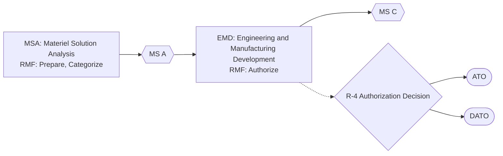

# Mini RMF framework (test fixture)

> **Generated file. Do not edit.** `uv run rmf render` writes this file from `tests/fixtures/framework_mini/`
> (framework version 0.1.0). To change it, edit the YAML and render again;
> `rmf ci` fails while the committed manual differs from a fresh render (FW-MAN-001).
>
> **Draft guidance, not policy.** This manual arranges public NIST, CNSS and DoD guidance into a
> working plan. It does not replace those documents, your DoD Component's RMF guidance, a Security
> Control Assessor or an Authorizing Official.

Five tasks across Prepare, Categorize and Authorize, with just enough entities to be valid.

## Contents

1. [How to read this manual](#how-to-read)
2. [Life cycle at a glance](#lifecycle)
3. [Who does what (RACI matrix)](#raci)
4. [Phases and tasks](#phases)
   - [Phase 1: MSA · Materiel Solution Analysis](#ph-msa) (4 tasks; also in [docs/manual/PH-MSA.md](docs/manual/PH-MSA.md))
   - [Phase 2: EMD · Engineering and Manufacturing Development](#ph-emd) (1 task; also in [docs/manual/PH-EMD.md](docs/manual/PH-EMD.md))
5. [Authorization decisions](#decisions)
6. [Acquisition pathway notes](#pathways)
7. [Artifact catalog](#artifacts)
8. [Persona catalog](#personas)
9. [References](#references)

## 1. How to read this manual

The manual follows a system from inception to disposal. It covers the 5 tasks of
the NIST SP 800-37 Rev. 2 Risk Management Framework (RMF) as the DoD runs them, arranged along the
phases, milestones and technical reviews of the [MCA](#pw-mca) acquisition pathway. Start with the
[life cycle](#lifecycle) to find the phase your program is in, then read that phase's chapter.

Each phase chapter has an overview (purpose, entry and exit criteria, the milestones and technical
reviews in the phase, and the RMF evidence each one expects), a task summary table, and one section
per task. Every task section has the same parts:

| Part | What it tells you |
|---|---|
| Purpose | The outcome the task produces. |
| Stakeholders (RACI) | Who does the work (**R**esponsible), who owns the outcome and signs off (**A**ccountable, exactly one), whose input is needed (**C**onsulted) and who is kept informed (**I**nformed). Names link to persona cards that describe each role. |
| Inputs | Artifacts and outside material the task needs, and the task that produces each artifact. |
| Outputs | The deliverables the task first **produces** or later **updates**, with their package status: *core* artifacts are required in the authorization package. |
| Entry criteria | What must be true before the task starts. |
| Exit criteria | What must be true to call the task done. |
| Alignment | The acquisition milestones, technical reviews and authorization decisions the task's results feed. |
| Citations | The source passages the task rests on. |
| Playbook | The step-by-step procedure an analyst or an AI agent follows to carry out the task. |
| Cross-references | Tasks this one depends on, tasks that depend on it, and feedback loops. |

Conventions:

- IDs are stable and never reused: `PH-` phases, `MS-` milestones and decision points, `RV-`
  technical reviews, `AD-` authorization decisions, `PER-` personas, `ART-` artifacts, `EXT-`
  outside inputs, and the SP 800-37 Rev. 2 task IDs (`P-1` to `M-7`). Tasks are shown by step
  and number with their name, and the ID in brackets: "Prepare 1: Risk Management Roles (P-1)"
  is SP 800-37 Rev. 2 Prepare task 1.
- A citation reads `REFERENCE, section "heading"` or `REFERENCE, p. N, "quoted words"`. The page is
  the PDF page. To read the passage, run `uv run rmf refs show REFERENCE --section "heading"` or
  `uv run rmf refs show REFERENCE --page N --anchor "quoted words"`.
- Tasks run in dependency order. A task lists every task it depends on; feedback loops (later
  results that revise earlier work) are shown separately and do not block.
- `facts.yaml` is the single record of system facts in a run (identity, boundary, categorization,
  baseline). Where a task writes one, its section says so.

> **Warning: CUI and LLM endpoints.** Put Controlled Unclassified Information (CUI) or any other
> non-public data into a fork of this repository, its `product/` folder or an AI agent's context only
> when the repository host, every machine involved and the LLM endpoint are all authorized for that
> data (AGENTS.md INV-7). Do not assume a commercial LLM service is authorized for CUI; confirm with
> your ISSM and AO first. Simulated (`synthetic`) runs need only public or invented product material.

## 2. Life cycle at a glance

| # | Phase | Starts at | Ends at | Milestones and decision points | Technical reviews | RMF tasks (primary phase) | Also active | Authorization decisions |
|---|---|---|---|---|---|---|---|---|
| 1 | [MSA](#ph-msa) Materiel Solution Analysis | — | [MS A](#ms-a) | [MS A](#ms-a) | — | [Prepare 11: Authorization Boundary (P-11)](#task-p-11), [Categorize 1: System Description (C-1)](#task-c-1), [Categorize 2: Security Categorization (C-2)](#task-c-2), [Categorize 3: Security Categorization Review and Approval (C-3)](#task-c-3) | — | — |
| 2 | [EMD](#ph-emd) Engineering and Manufacturing Development | — | [MS C](#ms-c) | [MS C](#ms-c) | [PDR](#rv-pdr) | [Authorize 4: Authorization Decision (R-4)](#task-r-4) | — | [ATO](#ad-ato), [DATO](#ad-dato) |

The flowchart shows the phases in order, joined by the milestones that open and close them. Dotted
lines lead to events inside a phase and to the tasks where the Authorizing Official makes an
authorization decision.

### RMF steps

| Step | Purpose | Tasks | Primary phases |
|---|---|---|---|
| Prepare (P) | Set the context for risk management. | [Prepare 11: Authorization Boundary (P-11)](#task-p-11) | [MSA](#ph-msa) |
| Categorize (C) | Describe and categorize the system. | [Categorize 1: System Description (C-1)](#task-c-1), [Categorize 2: Security Categorization (C-2)](#task-c-2), [Categorize 3: Security Categorization Review and Approval (C-3)](#task-c-3) | [MSA](#ph-msa) |
| Authorize (R) | Decide whether the risk is acceptable. | [Authorize 4: Authorization Decision (R-4)](#task-r-4) | [EMD](#ph-emd) |

## 3. Who does what (RACI matrix)

**R** Responsible (does the work) · **A** Accountable (owns the outcome; one per task) ·
**C** Consulted · **I** Informed. `A/R` means the accountable persona also does the work. Column
headings link to the persona catalog; each persona's card describes the role in full.

### Prepare (P)

| Task | [AO](#per-ao) | [PM/SO](#per-pm) | [ISSM](#per-issm) |
|---|:-:|:-:|:-:|
| [Prepare 11: Authorization Boundary (P-11)](#task-p-11) | A | R | R |

### Categorize (C)

| Task | [AO](#per-ao) | [PM/SO](#per-pm) | [ISSM](#per-issm) | [IO](#per-io) |
|---|:-:|:-:|:-:|:-:|
| [Categorize 1: System Description (C-1)](#task-c-1) | I | R/A | R | C |
| [Categorize 2: Security Categorization (C-2)](#task-c-2) | I | A | R | R |
| [Categorize 3: Security Categorization Review and Approval (C-3)](#task-c-3) | A | I | R | C |

### Authorize (R)

| Task | [AO](#per-ao) | [PM/SO](#per-pm) | [ISSM](#per-issm) |
|---|:-:|:-:|:-:|
| [Authorize 4: Authorization Decision (R-4)](#task-r-4) | R/A | I | I |

## 4. Phases and tasks

### Phase 1: MSA · Materiel Solution Analysis

Choose the materiel solution and start the RMF.

| | |
|---|---|
| Starts at | Start of the life cycle |
| Ends at | [MS A](#ms-a) Milestone A |
| RMF steps active | [P Prepare](#step-p), [C Categorize](#step-c) |
| Tasks | 4 with this primary phase |
| Authorization decisions possible | none |

**Entry criteria**

- Validated capability need.

**Exit criteria**

- Milestone A approved.

**Sources**

- [DODI5000.85](#ref-dodi5000-85), p. 11, "3.6. MSA PHASE."

#### MSA milestones and decision points

| Event | Kind | Decision authority | What it decides | RMF tasks that feed it |
|---|---|---|---|---|
| **MS A** Milestone A | milestone | — | Approve entry into technology maturation. | [Prepare 11: Authorization Boundary (P-11)](#task-p-11), [Categorize 1: System Description (C-1)](#task-c-1), [Categorize 2: Security Categorization (C-2)](#task-c-2), [Categorize 3: Security Categorization Review and Approval (C-3)](#task-c-3) |

#### MSA task summary

Tasks are listed in the order they can start: every task comes after the tasks it depends on.

| Task | Step | Accountable | Produces | Updates | Feeds |
|---|---|---|---|---|---|
| [Prepare 11: Authorization Boundary (P-11)](#task-p-11) | Prepare | [AO](#per-ao) | [Authorization boundary (ART-BND)](#art-bnd) | — | [MS A](#ms-a) |
| [Categorize 1: System Description (C-1)](#task-c-1) | Categorize | [PM/SO](#per-pm) | [System description (ART-SD)](#art-sd) | [Authorization boundary (ART-BND)](#art-bnd) | [MS A](#ms-a) |
| [Categorize 2: Security Categorization (C-2)](#task-c-2) | Categorize | [PM/SO](#per-pm) | [Security categorization (ART-CAT)](#art-cat) | — | [MS A](#ms-a) |
| [Categorize 3: Security Categorization Review and Approval (C-3)](#task-c-3) | Categorize | [AO](#per-ao) | — | [Security categorization (ART-CAT)](#art-cat) | [MS A](#ms-a) |

#### Prepare 11: Authorization Boundary (P-11)

*[Prepare](#step-p) step · system level · primary phase [MSA](#ph-msa) · required · at least 1 stakeholder interview*

**Purpose.** Determine the authorization boundary.

**Stakeholders (RACI)**

| Role | Persona |
|---|---|
| Responsible | [PM/SO](personas/PER-PM.md) Program Manager / System Owner [ISSM](personas/PER-ISSM.md) Information System Security Manager |
| Accountable | [AO](personas/PER-AO.md) Authorizing Official |

**Inputs**

| Input | What it is | Comes from |
|---|---|---|
| [Product material (EXT-PRODUCT)](#ext-product) | Product material | outside input (product) |

**Outputs**

| Output | What it is | This task | Package |
|---|---|---|---|
| [Authorization boundary (ART-BND)](#art-bnd) | Authorization boundary | produces | core |

Writes to `facts.yaml`: `boundary_id`.

**Entry criteria**

- Product material available.

**Exit criteria**

- ART-BND written; facts.boundary_id set_by P-11.

**Alignment**

- Milestones and decision points: [MS A](#ms-a)

**Citations**

- [SP800-37R2](#ref-sp800-37r2), section "TASK P-11"

**Playbook:** [playbooks/P/P-11.md](playbooks/P/P-11.md)

**Cross-references:** depends on nothing; required by [Categorize 1: System Description (C-1)](#task-c-1).

#### Categorize 1: System Description (C-1)

*[Categorize](#step-c) step · system level · primary phase [MSA](#ph-msa) · required · at least 1 stakeholder interview*

**Purpose.** Document the characteristics of the system.

**Stakeholders (RACI)**

| Role | Persona |
|---|---|
| Responsible | [PM/SO](personas/PER-PM.md) Program Manager / System Owner [ISSM](personas/PER-ISSM.md) Information System Security Manager |
| Accountable | [PM/SO](personas/PER-PM.md) Program Manager / System Owner |
| Consulted | [IO](personas/PER-IO.md) Information Owner / Steward |
| Informed | [AO](personas/PER-AO.md) Authorizing Official |

**Inputs**

| Input | What it is | Comes from |
|---|---|---|
| [Authorization boundary (ART-BND)](#art-bnd) | Authorization boundary | [Prepare 11: Authorization Boundary (P-11)](#task-p-11) (core artifact) |
| [Product material (EXT-PRODUCT)](#ext-product) | Product material | outside input (product) |

**Outputs**

| Output | What it is | This task | Package |
|---|---|---|---|
| [System description (ART-SD)](#art-sd) | System description | produces | core |
| [Authorization boundary (ART-BND)](#art-bnd) | Authorization boundary | updates | core |

Writes to `facts.yaml`: `system_id`, `system_name`.

**Entry criteria**

- ART-BND exists.

**Exit criteria**

- ART-SD written.

**Alignment**

- Milestones and decision points: [MS A](#ms-a)

**Citations**

- [SP800-37R2](#ref-sp800-37r2), section "TASK C-1"

**Playbook:** [playbooks/C/C-1.md](playbooks/C/C-1.md)

**Cross-references:** depends on [Prepare 11: Authorization Boundary (P-11)](#task-p-11); required by [Categorize 2: Security Categorization (C-2)](#task-c-2).

#### Categorize 2: Security Categorization (C-2)

*[Categorize](#step-c) step · system level · primary phase [MSA](#ph-msa) · required · at least 1 stakeholder interview*

**Purpose.** Categorize the system per CNSSI 1253.

**Stakeholders (RACI)**

| Role | Persona |
|---|---|
| Responsible | [ISSM](personas/PER-ISSM.md) Information System Security Manager [IO](personas/PER-IO.md) Information Owner / Steward |
| Accountable | [PM/SO](personas/PER-PM.md) Program Manager / System Owner |
| Informed | [AO](personas/PER-AO.md) Authorizing Official |

**Inputs**

| Input | What it is | Comes from |
|---|---|---|
| [System description (ART-SD)](#art-sd) | System description | [Categorize 1: System Description (C-1)](#task-c-1) (core artifact) |

**Outputs**

| Output | What it is | This task | Package |
|---|---|---|---|
| [Security categorization (ART-CAT)](#art-cat) | Security categorization | produces | core |

Writes to `facts.yaml`: `categorization`.

**Entry criteria**

- ART-SD exists.

**Exit criteria**

- facts.categorization set_by C-2.

**Alignment**

- Milestones and decision points: [MS A](#ms-a)

**Citations**

- [SP800-37R2](#ref-sp800-37r2), section "TASK C-2"
- [CNSSI1253](#ref-cnssi1253), section 3.1.2

**Playbook:** [playbooks/C/C-2.md](playbooks/C/C-2.md)

**Cross-references:** depends on [Categorize 1: System Description (C-1)](#task-c-1); required by [Categorize 3: Security Categorization Review and Approval (C-3)](#task-c-3); receives feedback from [Authorize 4: Authorization Decision (R-4)](#task-r-4).

#### Categorize 3: Security Categorization Review and Approval (C-3)

*[Categorize](#step-c) step · system level · primary phase [MSA](#ph-msa) · required · at least 1 stakeholder interview*

**Purpose.** Have the AO approve the categorization.

**Stakeholders (RACI)**

| Role | Persona |
|---|---|
| Responsible | [ISSM](personas/PER-ISSM.md) Information System Security Manager |
| Accountable | [AO](personas/PER-AO.md) Authorizing Official |
| Consulted | [IO](personas/PER-IO.md) Information Owner / Steward |
| Informed | [PM/SO](personas/PER-PM.md) Program Manager / System Owner |

**Inputs**

| Input | What it is | Comes from |
|---|---|---|
| [Security categorization (ART-CAT)](#art-cat) | Security categorization | [Categorize 2: Security Categorization (C-2)](#task-c-2) (core artifact) |

**Outputs**

| Output | What it is | This task | Package |
|---|---|---|---|
| [Security categorization (ART-CAT)](#art-cat) | Security categorization | updates | core |

Writes to `facts.yaml`: `categorization.approved`.

**Entry criteria**

- facts.categorization set_by C-2.

**Exit criteria**

- facts.categorization.approved set_by C-3.

**Alignment**

- Milestones and decision points: [MS A](#ms-a)

**Citations**

- [SP800-37R2](#ref-sp800-37r2), section "TASK C-3"

**Playbook:** [playbooks/C/C-3.md](playbooks/C/C-3.md)

**Cross-references:** depends on [Categorize 2: Security Categorization (C-2)](#task-c-2); required by [Authorize 4: Authorization Decision (R-4)](#task-r-4).

### Phase 2: EMD · Engineering and Manufacturing Development

Build, test and authorize the system.

| | |
|---|---|
| Starts at | End of the previous phase |
| Ends at | [MS C](#ms-c) Milestone C |
| RMF steps active | [R Authorize](#step-r) |
| Tasks | 1 with this primary phase |
| Authorization decisions possible | [ATO](#ad-ato), [DATO](#ad-dato) |

**Entry criteria**

- Milestone B approved.

**Exit criteria**

- Authorization decision made.

**Sources**

- [DODI5000.85](#ref-dodi5000-85), p. 15, "3.11. EMD PHASE."

#### EMD milestones and decision points

| Event | Kind | Decision authority | What it decides | RMF tasks that feed it |
|---|---|---|---|---|
| **MS C** Milestone C | milestone | — | Approve entry into production and deployment. | [Authorize 4: Authorization Decision (R-4)](#task-r-4) |

#### EMD technical reviews

| Review | Purpose | RMF evidence the review should see | RMF tasks that feed it |
|---|---|---|---|
| **PDR** Preliminary Design Review | Confirm the preliminary design. | Controls allocated to the design. | — |

Sources:

- **PDR**: [DODI5000.88](#ref-dodi5000-88), p. 16, "Preliminary design review (PDR)"

#### EMD task summary

Tasks are listed in the order they can start: every task comes after the tasks it depends on.

| Task | Step | Accountable | Produces | Updates | Feeds |
|---|---|---|---|---|---|
| [Authorize 4: Authorization Decision (R-4)](#task-r-4) | Authorize | [AO](#per-ao) | [AO decision memo (ART-AODM)](#art-aodm) | — | [MS C](#ms-c), [ATO](#ad-ato), [DATO](#ad-dato) |

#### Authorize 4: Authorization Decision (R-4)

*[Authorize](#step-r) step · system level · primary phase [EMD](#ph-emd) · required · at least 1 stakeholder interview*

**Purpose.** Decide whether the risk is acceptable.

**Stakeholders (RACI)**

| Role | Persona |
|---|---|
| Responsible | [AO](personas/PER-AO.md) Authorizing Official |
| Accountable | [AO](personas/PER-AO.md) Authorizing Official |
| Informed | [PM/SO](personas/PER-PM.md) Program Manager / System Owner [ISSM](personas/PER-ISSM.md) Information System Security Manager |

**Inputs**

| Input | What it is | Comes from |
|---|---|---|
| [Security categorization (ART-CAT)](#art-cat) | Security categorization | [Categorize 2: Security Categorization (C-2)](#task-c-2) (core artifact) |

**Outputs**

| Output | What it is | This task | Package |
|---|---|---|---|
| [AO decision memo (ART-AODM)](#art-aodm) | AO decision memo | produces | core |

**Entry criteria**

- Categorization approved.

**Exit criteria**

- decision.yaml names an AD-* decision.

**Authorization decision.** The [AO](#per-ao) decides here: [ATO](#ad-ato), [DATO](#ad-dato) (see [authorization decisions](#decisions)).

**Alignment**

- Milestones and decision points: [MS C](#ms-c)
- Authorization decisions: [ATO](#ad-ato), [DATO](#ad-dato)

**Citations**

- [SP800-37R2](#ref-sp800-37r2), section "TASK R-4"

**Playbook:** [playbooks/R/R-4.md](playbooks/R/R-4.md)

**Cross-references:** depends on [Categorize 3: Security Categorization Review and Approval (C-3)](#task-c-3); required by no later task; feeds back to [Categorize 2: Security Categorization (C-2)](#task-c-2).

## 5. Authorization decisions

Only the Authorizing Official makes an authorization decision, in the task listed. The decision memo
records it (see the artifact catalog).

| Decision | Decided by | Decided in | Phases | Termination date required | Conditions required |
|---|---|---|---|---|---|
| [ATO](#ad-ato) Authorization to Operate | [AO](#per-ao) | [Authorize 4: Authorization Decision (R-4)](#task-r-4) | [EMD](#ph-emd) | yes | no |
| [DATO](#ad-dato) Denial of Authorization to Operate | [AO](#per-ao) | [Authorize 4: Authorization Decision (R-4)](#task-r-4) | [EMD](#ph-emd) | no | no |

### ATO: Authorization to Operate

The risk is acceptable; the system may operate until the termination date.

Citations:

- [SP800-37R2](#ref-sp800-37r2), section "Authorization to Operate"

### DATO: Denial of Authorization to Operate

The risk is unacceptable; the system may not operate.

Citations:

- [SP800-37R2](#ref-sp800-37r2), section "Denial of Authorization"

## 6. Acquisition pathway notes

The RMF steps and tasks are the same on every acquisition pathway. Only the timing and the
acquisition events they line up with change. This manual follows [MCA](#pw-mca); for
another pathway, use the notes below to map its events onto the phases.

| Pathway | Instruction | Corresponding phases |
|---|---|---|
| [MCA](#pw-mca) Major Capability Acquisition | DoDI 5000.85 | [MSA](#ph-msa), [EMD](#ph-emd) |

### MCA: Major Capability Acquisition (the spine of this manual)

Milestone-based acquisition.

## 7. Artifact catalog

Artifacts are the deliverables of the RMF. The producing task creates an artifact; later tasks
update it. *Core* artifacts make up the authorization package; *supporting* artifacts feed them.
In a run, each artifact is a Markdown file from its template, with its structured data in the
listed data files; OSCAL documents are built from that data.

| Artifact | Package | Produced by | Updated by | Used by |
|---|---|---|---|---|
| [Authorization boundary (ART-BND)](#art-bnd) | core | [Prepare 11: Authorization Boundary (P-11)](#task-p-11) | [Categorize 1: System Description (C-1)](#task-c-1) | [Categorize 1: System Description (C-1)](#task-c-1) |
| [System description (ART-SD)](#art-sd) | core | [Categorize 1: System Description (C-1)](#task-c-1) | — | [Categorize 2: Security Categorization (C-2)](#task-c-2) |
| [Security categorization (ART-CAT)](#art-cat) | core | [Categorize 2: Security Categorization (C-2)](#task-c-2) | [Categorize 3: Security Categorization Review and Approval (C-3)](#task-c-3) | [Categorize 3: Security Categorization Review and Approval (C-3)](#task-c-3), [Authorize 4: Authorization Decision (R-4)](#task-r-4) |
| [AO decision memo (ART-AODM)](#art-aodm) | core | [Authorize 4: Authorization Decision (R-4)](#task-r-4) | — | — |

### Authorization boundary (ART-BND)

The boundary and its components.

| | |
|---|---|
| Package | core |
| Template | [templates/artifacts/ART-BND.md](templates/artifacts/ART-BND.md) |
| Data files | `artifacts/data/boundary.yaml` (schema `boundary`) |
| OSCAL | `ssp#system-implementation.components` |
| Produced by | [Prepare 11: Authorization Boundary (P-11)](#task-p-11) |
| Updated by | [Categorize 1: System Description (C-1)](#task-c-1) |
| Used by | [Categorize 1: System Description (C-1)](#task-c-1) |

Citations:

- [SP800-37R2](#ref-sp800-37r2), section 2.5

### System description (ART-SD)

The documented characteristics of the system.

| | |
|---|---|
| Package | core |
| Template | [templates/artifacts/ART-SD.md](templates/artifacts/ART-SD.md) |
| Data files | — |
| OSCAL | — |
| Produced by | [Categorize 1: System Description (C-1)](#task-c-1) |
| Updated by | — |
| Used by | [Categorize 2: Security Categorization (C-2)](#task-c-2) |

Citations:

- [SP800-37R2](#ref-sp800-37r2), section "TASK C-1"

### Security categorization (ART-CAT)

The CNSSI 1253 categorization and its approval.

| | |
|---|---|
| Package | core |
| Template | [templates/artifacts/ART-CAT.md](templates/artifacts/ART-CAT.md) |
| Data files | `facts.yaml#categorization` (schema `facts`) |
| OSCAL | — |
| Produced by | [Categorize 2: Security Categorization (C-2)](#task-c-2) |
| Updated by | [Categorize 3: Security Categorization Review and Approval (C-3)](#task-c-3) |
| Used by | [Categorize 3: Security Categorization Review and Approval (C-3)](#task-c-3), [Authorize 4: Authorization Decision (R-4)](#task-r-4) |

Citations:

- [CNSSI1253](#ref-cnssi1253), section 3.1

### AO decision memo (ART-AODM)

The authorization decision.

| | |
|---|---|
| Package | core |
| Template | [templates/artifacts/ART-AODM.md](templates/artifacts/ART-AODM.md) |
| Data files | `artifacts/data/decision.yaml` (schema `decision`) |
| OSCAL | — |
| Produced by | [Authorize 4: Authorization Decision (R-4)](#task-r-4) |
| Updated by | — |
| Used by | — |

Citations:

- [SP800-37R2](#ref-sp800-37r2), section "TASK R-4"

### Outside inputs

Material no RMF task produces: the program's own documents, organizational guidance, reference
content and operational data.

| Input | Kind | What it is | Used by |
|---|---|---|---|
| **Product material** (EXT-PRODUCT) | product | Design documentation supplied in product/. | [Prepare 11: Authorization Boundary (P-11)](#task-p-11), [Categorize 1: System Description (C-1)](#task-c-1) |

## 8. Persona catalog

Personas are the roles that take part in the RMF: DoD RMF roles plus the acquisition, engineering
and test roles the RMF works with. Each card describes the role's responsibilities, decision
authority, typical concerns and the questions to ask it; agents use the cards to interview
simulated stakeholders.

| Persona | Category | Appointed by | Card | Tasks R / A / C / I |
|---|---|---|---|---|
| [AO](#per-ao) Authorizing Official | rmf | DoD Component head | [PER-AO.md](personas/PER-AO.md) | 1 / 3 / 0 / 2 |
| [PM/SO](#per-pm) Program Manager / System Owner | acquisition | DoD Component Acquisition Executive | [PER-PM.md](personas/PER-PM.md) | 2 / 2 / 0 / 2 |
| [ISSM](#per-issm) Information System Security Manager | rmf | PM or SO | [PER-ISSM.md](personas/PER-ISSM.md) | 4 / 0 / 0 / 1 |
| [IO](#per-io) Information Owner / Steward | organization | — | [PER-IO.md](personas/PER-IO.md) | 1 / 0 / 2 / 0 |

### AO: Authorizing Official

Accepts the risk of operating the system.

- Card: [personas/PER-AO.md](personas/PER-AO.md)
- Category: rmf; appointed by: DoD Component head
- SP 800-37 Rev. 2 roles: Authorizing Official
- Responsible for: [Authorize 4: Authorization Decision (R-4)](#task-r-4)
- Accountable for: [Prepare 11: Authorization Boundary (P-11)](#task-p-11), [Categorize 3: Security Categorization Review and Approval (C-3)](#task-c-3), [Authorize 4: Authorization Decision (R-4)](#task-r-4)
- Consulted on: none
- Informed of: [Categorize 1: System Description (C-1)](#task-c-1), [Categorize 2: Security Categorization (C-2)](#task-c-2)
- Makes the authorization decisions: [ATO](#ad-ato), [DATO](#ad-dato)

Citations:

- [SP800-37R2](#ref-sp800-37r2), p. 133, "AUTHORIZING OFFICIAL"

### PM/SO: Program Manager / System Owner

Accountable for the system and its RMF execution.

- Card: [personas/PER-PM.md](personas/PER-PM.md)
- Category: acquisition; appointed by: DoD Component Acquisition Executive
- SP 800-37 Rev. 2 roles: System Owner
- Responsible for: [Prepare 11: Authorization Boundary (P-11)](#task-p-11), [Categorize 1: System Description (C-1)](#task-c-1)
- Accountable for: [Categorize 1: System Description (C-1)](#task-c-1), [Categorize 2: Security Categorization (C-2)](#task-c-2)
- Consulted on: none
- Informed of: [Categorize 3: Security Categorization Review and Approval (C-3)](#task-c-3), [Authorize 4: Authorization Decision (R-4)](#task-r-4)

Citations:

- [SP800-37R2](#ref-sp800-37r2), p. 142, "SYSTEM OWNER"

### ISSM: Information System Security Manager

Maintains the authorization package.

- Card: [personas/PER-ISSM.md](personas/PER-ISSM.md)
- Category: rmf; appointed by: PM or SO
- SP 800-37 Rev. 2 roles: System Security Officer
- Responsible for: [Prepare 11: Authorization Boundary (P-11)](#task-p-11), [Categorize 1: System Description (C-1)](#task-c-1), [Categorize 2: Security Categorization (C-2)](#task-c-2), [Categorize 3: Security Categorization Review and Approval (C-3)](#task-c-3)
- Accountable for: none
- Consulted on: none
- Informed of: [Authorize 4: Authorization Decision (R-4)](#task-r-4)

Citations:

- [DODI8510.01](#ref-dodi8510-01), p. 30, "ISSMs, in addition to the responsibilities established in DoDI 8500.01"

### IO: Information Owner / Steward

Sets the impact levels of the information it owns.

- Card: [personas/PER-IO.md](personas/PER-IO.md)
- Category: organization; appointed by: not specified
- SP 800-37 Rev. 2 roles: Information Owner or Steward
- Responsible for: [Categorize 2: Security Categorization (C-2)](#task-c-2)
- Accountable for: none
- Consulted on: [Categorize 1: System Description (C-1)](#task-c-1), [Categorize 3: Security Categorization Review and Approval (C-3)](#task-c-3)
- Informed of: none

Citations:

- [SP800-37R2](#ref-sp800-37r2), p. 138, "INFORMATION OWNER OR STEWARD"

## 9. References

The documents this manual cites, from `references/index.yaml`. Each one is kept in the repository
as a pinned PDF with a text extraction that citations resolve against; `references/INDEX.md` lists
the whole library with checksums.

| ID | Title | Publisher | Revision | Source | Text |
|---|---|---|---|---|---|
| **SP800-37R2** | Risk Management Framework for Information Systems and Organizations: A System Life Cycle Approach for Security and Privacy | NIST | Rev. 2 (December 2018) | <https://nvlpubs.nist.gov/nistpubs/SpecialPublications/NIST.SP.800-37r2.pdf> | [SP800-37R2.md](references/text/SP800-37R2.md) |
| **DODI8510.01** | Risk Management Framework for DoD Systems | DoD | July 19, 2022 | <https://www.esd.whs.mil/Portals/54/Documents/DD/issuances/dodi/851001p.pdf> | [DODI8510.01.md](references/text/DODI8510.01.md) |
| **CNSSI1253** | Security Categorization and Control Selection for National Security Systems | CNSS | 29 July 2022 | <https://www.cnss.gov/CNSS/issuances/Instructions.cfm> | [CNSSI1253.md](references/text/CNSSI1253.md) |
| **DODI5000.85** | Major Capability Acquisition | DoD | August 6, 2020, Change 1, November 4, 2021 | <https://www.esd.whs.mil/Portals/54/Documents/DD/issuances/dodi/500085p.pdf> | [DODI5000.85.md](references/text/DODI5000.85.md) |
| **DODI5000.88** | Engineering of Defense Systems | DoD | November 18, 2020 | <https://www.esd.whs.mil/Portals/54/Documents/DD/issuances/dodi/500088p.pdf> | [DODI5000.88.md](references/text/DODI5000.88.md) |
